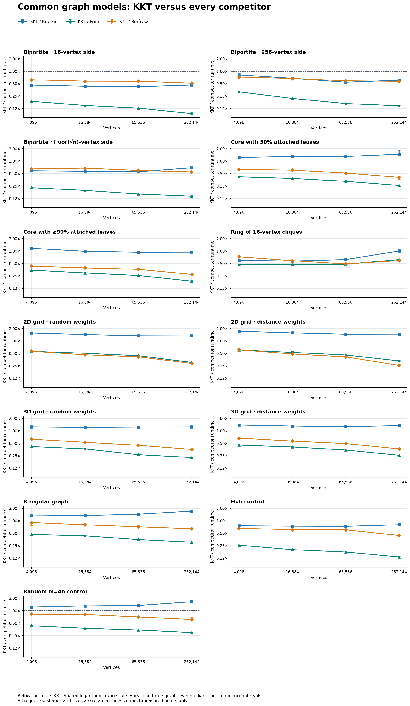
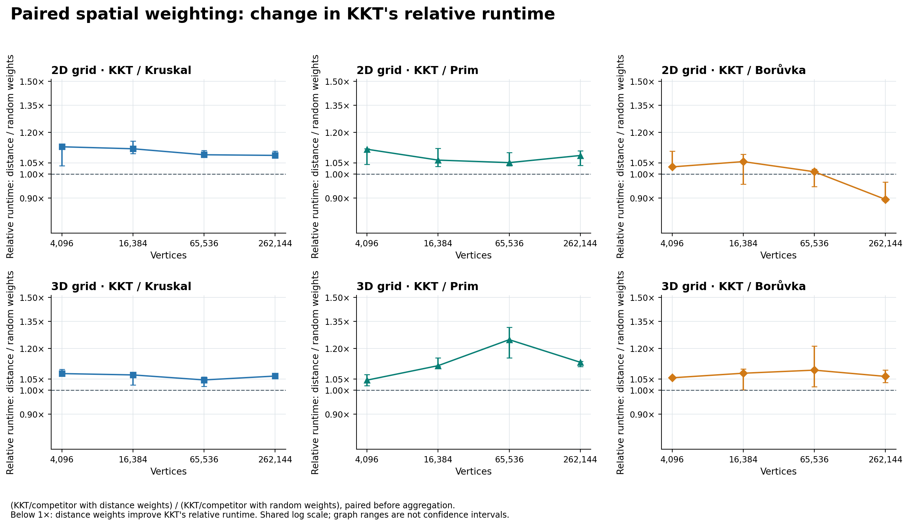
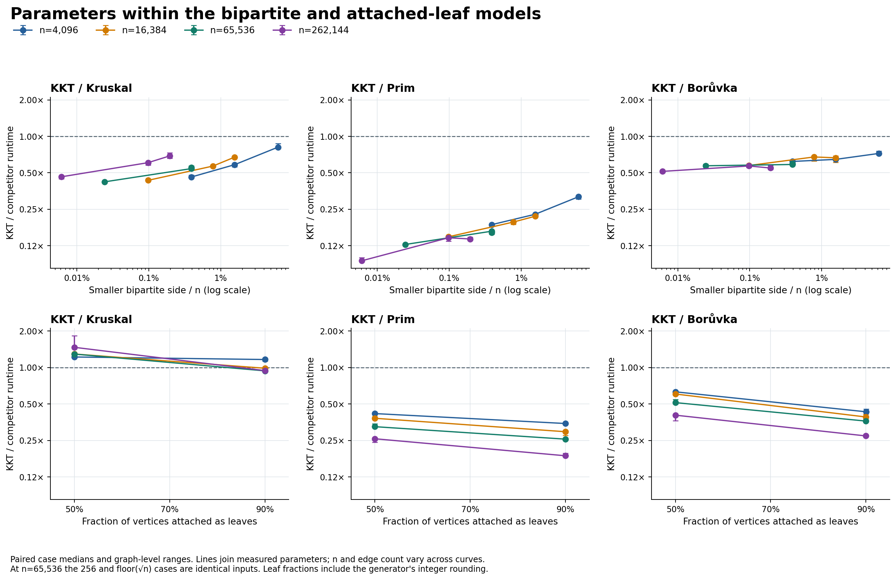

# Common graph models: KKT's useful shapes and remaining limits

The current KKT implementation has a repeatable advantage on these small-cover inputs and on some leaf-rich or locally dense inputs. It is still slower than Kruskal on every measured grid variant, every 50%-leaf case, and the regular/random controls. More vertices do not uniformly improve its position: the ring-of-cliques advantage disappears at 262,144 vertices.

This is a fixed **52-case exploratory follow-up**, with two complete timing campaigns retained separately. KKT leads all three repository competitors by paired case medians in **22/52 primary cases and 21/52 repeat cases**. The same **21 case labels** also lead on all three graph-level medians in both runs. Those labels include the intentional k=256/⌊√n⌋ alias at n=65,536; they are not 21 independent topology findings. Only 14 case labels have no individual KKT loss or tie against any competitor in either run.

The measured algorithm source is unchanged from final production revision `2d4fbf1`; the new infrastructure was frozen at `c9ed4cae8ee3bfce913cceb5298cbb961280baac`. The [boundary audit](boundary_audit.json) preserves the original algorithms, earlier fixtures, scheduling code and tuple-input timing boundary. This campaign changes graph coverage, not production KKT or its three baselines.

## What was measured

Each main case uses n=4,096, 16,384, 65,536 or 262,144, graph seeds 17/42/999 and KKT seeds 0/1/7. Every algorithm/seed pair has one checked warmup and four timed repetitions. The warmups are checked by the harness but are not CSV timing rows. The preselected matrix and diagnostics are recorded in [PROTOCOL.md](PROTOCOL.md).

| Dataset | Cases | Case/graph-seed realizations | Timed observations | Checked warmup calls | Separate work observations |
|---|---:|---:|---:|---:|---:|
| Primary | 52 | 156 | 7,488 | 1,872 | — |
| Repeat | 52 | Same 156 | 7,488 | 1,872 | — |
| Instrumented work | 52 | Same 156 | — | — | 468 |

There are **156 case/graph-seed realizations, with three duplicated weighted inputs** from the k=256/⌊√n⌋ intersection. The work data contains 153 distinct full-input fingerprints. Spatial random/distance variants also intentionally share topology while changing weights. The repeat campaign reuses these inputs; it is not a new sample of graphs. Sampling labels and repetitions are not additional graph draws.

For each graph, an independent certificate checks the Kruskal reference's source-edge membership, unique IDs, acyclic connectivity and cycle optimality using tree-path maxima. Distinct weights make the MST unique. Every timed output and warmup must match its exact IDs; other algorithms' returned endpoint/weight tuples are checked as well. Certification and validation sit outside the timed interval.

Timing starts from the same tuple edge list for all algorithms. It includes KKT input conversion, temporary-input destruction, and each algorithm's output construction. It excludes fixture generation, certification, output checking and destruction of the returned result. Algorithm order rotates so each algorithm occupies each timed position once within a four-repetition block. Case order is deterministically shuffled once and reused in both campaigns.

Runtime summaries take the median over repetitions, then sampling labels within a graph, then the three graph seeds. **Ratios divide matched trial times before applying that hierarchy.** A ratio of displayed median milliseconds need not equal the reported paired ratio. Graph ranges are descriptive min/max values across three graph-level medians, not confidence intervals. Work uses arithmetic sampling means within each graph, then arithmetic means over graphs.

## Exact models

All inputs are connected undirected simple graphs with IDs 0…m−1 and distinct positive integer weights 1…m. New models shuffle vertex labels and input order using RNG streams separate from topology and weights. Controls forward the earlier generator unchanged. No spanning-tree, leaf, core or inter-community edge receives a deliberately cheap weight class.

| Model IDs | Exact construction | Edges m |
|---|---|---:|
| `unbalanced_bipartite_16`, `_256`, `_sqrt` | Small side k=16, 256 or ⌊√n⌋; each other vertex joins four distinct small-side vertices. A seeded cycle through the small side ensures connectivity; remaining neighbors are drawn uniformly subject to uniqueness. | 4(n−k) |
| `leaf_core_50`, `_90` | c=⌊n/2⌋ or ⌊n/10⌋. A random recursive core tree plus uniformly proposed missing internal pairs reaches 4c core edges. Each remaining vertex attaches once to a uniformly selected core vertex. | n+3c |
| `ring_cliques_16` | Disjoint 16-vertex cliques; one edge with random endpoints joins each clique to the next around a cycle. All weights are shuffled globally. | 121n/16 |
| `grid2d_random`, `_distance` | Open four-neighbor grid. Axes balance the binary exponents of n, giving earlier axes the extra exponent. | Σᵢ(Lᵢ−1)n/Lᵢ |
| `grid3d_random`, `_distance` | Open six-neighbor grid with the same balanced-exponent rule in three axes. | Σᵢ(Lᵢ−1)n/Lᵢ |
| `regular_8` | Begin with ring offsets 1…4. Protect the offset-1 Hamiltonian cycle; attempt 20n degree-preserving two-edge switches on the other 3n slots, rejecting repeated endpoints or existing edges. | 4n |
| `hub`, `random_4` | The earlier unchanged hub and connected random sparse controls. | 4n |

The main 2D dimensions are 64², 128², 256² and 512². Main 3D dimensions are 16³, 32×32×16, 64×32×32 and 64³. Active coordinates are `1024*i + jitter`, with integer jitter in [−200,200]. Random/distance pairs share endpoints, IDs, order, labels and coordinates. Distance weights rank exact squared lengths with an original-ID tie-break; random variants shuffle the ranks independently. They are sparse meshes, not Delaunay, k-nearest-neighbor or road-network datasets.

The regular model is exactly degree eight and connected. No uniform-random or mixing claim is made. The ring's inter-clique links form a cycle only after each clique is contracted; an MST may retain every inter-clique link and omit an internal edge instead. The leaf name describes designated attachments: additional core vertices can be leaves. At n=65,536, the fixed-256 and square-root bipartite models generate byte-identical weighted inputs for each graph seed. Their separate observations are retained as an intentional parameter alias.

The implementation and independent structural tests are [common_graph_fixtures.hpp](../../common_graph_fixtures.hpp) and [common_test.cpp](../../common_test.cpp).

## Every case and competitor

Each ratio cell is **primary / repeat** paired KKT/competitor time; below 1 favors KKT. “All graphs, both” means every graph-level median against all three competitors is below one in both runs. It does not imply every individual observation wins. All 52 cases remain present.

| Family | n | KKT/Kruskal | KKT/Prim | KKT/Borůvka | All graphs, both |
|---|---:|---:|---:|---:|:---:|
| Bipartite k=16 | 4,096 | 0.461 / 0.462 | 0.187 / 0.190 | 0.620 / 0.615 | yes |
| Bipartite k=16 | 16,384 | 0.433 / 0.430 | 0.148 / 0.156 | 0.574 / 0.603 | yes |
| Bipartite k=16 | 65,536 | 0.421 / 0.417 | 0.128 / 0.129 | 0.571 / 0.601 | yes |
| Bipartite k=16 | 262,144 | 0.463 / 0.475 | 0.094 / 0.099 | 0.514 / 0.512 | yes |
| Bipartite k=256 | 4,096 | 0.814 / 0.825 | 0.317 / 0.301 | 0.723 / 0.722 | yes |
| Bipartite k=256 | 16,384 | 0.673 / 0.659 | 0.219 / 0.229 | 0.665 / 0.678 | yes |
| Bipartite k=256 | 65,536 | 0.541 / 0.551 | 0.165 / 0.163 | 0.586 / 0.602 | yes |
| Bipartite k=256 | 262,144 | 0.606 / 0.672 | 0.145 / 0.130 | 0.569 / 0.545 | yes |
| Bipartite k=⌊√n⌋ | 4,096 | 0.583 / 0.574 | 0.227 / 0.228 | 0.645 / 0.645 | yes |
| Bipartite k=⌊√n⌋ | 16,384 | 0.568 / 0.574 | 0.196 / 0.139 | 0.676 / 0.606 | yes |
| Bipartite k=⌊√n⌋ | 65,536 | 0.552 / 0.575 | 0.160 / 0.154 | 0.594 / 0.547 | yes |
| Bipartite k=⌊√n⌋ | 262,144 | 0.689 / 0.690 | 0.142 / 0.147 | 0.547 / 0.568 | yes |
| 50% attached leaves | 4,096 | 1.222 / 1.209 | 0.416 / 0.400 | 0.630 / 0.630 | — |
| 50% attached leaves | 16,384 | 1.293 / 1.271 | 0.381 / 0.374 | 0.604 / 0.577 | — |
| 50% attached leaves | 65,536 | 1.292 / 1.296 | 0.325 / 0.318 | 0.513 / 0.512 | — |
| 50% attached leaves | 262,144 | 1.469 / 1.373 | 0.258 / 0.264 | 0.404 / 0.404 | — |
| ≥90% attached leaves | 4,096 | 1.164 / 1.113 | 0.345 / 0.345 | 0.431 / 0.443 | — |
| ≥90% attached leaves | 16,384 | 0.986 / 1.005 | 0.295 / 0.229 | 0.390 / 0.305 | — |
| ≥90% attached leaves | 65,536 | 0.938 / 0.946 | 0.256 / 0.214 | 0.361 / 0.336 | yes |
| ≥90% attached leaves | 262,144 | 0.943 / 0.953 | 0.187 / 0.185 | 0.272 / 0.261 | yes |
| Ring of 16-cliques | 4,096 | 0.594 / 0.604 | 0.477 / 0.475 | 0.722 / 0.741 | yes |
| Ring of 16-cliques | 16,384 | 0.572 / 0.581 | 0.482 / 0.453 | 0.584 / 0.579 | yes |
| Ring of 16-cliques | 65,536 | 0.620 / 0.749 | 0.480 / 0.466 | 0.488 / 0.536 | yes |
| Ring of 16-cliques | 262,144 | 1.006 / 1.051 | 0.619 / 0.657 | 0.586 / 0.595 | — |
| 2D grid, random | 4,096 | 1.552 / 1.570 | 0.560 / 0.539 | 0.563 / 0.570 | — |
| 2D grid, random | 16,384 | 1.425 / 1.420 | 0.503 / 0.492 | 0.462 / 0.451 | — |
| 2D grid, random | 65,536 | 1.329 / 1.322 | 0.440 / 0.416 | 0.413 / 0.400 | — |
| 2D grid, random | 262,144 | 1.320 / 1.340 | 0.302 / 0.305 | 0.285 / 0.276 | — |
| 2D grid, distance | 4,096 | 1.721 / 1.737 | 0.603 / 0.587 | 0.609 / 0.603 | — |
| 2D grid, distance | 16,384 | 1.564 / 1.519 | 0.528 / 0.527 | 0.484 / 0.468 | — |
| 2D grid, distance | 65,536 | 1.451 / 1.445 | 0.457 / 0.452 | 0.411 / 0.406 | — |
| 2D grid, distance | 262,144 | 1.459 / 1.505 | 0.329 / 0.320 | 0.256 / 0.229 | — |
| 3D grid, random | 4,096 | 1.246 / 1.281 | 0.417 / 0.422 | 0.627 / 0.636 | — |
| 3D grid, random | 16,384 | 1.216 / 1.216 | 0.366 / 0.369 | 0.528 / 0.531 | — |
| 3D grid, random | 65,536 | 1.237 / 1.164 | 0.264 / 0.322 | 0.447 / 0.507 | — |
| 3D grid, random | 262,144 | 1.242 / 1.300 | 0.226 / 0.245 | 0.355 / 0.362 | — |
| 3D grid, distance | 4,096 | 1.382 / 1.373 | 0.452 / 0.447 | 0.668 / 0.662 | — |
| 3D grid, distance | 16,384 | 1.305 / 1.318 | 0.407 / 0.396 | 0.565 / 0.575 | — |
| 3D grid, distance | 65,536 | 1.262 / 1.257 | 0.344 / 0.322 | 0.491 / 0.487 | — |
| 3D grid, distance | 262,144 | 1.334 / 1.325 | 0.256 / 0.263 | 0.366 / 0.361 | — |
| Degree-eight regular | 4,096 | 1.308 / 1.311 | 0.465 / 0.458 | 0.905 / 0.874 | — |
| Degree-eight regular | 16,384 | 1.336 / 1.346 | 0.433 / 0.404 | 0.797 / 0.800 | — |
| Degree-eight regular | 65,536 | 1.436 / 1.396 | 0.350 / 0.366 | 0.714 / 0.741 | — |
| Degree-eight regular | 262,144 | 1.712 / 1.815 | 0.303 / 0.330 | 0.641 / 0.638 | — |
| Hub control | 4,096 | 0.754 / 0.756 | 0.257 / 0.259 | 0.657 / 0.667 | yes |
| Hub control | 16,384 | 0.740 / 0.721 | 0.200 / 0.218 | 0.608 / 0.626 | yes |
| Hub control | 65,536 | 0.733 / 0.735 | 0.175 / 0.177 | 0.603 / 0.566 | yes |
| Hub control | 262,144 | 0.799 / 0.871 | 0.133 / 0.138 | 0.441 / 0.443 | yes |
| Random4 control | 4,096 | 1.222 / 1.623 | 0.431 / 0.403 | 0.821 / 0.839 | — |
| Random4 control | 16,384 | 1.304 / 1.450 | 0.376 / 0.403 | 0.808 / 0.810 | — |
| Random4 control | 65,536 | 1.337 / 1.334 | 0.341 / 0.340 | 0.706 / 0.711 | — |
| Random4 control | 262,144 | 1.647 / 1.681 | 0.295 / 0.285 | 0.611 / 0.625 | — |

The 21 repeated all-competitor leads comprise all twelve bipartite parameter cases, all four hub cases, the ring at 4,096/16,384/65,536, and the 90%-leaf model at 65,536/262,144. The 90%-leaf case at 16,384 is a near-tie: KKT/Kruskal changes from 0.9865 to 1.0050, with 12/36 and 20/36 individual losses. The largest ring changes from 1.0058 to 1.0505, with graph ranges spanning one in both campaigns; its smaller-size lead does not persist.

KKT leads Prim and the repository's ordinary Borůvka by paired case medians in all 52 cases in both campaigns. The individual loss counts below show why this cannot be restated as “KKT always wins.” Each column covers 1,872 matched pairs, including the preserved alias.

| KKT slower than | Primary losses | Repeat losses |
|---|---:|---:|
| Kruskal | 1,085 | 1,091 |
| Prim | 0 | 18 |
| Ordinary Borůvka | 1 | 35 |

The [primary](primary_analysis/comparisons.csv) and [repeat](repeat_analysis/comparisons.csv) comparison files retain every paired ratio, graph range, individual loss and tie count. [Primary](primary_analysis/summary.csv) and [repeat](repeat_analysis/summary.csv) runtime summaries retain every algorithm's absolute times.



The [repeat figure](repeat_analysis/family_ratios.png) is retained separately. Lines only join measured sizes, and all family panels use a shared logarithmic ratio scale.

## Largest inputs

At n=262,144 the edge counts differ by family. Times below are primary hierarchical medians in milliseconds; these are within-input comparisons, not a fixed-m contest between families.

| Model | m | KKT ms | Kruskal ms | Prim ms | Borůvka ms |
|---|---:|---:|---:|---:|---:|
| Bipartite k=16 | 1,048,512 | 28.542 | 61.995 | 290.424 | 55.557 |
| Bipartite k=256 | 1,047,552 | 37.927 | 62.498 | 263.930 | 67.161 |
| Bipartite k=⌊√n⌋ | 1,046,528 | 42.970 | 62.028 | 301.832 | 73.258 |
| 50% attached leaves | 655,360 | 59.044 | 40.249 | 218.758 | 140.466 |
| ≥90% attached leaves | 340,786 | 18.887 | 19.835 | 101.532 | 69.198 |
| Ring of 16-cliques | 1,982,464 | 129.953 | 129.063 | 206.906 | 222.739 |
| 2D grid, random | 523,264 | 43.941 | 33.395 | 145.817 | 155.169 |
| 2D grid, distance | 523,264 | 47.972 | 33.440 | 150.917 | 187.640 |
| 3D grid, random | 774,144 | 59.606 | 48.069 | 267.995 | 173.733 |
| 3D grid, distance | 774,144 | 64.511 | 49.012 | 254.978 | 175.785 |
| Degree-eight regular | 1,048,576 | 110.063 | 64.610 | 366.633 | 179.520 |
| Hub control | 1,048,576 | 51.431 | 64.286 | 381.745 | 117.010 |
| Random4 control | 1,048,576 | 107.357 | 64.721 | 367.060 | 167.878 |

The strongest fixed-cover case takes 28.542 ms in KKT, but the large regular/random controls take roughly 110/107 ms and lose to Kruskal by 1.712/1.647× in the primary campaign. At the same n, 50% attachments are insufficient to produce a KKT/Kruskal lead; 90% attachments yield a modest repeated lead with individual losses (4/36 primary, 6/36 repeat). A graph label or a high maximum degree alone is not a reliable predictor.

## What the work counters show

All 468 observations perform sampling; 459 remove at least one heavy edge and nine do not. Thus none of this matrix's measured KKT invocations ends solely after its first two Borůvka rounds. That is an activity statement, not a causal speedup attribution.

At n=262,144, the following are arithmetic seed means except the sampling-call range. Heavy fraction is summed heavy-edge incidences divided by summed verifier input incidences within an observation, then averaged. These are not distinct original-edge counts. Σm includes all recursive KKT inputs, including the root; it does not count repeated internal scans.

| Model | Root edges retained | Sampling calls | Σm/m | Heavy fraction |
|---|---:|---:|---:|---:|
| Bipartite k=16 | <0.01% | 1–1 | 1.0000 | 40.00% |
| Bipartite k=256 | 0.18% | 2–3 | 1.0010 | 93.31% |
| Bipartite k=⌊√n⌋ | 0.76% | 3–3 | 1.0041 | 96.63% |
| 50% attached leaves | 60.24% | 7–7 | 1.3484 | 95.90% |
| ≥90% attached leaves | 23.59% | 5–7 | 1.1458 | 91.66% |
| Ring of 16-cliques | 0.98% | 5–8 | 1.0164 | 0.31% |
| 2D grid, random | 10.75% | 14–15 | 1.1417 | 31.92% |
| 2D grid, distance | 13.62% | 14–15 | 1.1818 | 31.49% |
| 3D grid, random | 15.72% | 8–15 | 1.1330 | 72.15% |
| 3D grid, distance | 18.31% | 11–14 | 1.1621 | 70.14% |
| Degree-eight regular | 75.88% | 7–7 | 1.4577 | 96.35% |
| Hub control | 5.76% | 3–3 | 1.0411 | 78.74% |
| Random4 control | 75.42% | 7–7 | 1.4364 | 96.69% |

The fixed-16 bipartite roots retain only 3–6 vertices and 3–15 edges after two rounds, with exactly one sampling call per invocation. The fixed-256 roots retain 58–65 vertices and 1,653–2,080 edges; square-root roots retain 122–130 vertices and 7,381–8,385 edges. All have no leaves, so the small-cover mechanism is distinct from degree-one termination.

A cover of size k implies at most k selected components after one Borůvka round: every outside vertex selects an edge to the cover, and every component contains a cover vertex. Removing parallel edges bounds the residual by k(k−1)/2 edges. A fixed k therefore bounds the recursive tail while input/output work still grows. The square-root family allows an O(n)-edge tail; it is a different asymptotic parameter regime.

The largest ring retains only about 0.98% of its edges, yet still has 19,018–19,087 residual vertices and 19,301–19,375 edges. Its heavy fraction is only about 0.31%. A small edge fraction can conceal a substantial near-tree residual. Conversely the regular/random controls remove over 96% of verifier incidences as heavy, but verification begins on much larger retained graphs and KKT still loses to Kruskal. These counters identify work mix; they do not measure allocator internals, memory stalls or a causal bottleneck.


[Work summaries](primary_analysis/work_summary.csv), [graph means](primary_analysis/graph_work_summary.csv) and [raw work](work.csv) retain all parameters and counters. The separate [production-contraction ablation](diagnostics/ablation_analysis/report.md) tests the whole strategy against continuing the exact same contraction primitive; it does not replace the ordinary Borůvka baseline in the four-algorithm results.

## Same mesh, different weight ordering

The grid comparison pairs random/distance variants by n, graph seed, sampling label and repetition. Each algorithm's own distance/random runtime ratio is aggregated from matched observations. The relative effect is `(KKT/competitor with distance weights)/(KKT/competitor with random weights)`, also formed before aggregation. A relative effect below one can improve KKT's position without making KKT fastest.

At n=262,144, distance weighting increases KKT's own paired time by 1.0998/1.1403× in 2D and 1.0764/1.0382× in 3D (primary/repeat). Both variants still lose to Kruskal at every size. The relative effects below are primary / repeat:

| Grid | KKT/Kruskal effect | KKT/Prim effect | KKT/Borůvka effect |
|---|---:|---:|---:|
| grid2d | 1.0846 / 1.1352 | 1.0841 / 1.0273 | 0.8949 / 0.8216 |
| grid3d | 1.0632 / 1.0365 | 1.1292 / 1.0789 | 1.0616 / 1.0042 |

In this mesh experiment, geometric ranking does not rescue KKT against Kruskal. The 2D change does improve KKT relative to ordinary Borůvka, showing why weight effects must be stated with a named comparator. Root retained-edge shares rise from 10.75% to 13.62% in 2D and 15.72% to 18.31% in 3D; recursion/input volume rises as well. This is consistent with changed reduction work, not a hardware-causality measurement.



[Primary spatial comparisons](primary_analysis/spatial_comparisons.csv), [repeat spatial comparisons](repeat_analysis/spatial_comparisons.csv) and their graph-summary files retain the ranges and every size. Parameter plots likewise preserve the k=256/√n alias and the exact rounded leaf fractions:



## Validation, provenance and limitations

- The [fixture log](fixture_tests.log) reports 222 checked generated fixtures, deterministic replay, paired geometry/rank ordering, controls and invalid-input rejection. The [Bazel log](bazel.log) records ten passing tests, including MST, KKT, verifier, contraction, certificate and fixture suites.
- The [analyzer self-test evidence](analyzer_selftest.json) records six positive checks and 25 rejected malformed inputs, including missing/duplicate rows, incorrect dimensions/order/seeds, inconsistent work identities, historical-control mismatches and the duplicated-input alias. A nonconstant spatial case distinguishes median-of-ratios from ratio-of-medians.
- Both real analyses enforce the exact case×seed×repetition×algorithm matrix, positive durations, validation marks, rotating order, full work matrix, degree constraints, counter identities and derived fractions. A separate calculation recomputed all 832 pairwise summaries and 208 algorithm-time summaries per campaign, plus all 56 spatial summaries per campaign, directly from raw timings.
- The 54 overlapping hub/random4 work observations (18 case/graph-seed realizations at n=4,096/16,384/65,536) match the earlier shape study's full-input fingerprints and every common work field. The source tests also compare generated controls to the unchanged original generator. All three alias graph seeds match fingerprints and work exactly.
- [Main metadata](metadata.json) and [diagnostic metadata](diagnostics/metadata.json) record source/binary/raw-output hashes, exact commands, start/end times, exit statuses and build profiles. Every run exited zero. The initial analyzer hash remains in campaign metadata; each analysis JSON records the final analyzer hash after a plot-tick readability adjustment. Timed C++ source and raw observations were not changed.

Main timings use Apple clang 15, native Make `-std=c++17 -O3 -Wall -Wextra -march=native`, assertions enabled, on an Apple M3 Max with 128 GiB RAM. Work is a separately instrumented build. The Google Benchmark diagnostic uses Bazel `-O3/NDEBUG` without `-march=native`; its curves and automatic labels must not be pooled with these native paired timings. The [complexity analysis](diagnostics/complexity_analysis/report.md) retains its full model/clock caveats.

Only one benchmark process ran at a time, with agent builds/tests/plots outside the timed phases. This was still an ordinary desktop without affinity or controlled power/thermal state. At the later Google Benchmark startup, its [log](diagnostics/complexity.log) recorded load averages **18.42, 16.06, 14.13**. Those are aggregate load values, not CPU-utilization percentages and not measurements throughout either main campaign. They reinforce the uncontrolled-desktop limitation; they do not identify the cause of any particular slowdown. The library also failed to read the CPU clock rate, so its printed frequency is not used.

Three seeded realizations per case are a small descriptive sample. Related campaigns reuse the same seeds; repeated timings, aliases and paired meshes do not create independent graph evidence. There are no confidence intervals, significance claims, demonstrated asymptotic crossover or workload-weighted rankings here. Near-ties, all losing families and both full campaigns remain visible. No real application dataset or second CPU architecture was measured.

## Reproduce and inspect

Build and validate before starting timings. Run the two runner phases serially into fresh directories; both refuse to overwrite evidence. From the repository root, the main campaign can be repeated with:

```sh
make diverse-benchmark common-work bin/common_test
bin/common_test
python3 benchmark/results/common-2026-10-11/run_campaign.py \
  bin/diverse_benchmark bin/common_work /tmp/kkt-common-replay
python3 benchmark/analyze_common.py \
  --input-csv /tmp/kkt-common-replay/primary.csv \
  --work-csv /tmp/kkt-common-replay/work.csv \
  --control-work-csv benchmark/results/shapes-2026-10-11/work.csv \
  --output-dir /tmp/kkt-common-replay/primary_analysis
python3 benchmark/analyze_common.py \
  --input-csv /tmp/kkt-common-replay/repeat.csv \
  --work-csv /tmp/kkt-common-replay/work.csv \
  --control-work-csv benchmark/results/shapes-2026-10-11/work.csv \
  --output-dir /tmp/kkt-common-replay/repeat_analysis
```

Use [run_diagnostics.py](run_diagnostics.py) afterward for the separately built ablation and Google Benchmark binaries. Its recorded commands and profiles are in [diagnostic metadata](diagnostics/metadata.json); [build](build.log), [work-build](final_work_build.log), [ablation-build](ablation_build.log), and [Bazel diagnostic build](bazel_diagnostics_build.log) logs retain the original flags. Rebuilt binaries need not hash identically on a different toolchain or machine.

| Evidence | Link |
|---|---|
| Fixed plan | [PROTOCOL.md](PROTOCOL.md) |
| All original main observations | [primary.csv](primary.csv), [repeat.csv](repeat.csv), [work.csv](work.csv) |
| Full generated main reports | [primary](primary_analysis/report.md), [repeat](repeat_analysis/report.md) |
| Source and runtime provenance | [metadata](metadata.json), [boundary audit](boundary_audit.json) |
| Continued-contraction diagnostic | [report](diagnostics/ablation_analysis/report.md), [primary](diagnostics/primary.csv), [repeat](diagnostics/repeat.csv), [trace](diagnostics/trace.csv) |
| Manual-time fits and built-in labels | [report](diagnostics/complexity_analysis/report.md), [raw Google Benchmark JSON](diagnostics/timing.json) |
| Checked complete small-graph exports | [graph_views.json](graph_views.json), [exporter](../../export_graph_views.cpp) |
| Overall narrative and interactive graphs | [Markdown report](../../../docs/kkt-report/REPORT.md), [HTML report](../../../docs/kkt-report/report.html), [offline explorer](../../../docs/kkt-report/graph-explorer.html) |

Each main analysis directory contains PNG, SVG and PDF versions of `family_ratios`, `family_work`, `spatial_weighting` and `core_leaf_parameters`, alongside all numeric tables. Raw observations are never replaced by fitted or plotted values.
