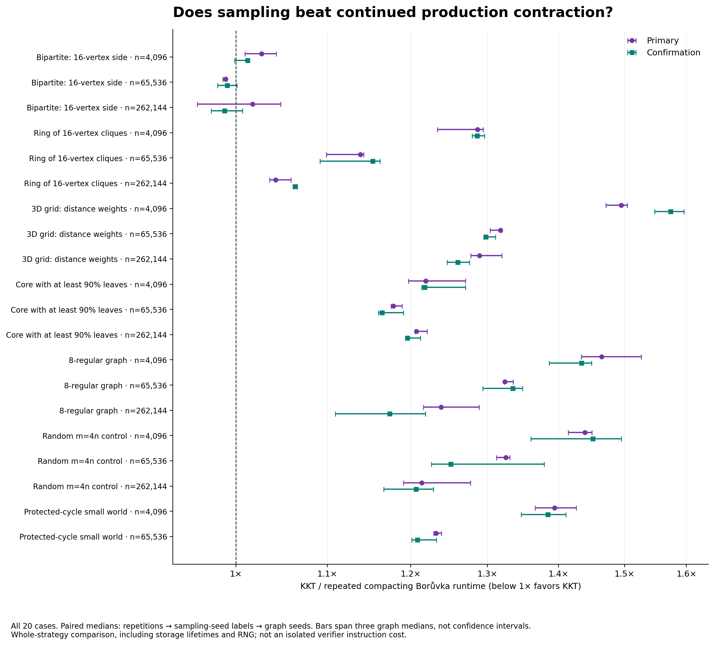
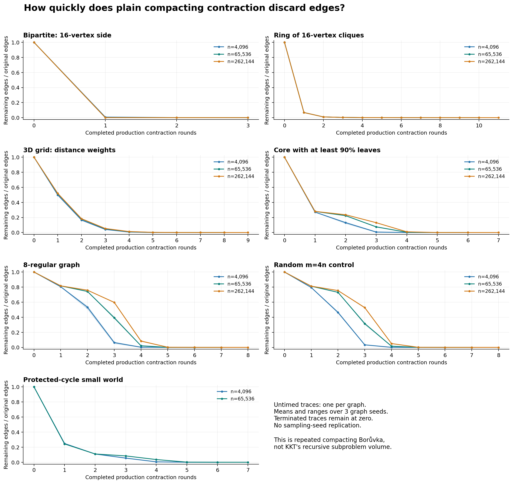

# KKT versus continued production contraction

Both full runs passed strict validation: 1,440 timings each, 20 cases, three graph seeds, three sampling-seed labels, four repeats, one checked warmup per algorithm. The separate trace covers all 60 graphs. Its original input fingerprints and graph sizes after two contractions (or earlier termination) match the independently collected common/shape work evidence. Intermediate edge contents are not compared.

KKT's case-level paired median is below repeated compacting Borůvka in **1/20 cases in both runs**. In **0/20 cases**, all three graph-level paired medians are below one in both runs. Every case and loss is retained below.

This is a whole-strategy ablation using the exact production boruvka_step: continue deterministic compaction versus KKT's sampling, verifier, recursion, RNG, and storage lifetimes. It does not isolate only verifier instructions, compare against a best possible Borůvka, or establish an asymptotic crossover. Compaction releases prior input storage each round; KKT has recursive lifetimes.

Both timings include tuple conversion, temporary input destruction, and the same reserved public ID-set construction. Validation and returned-result destruction are outside. The independently certified reference is outside timing. Fingerprints link the untimed trace to the other work campaigns; the timing CSV itself contains no per-call fingerprint, so binary/fixture provenance must accompany the data.

Paired ratios divide matched KKT/compaction elapsed times, take the median over repetitions, then sampling-seed labels, then graph seeds. Ranges span the three graph medians, not confidence intervals. Only three graph seeds represent graph draws; deterministic compaction's seed labels are repeated trials. Confirmation is a second execution, not a new graph sample. run_drift.csv retains each algorithm's matched confirmation/primary movement.

| Case | Primary ratio [graph range] | Confirmation ratio [graph range] |
|---|---:|---:|
| unbalanced_bipartite_16_n4096 | 1.0272 [1.0094, 1.0430] | 1.0123 [0.9985, 1.0124] |
| unbalanced_bipartite_16_n65536 | 0.9894 [0.9864, 0.9905] | 0.9909 [0.9809, 1.0012] |
| unbalanced_bipartite_16_n262144 | 1.0175 [0.9604, 1.0479] | 0.9884 [0.9746, 1.0071] |
| ring_cliques_16_n4096 | 1.2868 [1.2339, 1.2941] | 1.2863 [1.2793, 1.2962] |
| ring_cliques_16_n65536 | 1.1385 [1.0990, 1.1424] | 1.1533 [1.0918, 1.1622] |
| ring_cliques_16_n262144 | 1.0422 [1.0358, 1.0590] | 1.0637 [1.0612, 1.0661] |
| grid3d_distance_n4096 | 1.4946 [1.4709, 1.5043] | 1.5736 [1.5477, 1.5959] |
| grid3d_distance_n65536 | 1.3176 [1.3038, 1.3191] | 1.2979 [1.2949, 1.3109] |
| grid3d_distance_n262144 | 1.2892 [1.2776, 1.3195] | 1.2603 [1.2466, 1.2760] |
| leaf_core_90_n4096 | 1.2189 [1.1970, 1.2707] | 1.2179 [1.2137, 1.2705] |
| leaf_core_90_n65536 | 1.1787 [1.1755, 1.1891] | 1.1646 [1.1602, 1.1909] |
| leaf_core_90_n262144 | 1.2073 [1.2055, 1.2208] | 1.1959 [1.1936, 1.2121] |
| regular_8_n4096 | 1.4646 [1.4336, 1.5266] | 1.4343 [1.3868, 1.4491] |
| regular_8_n65536 | 1.3240 [1.3229, 1.3355] | 1.3349 [1.2938, 1.3487] |
| regular_8_n262144 | 1.2385 [1.2162, 1.2889] | 1.1742 [1.1094, 1.2188] |
| random_4_n4096 | 1.4392 [1.4142, 1.4499] | 1.4511 [1.3603, 1.4948] |
| random_4_n65536 | 1.3250 [1.3122, 1.3309] | 1.2514 [1.2261, 1.3792] |
| random_4_n262144 | 1.2140 [1.1910, 1.2773] | 1.2066 [1.1665, 1.2289] |
| small_world_n4096 | 1.3941 [1.3665, 1.4261] | 1.3846 [1.3465, 1.4111] |
| small_world_n65536 | 1.2323 [1.2291, 1.2389] | 1.2085 [1.2012, 1.2327] |

## Untimed contraction volumes

Volumes are arithmetic means over three graphs. A round's input is counted once; these are edge visits to whole contraction calls, not the number of individual loop passes or KKT recursive edge volume. The round plot shows remaining edges and pads completed traces with zero, preserving every size.

| Case | Rounds mean [range] | Sum of round input edges / m, mean | After two rounds / m, mean |
|---|---:|---:|---:|
| unbalanced_bipartite_16_n4096 | 3.00 [3, 3] | 1.0080 | 0.0006 |
| unbalanced_bipartite_16_n65536 | 3.00 [3, 3] | 1.0005 | 0.0000 |
| unbalanced_bipartite_16_n262144 | 3.00 [3, 3] | 1.0001 | 0.0000 |
| ring_cliques_16_n4096 | 7.00 [7, 7] | 1.0831 | 0.0099 |
| ring_cliques_16_n65536 | 10.00 [10, 10] | 1.0830 | 0.0098 |
| ring_cliques_16_n262144 | 10.67 [10, 11] | 1.0825 | 0.0098 |
| grid3d_distance_n4096 | 5.67 [5, 6] | 1.7124 | 0.1656 |
| grid3d_distance_n65536 | 7.67 [7, 8] | 1.7585 | 0.1794 |
| grid3d_distance_n262144 | 9.00 [9, 9] | 1.7712 | 0.1831 |
| leaf_core_90_n4096 | 4.67 [4, 5] | 1.4076 | 0.1306 |
| leaf_core_90_n65536 | 6.00 [6, 6] | 1.5817 | 0.2235 |
| leaf_core_90_n262144 | 6.67 [6, 7] | 1.6565 | 0.2359 |
| regular_8_n4096 | 5.33 [5, 6] | 2.4022 | 0.5319 |
| regular_8_n65536 | 6.67 [6, 7] | 2.9726 | 0.7421 |
| regular_8_n262144 | 7.67 [7, 8] | 3.2587 | 0.7588 |
| random_4_n4096 | 5.33 [5, 6] | 2.2937 | 0.4646 |
| random_4_n65536 | 7.00 [7, 7] | 2.8743 | 0.7308 |
| random_4_n262144 | 7.67 [7, 8] | 3.1465 | 0.7542 |
| small_world_n4096 | 5.67 [5, 6] | 1.4184 | 0.1095 |
| small_world_n65536 | 7.00 [7, 7] | 1.4739 | 0.1097 |

Raw matched pairs, graph-level ratios, slower/equal observation counts, both runtime summaries, confirmation summary, run drift, contraction summaries, round volumes, and provenance matches are retained as CSVs. analysis_inputs.json records input hashes. No cases are selected after observing which algorithm wins.
