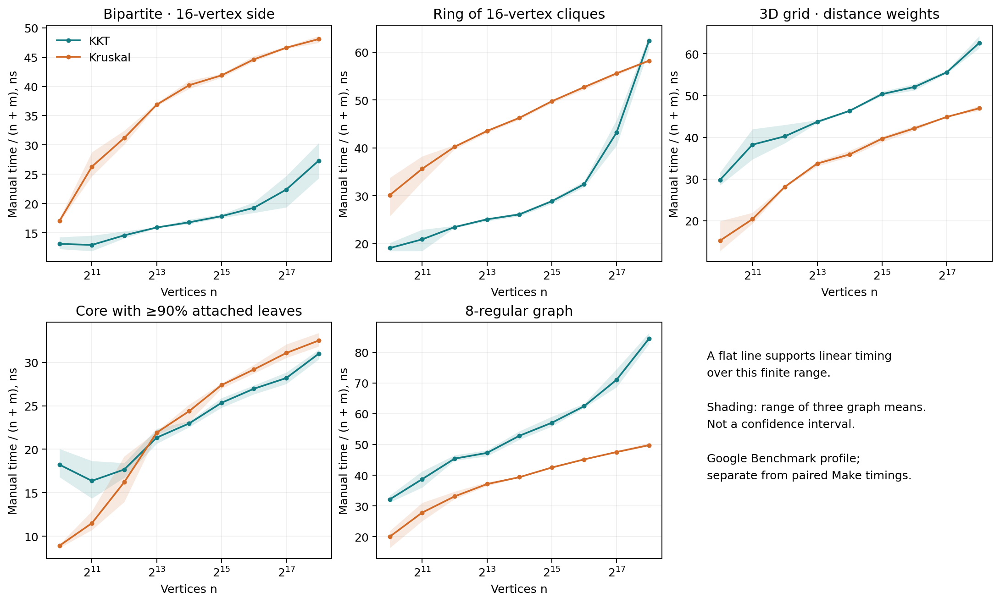

# Added Google Benchmark complexity diagnostics

Validated 810 raw records, 2430 timed calls, and 60 built-in fit rows. All five families, nine powers of two from 1,024 to 262,144 vertices, two algorithms, three graph seeds and three repetition batches are present. Each batch cycles KKT seeds 0, 1, 7.

Input size is N=n+m. Fits use balanced arithmetic means; the paired comparison campaigns use a different aggregation and native build profile. Neither type of fit proves Big-O complexity.

| Family | Algorithm | Full p | Upper-half p | ns/N first | ns/N last | Built-in models across graph seeds |
|---|---|---:|---:|---:|---:|---|
| Bipartite · 16-vertex side | KKT | 1.126 | 1.173 | 13.134 | 27.334 | NlgN, NlgN, NlgN |
| Bipartite · 16-vertex side | Kruskal | 1.161 | 1.067 | 17.054 | 48.068 | NlgN, NlgN, NlgN |
| Ring of 16-vertex cliques | KKT | 1.185 | 1.309 | 19.096 | 62.403 | N^2, N^2, N^2 |
| Ring of 16-vertex cliques | Kruskal | 1.112 | 1.082 | 30.142 | 58.205 | NlgN, NlgN, NlgN |
| 3D grid · distance weights | KKT | 1.113 | 1.100 | 29.785 | 62.618 | NlgN, NlgN, NlgN |
| 3D grid · distance weights | Kruskal | 1.186 | 1.095 | 15.253 | 46.954 | NlgN, NlgN, NlgN |
| Core with ≥90% attached leaves | KKT | 1.115 | 1.102 | 18.224 | 30.983 | NlgN, NlgN, NlgN |
| Core with ≥90% attached leaves | Kruskal | 1.230 | 1.101 | 8.905 | 32.502 | NlgN, NlgN, NlgN |
| 8-regular graph | KKT | 1.157 | 1.167 | 32.139 | 84.398 | NlgN, NlgN, NlgN |
| 8-regular graph | Kruskal | 1.144 | 1.084 | 20.007 | 49.771 | NlgN, NlgN, NlgN |

The built-in model is chosen from CPU time in Google Benchmark 1.5.2, then manual time is fitted to that same model. All model coefficients and RMS records remain in builtin_complexity.json. Independent fits retain N, N log N, N (log N)^2, N^2 and a free power, full and upper-half windows, with original-unit and relative residuals. The exponent p is from log-space regression.

Upper-half timing fits use the largest five of nine sizes. Work fits use the four fixed main sizes and the largest two for their upper half: the latter are only a two-point slope. Work counters omit allocator internals, hash collisions, deallocation and cache behavior. Registration order is fixed; there is no paired/randomized algorithm schedule in this separate diagnostic.
