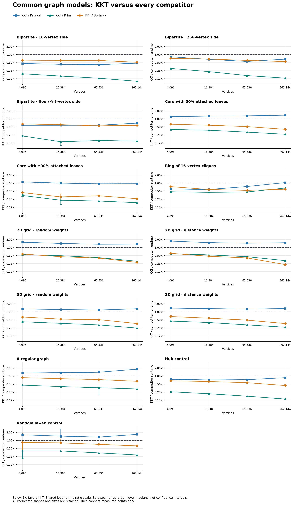
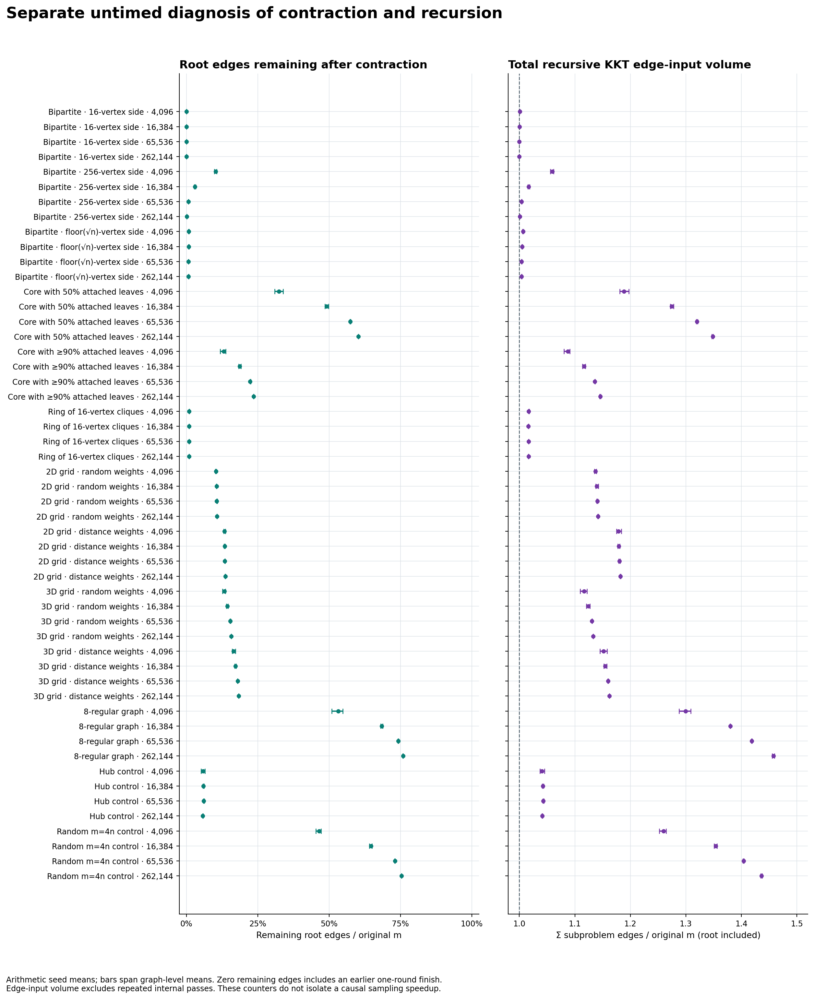
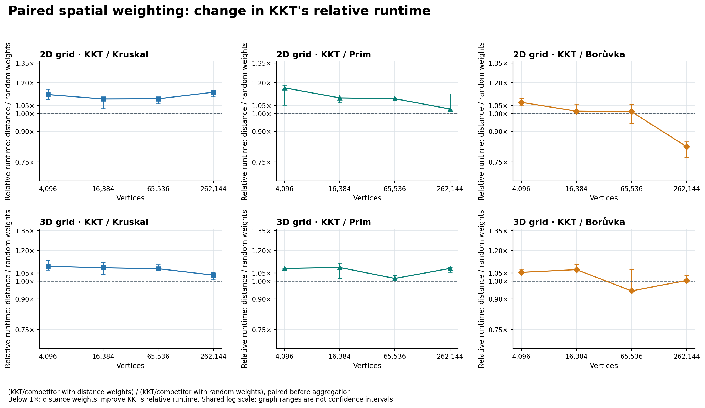
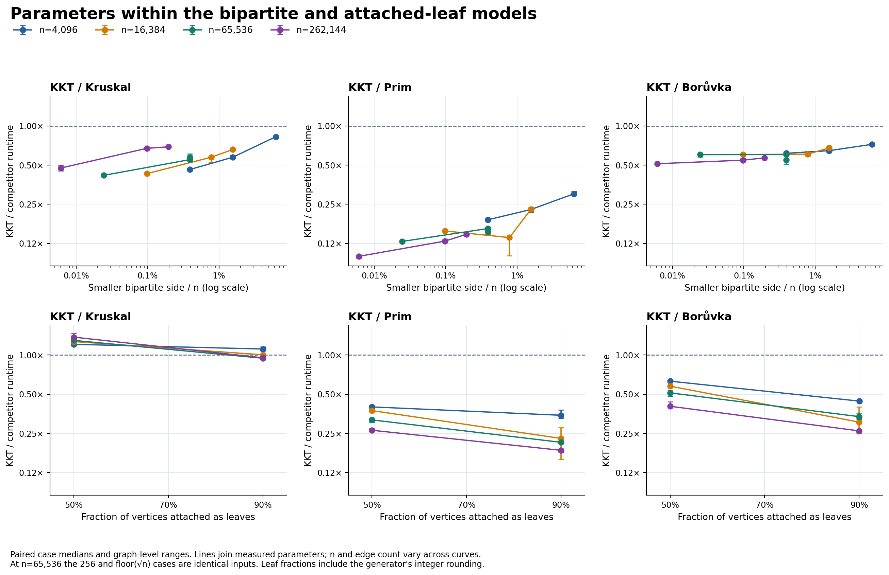

# Common graph models experiment

Validated **52 cases and 7,488 timed observations**, with three graph seeds, three sampling-seed labels, 4 repetitions, and one warmup per algorithm/seed pair. The complete requested matrix retains all thirteen families at sizes 4096, 16384, 65536, 262144. All families and the hub/random-4 controls were selected before these measurements; no family is dropped according to its result.

Median of repetitions for each graph/sampling-seed pair; median of the three sampling-seed values per graph; median of the three graph values. Paired ratios apply the same hierarchy to matched algorithm/reference elapsed-time ratios. Error bars span graph-level medians and are not confidence intervals.

Lower ratios favor KKT. Displayed runtime medians and paired ratios are aggregated separately; dividing displayed times need not reproduce the paired ratios.

| Case | KKT ms | Kruskal ms | Prim ms | Borůvka ms | KKT/Kruskal | KKT/Prim | KKT/Borůvka |
|---|---:|---:|---:|---:|---:|---:|---:|
| unbalanced_bipartite_16_n4096 | 0.325 | 0.707 | 1.719 | 0.526 | 0.462× | 0.190× | 0.615× |
| unbalanced_bipartite_16_n16384 | 1.402 | 3.227 | 8.917 | 2.327 | 0.430× | 0.156× | 0.603× |
| unbalanced_bipartite_16_n65536 | 5.953 | 14.263 | 46.087 | 10.075 | 0.417× | 0.129× | 0.601× |
| unbalanced_bipartite_16_n262144 | 31.417 | 65.757 | 333.881 | 63.327 | 0.475× | 0.099× | 0.512× |
| unbalanced_bipartite_256_n4096 | 0.533 | 0.647 | 1.775 | 0.737 | 0.825× | 0.301× | 0.722× |
| unbalanced_bipartite_256_n16384 | 2.018 | 3.078 | 8.843 | 2.954 | 0.659× | 0.229× | 0.678× |
| unbalanced_bipartite_256_n65536 | 7.872 | 14.142 | 47.422 | 12.832 | 0.551× | 0.163× | 0.602× |
| unbalanced_bipartite_256_n262144 | 41.305 | 61.590 | 326.166 | 75.140 | 0.672× | 0.130× | 0.545× |
| unbalanced_bipartite_sqrt_n4096 | 0.382 | 0.661 | 1.753 | 0.599 | 0.574× | 0.228× | 0.645× |
| unbalanced_bipartite_sqrt_n16384 | 2.679 | 4.958 | 27.970 | 4.662 | 0.574× | 0.139× | 0.606× |
| unbalanced_bipartite_sqrt_n65536 | 8.766 | 14.707 | 60.883 | 15.340 | 0.575× | 0.154× | 0.547× |
| unbalanced_bipartite_sqrt_n262144 | 43.191 | 62.241 | 295.424 | 75.915 | 0.690× | 0.147× | 0.568× |
| leaf_core_50_n4096 | 0.543 | 0.439 | 1.340 | 0.872 | 1.209× | 0.400× | 0.630× |
| leaf_core_50_n16384 | 2.556 | 2.027 | 6.908 | 4.446 | 1.271× | 0.374× | 0.577× |
| leaf_core_50_n65536 | 11.685 | 9.050 | 36.936 | 23.360 | 1.296× | 0.318× | 0.512× |
| leaf_core_50_n262144 | 55.979 | 39.883 | 204.648 | 139.653 | 1.373× | 0.264× | 0.404× |
| leaf_core_90_n4096 | 0.228 | 0.212 | 0.660 | 0.505 | 1.113× | 0.345× | 0.443× |
| leaf_core_90_n16384 | 1.060 | 1.075 | 6.216 | 4.788 | 1.005× | 0.229× | 0.305× |
| leaf_core_90_n65536 | 4.285 | 4.536 | 19.986 | 12.768 | 0.946× | 0.214× | 0.336× |
| leaf_core_90_n262144 | 18.810 | 19.747 | 101.514 | 70.204 | 0.953× | 0.185× | 0.261× |
| ring_cliques_16_n4096 | 0.865 | 1.420 | 1.823 | 1.167 | 0.604× | 0.475× | 0.741× |
| ring_cliques_16_n16384 | 3.697 | 6.376 | 8.106 | 6.431 | 0.581× | 0.453× | 0.579× |
| ring_cliques_16_n65536 | 23.635 | 31.403 | 49.445 | 43.506 | 0.749× | 0.466× | 0.536× |
| ring_cliques_16_n262144 | 137.690 | 130.465 | 209.014 | 233.023 | 1.051× | 0.657× | 0.595× |
| grid2d_random_n4096 | 0.547 | 0.348 | 1.044 | 0.960 | 1.570× | 0.539× | 0.570× |
| grid2d_random_n16384 | 2.367 | 1.650 | 4.856 | 5.274 | 1.420× | 0.492× | 0.451× |
| grid2d_random_n65536 | 10.123 | 7.508 | 24.783 | 25.550 | 1.322× | 0.416× | 0.400× |
| grid2d_random_n262144 | 45.187 | 33.532 | 146.839 | 160.858 | 1.340× | 0.305× | 0.276× |
| grid2d_distance_n4096 | 0.644 | 0.371 | 1.077 | 1.099 | 1.737× | 0.587× | 0.603× |
| grid2d_distance_n16384 | 2.520 | 1.683 | 4.804 | 5.376 | 1.519× | 0.527× | 0.468× |
| grid2d_distance_n65536 | 10.911 | 7.531 | 24.533 | 27.064 | 1.445× | 0.452× | 0.406× |
| grid2d_distance_n262144 | 51.819 | 33.709 | 162.973 | 222.374 | 1.505× | 0.320× | 0.229× |
| grid3d_random_n4096 | 0.658 | 0.512 | 1.544 | 1.044 | 1.281× | 0.422× | 0.636× |
| grid3d_random_n16384 | 2.811 | 2.309 | 7.676 | 5.329 | 1.216× | 0.369× | 0.531× |
| grid3d_random_n65536 | 12.696 | 10.975 | 39.607 | 25.116 | 1.164× | 0.322× | 0.507× |
| grid3d_random_n262144 | 62.887 | 48.684 | 262.046 | 172.911 | 1.300× | 0.245× | 0.362× |
| grid3d_distance_n4096 | 0.704 | 0.518 | 1.604 | 1.074 | 1.373× | 0.447× | 0.662× |
| grid3d_distance_n16384 | 3.152 | 2.357 | 7.895 | 5.415 | 1.318× | 0.396× | 0.575× |
| grid3d_distance_n65536 | 13.750 | 10.952 | 42.484 | 28.261 | 1.257× | 0.322× | 0.487× |
| grid3d_distance_n262144 | 65.768 | 49.177 | 249.073 | 178.965 | 1.325× | 0.263× | 0.361× |
| regular_8_n4096 | 0.974 | 0.733 | 2.150 | 1.107 | 1.311× | 0.458× | 0.874× |
| regular_8_n16384 | 4.309 | 3.225 | 10.390 | 5.328 | 1.346× | 0.404× | 0.800× |
| regular_8_n65536 | 20.727 | 14.847 | 55.953 | 27.827 | 1.396× | 0.366× | 0.741× |
| regular_8_n262144 | 118.195 | 65.199 | 357.403 | 186.308 | 1.815× | 0.330× | 0.638× |
| hub_n4096 | 0.575 | 0.716 | 2.202 | 0.840 | 0.756× | 0.259× | 0.667× |
| hub_n16384 | 2.362 | 3.284 | 10.767 | 3.760 | 0.721× | 0.218× | 0.626× |
| hub_n65536 | 10.933 | 14.783 | 60.485 | 19.127 | 0.735× | 0.177× | 0.566× |
| hub_n262144 | 57.950 | 65.644 | 426.876 | 131.652 | 0.871× | 0.138× | 0.443× |
| random_4_n4096 | 3.332 | 0.765 | 2.681 | 4.374 | 1.623× | 0.403× | 0.839× |
| random_4_n16384 | 6.161 | 3.993 | 14.781 | 9.424 | 1.450× | 0.403× | 0.810× |
| random_4_n65536 | 19.858 | 14.847 | 58.608 | 27.793 | 1.334× | 0.340× | 0.711× |
| random_4_n262144 | 109.896 | 65.283 | 395.379 | 181.234 | 1.681× | 0.285× | 0.625× |

KKT leads all competitors by paired case medians in: `unbalanced_bipartite_16_n4096`, `unbalanced_bipartite_16_n16384`, `unbalanced_bipartite_16_n65536`, `unbalanced_bipartite_16_n262144`, `unbalanced_bipartite_256_n4096`, `unbalanced_bipartite_256_n16384`, `unbalanced_bipartite_256_n65536`, `unbalanced_bipartite_256_n262144`, `unbalanced_bipartite_sqrt_n4096`, `unbalanced_bipartite_sqrt_n16384`, `unbalanced_bipartite_sqrt_n65536`, `unbalanced_bipartite_sqrt_n262144`, `leaf_core_90_n65536`, `leaf_core_90_n262144`, `ring_cliques_16_n4096`, `ring_cliques_16_n16384`, `ring_cliques_16_n65536`, `hub_n4096`, `hub_n16384`, `hub_n65536`, `hub_n262144`.
The stricter descriptive check, a lead on every graph-level median against every competitor, holds in: `unbalanced_bipartite_16_n4096`, `unbalanced_bipartite_16_n16384`, `unbalanced_bipartite_16_n65536`, `unbalanced_bipartite_16_n262144`, `unbalanced_bipartite_256_n4096`, `unbalanced_bipartite_256_n16384`, `unbalanced_bipartite_256_n65536`, `unbalanced_bipartite_256_n262144`, `unbalanced_bipartite_sqrt_n4096`, `unbalanced_bipartite_sqrt_n16384`, `unbalanced_bipartite_sqrt_n65536`, `unbalanced_bipartite_sqrt_n262144`, `leaf_core_90_n65536`, `leaf_core_90_n262144`, `ring_cliques_16_n4096`, `ring_cliques_16_n16384`, `ring_cliques_16_n65536`, `hub_n4096`, `hub_n16384`, `hub_n65536`, `hub_n262144`.

All individual loss counts, ties, and graph-level ratio ranges remain in [comparisons.csv](comparisons.csv). [summary.csv](summary.csv) retains every algorithm's runtime, and [graph_summary.csv](graph_summary.csv) retains every graph seed.

## Separate logical-work diagnosis

The untimed probe certifies its reference MST independently and checks exact KKT IDs. Work summaries use arithmetic means across sampling seeds within each graph and then across the three graphs. They are separate from timing medians and cannot establish that sampling caused a runtime advantage.

At n=262,144, root reduction and recursion are:

| Family | Mean maximum degree | Mean leaves | Root edges retained | Sampling calls, range | Σm/m, mean | Heavy fraction, mean |
|---|---:|---:|---:|---:|---:|---:|
| Bipartite · 16-vertex side | 65849.0 | 0.0 | <0.01% | 1–1 | 1.0000 | 40.00% |
| Bipartite · 256-vertex side | 4285.7 | 0.0 | 0.18% | 2–3 | 1.0010 | 93.31% |
| Bipartite · floor(√n)-vertex side | 2184.0 | 0.0 | 0.76% | 3–3 | 1.0041 | 96.63% |
| Core with 50% attached leaves | 26.7 | 131132.0 | 60.24% | 7–7 | 1.3484 | 95.90% |
| Core with ≥90% attached leaves | 36.0 | 235930.0 | 23.59% | 5–7 | 1.1458 | 91.66% |
| Ring of 16-vertex cliques | 17.0 | 0.0 | 0.98% | 5–8 | 1.0164 | 0.31% |
| 2D grid · random weights | 4.0 | 0.0 | 10.75% | 14–15 | 1.1417 | 31.92% |
| 2D grid · distance weights | 4.0 | 0.0 | 13.62% | 14–15 | 1.1818 | 31.49% |
| 3D grid · random weights | 6.0 | 0.0 | 15.72% | 8–15 | 1.1330 | 72.15% |
| 3D grid · distance weights | 6.0 | 0.0 | 18.31% | 11–14 | 1.1621 | 70.14% |
| 8-regular graph | 8.0 | 0.0 | 75.88% | 7–7 | 1.4577 | 96.35% |
| Hub control | 262143.0 | 661.3 | 5.76% | 3–3 | 1.0411 | 78.74% |
| Random m=4n control | 27.0 | 321.3 | 75.42% | 7–7 | 1.4364 | 96.69% |

Zero root-retained edges includes a finish after the first contraction. Heavy fractions divide summed heavy-edge incidences by verifier input incidences within each observation before averaging; they are not fractions of distinct original edges. Σm includes every recursive KKT input, including the root, but omits repeated internal passes. [work_summary.csv](work_summary.csv) retains all sizes and execution regimes; [graph_work_summary.csv](graph_work_summary.csv) retains graph-level means.

## Paired spatial weighting

Each random/distance pair shares the same graph topology, coordinates, labels, IDs, and input order by construction; only the unique weight ranks change. Distance ranks use squared jittered-coordinate distances with an ID tie-break. The fixture tests verify the pairing; CSV degree metrics are an additional consistency check, not a proof of equal topology.

Relative effects below are `(KKT/competitor with distance weights) / (KKT/competitor with random weights)`, formed within matched graph/sampling/repetition observations before applying the timing aggregation. Below 1× means the distance ordering improves KKT's relative runtime, not necessarily that KKT beats the competitor.

At n=262,144:

| Grid | Competitor | Paired relative effect | Graph-level range |
|---|---|---:|---:|
| 2D | Kruskal | 1.135× | 1.105–1.145× |
| 2D | Prim | 1.027× | 1.011–1.124× |
| 2D | Borůvka | 0.822× | 0.772–0.846× |
| 3D | Kruskal | 1.037× | 1.009–1.053× |
| 3D | Prim | 1.079× | 1.055–1.085× |
| 3D | Borůvka | 1.004× | 1.002–1.036× |

[spatial_comparisons.csv](spatial_comparisons.csv) retains these relative effects and each algorithm's own distance/random runtime ratio, including all sizes and individual losses/ties. [spatial_graph_summary.csv](spatial_graph_summary.csv) retains every graph seed.

## Core and leaf parameters

The smaller bipartite sides have 16, 256, or floor(√n) vertices; every other vertex has four distinct neighbors on that side. Attached-leaf models use cores of floor(n/2) or floor(n/10) vertices with 4c core edges and one edge per added leaf. The nominal 90% setting therefore has a leaf attachment fraction at least 90%, with integer rounding. At n=65,536, the fixed-256 and floor(√n) variants are byte-identical weighted inputs per graph seed; their separately retained timings are an intentional parameter alias, not independent graph evidence. Other parameter settings change both graph instances and edge counts; they do not hold every other property fixed.

## Limits

These are synthetic models, not representative application datasets or a workload-weighted ranking. Three graph seeds are the independent graph samples; sampling labels and repetitions are not extra graphs. Graph ranges are descriptive, not confidence intervals, and no statistical significance or asymptotic crossover is claimed. Lines connect measured sizes only. Every family has distinct weights. Grid distance variants order weights by geometry; the other variants shuffle weight ranks. Topology labels alone do not describe every real graph with a similar name.

All four algorithms use the common tuple-edge-list boundary. KKT conversion and temporary input destruction are included; fixture generation, reference certification, result checks, and returned-result destruction are excluded. The rotating order is balanced within each graph/sampling pair. Ordinary desktop scheduling, cache/allocator state, and power/thermal variation can still affect measurements. Consult campaign metadata for binary, source, and build provenance.
