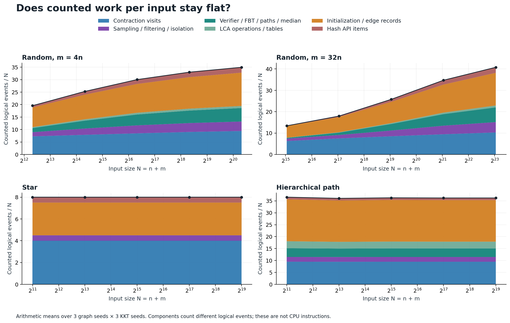
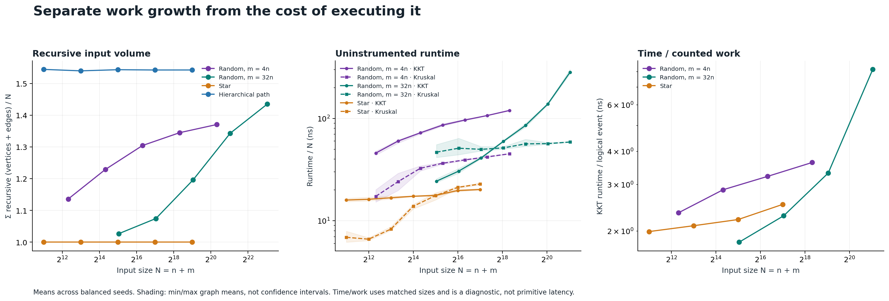

# KKT: counted work versus elapsed time

The measurements support a much milder growth rate for KKT's explicit work
than its wall-clock timings suggest. They do **not** establish a future size
at which KKT dominates. On the denser random graphs, KKT loses its small-input
advantage as size grows.

We added six GoogleTest work/correctness checks, 65 optional work counters,
and a separate uninstrumented Google Benchmark executable. All seven Bazel
test targets passed. Every measured result matched an independently certified
MST: 180 counter observations and 1,134 timed calls. Details and reproduction
commands are in [METHODS.md](METHODS.md); full numeric tables are in the
generated [report](report.md).

## What the counters show

The work sweep spans 1,024–262,144 vertices, reaching 8,388,608 edges.
Here `N=n+m`; work is a documented sum of logical events, not CPU instructions.

| Family | Work/N, smallest → largest | Fitted work exponent, full range | Last size-step exponent |
| --- | ---: | ---: | ---: |
| Random, m=4n | 19.57 → 34.95 | 1.103 | 1.042 |
| Random, m=32n | 13.41 → 40.78 | 1.208 | 1.116 |
| Star | 8.00 → 8.00 | 1.000 | 1.000 |
| Hierarchical path | 36.57 → 36.22 | 0.999 | 1.000 |

The star and hierarchical path controls have essentially constant work per
input element. Random-graph work per input grows, but the growth slows at the
larger sizes. A major finite-size effect is visible directly: on random `m=32n`
graphs, the first two contractions retain only **4.2%** of the original edges
at 1,024 vertices, versus **87.4%** at 262,144. Small graphs benefit much more
from eliminating parallel edges after contraction.

Despite that change, summed recursive edge volume grows from **1.024m** to
**1.446m** on this family. There is no observed explosion in recursive input
volume. The counters and source audit are consistent with expected linear
structure; random-graph work/N has not yet become flat, and finite samples
cannot prove the bound for all inputs and sampling outcomes.

## Why elapsed time looks worse

The separate timing sweep uses 1,024–65,536 vertices, with the same fixtures
at shared sizes. These are descriptive power fits `T≈cN^p` on that window:

| Family | KKT time exponent p | Kruskal time exponent p | KKT/Kruskal at 65,536 vertices |
| --- | ---: | ---: | ---: |
| Random, m=4n | 1.222 | 1.215 | 2.65× |
| Random, m=32n | 1.573 | 1.052 | 4.81× |
| Star | 1.060 | 1.345 | 0.88× |

For random `m=32n`, increasing vertices 64× increases runtime about **744×**.
Counted work per input increases **2.59×** over those same endpoints; time
per counted event increases another **4.49×**. Growing counted work explains
only part of the slowdown. Allocator behavior, hash internals, and memory
access costs are outside the counter model and need profiling before assigning
causality. Even the star's exactly linear counted work accompanies a **1.27×**
rise in time per event.

Google Benchmark's automatic fit labels dense-random KKT as `N²` and star KKT
as `N log N` on this range. Those labels plainly are not complexity proofs:
the star deterministically finishes in one linear contraction. We retain
the builtin fits, independent manual-time fits, and [local slopes](effective_exponents.png)
so these distinctions remain visible.

At small sizes the denser random family actually favors KKT: its ratio to
Kruskal is 0.52 at 1,024 vertices and 0.82 at 4,096, then 1.16 at 8,192 and
4.81 at 65,536. Stars favor KKT at the upper end of this timing window.
Neither observation supports a universal crossover. The separate
[million-vertex experiment](../large-2026-10-10/README.md) retains the larger
losses, including stars eventually falling behind; its timings are not pooled
with this different build and measurement protocol.

## What the theorem does and does not promise

KKT's expected linear bound assumes a unit-cost RAM and linear local phases.
It does not specify useful constants, a crossover size, or equal practical
cost per operation between implementations.
[Original KKT paper](https://www.cs.cmu.edu/~guyb/paralg/papers/KargerKleinTarjan95.pdf).

The source audit found no obvious extra asymptotic factor in contraction,
the repaired median table, or LCA preprocessing. The verifier's binary searches
have an aggregate comparison bound; charging the worst individual search
depth to every node would overestimate them. Hash operations and sampling
still carry their usual assumptions. The audit is documented in the methods,
not presented as a formal proof of the complete implementation.

An eventual crossover can follow from tight linear versus superlinear bounds
under a shared cost model. Comparing Big-O upper bounds alone is insufficient,
and extrapolating these finite timing slopes to predict a crossover would be
unreliable. The actionable finding is that reducing the number and cost of
passes, allocations, conversions, and hash operations matters more than
waiting for graph size to rescue the current implementation.

Raw evidence: [work.csv](work.csv), [timing.json](timing.json),
[model fits](model_fits.csv), [metadata](metadata.json), and
[GoogleTest output](complexity_test.log). Figures are also available as SVG
and PDF. Results are specific to this revision, Apple M3 Max, and build profile.
