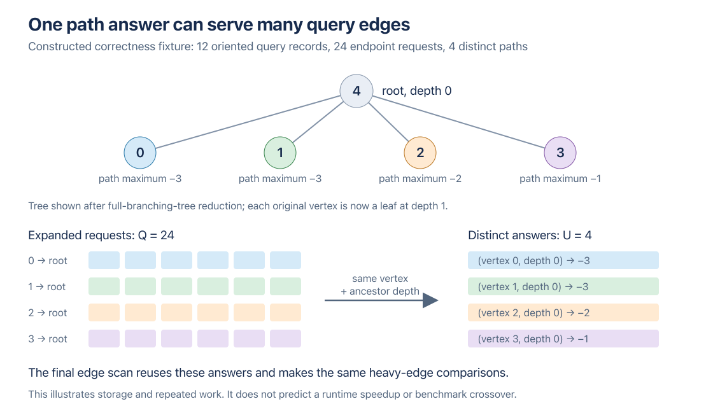
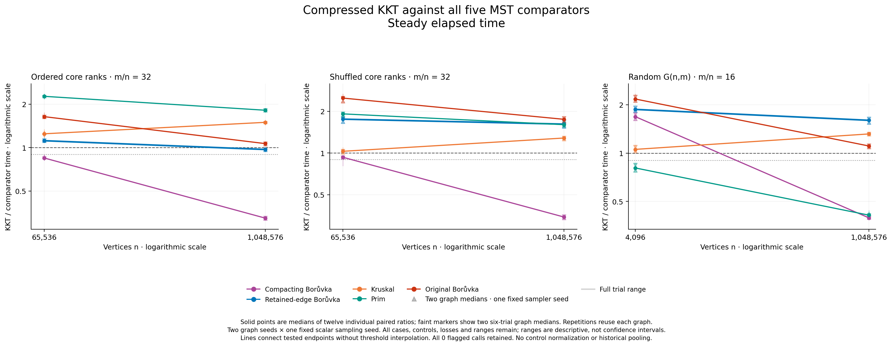

# Computing repeated verifier requests once

**Compressing verifier requests helps the large cases, but hurts the small ones.** At 1,048,576 vertices, KKT improves by 8.4–14.6% against its unchanged-query reference. On the ordered hierarchy it crosses from losing to retained-edge Borůvka at 65,536 vertices to winning by about 3% at the large endpoint. This is a narrow observed transition, below the prespecified 10% strong-crossover threshold. Original Borůvka still beats KKT in every paired trial; KKT is never the fastest of all six solvers here.

All 24 children and 1,008 outputs passed [strict reanalysis](analysis/README.md) and the [independent raw numerical audit](validation/independent-numerical-audit/README.md). The [prospective protocol](PROTOCOL.md) remains unchanged; its pre-release wording records when it was frozen.

This experiment changes the representation of KKT's heavy-edge verifier requests. Many graph edges ask for the same maximum-weight path segment. The reference stores each request separately and repeatedly updates an answer indexed by graph-edge position. The candidate computes each distinct request once, then reconstructs the same per-edge decisions. The question is whether that reduces enough local work to improve KKT against **retained-edge Borůvka**, as well as the other four competitors.

This is separate from packed sampling. Both binaries use the existing **scalar sampler**, retained-parallel contraction and direct-Edge verifier input. Seven production objects, including `kkt.o`, and the six-solver harness object are physically shared. Only `verifier_v2.o` differs. The candidate is enabled by `KKT_EXPERIMENT_COMPRESSED_QUERIES`; the default verifier body remains textually unchanged. Fresh paired timings are required even with that source guarantee.

## What is shared, and why the answers are equivalent

KKT's filter asks whether a graph edge is heavier than the maximum edge on the corresponding path in a sampled forest. Within a forest component, the verifier reduces its tree to a full branching tree. For a query edge with endpoints u and v, its lowest common ancestor divides that path into two endpoint-to-ancestor requests.

On one endpoint's ancestor chain, a depth identifies exactly one ancestor. Thus repeated requests with the same **endpoint and ancestor depth** require the same answer, regardless of which graph edge requested it. The [candidate helper](../../../verifier/experimental_compressed_queries.hpp) stores a bit for each locally requested depth, counts the set bits, and assigns a compact interval of answer values to each vertex.



The diagram reproduces the linked-dispatch correctness fixture: twelve oriented query records generate **Q=24** logical endpoint requests but only **U=4** distinct answers. It illustrates reuse, not a measured benchmark graph or runtime gain. The [diagram review](DIAGRAM_QA.md) checked the rendered image; an [SVG version](query-compression.svg) is available.

Two masks must remain separate. The immutable local mask **R[v]** says which answers are requested *at v*. The propagated mask **D[v]** also carries descendant requests needed by the Hagerup traversal. Replacing R with D would store requests at the wrong vertices; using only R for the traversal would lose descendant state. The candidate starts D from R and applies the same propagation, path-state expressions, binary search and child order as the reference.

During traversal, each local set bit produces one stored maximum. A final graph pass uses the cached LCA and a popcount rank to retrieve the endpoint answers, combines them, and applies the unchanged strict weight comparison. Rank counts requested depths below the desired bit; depth zero correctly has rank zero. New request-bit shifts use unsigned masks and checked depths; the existing signed path-state expressions and supported-height limit are retained.

Self-loops keep the existing unmarked behavior and require no proper-ancestor lookup. Edges crossing sampled-forest components remain unmarked by the existing wrapper. Empty inputs, isolated components and duplicate or negative edge IDs preserve their established contracts: classifications remain indexed by graph position, rather than treating caller IDs as array indices. The direct-mark oracle tests these cases. Unchanged source and deterministic operations provide the equivalence argument; observed gates establish matching inputs, results and cumulative counters, **not a separately recorded trace of every intermediate sampled forest**.

## How many answers can be shared?

These bounds describe **one connected verifier-tree call**, not the original benchmark graph. Let r be its vertices before full-branching-tree reduction, N the reduced-tree vertices, h its height, and m₀ its non-loop query edges. Q counts logical proper-ancestor requests including duplicates; U counts distinct `(vertex, ancestor depth)` requests.

For arbitrary valid helper requests,

`U ≤ min(Q, Σv depth(v)) ≤ min(Q, N·h)`.

A vertex has only `depth(v)` proper ancestor depths. In this implementation's production reduction, the original r vertices are equal-depth leaves, N<2r and h≤floor(log₂r). Each non-loop internal query edge generates two proper requests, so

`Q = 2m₀`, and `U ≤ min(Q, r·h)`.

When Q>0, this gives `U/Q ≤ min(1, h / average_query_degree)`, with average query degree `2m₀/r`. Loops contribute no proper requests, and graph edges crossing forest components must not be included in m₀. If Q=0, U=0 and the ratio is undefined. Different components require separate bounds before summing.

Cheap leaf attachments can leave a small residual core with many retained query edges after contraction. Many requests must then share the limited ancestor depths. The opportunity does not require original parallel edges: contraction can create them, and distinct opposite endpoints can also share an LCA depth. Dense residual random graphs may benefit for the same reason. Original density alone does not determine U/Q; sampled-forest components and the reduced tree matter.

The [detailed mechanism note](MECHANISM.md) includes a conditional hierarchy example and full array-lifetime accounting. These are deterministic bounds and hypotheses, not measured duplicate fractions. Sparse requests can have U=Q. The implementation iterates actual set bits rather than every possible depth, retaining a local O(m+N) bound because U≤Q≤2m; it does not make the entire verifier proportional to U.

## Where the constant reduction might come from

The reference visits duplicate requests and scatters updates into a large per-edge maximum array as it traverses vertices. The candidate writes each vertex's compact answer interval once and later reads those answers while scanning graph records. Vertex intervals are visited in tree order, so the answer writes are **not necessarily globally sequential**. The final graph pass still performs indexed reads; compression does not eliminate all irregular access.

A smaller answer working set and fewer scattered writes could reduce memory traffic or improve cache behavior. Removing the query-record fill pass also removes one full graph scan inside each connected verifier call. These are **implementation hypotheses**, not profiler findings. The previous profiling attempt failed; it supplied no successful hardware-counter attribution. The candidate adds depth precomputation, a local-mask array, popcount ranks and dependent answer reads, so low-duplication inputs may gain little or lose.

Memory must be compared at matching lifetimes. The cached LCA array now survives traversal and replaces the reference's per-edge maximum array; both account for 4m nominal element bytes on this target. Query records, compact values, local masks, offsets, depth arrays, path state and enclosing recursive graphs also matter. The mechanism note derives a particular final-phase nominal array difference of `8Q−4U−4N` bytes. It is **not** a global peak allocation or RSS estimate, and initialized-slot counters count heterogeneous elements rather than bytes.

## Measured comparisons

The completed capture contains **24 children and 1,008 certified outputs**: 864 timed calls and 144 warmups. Tables use medians of twelve individual paired ratios, with graph medians retained separately. Lower than one favors KKT. Density d means m/n. Every slash-separated entry is **wall / process CPU**, rounded here; the [CSV tables](analysis/comparisons.csv) retain full precision, graph/trial ranges and wins.

| Family | n | d | Compressed / reference KKT | Paired gains, each clock |
|---|---:|---:|---:|---:|
| Leaf hierarchy | 65,536 | 32 | 1.07489 / 1.07488 | 0/12 |
| Shuffled core | 65,536 | 32 | 1.02609 / 1.02611 | 1/12 |
| Leaf hierarchy | 1,048,576 | 32 | 0.88771 / 0.88771 | 12/12 |
| Shuffled core | 1,048,576 | 32 | 0.85362 / 0.85362 | 12/12 |
| Connected G(n,m) | 4,096 | 16 | 1.03838 / 1.03827 | 0/12 |
| Connected G(n,m) | 1,048,576 | 16 | 0.91627 / 0.91626 | 12/12 |

Compression wins 37/72 paired KKT trials on each clock. All three large-case graph medians improve; all three small-case medians regress by 2.6–7.5%. This is a size-dependent implementation tradeoff, not a universal repair.

Both variants against all five competitors follow. H denotes hierarchy, S shuffled core, G connected G(n,m); k/M abbreviate the exact sizes above. R is reference, C compressed. “Dedup B” is the deduplicating compactor; “retained B” repeats the same retained-parallel contraction used by KKT.

| Case / variant | / dedup B | / retained B | / Kruskal | / Prim | / original B |
|---|---:|---:|---:|---:|---:|
| H 65k R | .8182 / .8182 | 1.0377 / 1.0377 | 1.1823 / 1.1823 | 2.1459 / 2.1459 | 1.5196 / 1.5196 |
| H 65k C | .8471 / .8471 | 1.1167 / 1.1167 | 1.2474 / 1.2474 | 2.2688 / 2.2686 | 1.6400 / 1.6399 |
| S 65k R | .9329 / .9329 | 1.7534 / 1.7534 | 1.0119 / 1.0120 | 1.8956 / 1.8956 | 2.4496 / 2.4496 |
| S 65k C | .9316 / .9316 | 1.7559 / 1.7559 | 1.0291 / 1.0291 | 1.9174 / 1.9174 | 2.4933 / 2.4933 |
| H 1M R | .3655 / .3655 | 1.0955 / 1.0955 | 1.6791 / 1.6791 | 2.0200 / 2.0200 | 1.1971 / 1.1971 |
| H 1M C | .3244 / .3244 | .9707 / .9707 | 1.4977 / 1.4977 | 1.8170 / 1.8170 | 1.0662 / 1.0662 |
| S 1M R | .4041 / .4041 | 1.8976 / 1.8976 | 1.5049 / 1.5049 | 1.8723 / 1.8723 | 2.0205 / 2.0205 |
| S 1M C | .3449 / .3449 | 1.6171 / 1.6171 | 1.2830 / 1.2830 | 1.6020 / 1.6020 | 1.7517 / 1.7517 |
| G 4k R | 1.6269 / 1.6267 | 1.7998 / 1.7996 | .9996 / .9995 | .7741 / .7742 | 2.0576 / 2.0573 |
| G 4k C | 1.6857 / 1.6857 | 1.8700 / 1.8700 | 1.0544 / 1.0542 | .8079 / .8078 | 2.1713 / 2.1695 |
| G 1M R | .4278 / .4278 | 1.7604 / 1.7604 | 1.4385 / 1.4385 | .4393 / .4393 | 1.2120 / 1.2120 |
| G 1M C | .3953 / .3953 | 1.5997 / 1.5998 | 1.3155 / 1.3155 | .4107 / .4107 | 1.1073 / 1.1073 |

Across the 72 trials per clock, compressed KKT beats dedup B **60** times, retained B **12**, Kruskal **2**, Prim **24**, and original B **0**. Reference counts are **59, 0, 7, 24, 0**. Original Borůvka's 72/72 wins against each variant rule out an all-six winner on every individual trial, not merely on case medians.

The unchanged controls' compressed/reference case medians span **0.96826–1.03705 wall** and **0.96826–1.03704 CPU**; retained B alone spans 0.99922–1.01033 wall. Shared object identity does not imply identical observations: host state and scheduling still vary. These controls are shown in [all-six variant comparisons](analysis/variant_comparisons.csv) and are never used to normalize KKT.

For scale, large-hierarchy absolute wall medians are 3.876 s reference KKT, 3.453 s compressed KKT, 3.548 s retained B, 3.236 s original B and 1.914 s Prim in the compressed child. Large shuffled-core compressed KKT takes 2.951 s; large G(n,m), 1.492 s. Absolute medians do not replace the paired-ratio statistic. [All solver times](analysis/summary.csv) retain both variants/clocks and all six cases.



[Figure gallery](figures-attempt03/README.md): both clocks for all-six variant drift, both variants' five-comparator ratios, and absolute times; every trial range is retained. Visual review caught missing legends in [attempt 1](figures/QA.md), then an inaccurate “Candidate KKT” label on reference plots in [attempt 2](figures-attempt02/QA.md). Both renders are preserved. [Attempt 3 passed visual QA](figures-attempt03/QA.md) for all ten images and thirty panels. It uses neutral “KKT” labels; plotted values are byte-identical across attempts, and timing data and frozen helpers remain unchanged.

## The retained-edge result is a narrow crossover

For hierarchy d=32, compressed KKT/retained B changes from **1.11674** at 65,536 vertices to **0.97073** at 1,048,576. All twelve small-case pairs lose and all twelve large-case pairs win, on both clocks. The four large-case graph/clock medians lie in **0.967748–0.971451**. That supports an observed loss-to-narrow-lead bracket `(65,536, 1,048,576]`, not a 10% advantage or a located crossing. The shuffled twin still loses by roughly 62% at the large endpoint: weight ordering matters.

The prespecified strong bracket requires **both graph medians on both clocks** above 1 at the small endpoint and at most 0.90 at the large endpoint. **No retained-edge B bracket passes.** The only two passing [classifications](analysis/strong_crossover_classifications.csv) are reference and compressed KKT against dedup B on G(n,m), `(4,096, 1,048,576]`. Leads at both endpoints, such as G(n,m) against Prim, are not observed crossovers. Every one of the thirty classifications remains. Two measured endpoints cannot prove monotonicity, persistence beyond the range, or asymptotic dominance.

## Validation, diagnostics and limitations

[Native validation](validation/NATIVE_VALIDATION.md) passed first-attempt Apple Clang 15 O3 and Clang 22 ASan+UBSan gates. Each profile checked 1,344 paired full-KKT records with identical inputs/MST IDs, all 61 unchanged counters and four exact changed-counter identities; 549 records witnessed reduced query work. Focused tests covered 252 positional cases and seven malformed lookups per variant, alongside 1,248 unchanged direct-oracle cases. Wrong linked policies and a substituted reference stream were rejected. Final uninstrumented object sets passed the unchanged six-solver harness. The native-validation document records the pre-timing stage, not the current capture status.

The separate [untimed work study](work/analysis-attempt01/README.md) completed **24 children and 72 certified solver outputs** on the exact timing fingerprints, without rebuilding. Independent raw reconstruction confirmed all **780 paired counter rows**, **61 unchanged fields** on every pair, the four changed-field identities, and identical records/round replays for both Borůvka continuations across variants. Their final-set insertion work remains explicitly unmeasured, not zero.

Across twelve case/graph pairs, cumulative **U/Q is 0.2696–0.8738%**, with descriptive median 0.5194%. Thus the distinct answer table is much smaller than the repeated logical request volume on every tested input. U sums per-call distinct requests; it is not a globally unique count or a per-call distribution. The following entries are descriptive medians of the **two graph values**, not timing statistics; m is the original input's edge count.

| Case | U/Q | Initialized slots saved / m | Path-query visits saved / m |
|---|---:|---:|---:|
| H 65k | 0.8381% | 5.0310 | 6.7174 |
| S 65k | 0.2915% | 4.6475 | 6.1997 |
| H 1M | 0.8268% | 5.4000 | 7.2099 |
| S 1M | 0.3504% | 5.1474 | 6.8673 |
| G 4k | 0.4393% | 3.8756 | 5.1712 |
| G 1M | 0.5398% | 4.8620 | 6.4885 |

The [full counters](work/analysis-attempt01/counter_difference_summary.csv) show median compressed/reference ratios of **0.42362 initialized slots**, **0.50130 path-query visits** and **0.66732 verifier edge visits**. Verifier vertex visits increase **1.744–2×**, median 2×. Path-query work does not shrink to U: request construction and final lookups still contribute 2Q. Exact accounting gives reference visits 4Q, candidate visits 2Q+U, initialized slots saved M+Q−U+T, edge visits saved M and vertex visits added Nsum. Here M, T and Nsum sum connected-tree query edges, verifier-tree calls and reduced-tree vertices across the run.

Sampling, recursion, contraction and logical Q remain identical. Even the slower small cases remove over 99% of duplicate answer storage requests; redundancy alone therefore does not predict a runtime win. The result is consistent with a tradeoff between reduced repeated/scattered work and added traversal/lookup overhead, whose cache or allocator contribution is **not measured**. Logical slots are heterogeneous elements, not bytes; these counters establish neither peak-memory savings nor sole runtime causality. The [work protocol](work/PROTOCOL.md), [validation](work/VALIDATION.md) and [all twelve Q/U records](work/analysis-attempt01/query_compression.csv) preserve the boundaries and every case.

The favorable family also depends on the competitor's work. At n=1,048,576, both weight twins have m=33,554,432 edges. Summing the actual retained-B [round replays](work/analysis-attempt01/rounds.csv) exactly reproduces its contraction-input counter:

| Core weights | Graph seed | Retained-B rounds | Total contraction-input edges | Input-edge volume / m |
|---|---:|---:|---:|---:|
| Hierarchy | 8000009 | 19 | 586,697,390 | 17.48494 |
| Hierarchy | 8000023 | 19 | 586,684,560 | 17.48456 |
| Shuffled | 8000009 | 8 | 245,511,924 | 7.31683 |
| Shuffled | 8000023 | 8 | 252,251,550 | 7.51768 |

Shuffled cores have *more* query sharing (U/Q about 0.35%, versus 0.83% for hierarchy), yet KKT/retained B is about 1.62 rather than 0.97. Their retained-B continuation finishes in fewer rounds and handles much less cumulative edge volume. Ordered cheap merges keep many heavy chords crossing components for repeated rounds; the [earlier hierarchy derivation](../density-search-2026-10-15/HIERARCHY_RETENTION.md) explains that structure. These current-run counts show why verifier compression alone cannot select a winning family. They do not apportion CPU time among scans, allocations or cache behavior.

The [fixed manifest](manifest.csv) uses graph seeds 8000009/8000023 and one sampler seed, 1801. Hierarchy/shuffled twins preserve topology and physical order while changing core weights; cheap attachments remain. Repetitions reuse each realization. Graph seed is confounded with case/variant-order reversal, and one sampler seed cannot establish robustness across sampled forests. These are two graphs per case, not twelve independent graph samples.

The [freeze](freeze.json) binds source revision `a7cb2d6` and both exact binaries; capture ran at `a07f047`. Seven production objects and the harness object are shared. The [build records](validation/timing-build-compressed-build-record.json) bind Apple Clang 15, native arm64 `-O3 -march=native`, assertions and a 512 MiB main stack. The host was an Apple M3 Max with 128 GiB RAM, macOS 26.6.2. Python metadata reports its x86_64 controller environment; binary inspection confirms native arm64 solvers.

Capture ran **10:24:01.918–10:55:59.571 UTC on 2026-10-15**, 31.9602 monotonic minutes. Maximum sampled group RSS was **8.80682 GiB** under the 40 GiB ceiling; one unavailable observation was retained, followed by successful monitoring. All 24 groups were verified empty. There were zero call/UTC flags and zero logged sleep overlaps. The postflight power query exited successfully, but all three caffeinate attempts had failed: sleep inhibition and thermal stability were not verified. RSS samples are neither continuous peaks nor proof of a candidate memory reduction. No observation was trimmed or corrected.

The independent audit imported no collector aggregator and recomputed **864 all-solver cross-variant ratios, 1,440 direct-comparator ratios, 2,016 summary medians and all 30 classifications** from raw integer times. Its [attempt receipt](validation/independent-numerical-audit-attempt01.json) preserves execution status. From the worktree root, reproduce analysis into a fresh output directory:

```sh
python3 -B benchmark/run_compressed_queries.py analyze \
  --capture benchmark/results/compressed-query-2026-10-15/paired.json \
  --output-dir /tmp/compressed-query-analysis
python3 -B benchmark/results/compressed-query-2026-10-15/validation/independent_numerical_audit.py \
  --capture benchmark/results/compressed-query-2026-10-15/paired.json \
  --analysis-dir /tmp/compressed-query-analysis \
  --output-dir /tmp/compressed-query-audit
```

Optional power correlation requires the separately archived private log. Historical packed-sampling gains must not be multiplied into this scalar-sampling experiment.

This experiment does not rerun Google Benchmark complexity fits. Expected O(m+n) is an algorithmic target, not a claim of literal linear wall time. A finite two-size screen cannot settle an asymptotic crossover or a Wikipedia classification. The result must remain bounded by the measured implementation, workloads, machine and declared replication.

[The old astronomical estimate](OLD_CROSSOVER_ESTIMATE.md) explains why extrapolating the original fitted constants to approximately 9 × 10^151 did not establish a universal threshold.
