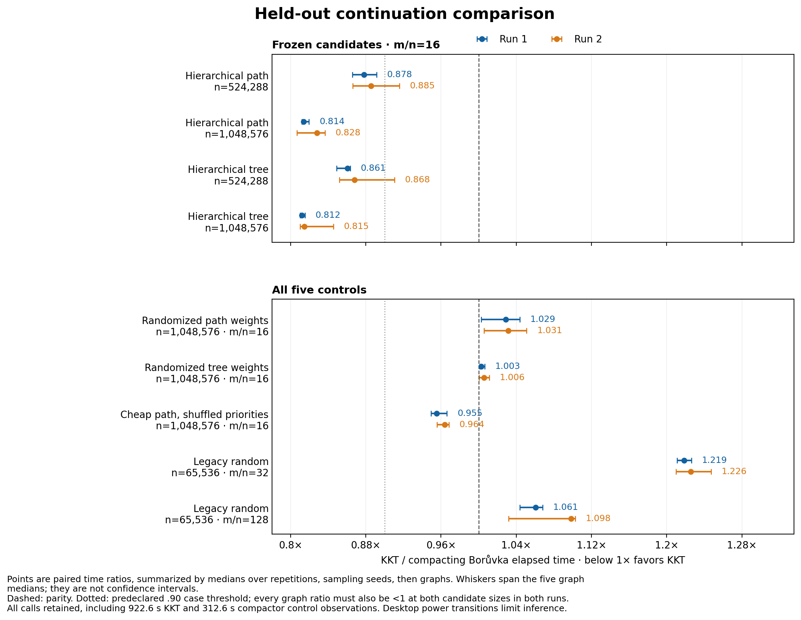
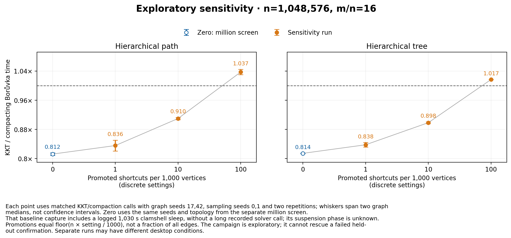
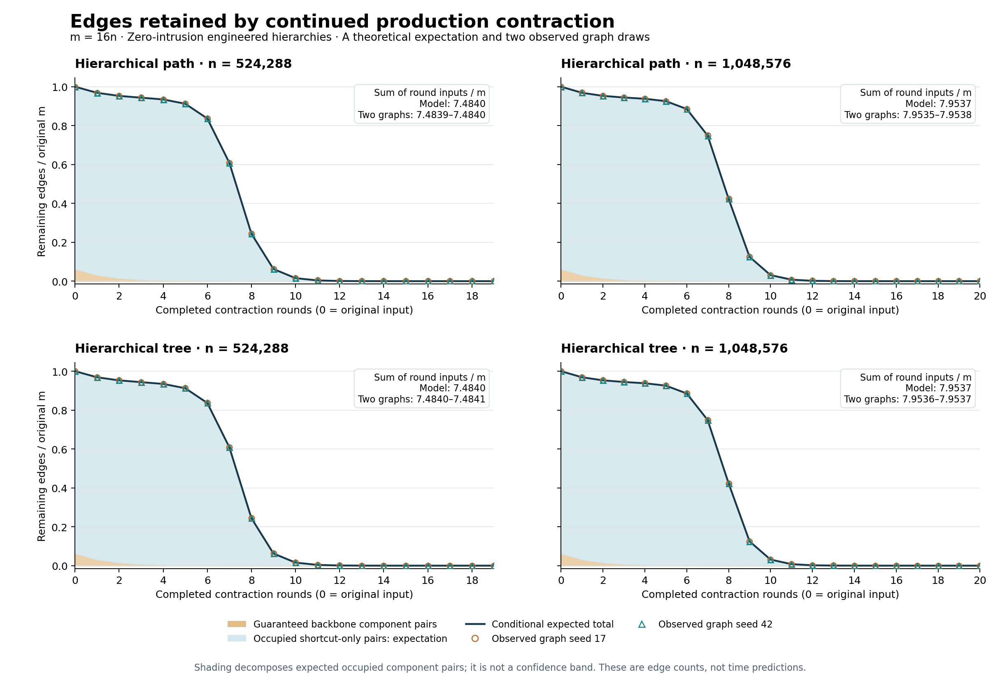

# KKT versus compacting Borůvka: results for hierarchical graphs

12 October 2026 · Apple M3 Max · continuation of the [common-family study](../common-2026-10-11/README.md)

## The answer

**Yes: this implementation has a repeated median-time advantage on a
constructed family of hierarchical graphs with many expensive shortcuts.**
Both path and tree backbones pass the predeclared numerical rule in two complete
campaigns using held-out graph seeds. At 1,048,576 vertices and 16,777,216 edges,
KKT uses **17–19% less median solver time**, approximately a 1.21–1.23× speedup.
At 524,288 vertices and 8,388,608 edges, the saving is 11–14%.

This is a moderate, consistent advantage on an engineered family. It is not a
demonstrated win on ordinary application networks, and this experiment does not
establish superiority over Kruskal or Prim. Neither production solver changed.
The comparator repeatedly calls the exact production contraction routine used
inside KKT, including its parallel-edge compaction.

Ratio below 1 favors KKT. These are matched, nested medians, not ratios of
independently averaged times:

| Backbone | Vertices | Edges | First run ratio | Reverse run ratio | Median time saved |
|---|---:|---:|---:|---:|---:|
| Hierarchical path |524,288|8,388,608|0.8779|0.8854|11.5–12.2%|
| Hierarchical tree |524,288|8,388,608|0.8606|0.8679|13.2–13.9%|
| Hierarchical path |1,048,576|16,777,216|0.8140|0.8281|17.2–18.6%|
| Hierarchical tree |1,048,576|16,777,216|0.8121|0.8146|18.5–18.8%|

All 40 candidate graph-level medians favor KKT: 20 graph instances, each measured
in both runs. KKT wins 479 of 480 individual candidate pairs; the one loss is
retained. The largest candidate graph median is 0.9157, so the 10% threshold is a
**case-median** requirement, not a promise that every graph saves 10%.

For scale, the million-vertex tree takes 4.438 versus 5.445 seconds in the first
run, and 4.601 versus 5.637 seconds in the repeat. The path takes 4.494 versus 5.526
and 5.079 versus 6.129 seconds. Absolute times vary with the desktop environment;
the comparison is paired within each graph and repetition.

**Timing limitation:** these are shared-desktop measurements. Both confirmation
runs contain logged maintenance sleeps and an extreme control observation
(922.6 seconds for KKT in the first run; 312.6 seconds for the compactor in the
repeat). Every observation remains included, with the median rule fixed before
timing. Neither extreme occurs in a selected hierarchy case, but that does not
establish that candidate calls were free of system effects. Separate candidate
time medians drift by roughly −13% to +28% between runs. The numerical criterion
passes; these are not sleep-controlled replications. The
[clock audit](CLOCK_AUDIT.md) gives exact events, clocks and checks.



The plot shows the five-graph range, not a confidence interval or the range of
individual calls. The [full comparison](final-comparison/report.md) preserves
case, graph, pair, order and between-run tables. The frozen selection was
committed before any fresh-seed measurement.

## Where the advantage does not generalize

Here `d = m/n`; the average degree is `2d`.

| Control | First run ratio | Reverse run ratio | Interpretation |
|---|---:|---:|---|
| Random weights, same tree topology;1M,d16 |1.0030|1.0059|Essentially tied; no KKT advantage|
| Random weights, same path topology;1M,d16 |1.0290|1.0315|KKT about3% slower|
| Cheap path, shuffled backbone priorities;1M,d16 |0.9554|0.9640|Only3.6–4.5% less median time|
| Legacy random;65,536,d32 |1.2185|1.2257|KKT21.9–22.6% slower|
| Legacy random;65,536,d128 |1.0607|1.0984|KKT6.1–9.8% slower|

Larger unchanged random controls also lost in discovery: at 262,144 vertices,
KKT/compactor was 1.1076 for 8.39 million edges and 1.0296 for 33.55 million edges.
Large size or high edge count alone did not produce a clear win.

All 43 discovery cases remain in the [screening comparison](screen-comparison/report.md),
including small hierarchy cases that lose. At density 16, the screened hierarchy
ratios improve from losses at the two smallest sizes to modest wins at 262,144
vertices and larger wins at 524,288 and 1,048,576. This is an observed finite-range
trend, not a guaranteed crossover size for another machine.

Distance-ordered variants also won in exploration: at 262,144 vertices and 64n
edges, ratios were 0.8612 for the path and 0.8675 for the tree. Their MST can use
shortcuts, so fixed backbone membership is not essential to every observed win.
They remain engineered, predominantly backbone-based instances and did not
receive fresh-seed confirmation. They cannot inherit the confirmed claim above.

## How fragile is the hierarchy advantage?

The sensitivity study promotes uniformly chosen shortcuts into the cheap edge
ordering, preserving topology and relative backbone priorities. At one million
vertices and density 16, a small number of promotions preserves the advantage;
the largest tested perturbation removes it in both families.

| Promotions per 1,000 vertices | Promoted edges | Fraction of all edges | Path ratio | Tree ratio |
|---:|---:|---:|---:|---:|
| 0, discovery baseline | 0 | 0% | 0.8122 | 0.8142 |
| 1 | 1,048 | ≈0.00625% | 0.8356 | 0.8377 |
| 10 | 10,485 | ≈0.0625% | 0.9097 | 0.8983 |
| 100 | 104,857 | ≈0.625% | 1.0372 | 1.0166 |

The percentage is deliberately explicit: the setting is per thousand **vertices**,
not edges. A promoted edge need not enter the MST. With the largest perturbation,
KKT loses 7/8 individual path pairs and 6/8 tree pairs; both graph-level medians
lose in both families. The two lighter perturbations win every individual pair.



These are two discovery graph seeds and two sampling seeds, not a new held-out
confirmation. The zero-promotion baseline comes from the earlier million-vertex
screen, so differences across settings also include run conditions. That screen
had a logged 1,030-second sleep outside any comparably long recorded solver
observation; its exact phase cannot be located. The sensitivity timing capture
has no such clock gap. Its later untimed trace capture does, as separately
documented in the clock audit; trace durations are not performance evidence.
All raw values remain available. This supports a limited conclusion:
the favorable regime survives light perturbation, but changing under 1% of edge
priorities can erase it in these fixtures.

The separate logical counters explain the direction. From zero to the largest
perturbation, the compactor's contraction-input volume falls from about 7.95m
to 4.53–4.54m, while KKT's falls only from about 3.42m to 3.21m. KKT's edge
materializations go from 0.78 times the compactor's to 1.28 times. Cheap
shortcuts let contraction eliminate the residual sooner, reducing the work that
filtering can save. These are means over the two graph seeds and KKT sampling
seeds, not a calibrated conversion from operations to seconds.

## What this comparison measures

The competitor repeatedly calls KKT's exact production `boruvka_step` until the
graph is empty. Both strategies start from the same tuple list, include input
conversion, temporary-input destruction and construction of the same reserved
edge-ID set. Neither receives the fixture's backbone or hierarchy metadata.
Production KKT, contraction and verification code are unchanged from the earlier
study at `8b90ec2`. The [source-boundary audit](boundary_audit.json) also checks that the
compactor wrapper and timing function stayed identical across exploration
revisions.

This compares whole continuation strategies. Recursion, random-number generation,
filtering, storage lifetimes and output accumulation all count. It does not
isolate verifier instructions, and it does not establish that either competitor
is the fastest possible MST implementation.

## The missing structural condition

The earlier common families often collapsed into a tiny, sparse residual. More
Borůvka rounds were cheap. Here the hypothesis is different: **vertices merge
slowly while many distinct edges remain**. Repeated contraction must then scan
large residuals several times, creating an opportunity for sampling and
filtering.

The new generators use a path or a randomly embedded dyadic tree as a connected
backbone, plus uniformly sampled distinct shortcut pairs. There are exactly
`m = d*n` edges, so average degree is `2d`; these are asymptotically sparse inputs
at fixed `d`, even when their contracted residuals become dense. All vertex labels
and edge order are independently shuffled. All weights are distinct positive
integer ranks.

| Weight model | Construction | What it tests |
|---|---|---|
| Hierarchical path/tree | Backbone edges are cheaper than shortcuts; their ranks follow dyadic merge levels | Exact pairwise contraction with many surviving shortcuts; deliberately planted MST |
| Distance-ordered path/tree | Every edge is ranked by `floor(log2(u xor v))` before relabeling, with random order within levels | The same contraction schedule, with shortcut edges eligible for the MST |
| Cheap shuffled path | The backbone stays cheap, but its internal weight order is shuffled | Whether planting a cheap backbone is enough without exact dyadic ordering |
| Globally random path/tree | Random ranks across every edge of the identical topology | Separates weight ordering from topology, IDs, labels and input order |
| Legacy random | Unchanged earlier random generator at several densities | Continuity with ordinary random-graph results |

The distance ranks are order-equivalent to tie-broken hierarchical metric costs;
the stored integer ranks themselves are not claimed to satisfy the triangle
inequality. These remain **engineered hierarchical models**, not measured
application networks. Even the distance model retains most backbone edges in its
MST at large sizes; the certified overlap is logged rather than hidden.

The [mechanism derivation](MECHANISM.md) gives the exact expected residual-edge
formula. At fixed density greater than one, the idealized hierarchy can force
expected Θ(m log n) total contraction-input volume. KKT's filtering targets that
volume: a half-sample's MSF leaves only O(n) expected light edges. That is a
structural explanation, not a wall-clock crossover guarantee. See the
[original sampling lemma](https://people.csail.mit.edu/karger/Papers/mst.pdf).

The distinction is edge reduction. If residual edges decrease geometrically,
the compactor's total volume is also O(m); KKT's expected O(n+m) bound gives no
automatic reason to beat it there. The hierarchy keeps a large edge population
alive for additional rounds. At fixed `d`, O(n+m) is linear in `n`; this does not
make O(n) the appropriate input-size bound for arbitrary density.

The actual contraction traces closely match the exact model. At 1,048,576
vertices, the compactor processes about **7.954 times the original edge count**
across its rounds; at 524,288, about 7.484 times. Across the eight separately
traced hierarchy graphs, the maximum total-volume deviation from the expectation
is 0.002760%. This is an edge-count prediction, not a fitted timing prediction.



## Evidence discipline

The [protocol](PROTOCOL.md) separates adaptive discovery from fresh-seed
confirmation. Initial discovery, its larger extensions and all losing controls
remain archived. Selection uses graph seeds 17 and 42, sampling seeds 0 and 1,
two balanced repetitions and one checked warmup. Additional size/density screens
are explicitly dated in the protocol before holdout.

Confirmation uses five fresh graph seeds (2027, 4099, 8191, 104729, 131071), three
fresh sampling seeds (11, 29, 97), four balanced repetitions and one checked
warmup. The second complete campaign reverses the first campaign's case order.
The predeclared descriptive threshold requires KKT/compaction ≤0.90 at the two
largest tested sizes of a selected family/density in **both** runs, with every
graph-level ratio below one. Failure cannot be rescued by pooling runs or by a
later sensitivity test.

Ratios are formed within matched calls, then summarized by medians over
repetitions, sampling seeds and graph seeds, in that order. Repetitions and
sampling seeds are not extra independent graphs. Graph ranges are descriptive,
not confidence intervals; the threshold is not a statistical significance test.
Independent time medians need not divide to the reported paired ratio.

A Kruskal reference receives an independent structure/connectivity/cycle-property
certificate. Every timed output, warmup and instrumented output must match its
exact unique MST IDs. Generation, reference construction, certification, result
checks and returned-set destruction are outside timing. Instrumented work and
contraction traces are captured separately. No instrumented duration is used as
performance evidence.

Only one timed process runs at a time; builds, tests and plotting occur between
timing campaigns. This is still an ordinary desktop experiment, without
controlled CPU affinity or power state. A [pre-confirmation snapshot](preconfirmation_host.json)
records active background services; the machine was not isolated. The [environment](environment.json),
build logs, exact runner commands, source/binary/manifest hashes and raw CSVs
bound every claim to this implementation and machine.

The four completed screens, two confirmation campaigns and sensitivity total
**2,944 timed outputs and 932 checked warmups**, all correct. Confirmation and
sensitivity captures use revision `e9ee714ecad61f86b33b3e581fe63d25ec23fda1`;
earlier screens record their own revisions in capture metadata. The build uses
Apple Clang 15, native arm64, `-O3 -march=native`, with assertions enabled, on an
Apple M3 Max with 128 GiB RAM.
The [clock audit](CLOCK_AUDIT.md) verifies all seven raw/log hashes against their
metadata. It also documents failed/unverified sleep-prevention attempts. The
native clock's recorded extremes are consistent with including host suspension;
the runner's Python monotonic duration excludes those large gaps. Neither field
should silently replace the other.

## Useful limits of the counters

At the selected million-vertex size, the separately instrumented discovery
graphs give the following means over two graph seeds and, for KKT, two sampling
seeds. They are logical counts, not timings or held-out counter measurements.

| Counter, millions | KKT path | Compactor path | KKT tree | Compactor tree |
|---|---:|---:|---:|---:|
| Contraction-call input edges | 57.366 | 133.439 | 57.355 | 133.440 |
| Edge materializations | 109.358 | 140.206 | 109.342 | 140.205 |
| Verifier input edges across recursion | 24.456 | — | 24.447 | — |

KKT cuts contraction-input volume by about 57%, but materializations by only
22%, and it pays for verification. About 759–761 thousand edges are retained
across its recursive filtering calls. Its mixed logical-work proxy is still
about 1.147 times the compactor's. Thus the 17–19% time saving is plausible without
equating the contraction-volume reduction to the total cost reduction.

For the screened hierarchical-path graph at n=262,144 and m=64n, averaging the
recorded graph/sampling seeds gives 53.56 million contraction-input edges for
KKT and 104.85 million for the compactor. But KKT also sends 22.23 million edges
through verifier inputs across its recursion, retaining about 190,045 light
edges. Edge materializations remain much closer: 100.37 versus 111.95 million.

The mixed logical-work proxy is actually **1.298 times larger for KKT** on that
case, despite its lower measured time. That proxy adds unlike visits,
initializations, table cells and API operations; it is not CPU instructions,
bytes transferred or a calibrated cost model. The same `contraction_edges`
counter is comparable between solvers; recursive-input volume is a different
quantity. No per-solver hardware measurements establish a cache bottleneck.
Whole-process instruction/cycle totals include setup and both solvers.

## Explore the mechanism

The [offline interactive explorer](visualization/index.html) contains seven
complete, certified n=64, m=256 fixtures. Compare weight variants, move through
actual production contraction stages and inspect component membership, selected
edges and residual edges. Layout positions are schematic; small pictures explain
the mechanism and are not timing evidence.

The exporter checks each stage against independent minimum-edge, disjoint-set
and parallel-edge oracles. Automated JavaScript checks cover 492 control
combinations and 984 rendered panel states. Browser appearance remains
unverified: headless Chrome failed and the browser tool denied local-file
navigation. [QA details](visualization/QA.md) retain those limitations.

## Setup repair and retained failures

The first extension attempt, `extension_timing.*`, was intentionally interrupted
after unusually slow fixture setup. It has no complete timing rows and is
excluded from performance analysis. Its failure metadata and the strict
analyzer's rejection remain archived.

A fixture-local mixed hash replaces an endpoint identity hash whose buckets
could cluster keys. It changes no RNG draws, membership decisions, graph order
or solver code. Exact comparisons cover 489 fixtures and a 4.19-million-edge
case. That large **generation-only** check improved from 12.283 to 0.605 seconds;
it is not a KKT speedup. [The archive](fixture-hash-repair/README.md) preserves the
old/new source, exact-output checks and one-call, old-then-new limitation.
Initial smoke captures predate runner hardening and are correctness/setup
checks, not performance evidence for the final conclusions.

Native correctness suites and the new 251-fixture suite passed; the latter
checks 753 KKT outputs. Analyzer tests include five accepted and 71 rejected
inputs; cross-campaign checks include six accepted and 40 rejected inputs.
Bazel failed during JVM/server startup before executing tests, including a
batch-mode retry. Both logs are retained; no new Bazel success is claimed.

## Reproduce the confirmation

The selection was committed as `7b4b3c5` before fresh-seed timing. The
[selection record](confirmation_selection.json) binds candidate groups, sizes,
seed banks, discovery files, manifests and the frozen native binary. Rebuilding
on another machine produces a different binary; it is a new replication, not
the archived campaign.

```sh
make -j4 bin/continuation_search bin/continuation_search_work bin/continuation_test
./bin/continuation_test
python3 benchmark/results/continuation-2026-10-12/run_capture.py \
  --binary bin/continuation_search \
  --manifest benchmark/results/continuation-2026-10-12/confirmation.csv \
  --output /tmp/kkt-confirmation.csv \
  --graph-seeds 2027,4099,8191,104729,131071 \
  --sampling-seeds 11,29,97 --repetitions 4 --warmups 1
```

Run the same command with `confirmation_reverse.csv` and a different fresh
output path for the second campaign. Run the campaigns serially, without
concurrent builds or analysis. The capture script refuses to overwrite evidence.
Its metadata contains the exact expanded command, source hashes, binary hash,
manifest hash and output hash. Graph generation and correctness checks are
included in whole-process wall time but excluded from solver durations.

For postprocessing, without new timing:

```sh
python3 benchmark/compare_continuation.py \
  --config benchmark/results/continuation-2026-10-12/comparison-final.json \
  --output-dir /tmp/kkt-continuation-comparison
python3 benchmark/plot_continuation_report.py \
  --comparison-dir /tmp/kkt-continuation-comparison \
  --output-dir /tmp/kkt-continuation-figures
python3 benchmark/plot_continuation_retention.py \
  benchmark/results/continuation-2026-10-12/million_trace.csv \
  --output-dir /tmp/kkt-retention-figure
```

The source manifests and raw evidence are indexed by
[`comparison-final.json`](comparison-final.json). The generated
[case tables](final-comparison/case_summary.csv),
[every matched pair](final-comparison/paired_pairs.csv),
[work counters](final-comparison/work_summary.csv) and
[round traces](final-comparison/round_edge_volumes.csv) retain wins and losses.
The plot scripts use Matplotlib; analysis validates source, fixture, schedule
and frozen-selection identities before computing results.
