# Continuation campaigns: all outcomes

Campaigns retain their own seed banks and timing medians. Screening selected candidates; it does not confirm them. Ratios divide matched call times before medians across repetitions, sampling seeds and graphs. Individual pairs, order strata, graph ranges and separate algorithm times remain in CSVs.

| Campaign | Role | Cases | Timed calls | Checked warmups | Case leads | Every graph leads |
|---|---|---:|---:|---:|---:|---:|
| discovery | screen | 24 | 384 | 192 | 3 | 3 |
| extension | screen | 12 | 192 | 96 | 12 | 11 |
| million | screen | 5 | 80 | 40 | 5 | 5 |
| large-random | screen | 2 | 32 | 16 | 0 | 0 |
| confirmation | confirmation | 9 | 1080 | 270 | 5 | 5 |
| confirmation-repeat | confirmation | 9 | 1080 | 270 | 5 | 5 |
| sensitivity | sensitivity | 6 | 96 | 48 | 4 | 4 |

The comparison measures the whole continuation strategy: repeated production contraction versus unchanged KKT, including iterative/recursive storage lifetimes, RNG, sampling and verification. Engineered hierarchy and hierarchical-distance cases are stress tests, not representative application graphs. Counters cannot identify an unmeasured cache or allocator bottleneck.

## Predeclared confirmation

A selected group passes only when its case ratio is ≤0.90 and every graph ratio is <1 at each of its two largest tested sizes, separately in both runs. Adjacent means adjacent entries in the frozen size menu. Runs use fresh seeds and reverse manifest order; they are not pooled. This descriptive criterion is not a significance test. When a frozen selection record is supplied, its candidates, sizes, screen/manifest hashes and binary must match, and runner start timestamps must follow its freeze timestamp. These recorded timestamps complement the pre-timing git commit; they are not an independent authentication of historical order.

| Family | m/n | Intrusion ‰ of n | Selected | Two largest sizes | Numeric rule | Confirmed selected group |
|---|---:|---:|---|---|---|---|
| hierarchical_path | 16 | 0 | True | 524288,1048576 | True | True |
| hierarchical_tree | 16 | 0 | True | 524288,1048576 | True | True |
| legacy_random | 32 | 0 | False | 65536 | False | False |
| legacy_random | 128 | 0 | False | 65536 | False | False |
| low_path | 16 | 0 | False | 1048576 | False | False |
| random_path | 16 | 0 | False | 1048576 | False | False |
| random_tree | 16 | 0 | False | 1048576 | False | False |

## Every case

| Campaign | Case | KKT / compaction [graph range] | KKT ms | Compaction ms | Individual KKT losses / pairs |
|---|---|---:|---:|---:|---:|
| discovery | hierarchical_tree_n65536_d4_p0 | 1.4204 [1.4062, 1.4347] | 29.585 | 20.827 | 8/8 |
| discovery | hierarchical_tree_n16384_d64_p0 | 1.1731 [1.1603, 1.1859] | 71.597 | 61.028 | 8/8 |
| discovery | legacy_random_n65536_d128_p0 | 1.0357 [1.0347, 1.0367] | 1257.352 | 1214.535 | 7/8 |
| discovery | legacy_random_n16384_d4_p0 | 1.3517 [1.3485, 1.3550] | 3.924 | 2.903 | 8/8 |
| discovery | hierarchical_path_n65536_d4_p0 | 1.4171 [1.4160, 1.4182] | 30.374 | 21.435 | 8/8 |
| discovery | hierarchical_path_n65536_d64_p0 | 0.9348 [0.9218, 0.9478] | 602.861 | 645.067 | 1/8 |
| discovery | hierarchical_tree_n16384_d16_p0 | 1.2464 [1.2411, 1.2517] | 19.486 | 15.635 | 8/8 |
| discovery | random_path_n65536_d16_p0 | 1.3030 [1.2540, 1.3521] | 73.767 | 56.696 | 8/8 |
| discovery | legacy_random_n16384_d128_p0 | 0.9853 [0.9733, 0.9973] | 112.559 | 114.912 | 5/8 |
| discovery | legacy_random_n16384_d32_p0 | 1.2339 [1.2119, 1.2558] | 22.700 | 18.416 | 8/8 |
| discovery | random_tree_n16384_d16_p0 | 1.3086 [1.3071, 1.3100] | 12.400 | 9.477 | 8/8 |
| discovery | hierarchical_tree_n16384_d4_p0 | 1.5154 [1.5143, 1.5164] | 6.719 | 4.435 | 8/8 |
| discovery | low_path_n65536_d16_p0 | 1.2597 [1.2015, 1.3180] | 87.674 | 69.877 | 8/8 |
| discovery | random_tree_n65536_d16_p0 | 1.3169 [1.3124, 1.3214] | 73.231 | 55.660 | 8/8 |
| discovery | low_path_n16384_d16_p0 | 1.3571 [1.3491, 1.3651] | 15.996 | 11.793 | 8/8 |
| discovery | random_path_n16384_d16_p0 | 1.3093 [1.2971, 1.3215] | 12.459 | 9.517 | 8/8 |
| discovery | hierarchical_path_n16384_d64_p0 | 1.1912 [1.1908, 1.1916] | 73.285 | 61.527 | 8/8 |
| discovery | hierarchical_tree_n65536_d16_p0 | 1.1374 [1.1349, 1.1399] | 103.911 | 91.372 | 8/8 |
| discovery | hierarchical_tree_n65536_d64_p0 | 0.9286 [0.9170, 0.9402] | 587.766 | 633.610 | 0/8 |
| discovery | legacy_random_n65536_d4_p0 | 1.3361 [1.3302, 1.3420] | 18.873 | 14.125 | 8/8 |
| discovery | legacy_random_n65536_d32_p0 | 1.1608 [1.1391, 1.1825] | 179.646 | 155.082 | 8/8 |
| discovery | hierarchical_path_n16384_d16_p0 | 1.2036 [1.1442, 1.2630] | 20.189 | 17.048 | 7/8 |
| discovery | hierarchical_path_n16384_d4_p0 | 1.5312 [1.5104, 1.5521] | 6.755 | 4.412 | 8/8 |
| discovery | hierarchical_path_n65536_d16_p0 | 1.0894 [1.0720, 1.1068] | 107.445 | 98.916 | 7/8 |
| extension | hierarchical_path_n262144_d64_p0 | 0.8640 [0.8565, 0.8715] | 3820.750 | 4422.803 | 0/8 |
| extension | distance_path_n65536_d64_p0 | 0.9831 [0.9649, 1.0013] | 492.381 | 501.616 | 2/8 |
| extension | hierarchical_tree_n131072_d64_p0 | 0.8939 [0.8908, 0.8970] | 1441.107 | 1615.300 | 0/8 |
| extension | distance_tree_n131072_d64_p0 | 0.9089 [0.9082, 0.9095] | 1488.085 | 1637.330 | 0/8 |
| extension | distance_path_n131072_d64_p0 | 0.9191 [0.9109, 0.9273] | 1490.105 | 1621.822 | 0/8 |
| extension | hierarchical_tree_n262144_d16_p0 | 0.9218 [0.9196, 0.9240] | 699.112 | 758.937 | 0/8 |
| extension | hierarchical_path_n131072_d64_p0 | 0.9339 [0.9229, 0.9450] | 1503.144 | 1609.985 | 0/8 |
| extension | hierarchical_path_n262144_d16_p0 | 0.9377 [0.9340, 0.9413] | 684.056 | 729.691 | 0/8 |
| extension | distance_path_n262144_d64_p0 | 0.8612 [0.8575, 0.8648] | 3767.224 | 4375.160 | 0/8 |
| extension | hierarchical_tree_n262144_d64_p0 | 0.8690 [0.8629, 0.8751] | 3780.324 | 4350.347 | 0/8 |
| extension | distance_tree_n262144_d64_p0 | 0.8675 [0.8647, 0.8703] | 3794.964 | 4374.733 | 0/8 |
| extension | distance_tree_n65536_d64_p0 | 0.9841 [0.9832, 0.9851] | 496.485 | 504.495 | 0/8 |
| million | hierarchical_tree_n1048576_d16_p0 | 0.8142 [0.8134, 0.8151] | 4482.961 | 5506.213 | 0/8 |
| million | hierarchical_path_n524288_d16_p0 | 0.8681 [0.8607, 0.8756] | 1823.740 | 2101.077 | 0/8 |
| million | hierarchical_tree_n524288_d16_p0 | 0.8584 [0.8556, 0.8612] | 1817.249 | 2116.921 | 0/8 |
| million | hierarchical_path_n1048576_d16_p0 | 0.8122 [0.8088, 0.8156] | 4519.195 | 5564.099 | 0/8 |
| million | low_path_n1048576_d16_p0 | 0.9311 [0.9267, 0.9354] | 4205.333 | 4517.604 | 0/8 |
| large-random | legacy_random_n262144_d32_p0 | 1.1076 [1.0892, 1.1261] | 1407.878 | 1272.570 | 8/8 |
| large-random | legacy_random_n262144_d128_p0 | 1.0296 [1.0288, 1.0304] | 6989.697 | 6788.761 | 8/8 |
| confirmation | hierarchical_path_n1048576_d16_p0 | 0.8140 [0.8121, 0.8197] | 4493.786 | 5525.557 | 0/60 |
| confirmation | hierarchical_tree_n524288_d16_p0 | 0.8606 [0.8492, 0.8635] | 1823.260 | 2112.685 | 0/60 |
| confirmation | random_tree_n1048576_d16_p0 | 1.0030 [1.0011, 1.0064] | 3777.915 | 3788.085 | 44/60 |
| confirmation | random_path_n1048576_d16_p0 | 1.0290 [1.0026, 1.0437] | 4595.330 | 4508.849 | 47/60 |
| confirmation | hierarchical_path_n524288_d16_p0 | 0.8779 [0.8660, 0.8915] | 2261.369 | 2613.953 | 0/60 |
| confirmation | low_path_n1048576_d16_p0 | 0.9554 [0.9494, 0.9664] | 4710.102 | 4934.123 | 5/60 |
| confirmation | legacy_random_n65536_d32_p0 | 1.2185 [1.2109, 1.2263] | 151.422 | 124.032 | 60/60 |
| confirmation | legacy_random_n65536_d128_p0 | 1.0607 [1.0440, 1.0679] | 956.040 | 916.161 | 60/60 |
| confirmation | hierarchical_tree_n1048576_d16_p0 | 0.8121 [0.8103, 0.8154] | 4438.204 | 5444.723 | 0/60 |
| confirmation-repeat | hierarchical_tree_n1048576_d16_p0 | 0.8146 [0.8101, 0.8456] | 4600.842 | 5636.987 | 0/60 |
| confirmation-repeat | legacy_random_n65536_d128_p0 | 1.0984 [1.0320, 1.1029] | 1082.159 | 991.562 | 47/60 |
| confirmation-repeat | legacy_random_n65536_d32_p0 | 1.2257 [1.2101, 1.2473] | 176.324 | 148.002 | 56/60 |
| confirmation-repeat | low_path_n1048576_d16_p0 | 0.9640 [0.9559, 0.9684] | 4556.344 | 4685.444 | 5/60 |
| confirmation-repeat | hierarchical_path_n524288_d16_p0 | 0.8854 [0.8660, 0.9157] | 2018.541 | 2273.039 | 1/60 |
| confirmation-repeat | random_path_n1048576_d16_p0 | 1.0315 [1.0056, 1.0511] | 4124.612 | 4015.785 | 52/60 |
| confirmation-repeat | random_tree_n1048576_d16_p0 | 1.0059 [1.0006, 1.0114] | 3783.183 | 3733.047 | 45/60 |
| confirmation-repeat | hierarchical_tree_n524288_d16_p0 | 0.8679 [0.8521, 0.9104] | 2330.428 | 2649.045 | 0/60 |
| confirmation-repeat | hierarchical_path_n1048576_d16_p0 | 0.8281 [0.8068, 0.8367] | 5079.413 | 6128.656 | 0/60 |
| sensitivity | hierarchical_path_n1048576_d16_p1 | 0.8356 [0.8206, 0.8505] | 5084.848 | 6088.395 | 0/8 |
| sensitivity | hierarchical_tree_n1048576_d16_p100 | 1.0166 [1.0165, 1.0167] | 4823.738 | 4744.522 | 6/8 |
| sensitivity | hierarchical_path_n1048576_d16_p100 | 1.0372 [1.0301, 1.0444] | 4859.357 | 4686.542 | 7/8 |
| sensitivity | hierarchical_tree_n1048576_d16_p1 | 0.8377 [0.8315, 0.8439] | 4886.611 | 5834.759 | 0/8 |
| sensitivity | hierarchical_tree_n1048576_d16_p10 | 0.8983 [0.8959, 0.9008] | 4868.670 | 5421.003 | 0/8 |
| sensitivity | hierarchical_path_n1048576_d16_p10 | 0.9097 [0.9067, 0.9127] | 4958.576 | 5450.704 | 0/8 |

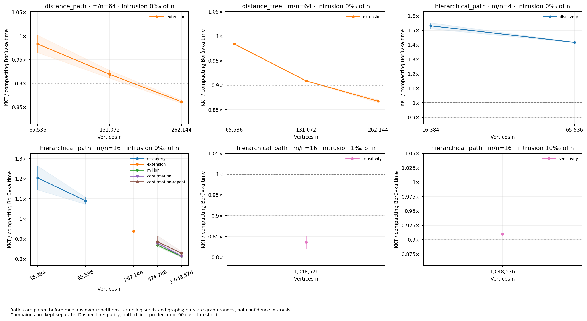

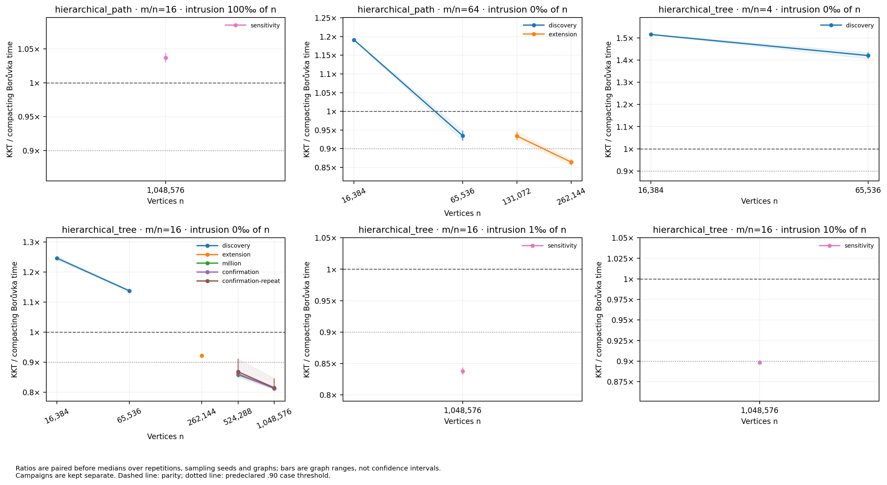

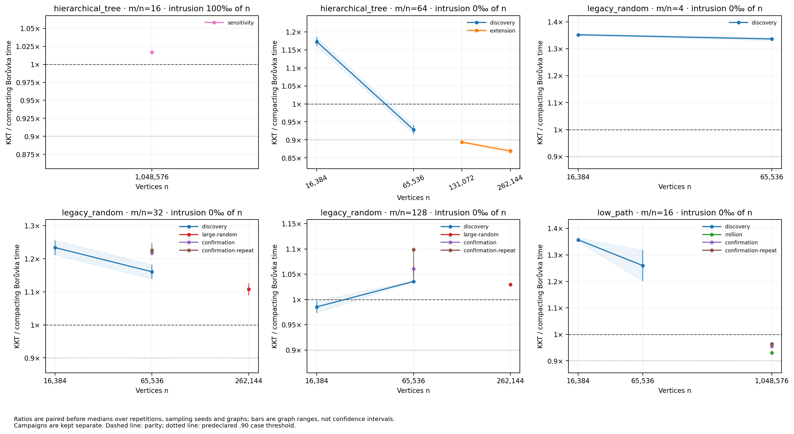

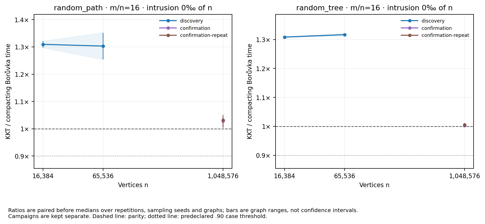

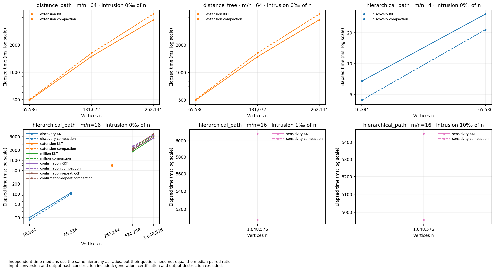

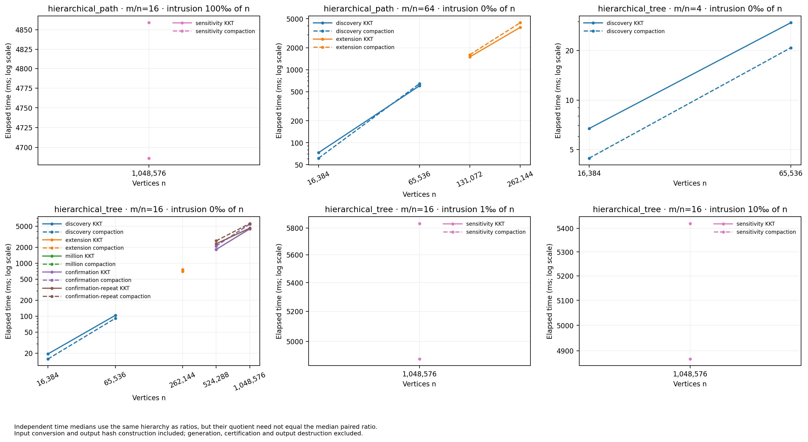

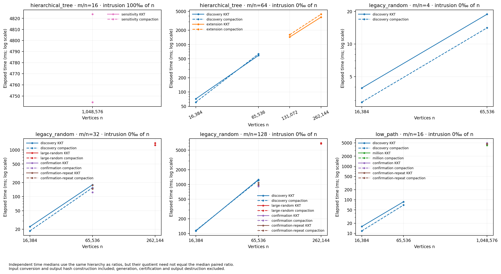

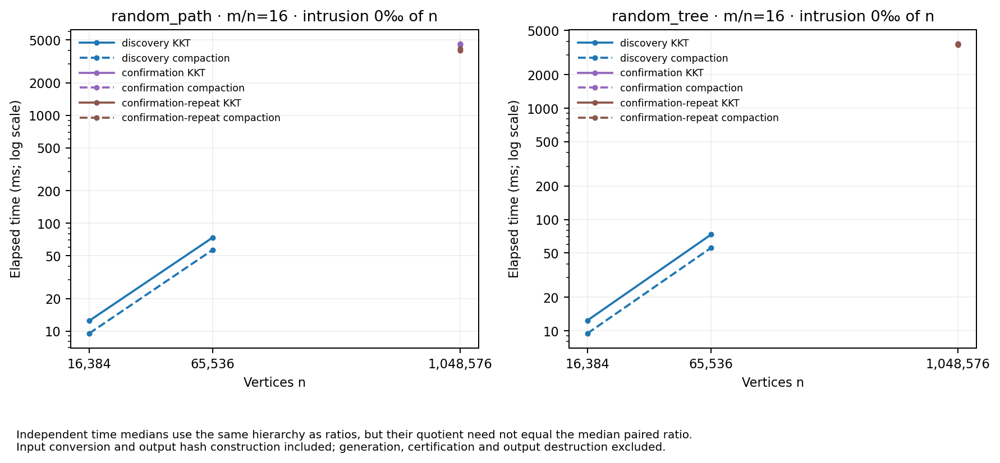

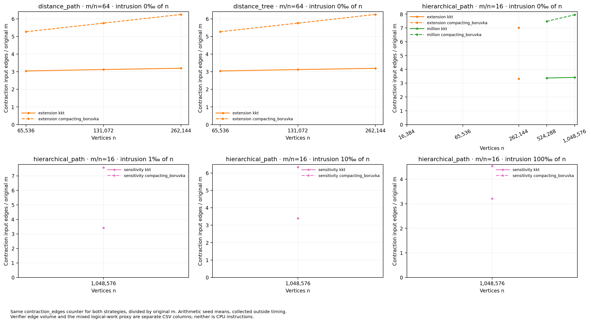

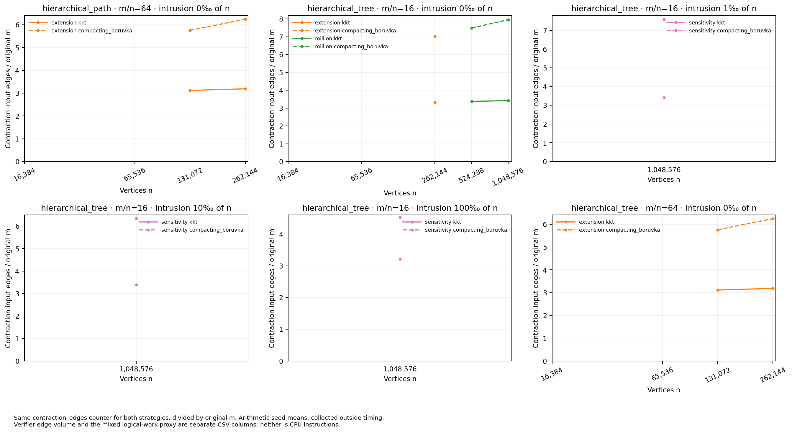

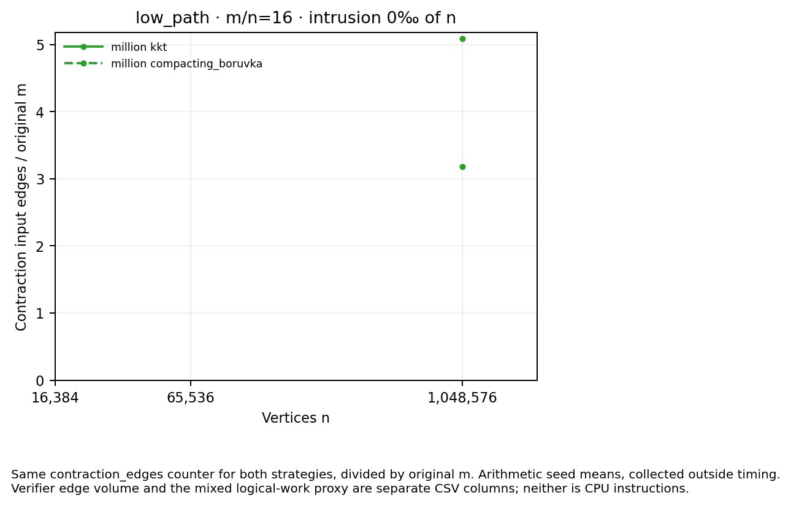

`comparison_inputs.json` records source/config/raw hashes and each runner metadata file. Across screening phases, automatic source checks cover the listed production-library files, not changed harness function bodies: the compaction wrapper and timing boundary live in `continuation_search.cpp`, whose setup/logging code may change. Their cross-screen equivalence requires the separately recorded source audit. The held-out pair requires identical full source inventories and binary hashes. FNV64 input fingerprints crosscheck labels and paired controls; they are not collision-proof equality certificates. Exact-MST pass fields are validated for every row. Build assertions and independent certificates belong to the recorded harness, and graph generation/validation are outside the timed region.
