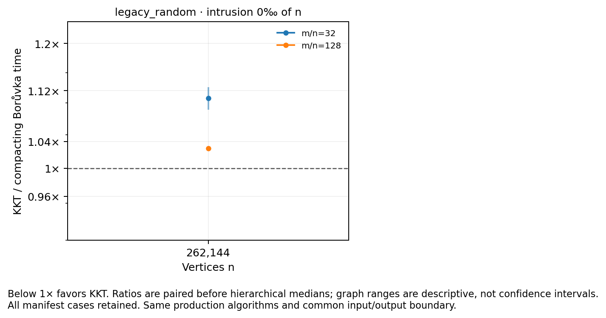

# Unchanged KKT versus continued production contraction

Validated 32 timed calls across 2 manifest cases; 16 additional checked warmup calls are not timing rows.

KKT has a lower paired case median in **0/2** cases; all graph medians favor KKT in **0/2**. These are this run's descriptive results, not automatic confirmation of a selected hypothesis.

Every ratio divides matched call times first, then takes medians across repetitions, sampling seeds and graph seeds. Independent timing medians need not divide to the paired ratio. Graph ranges are not confidence intervals. Order-stratified summaries and every individual loss/tie are retained.

| Case | KKT / compaction [graph range] | KKT ms | Compaction ms | KKT losses / pairs |
|---|---:|---:|---:|---:|
| legacy_random_n262144_d32_p0 | 1.1076 [1.0892, 1.1261] | 1407.878 | 1272.570 | 8/8 |
| legacy_random_n262144_d128_p0 | 1.0296 [1.0288, 1.0304] | 6989.697 | 6788.761 | 8/8 |

The comparison uses identical production contraction code and reserved ID-set output. It measures whole continuation strategies, including recursive/iterative storage lifetimes, RNG, sampling and verification. Engineered hierarchy, cheap-backbone and hierarchical-distance cases are stress tests, not representative application graphs. Globally randomized weight controls share topology/IDs/order only; their full weighted fingerprints are not required to match.

Timing and instrumented work are separate runs. Work means average sampling seeds within graphs, then graph seeds. The logical proxy sums mixed loop/table/storage/hash-API events, omitting allocator internals, collisions, deallocation and cache behavior; it is not CPU instructions.

Input hashes, exact manifest and ordered seed banks are recorded in analysis_inputs.json. Build/machine provenance comes from the accompanying runner metadata, not from timing CSV alone.
