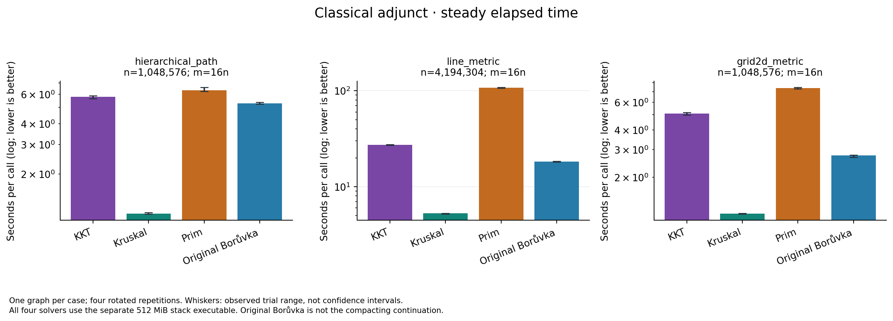
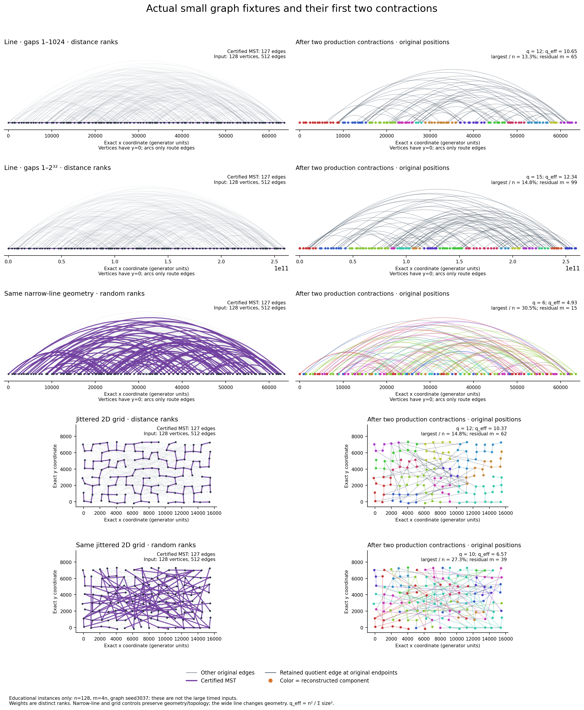
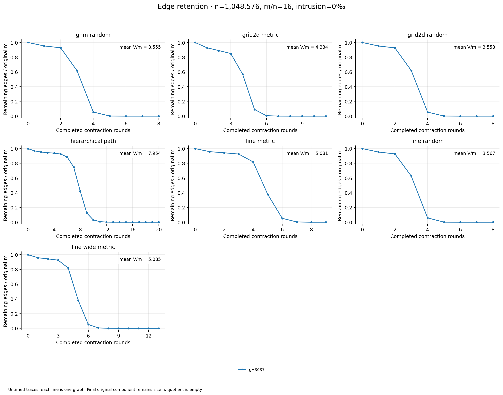

# KKT at 134 million edges: real advantages and their limits

Captured 13 October 2026 UTC (12–13 October locally). Production solver sources are unchanged. This follow-up complements the [implementation and Google Benchmark report](../../../docs/kkt-report/REPORT.md) and the [previous confirmed hierarchy study](../continuation-2026-10-12/README.md).

The new screens find modest KKT leads on several larger inputs, but **no new family establishes a clear, repeatable large-size crossover**. The hierarchical-path control still leads at 4,194,304 vertices and 67,108,864 edges: paired ratio **0.8643**, or **13.6% less time**. This extends the observed favorable range on one graph; the prior independent-graph confirmation remains at the smaller sizes. The geometric line is the strongest new lead at one size: paired KKT/compactor runtime is **0.8880 at 2,097,152 vertices**, then **0.9969 at 8,388,608**. The largest line is a near-tie with one winning and one losing repetition. Connected random graphs are also near parity at the largest size, rather than showing a decisive advantage. These outcomes are retained alongside the smaller-size losses.

The main comparison is against repeated production `boruvka_step`, including compaction and deduplication, with the same reserved edge-ID-set output as KKT. The completed classical adjunct supplies a crucial qualification: **Kruskal wins all three selected cases, and the original Borůvka also beats KKT in every trial.** KKT beats Prim. A practical advantage over this particular compactor is real evidence about that comparison; it does not establish that KKT is the fastest available MST solver.

## What was measured

| Completed campaign | Cases | Timed solver calls | Checked warmups | Flagged calls |
|---|---:|---:|---:|---:|
| Discovery | 19 | 76 | 38 | 0 |
| Extension | 3 | 12 | 6 | 0 |
| Precision ablation | 5 | 20 | 10 | 0 |
| Retained total | 27 | 108 | 54 | 0 |

Each case uses one graph seed, **3037**, and one KKT sampling seed, **101**; each solver receives two timed repetitions with balanced first/second positions and one checked warmup. There are 54 paired timed comparisons, not 54 independent graph draws. Every timed and warmup result matches the unique independently certified MST. The [strict comparison](all-screens-comparison/report.md) retains all cases, repetitions, execution-order strata and clock records. No observations were removed or adjusted.

The initial 19 cases include five new families at three sizes with `m=16n`, two old anchors, and two `m=4n` grid controls. The three-case extension adds the two-million-vertex line and eight-million-vertex line/random inputs. Largest `m` is **134,217,728 edges**. The native Make profile is Apple clang C++17 `-O3 -march=native`, with assertions enabled. Discovery was captured at `0ec6f80`, extension at `1424566`; the [extension audit](extension_boundary_audit.json) records unchanged production libraries and measurement/main bodies, with input-range guards and associated domain tests changed. Precision was captured at `39a2684`, with the separately added wide-gap fixture and the [unchanged-boundary audit](precision_boundary_audit.json). These remain separate campaigns and binaries, not a pooled uninterrupted run. Exact commands, source inventories, binary hashes and capture hashes are in [discovery metadata](discovery_timing.json) and [extension metadata](extension_timing.json), and [precision metadata](precision_timing.json).

The steady-clock interval includes tuple conversion, temporary-input destruction and output construction. Graph generation, reference MST construction, independent certification, output checking and returned-result destruction are outside it. Process CPU is a separately recorded diagnostic envelope, not a replacement for elapsed time. See the [protocol](PROTOCOL.md) for the full boundary and confirmation rules.

## Full size trends and retained controls

The following values are **paired KKT / compacting-Borůvka elapsed-time ratios**; lower is better. Values below one indicate a case median lead in this screen. Each ratio is calculated within a repetition before aggregation. A dash means that case was not measured in these campaigns. Precision (P) supplies every wide-line point. For the other rows, the two- and eight-million points come from extension; the other sizes come from discovery.

| Family, `m=16n` | 262,144 | 1,048,576 | 2,097,152 | 4,194,304 | 8,388,608 |
|---|---:|---:|---:|---:|---:|
| Line, distance ranks | 1.0541 | 0.9317 | 0.8880 | 0.9078 | 0.9969 |
| Line, wide-gap distance ranks (P) | 0.9824 | 0.8955 | — | 0.9339 | 0.9642 |
| Same line topology, random ranks | 1.1473 | 1.0069 | — | 0.9746 | — |
| Open 2D grid + shortcuts, distance ranks | 1.1122 | 0.9552 | — | 0.9457 | — |
| Same grid topology, random ranks | 1.0846 | 0.9969 | — | 0.9817 | — |
| Connected G(n,m), random ranks | 1.1518 | 1.0132 | — | 0.9946 | 0.9869 |

| Additional control | Paired elapsed-time ratio |
|---|---:|
| Grid distance ranks, n=262,144, m=4n | 1.3193 |
| Grid random ranks, n=262,144, m=4n | 1.2764 |
| Prior hierarchical-path anchor, n=1,048,576, m=16n | 0.8122 |
| Prior random-weight tree + shortcuts anchor, n=1,048,576, m=16n | 1.0107 |
| Larger hierarchical-path anchor (P), n=4,194,304, m=16n | 0.8643 |

All values come from [wall case summaries](all-screens-comparison/wall_case_summary.csv); [individual pairs](all-screens-comparison/wall_paired_pairs.csv) retain the losses. The figures retain campaign identity and individual paired ranges; they contain no extrapolated fit.

The [full figure bundle](all-screens-figures/README.md) includes CPU diagnostics, all controls and complete case appendices in PNG, SVG and PDF.

The line's observed parity crossing is bracketed by 262,144 and 1,048,576 vertices in discovery. Its subsequent lead is not monotonic across the separately recorded screens. At two million vertices, median solver times are **9.568 s for KKT and 10.775 s for compaction**. At eight million, the two individual paired ratios are **0.938340 and 1.055450**; their median is 0.996895. The separately aggregated times are **57.111 s and 57.102 s**, respectively. This small apparent reversal between the paired statistic and the ratio of separate time medians is expected from the different aggregation rules; neither statistic supports a clear lead there.

The corresponding eight-million line CPU ratio is **0.998141**, with the same one-winning/one-losing pattern. The standard random eight-million case has elapsed ratio **0.986873** and CPU ratio **0.986870**, with elapsed medians **45.089 s versus 45.690 s**. That roughly 1.3% screen lead is not a confirmed practical separation. At four million vertices, both the random grid and connected-random cases have medians below one, but the latter retains one individual loss; the one-million random grid also retains one loss. The full tables preserve these near-ties.

All three power audits ([discovery](discovery_power_audit.json), [extension](extension_power_audit.json), [precision](precision_power_audit.json)) found no overlapping recorded Sleep/Wake/DarkWake events, and the clock checks raised no flags. This is not proof of fixed power, thermal, frequency or scheduling conditions. The late eight-million line calls slowed in CPU as well as wall time; these clocks cannot identify the cause. No per-solver hardware-counter evidence currently attributes the change to cache behavior, memory bandwidth or the gap distribution.

## The classical comparison changes the practical conclusion

The independently [predeclared adjunct](CLASSICAL_PLAN.md) uses the same exact
screened inputs, graph seed 3037 and KKT seed 101. Four rotated repetitions place
each of KKT, Kruskal, Prim and original Borůvka once in every execution position.
Each receives a checked warmup. These are public tuple-input APIs: KKT returns
an ID set; the classical solvers return tuples. Those representations and their
original timing boundaries are preserved.

| Input, m=16n | KKT median (s) | Kruskal (s) | Prim (s) | Original Borůvka (s) |
|---|---:|---:|---:|---:|
| Hierarchical path, n=1,048,576 | 5.780 | **1.157** | 6.334 | 5.277 |
| Geometric line, n=4,194,304 | 27.240 | **5.258** | 107.988 | 18.289 |
| Geometric grid + shortcuts, n=1,048,576 | 5.071 | **1.170** | 7.372 | 2.743 |

KKT takes **4.33–5.21 times Kruskal's time** and **1.10–1.85 times original
Borůvka's time** by paired median, depending on the case. Every one of its four
trials loses to those two baselines and beats Prim. Process-CPU results have the
same ordering. These are three selected graph instances, not a population
ranking. No compactor times are imported into this separate campaign.

There is no contradiction between these losses and the compactor wins.
[Original Borůvka](../../../boruvka/boruvka.cpp) repeatedly scans the original
edge array and relabels its selected forest. It avoids constructing and
deduplicating a new quotient edge array each round. Its individual scan is
different from a contraction call, so counting fewer contraction input edges
does not establish fewer seconds than this baseline. [Kruskal](../../../kruskal/kruskal.cpp)
uses a contiguous copy, comparison sort and union–find scan; it does not stop
after finding the tree. The timings establish their advantage here, but no
per-phase hardware profile isolates its precise physical cause.

An actual failure is retained. Original Borůvka recursively labels its selected
forest; a path requires linear call-stack depth. The first adjunct attempt
crashed during the million-vertex hierarchy warmup block. LLDB located a stack
write in that recursive traversal after KKT, Kruskal and Prim had passed their
warmups. The native CSV block had not yet flushed, so the failed capture has
no usable timing rows. The debugger run is diagnostic only.

We preserved the failure and validated a **separate 512 MiB main-thread stack
profile**, then reran the entire adjunct. All algorithms use this same profile.
The new binary's entire executable code section is byte-identical to the
original; source, object files, graph cases and measurement bodies are unchanged.
A forced-depth 4,194,304-vertex path passed exact tuple and 64-bit weight checks
before timing. A proposed 1 GiB reservation was rejected by Apple's linker and
is also retained. This fixes the measurement resource limit without changing
an algorithm or counting a crash as a speedup. It does not repair the original
baseline's recursive-stack robustness problem.

The full [classical report](classical-analysis/report.md) retains all 48 timed
calls, 12 warmups, paired ratios, CPU results and individual ranges. The
[stack extension](CLASSICAL_STACK_EXTENSION.md) and
[validation archive](large-stack-validation-512m/README.md) record the failure,
resource change, assembly identity and worst-depth check. The complete rerun
has zero clock flags and no overlapping recorded power events in its
[power audit](classical_large_stack_power_audit.json).

## What the screens do and do not explain

Weight/topology correlation matters here. In the distance-weighted line, every long shortcut is heavier than every adjacent gap on the path between its endpoints, so the adjacent path is the unique MST. The grid allows a variable local MST, but its uniformly sampled long shortcuts are predominantly too long to enter that tree. These are meaningful controlled models of a local network with nonlocal edges; they are not road datasets or ordinary nearest-neighbor random geometric graphs. The random-weight twins hold topology, labels, IDs and input order fixed while removing geometric weight ordering. Connected G(n,m) supplies a separate scaffold-free random control. Their definitions and limitations are derived in [MECHANISM.md](MECHANISM.md).

These are complete certified **128-vertex, m=4n illustrations**, not downsampled
large benchmark inputs. The same fixture code exports their actual coordinates,
MST edges and two production contraction rounds. The line is truly one
dimensional; curved edge routing only separates overlapping lines visually.
The random-weight twins keep the topology and geometry. [The export archive](graph-views-final/README.md)
retains all tuples and selected IDs; the earlier report also has an
[offline 3D explorer](../../../docs/kkt-report/graph-explorer.html) for its own
small fixtures. Neither small visualization substitutes for the large traces.

A useful cost diagnostic is the total edge volume entering contraction rounds,
`V=Σ m_r`. KKT pays for sampling and verification in exchange for discarding
edges before further full contraction scans. That trade can help when many
edges survive successive contractions. It can lose when compaction alone
rapidly removes them or verification consumes the saving. The diagnostics
count the same contraction primitive in both implementations, including KKT's
recursive calls. They are logical work measures, not instructions or bytes.

| Family | n | Compactor rounds | Contraction volume/m: KKT | Compactor | Materializations/m: KKT | Compactor |
|---|---:|---:|---:|---:|---:|---:|
| Line, distance | 1,048,576 | 9 | 3.182 | 5.081 | 5.983 | 5.408 |
| Line, wide distance | 1,048,576 | 13 | 3.189 | 5.085 | 5.994 | 5.413 |
| Line, random | 1,048,576 | 8 | 2.840 | 3.567 | 4.940 | 3.793 |
| Grid, distance | 1,048,576 | 11 | 3.066 | 4.334 | 5.687 | 4.628 |
| Grid, random | 1,048,576 | 8 | 2.837 | 3.553 | 4.941 | 3.777 |
| Connected random | 1,048,576 | 8 | 2.838 | 3.555 | 4.944 | 3.779 |
| Hierarchical path | 1,048,576 | 20 | 3.422 | 7.954 | 6.523 | 8.357 |
| Line, distance | 8,388,608 | 10 | 3.336 | 5.926 | 6.293 | 6.231 |
| Line, wide distance | 8,388,608 | 15 | 3.337 | 5.959 | 6.295 | 6.289 |
| Hierarchical path | 4,194,304 | 22 | 3.493 | 8.892 | 6.693 | 9.295 |

The hierarchy gives KKT the largest contraction-volume saving and also saves
edge materializations. On the million-vertex geometric line, KKT processes
fewer contraction edges but materializes **more** edges; on random inputs,
the contraction saving is smaller still. KKT additionally verifies about
0.99–1.51 times m in recursive edge incidences and initializes more slots than
the compactor in every selected case. These separate costs must not be added
as if each unit had the same price.

Filtering removes **96.9–99.3% of verifier input incidences** in these cases.
The highest removal fraction belongs to ordinary random inputs, which do not
have the strongest timing advantage. What matters is how much *future work*
those edges would otherwise generate. An original edge can occur in several
recursive verifier calls, so this fraction is neither a unique-root-edge count
nor an isolated measurement of the sampling step.

From 1M to 4M vertices, the hierarchy’s compactor volume rises from 7.954m to
8.892m, while KKT’s rises from 3.422m to 3.493m. Its materialization savings
also widen. The wall-time lead nevertheless narrows. These logical counters
explain the opportunity for savings without accounting for all elapsed cost.

All ten predeclared cases passed the [strict work/trace reconciliation](diagnostics-analysis/report.md):
20 work records, 124 contraction stages and 124 independently reconstructed
component-moment records. The first two residual sizes agree with KKT’s root
counters, every compactor edge-volume sum agrees with its work counter, and
graph fingerprints match their designated screen. The [full work figures](work-figures/README.md)
also show materializations and verifier incidences. Diagnostics cover the
seven 1M cases plus the two 8M lines and 4M hierarchy; they do not diagnose
every intermediate size or the 8M connected-random case.

The component traces reveal a concrete difference before any giant component
appears. At one million vertices, after four compactor rounds:

| Family | Components q | Effective/actual component count | Largest component / n | Edges remaining / m |
|---|---:|---:|---:|---:|
| Hierarchical path | 65,536 | 1.000 | 0.00153% | 93.8% |
| Geometric line | 12,412 | 0.841 | 0.04% | 81.9% |
| Geometric grid + shortcuts | 7,001 | 0.732 | 0.08% | 56.9% |
| Connected G(n,m), random ranks | 1,420 | 0.488 | 0.80% | 5.55% |

Here `q_eff=n²/Σ(size_i²)` and the balance column is `q_eff/q`: it is one
for equal components and falls as sizes become uneven. A simple quotient
on 1,420 components can contain at most 1,007,490 edges—about 6.0% of
this original input. The measured random graph is already close to that
capacity. Its largest component is still below 1% of n. A giant-component
explanation is unnecessary: the much smaller quotient already forces
extensive parallel-edge removal. The spatial partitions contract more slowly,
and the dyadic hierarchy slowest and perfectly evenly, leaving useful work
for KKT's filtering to avoid.

Stage zero is the original graph; stage r follows r contractions. Each panel
shows its own complete round range, so compare the numbered axes rather than
horizontal widths. At termination the original-vertex ledger has one component,
while the production quotient is empty. The [complete trace figures](moments-analysis/report.md)
include effective component counts, size balance, the 4M hierarchy and both
8M lines.

This establishes measured partition and edge-retention differences, not an
independent causal decomposition of each second. The partition-independence
assumption in the hierarchy's occupancy proof does not automatically extend
to globally random-weight or grid partitions. Their traces are direct
observations, not an application of that theorem.

The original line uses gaps drawn from the fixed integer alphabet `1…1024`, with equal path gaps ordered by increasing original path-edge ID. The source-level argument shows that each round removes every boundary with the smallest remaining raw gap, so at most 1,024 contraction rounds are possible, in addition to the ordinary halving bound. A fixed alphabet therefore also gives an asymptotically linear contraction-work upper bound, with a potentially large fixed constant. The 1,024 bound is much larger than the 23-round halving bound at eight million vertices, so this fact alone does **not** explain the observed near-tie or prove that ties caused it.

The [predeclared precision ablation](PRECISION_ABLATION.md) tests a new `line_wide_metric` model with integer gaps `1…2³²`, preserving topology, IDs, labels and input order while changing coordinates and distance ranks. Its four completed wide-line ratios are 0.9824, 0.8955, 0.9339 and 0.9642 in increasing size order. The larger hierarchy anchor is 0.8643. There is no monotonic widening advantage, and the wide-line screen starts below one, so its observed range does not locate a crossover onset. The old line results remain untouched. The wide alphabet is still finite and still forces a path MST; it cannot turn these finite measurements into an asymptotic dominance proof.

The completed [gap investigation](GAP_FINDINGS.md) finds the predicted late
equal-gap collapse, but rejects it as a bulk edge-volume explanation. The
narrow/wide lines take **9/13 rounds at 1M**, and **10/15 at 8M**. Nevertheless,
the wide graph's total compactor volume is only **0.093%/0.552% larger**,
respectively. At 8M, all wide-line rounds after stage 8 together process just
738,693 edges: 0.550% of one original input, and 0.0924% of its total V.
The extra rounds operate on tiny quotients. Most of the small volume difference
arises earlier; the final large component arrives too late to explain the bulk
of scanning.

This conclusion is checked against the real implementation, not only a model.
An independently tested path-boundary simulator matches every component count,
second moment, largest size and selected-edge count in all four full production
line traces. But the two gap mappings also reorder unequal gaps, so they do not
isolate tie-breaking. Different early ordering, recursive sampling and uncounted
costs remain possible timing contributors; no hardware-level cause is established.

After all three screens, [zero new families were selected](SELECTION_DECISION.md) for confirmation; no holdout seed was consumed. No new family passes the screening pattern needed to justify the frozen confirmation rule: paired medians at most **0.90 at two adjacent largest selected sizes**, every graph median below one, separately for wall and CPU in **both** complete fresh-seed campaigns. A single promising 0.8880 screen point is insufficient. The rule is descriptive, not a significance test, and it remains unchanged after the disappointing larger line result.

### Why the hierarchy has a real asymptotic work separation

In the zero-intrusion hierarchy, all backbone edges are cheaper than the random
background. After r contractions, q=n/2^r components each contain exactly 2^r
original vertices. The partition is independent of the shortcut draw. At fixed
density, the background contains B=Θ(n) edges. Its expected internal-edge loss
is O(B/q), and the expected number of duplicate pairs is O(B²/q²).

For any fixed 0<ε<1/2, the first (1/2−ε)log₂n rounds have q≥n^(1/2+ε), so both
losses are o(B). Almost the entire background survives each of a logarithmic
number of rounds: **E[V]=Θ(m log n)**. A hierarchy containing only its tree
backbone would instead have linear total volume. The heavy global background
and balanced merging work together; the visual shape of the MST alone is
insufficient.

The [full derivation](HIERARCHY_BOUND.md) proves that lower bound under ideal
uniform shortcut sampling and explicitly separates the finite PRNG, input-size
guards and word-RAM assumptions. Combined with the expected-linear KKT argument,
it supplies a family-specific operation-count separation. It does not determine
the constants or predict monotonic finite wall-clock gains. The measured lead
actually narrows from 18.8% at 1M to 13.6% at 4M in these separate one-graph screens.

## Revisiting the “galactic” interpretation

The [historical analysis](GALACTIC.md) separates a conditional extrapolation from a theorem. The linked Wikipedia revision cites the author's fitted models `2357N` and `4.67N log₂N`, where `N=n+m`; extending those formulas and equating them gives `log₂N≈504.7`, hence the astronomical threshold. That arithmetic does not establish a universal KKT constant or a lower bound on when this repaired implementation can win. The old density sweep held n fixed, and subsequent source repairs changed important local costs. The prior independently certified, held-out hierarchy results already show much smaller practical leads over this specific compactor; the present screens ask whether they extend beyond that engineered class.

The repairs were substantive. Old recursive bookkeeping used the **original
edge-ID range** even for tiny subproblems, violating the local-size accounting
that KKT needs. The old verifier's subset-based median-table construction had
an Ω(L log L) slice for L leaves. Both were replaced with work bounded by the
current subproblem. A separate repair stopped resetting the same random stream
at every recursive sample. Later changes reduced hash lookups, linked storage,
graph copies and output-table growth. The [implementation archaeology](../../../docs/kkt-report/REPORT.md#2-the-old-implementation-broke-local-accounting)
links the exact commits and distinguishes these asymptotic defects from constant
reductions. None of those production sources changed during this new study.

The [KKT theorem](https://people.csail.mit.edu/karger/Papers/mst.pdf) bounds expected work under its computational assumptions. An `O(m+n)` upper bound and another algorithm's `O(m log n)` upper bound do not, by themselves, force a crossover: the latter implementation may also do linear work on the chosen family, constants differ, and wall time is not a unit-cost-operation count. A genuine eventual separation requires stronger family-specific growth information and a shared cost model. These new screens support bounded implementation/workload claims, not universal practicality, independent published consensus, or an edit to Wikipedia.

### What the complexity estimator can establish

GoogleTest supplies correctness and structural work checks; **Google Benchmark**
supplies the fitted-complexity feature. The [previous complete report](../../../docs/kkt-report/REPORT.md#9-googletest-is-not-a-complexity-estimator)
retains those actual fits. They do not give a uniform empirical O(N) answer:
stars were close to linear, while several random, geometric and community
families had rising time per input. The pinned Google Benchmark 1.5.2 chooses
its automatic model using CPU time, even when the reported real-time fit uses
manual timings. A finite-window label is not an asymptotic proof.

This follow-up does **not** produce another Google Benchmark fit. It measures
larger paired comparisons and the mechanisms behind them. The cost-per-edge
curves above rise overall for both algorithms; no measured plateau establishes
uniform linear elapsed time here. Conversely, that rise does not refute an
expected unit-cost work bound: the work mix and physical cost of operations
can change with size. The hierarchy's explicit family-specific work lower bound
is stronger evidence for an eventual abstract separation than extrapolating a
pair of fitted wall-clock curves, but still does not locate a universal practical
crossover.

## One bounded future optimization

The current verifier does not exploit a forest-component maximum before issuing path queries. If distinct endpoints lie in the same forest component C and an edge's weight is strictly larger than the maximum forest-edge weight in C, it is certainly F-heavy. This could skip LCA/path queries and, in the disconnected-forest branch, avoid copying already classified edges into component subgraphs. It is only a sufficient test: all remaining cases require the normal verifier; disconnected endpoints and self-loops must retain their current behavior, and negative weights require a valid nonempty maximum rather than a zero sentinel. One high-weight forest connector may make the bound loose.

This is a future experiment, not a change used in these results. First count certain-heavy hits, unresolved edges, fully bypassed verifier components, added forest scans and storage, and saved LCA/path queries and edge materializations; independently compare complete mark vectors with the existing path oracle. Then measure any candidate against the unchanged solver with all losses retained. The previously [rejected minimum-cache experiment](../practical-2026-10-10/README.md#rejected-experiment-cached-contraction-minima) cached per-vertex contraction minima and tested a different mechanism; its rejection remains part of the record.

## Correctness and reproducibility

The reference MST is independently checked for source-edge membership,
acyclicity, connectivity and cycle optimality. Unique ranks make its exact
edge-ID set unambiguous. Every retained successful solver call must match that
set; large sums do not rely on the legacy 32-bit cost helper. The classical
outputs are also checked against the input tuples. These gates accompany
measurements, rather than checking only an example before a timing loop.

The timing campaigns contain **222 successful checked outputs**: 162 across
the three compactor screens, and 60 in the complete classical rerun. The untimed work and trace
captures add 20 and 10 checked solver outputs, respectively: **252 successful
outputs overall**, plus the 124-stage component-ledger validation. The failed
initial classical capture remains a failure
and contributes no usable timing rows. The separate stack-depth test, small
illustrations and path simulator are additional correctness evidence, not
benchmark repetitions.

The final fixture checks passed [111 generated cases and 315 certified KKT calls](fixture_precision_tests.log).
The [continuation checks](continuation_tests.log) passed 251 fixtures and 753
certified KKT calls; the [native regressions](native_tests.log) include an
independent 214-case contraction partition/order oracle and positive/negative
MST-certificate checks. The relevant gates preceded each corresponding capture;
no production source was subsequently changed. The classical analyzer's
[malformed-input checks](classical-analysis/validation_checks.json),
[24 diagnostic/renderer rejection checks](diagnostics-analysis/validation_checks.json)
and [path-transition self-test](gap_selftest.json) exercise separate validation
logic. The [closing audit](FINAL_VALIDATION.json) verifies the retained counts,
54 frozen C++ files, raw/derived hashes and report links. Figures were inspected
visually; their QA notes and exact plotted values accompany each bundle.

Measurements use one Apple M3 Max with 128 GiB RAM and macOS 26.6.2. The
[environment record](environment.json), capture metadata and build logs identify
the machine and exact compiler/profile. Runs were serial, with generation and
certification outside timing; no benchmark overlapped another study native process,
build or plot job. The eight-million extension reached about 24 GiB maximum
RSS. The per-call clock and recorded power-event audits are retained, but this
was an interactive desktop, not a machine with fixed frequency or thermal state.

| Evidence | Files |
|---|---|
| Plans fixed before their corresponding runs | [protocol](PROTOCOL.md), [extension](EXTENSION.md), [precision ablation](PRECISION_ABLATION.md), [classical plan](CLASSICAL_PLAN.md), [diagnostics plan](DIAGNOSTICS_PLAN.md) |
| All compactor timings and checked warmups | [discovery CSV](discovery_timing.csv) / [metadata](discovery_timing.json), [extension CSV](extension_timing.csv) / [metadata](extension_timing.json), [precision CSV](precision_timing.csv) / [metadata](precision_timing.json) |
| Full paired summaries and clock records | [comparison report](all-screens-comparison/report.md), [comparison provenance](all-screens-comparison/comparison_inputs.json) |
| Original failure and full larger-stack rerun | [failure metadata](classical_timing.json), [LLDB diagnostic](classical_crash_lldb.log), [rerun CSV](classical_large_stack_timing.csv) / [metadata](classical_large_stack_timing.json) |
| Untimed counters and original-component traces | [work CSV](diagnostics_work.csv) / [metadata](diagnostics_work.json), [trace CSV](diagnostics_trace.csv) / [metadata](diagnostics_trace.json), [moment log](diagnostics_trace.log) |
| Source history and historical claim | [earlier implementation report](../../../docs/kkt-report/REPORT.md), [galactic analysis](GALACTIC.md), [family-specific lower bound](HIERARCHY_BOUND.md) |

Each capture records the exact command, revision, complete C++ source inventory,
binary, manifest and helper hashes. Reproduction must use fresh output paths:
the runners reject existing captures. The precision binary is the native trace
binary; work counters use a separate instrumented executable. The classical
rerun uses the explicitly validated larger-stack binary. Their profiles and
results remain separate.

For new captures, build `bin/continuation_search` and
`bin/continuation_search_work` with the repository Makefile and the recorded
system compiler, then use the exact commands in the metadata. The classical
stack profile and validation commands are retained in its [archive](large-stack-validation-512m/README.md).
Run timing serially before instrumentation or rendering. To reproduce the
analysis alone, use [the screen comparator](../../compare_crossover.py),
[the classical analyzer](../../analyze_crossover_baselines.py) and
[the strict diagnostic analyzer](../../analyze_crossover_diagnostics.py) with
their archived inputs; each emits provenance. All graph-seed confirmation
reserves remain unused because no new candidate passed selection.
