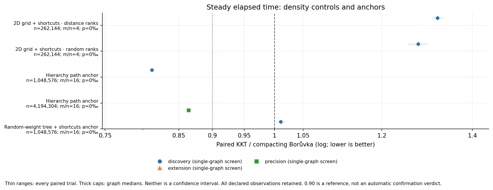
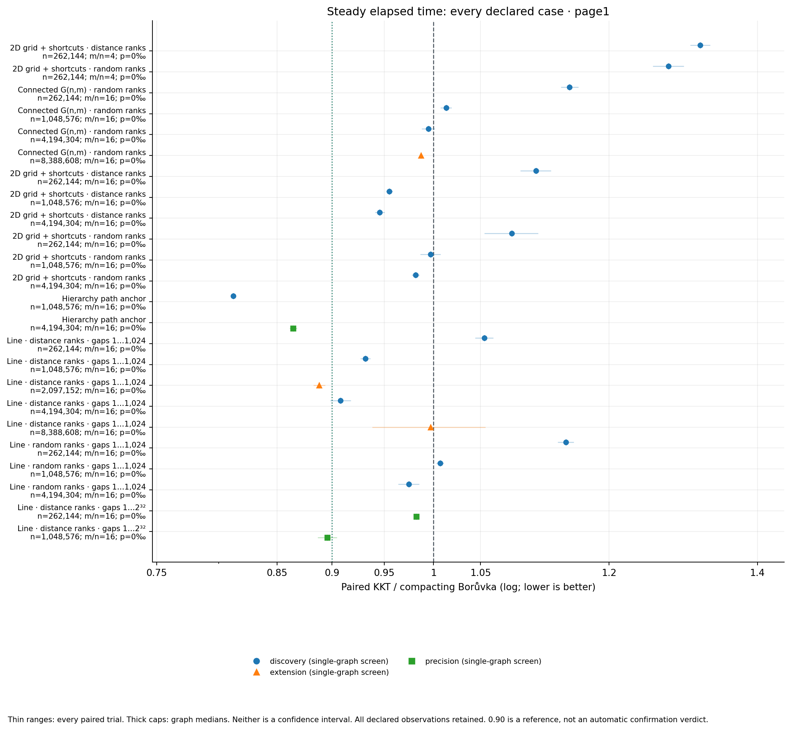
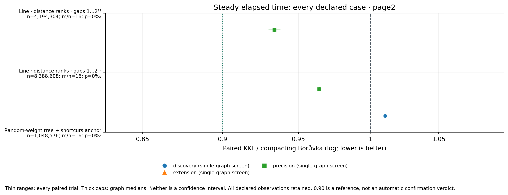
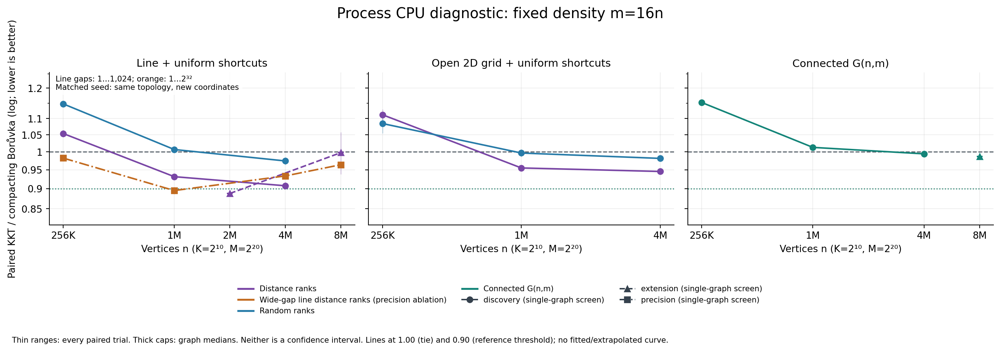
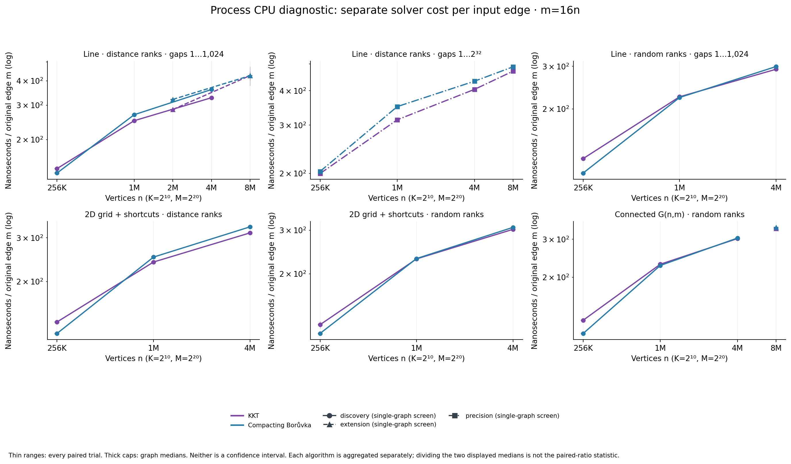

# Crossover figure guide

Ratios pair algorithm times within each trial, then take medians over repetitions, sampling seeds, and graph seeds. Algorithm costs use the same hierarchy separately, divided by the original input edge count m. A ratio of the displayed algorithm medians need not equal the paired-ratio median. Thick capped ranges span graph-level medians; thin ranges span all individual paired trials. Neither range is a confidence interval. Repeated timing and sampling seeds are not additional graph draws. Campaigns remain separate.

Steady elapsed time is primary. Process CPU is a separately plotted diagnostic envelope; its clock reads surround the solver interval. No flagged calls are removed. Connecting segments join only measured sizes within the same campaign and family; no extrapolation or asymptotic fit is drawn.

A single-graph screen has no measured graph-to-graph spread. Its thin trial range reflects repeated timings of that one graph. The 0.90 line is a visual reference: the frozen criterion additionally requires both selected sizes, every graph median below1, both wall/CPU metrics and both confirmation campaigns.

The wide-gap line is a precision ablation: its gaps are uniform integers from 1 to 2³², versus 1 to 1,024 for the original line. At matched size, density and graph seed, topology, edge IDs, labels and input order agree, but coordinates and distance ranks differ. The random-rank line uses the original narrow-gap geometry. Both gap alphabets are fixed and finite; these finite-size curves do not establish an asymptotic crossover.

| Campaign | Role | Cases | Graphs | Sampling seeds | Repeats | Warmups | Flagged calls |
|---|---|---:|---:|---:|---:|---:|---:|
| discovery | screen | 19 | 1 | 1 | 2 | 1 | 0 |
| extension | screen | 3 | 1 | 1 | 2 | 1 | 0 |
| precision | screen | 5 | 1 | 1 | 2 | 1 | 0 |

[Strict comparison report](../all-screens-comparison/report.md), [all plotted numeric values](figure_points.csv), [input and script provenance](provenance.json).

