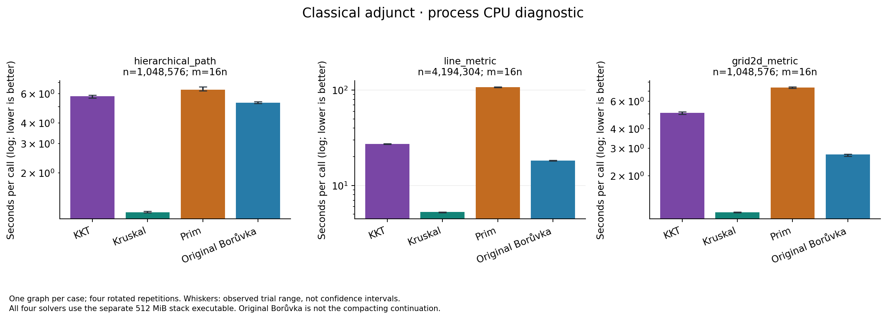

# Selected classical baselines: separate large-stack profile

Validated all three declared cases, 48 timed calls and 12 checked warmups. The original-stack capture failed and remains separate; this is the complete 512 MiB stack rerun. The archived stack validation records byte-identical executable __TEXT,__text and a correct worst-depth four-million-vertex path. No algorithm source change is claimed. Every solver in this rerun uses the same large-stack executable.

One graph seed 3037 and KKT seed 101, four fully rotated timed repetitions, one warmup. Steady elapsed time is primary; process CPU is a secondary enclosing-clock diagnostic. Trial minima/maxima are descriptive ranges, not confidence intervals. All flags and individual losses remain. These selected inputs do not establish a population ranking or an asymptotic crossover.

The original public Borůvka below is not compacting Borůvka. KKT returns an ID set while the classical algorithms return edge tuples; their public input boundaries are retained. No absolute timings from the compactor campaigns are imported or paired with this rerun.

## WALL: algorithm times

| Case | Algorithm | Median seconds | Trial range seconds |
|---|---|---:|---:|
| hierarchical_path_n1048576_d16_p0 | KKT | 5.7797 | 5.6514–5.8622 |
| hierarchical_path_n1048576_d16_p0 | Kruskal | 1.1574 | 1.1554–1.1790 |
| hierarchical_path_n1048576_d16_p0 | Prim | 6.3342 | 6.2529–6.5864 |
| hierarchical_path_n1048576_d16_p0 | Original Borůvka | 5.2771 | 5.2424–5.3617 |
| line_metric_n4194304_d16_p0 | KKT | 27.2403 | 27.0742–27.4356 |
| line_metric_n4194304_d16_p0 | Kruskal | 5.2584 | 5.1981–5.2720 |
| line_metric_n4194304_d16_p0 | Prim | 107.9881 | 106.7878–108.3619 |
| line_metric_n4194304_d16_p0 | Original Borůvka | 18.2891 | 18.1213–18.4081 |
| grid2d_metric_n1048576_d16_p0 | KKT | 5.0711 | 4.9602–5.1679 |
| grid2d_metric_n1048576_d16_p0 | Kruskal | 1.1700 | 1.1662–1.1778 |
| grid2d_metric_n1048576_d16_p0 | Prim | 7.3725 | 7.3055–7.4447 |
| grid2d_metric_n1048576_d16_p0 | Original Borůvka | 2.7430 | 2.6717–2.7585 |

| Case | KKT / baseline | Paired median | Pair range | KKT losses / pairs |
|---|---|---:|---:|---:|
| hierarchical_path_n1048576_d16_p0 | Kruskal | 4.9936 | 4.7933–5.0739 | 4/4 |
| hierarchical_path_n1048576_d16_p0 | Prim | 0.9153 | 0.8580–0.9316 | 0/4 |
| hierarchical_path_n1048576_d16_p0 | Original Borůvka | 1.1010 | 1.0540–1.1065 | 4/4 |
| line_metric_n4194304_d16_p0 | Kruskal | 5.2089 | 5.1355–5.2202 | 4/4 |
| line_metric_n4194304_d16_p0 | Prim | 0.2524 | 0.2504–0.2561 | 0/4 |
| line_metric_n4194304_d16_p0 | Original Borůvka | 1.4841 | 1.4814–1.5140 | 4/4 |
| grid2d_metric_n1048576_d16_p0 | Kruskal | 4.3342 | 4.2533–4.3877 | 4/4 |
| grid2d_metric_n1048576_d16_p0 | Prim | 0.6821 | 0.6790–0.7059 | 0/4 |
| grid2d_metric_n1048576_d16_p0 | Original Borůvka | 1.8504 | 1.8377–1.8894 | 4/4 |

## CPU: algorithm times

| Case | Algorithm | Median seconds | Trial range seconds |
|---|---|---:|---:|
| hierarchical_path_n1048576_d16_p0 | KKT | 5.7732 | 5.6461–5.8571 |
| hierarchical_path_n1048576_d16_p0 | Kruskal | 1.1565 | 1.1545–1.1774 |
| hierarchical_path_n1048576_d16_p0 | Prim | 6.3282 | 6.2464–6.5800 |
| hierarchical_path_n1048576_d16_p0 | Original Borůvka | 5.2722 | 5.2382–5.3567 |
| line_metric_n4194304_d16_p0 | KKT | 27.1663 | 27.0438–27.4076 |
| line_metric_n4194304_d16_p0 | Kruskal | 5.2524 | 5.1930–5.2655 |
| line_metric_n4194304_d16_p0 | Prim | 107.8734 | 106.6910–108.2537 |
| line_metric_n4194304_d16_p0 | Original Borůvka | 18.2701 | 18.0928–18.3152 |
| grid2d_metric_n1048576_d16_p0 | KKT | 5.0668 | 4.9567–5.1640 |
| grid2d_metric_n1048576_d16_p0 | Kruskal | 1.1686 | 1.1647–1.1769 |
| grid2d_metric_n1048576_d16_p0 | Prim | 7.3660 | 7.2989–7.4380 |
| grid2d_metric_n1048576_d16_p0 | Original Borůvka | 2.7406 | 2.6689–2.7559 |

| Case | KKT / baseline | Paired median | Pair range | KKT losses / pairs |
|---|---|---:|---:|---:|
| hierarchical_path_n1048576_d16_p0 | Kruskal | 4.9917 | 4.7952–5.0732 | 4/4 |
| hierarchical_path_n1048576_d16_p0 | Prim | 0.9152 | 0.8581–0.9317 | 0/4 |
| hierarchical_path_n1048576_d16_p0 | Original Borůvka | 1.1009 | 1.0540–1.1062 | 4/4 |
| line_metric_n4194304_d16_p0 | Kruskal | 5.2007 | 5.1360–5.2201 | 4/4 |
| line_metric_n4194304_d16_p0 | Prim | 0.2524 | 0.2504–0.2552 | 0/4 |
| line_metric_n4194304_d16_p0 | Original Borůvka | 1.4845 | 1.4814–1.5148 | 4/4 |
| grid2d_metric_n1048576_d16_p0 | Kruskal | 4.3359 | 4.2558–4.3877 | 4/4 |
| grid2d_metric_n1048576_d16_p0 | Prim | 0.6822 | 0.6790–0.7060 | 0/4 |
| grid2d_metric_n1048576_d16_p0 | Original Borůvka | 1.8509 | 1.8371–1.8901 | 4/4 |

Ratios pair calls within a repetition before taking their median. This need not equal the ratio of the separately displayed algorithm medians. Warmups are retained in validated_calls.csv but excluded from the timed summaries. Reference matching checks the selected graph fingerprints; full discovery protocol validation belongs to its separate screen analysis.

Clock flags: 0; no flagged calls removed. Absence of flags does not establish thermal/power control.

[Algorithm summary](algorithm_summary.csv), [all paired ratios](paired_ratios.csv), [comparisons](comparisons.csv), [all calls including warmups](validated_calls.csv), [clock diagnostics](call_diagnostics.csv), [provenance](provenance.json).

- [timing_csv](../classical_large_stack_timing.csv)
- [capture_metadata](../classical_large_stack_timing.json)
- [manifest](../classical.csv)
- [reference_timing_csv](../discovery_timing.csv)
- [stack_provenance](../large-stack-validation-512m/provenance.json)

