# Untimed contraction components

Untimed original-vertex component moments reconstructed independently from selected original edge IDs. Curves retain each graph draw. Summary means weight graph seeds equally; ranges are observed ranges, not confidence intervals. Stage zero is the original graph; stage r follows r contractions. The final original component has size n although the production quotient is empty. These counters do not predict elapsed time.

Validated 10 cases, 10 graphs and 124 moment/trace stages; all retained.

`q_eff = n² / sum(size²)` measures effective component count; `q_eff/q` is one for equal sizes and falls as sizes become uneven. The largest fraction is max(size)/n. These are descriptive statistics, not an independent-background occupancy theorem for random-weight graphs.

| Case | Graphs | Mean V/m [graph range] | Mean balance after two rounds | Mean largest fraction after two rounds |
|---|---:|---:|---:|---:|
| line_metric_n1048576_d16_p0 | 1 | 5.0805 [5.0805, 5.0805] | 0.8543 | 0.000035 |
| line_wide_metric_n1048576_d16_p0 | 1 | 5.0853 [5.0853, 5.0853] | 0.8536 | 0.000038 |
| line_random_n1048576_d16_p0 | 1 | 3.5670 [3.5670, 3.5670] | 0.6236 | 0.000187 |
| grid2d_metric_n1048576_d16_p0 | 1 | 4.3342 [4.3342, 4.3342] | 0.7984 | 0.000056 |
| grid2d_random_n1048576_d16_p0 | 1 | 3.5533 [3.5533, 3.5533] | 0.6215 | 0.000159 |
| gnm_random_n1048576_d16_p0 | 1 | 3.5553 [3.5553, 3.5553] | 0.6246 | 0.000189 |
| hierarchical_path_n1048576_d16_p0 | 1 | 7.9535 [7.9535, 7.9535] | 1.0000 | 0.000004 |
| line_metric_n8388608_d16_p0 | 1 | 5.9262 [5.9262, 5.9262] | 0.8548 | 0.000005 |
| line_wide_metric_n8388608_d16_p0 | 1 | 5.9589 [5.9589, 5.9589] | 0.8541 | 0.000005 |
| hierarchical_path_n4194304_d16_p0 | 1 | 8.8918 [8.8918, 8.8918] | 1.0000 | 0.000001 |

Raw inputs:

- [trace_csv](../diagnostics_trace.csv)
- [log](../diagnostics_trace.log)
- [manifest](../diagnostics.csv)

[Per-stage data](component_stages.csv), [per-graph volumes](graph_summary.csv), [case summaries](case_summary.csv), [provenance](provenance.json).

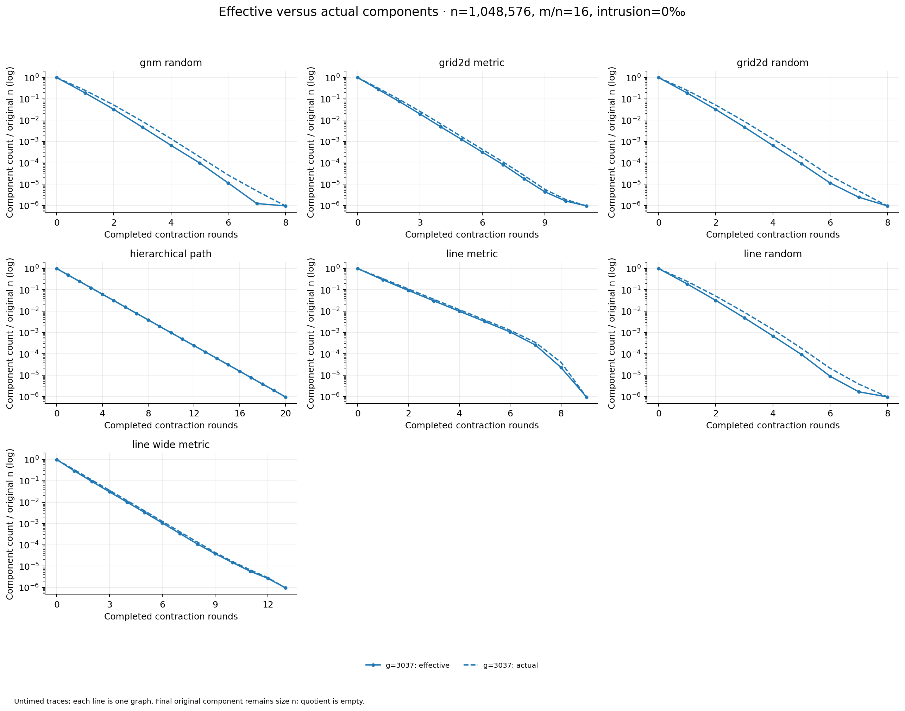

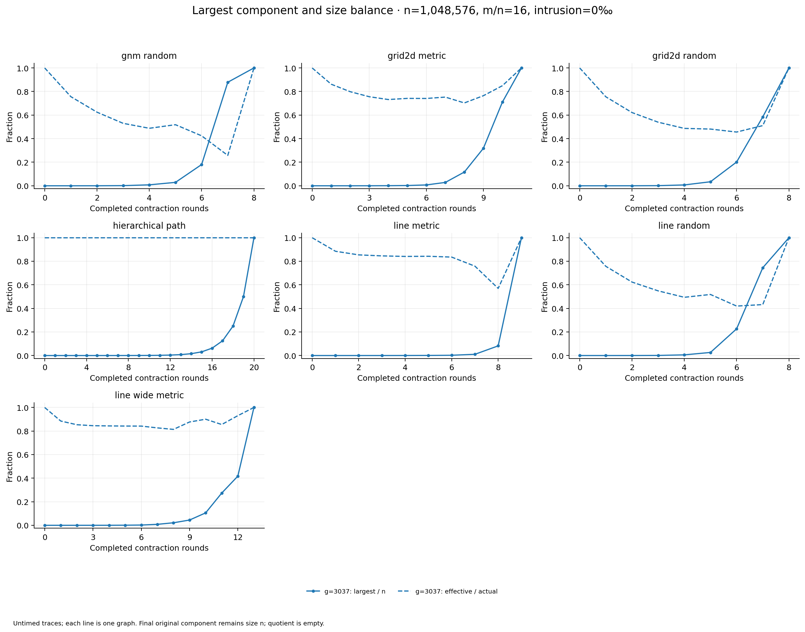

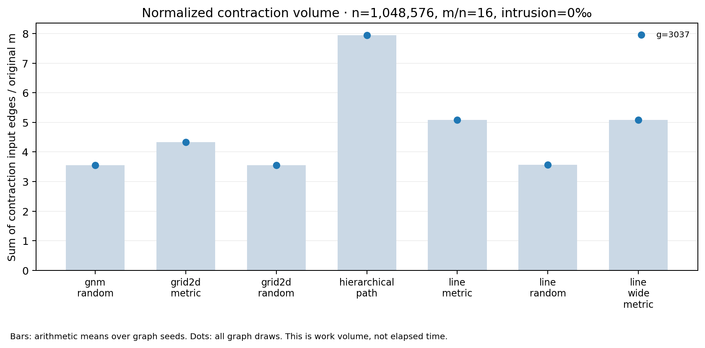

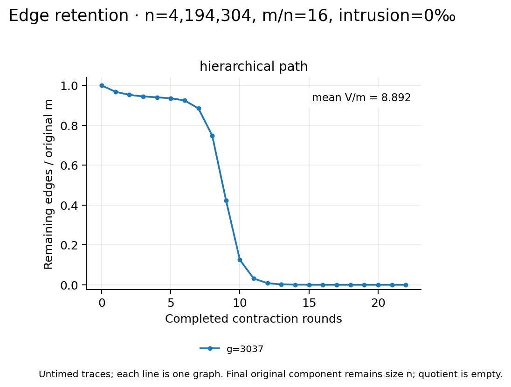

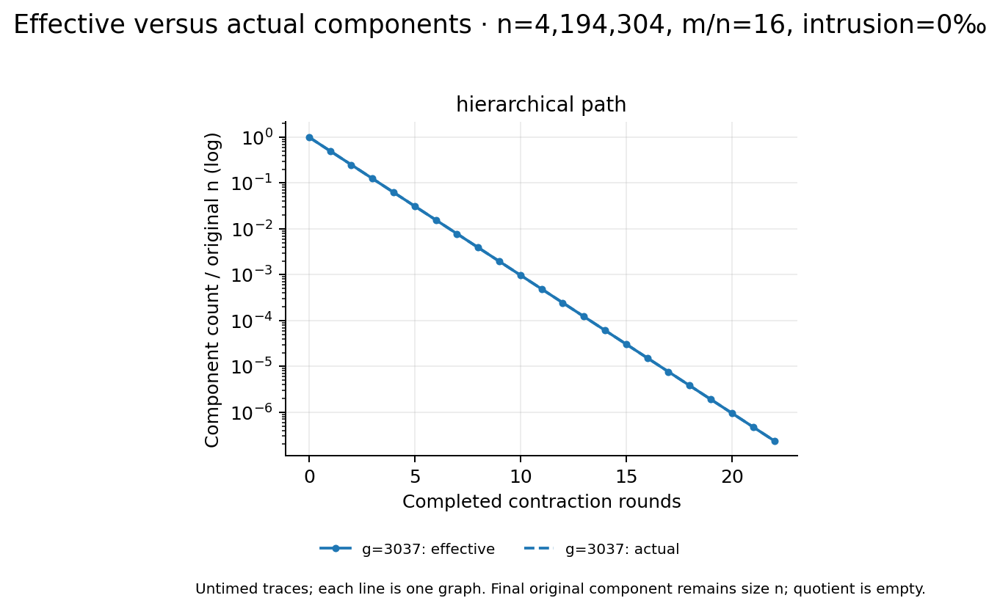

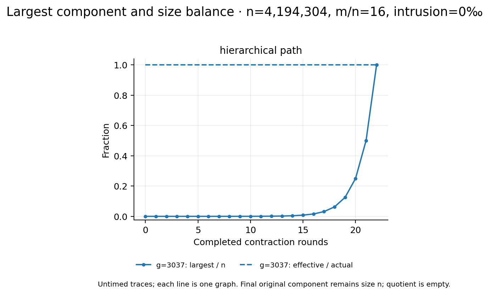

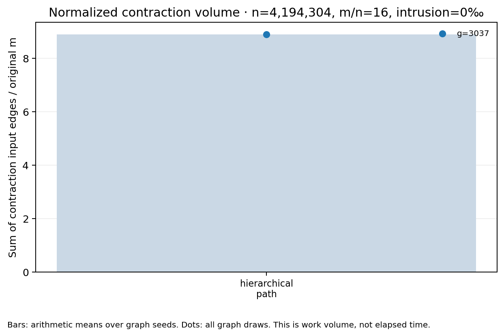

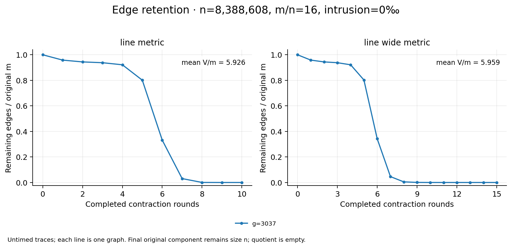

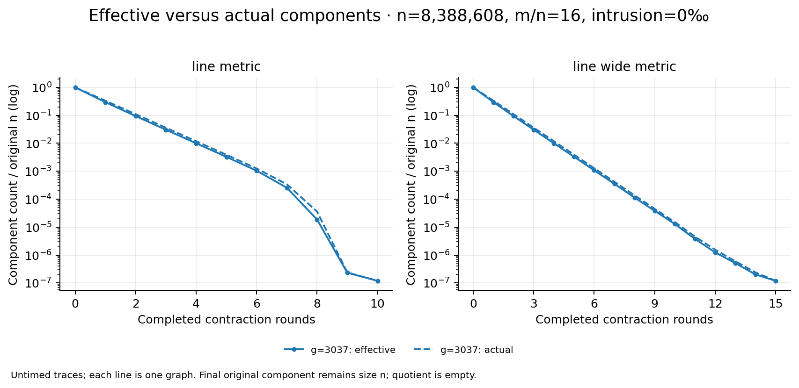

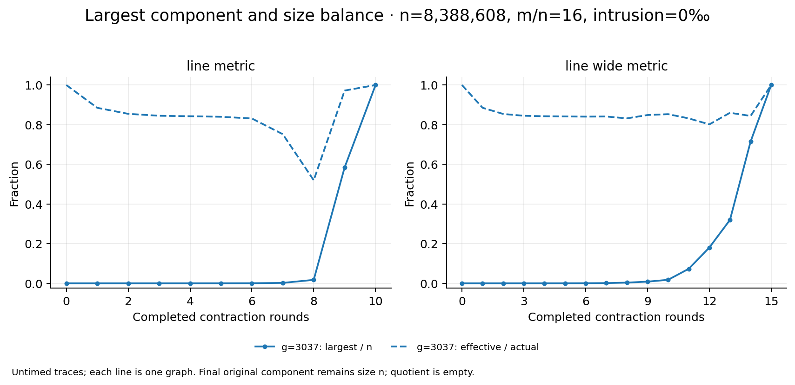

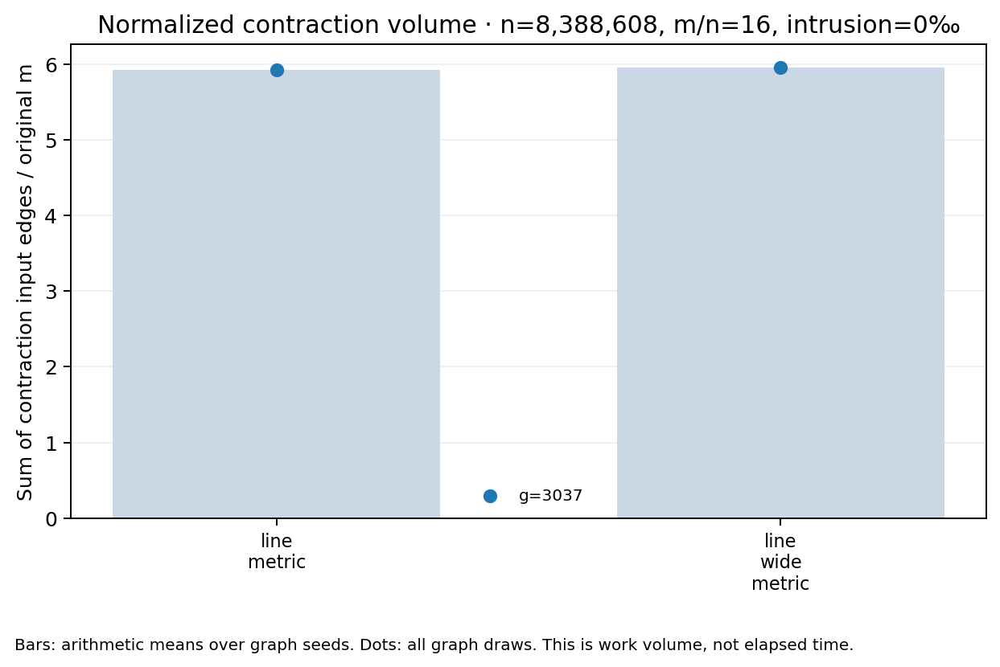
