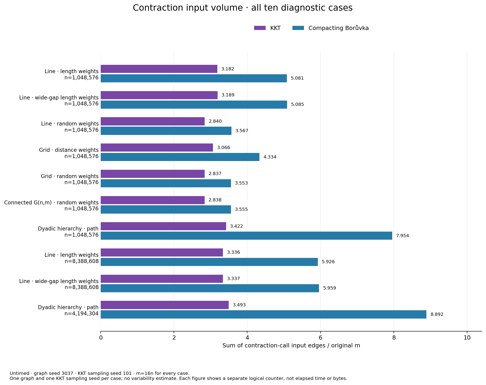
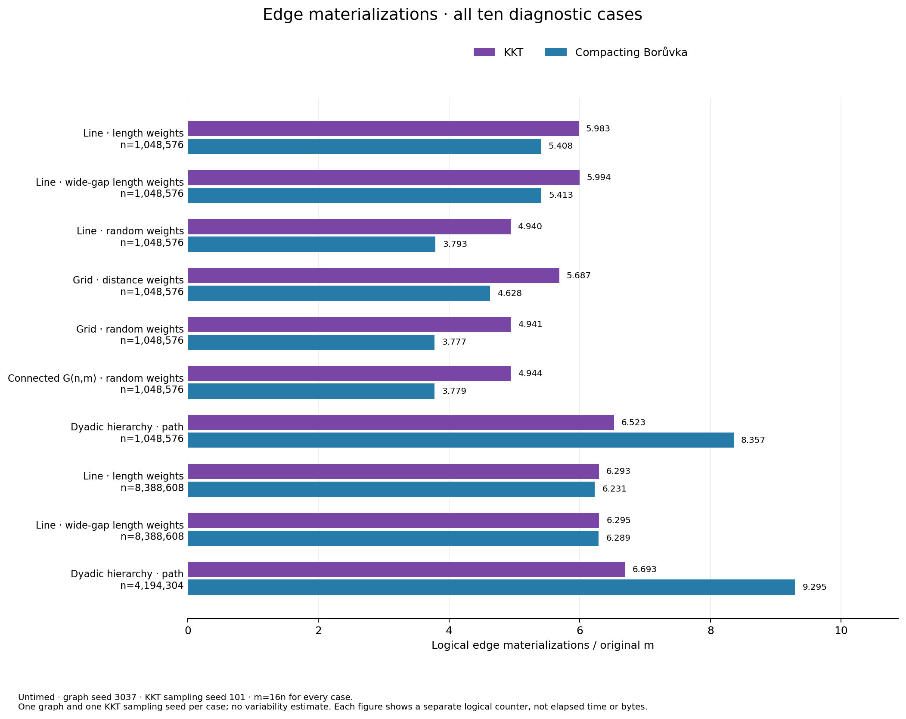
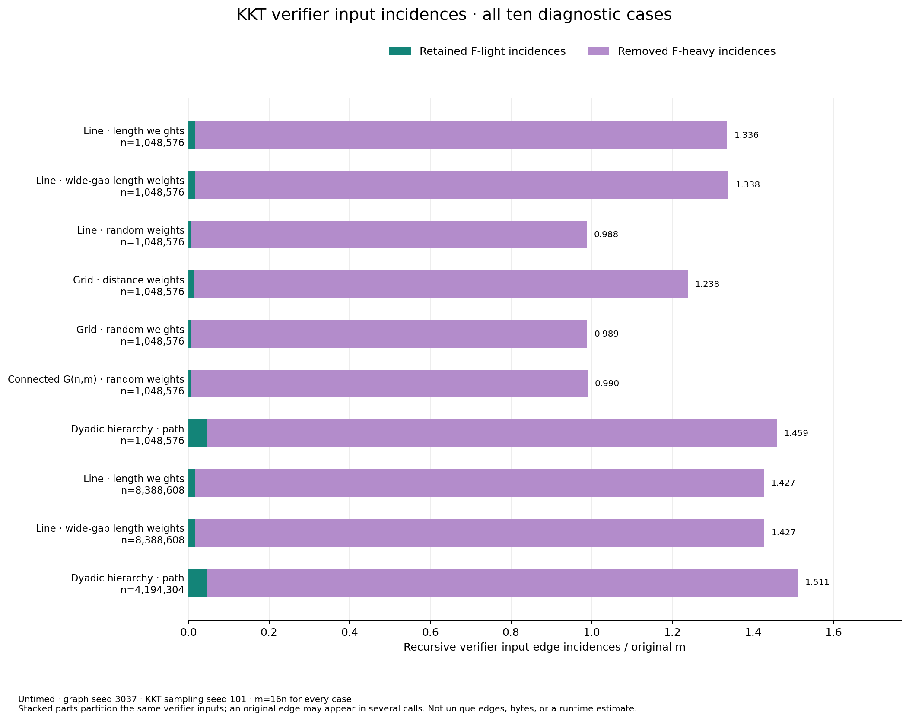

# Untimed crossover work figures

Untimed logical counters, one graph seed and one KKT sampling seed; all ten declared cases retained.

All figures use the same declared case order and original-edge denominator m=16n. The paired bars use the same counter for KKT and compacting Borůvka. Materializations are logical counted events, not bytes or allocator costs. The verifier figure partitions its own recursive input incidences into retained F-light and removed F-heavy parts; it does not count unique original edges. Counters from different figures are not summed. There are no error bars, confidence claims or timing estimates.

The renderer requires successful strict diagnostic provenance and matching derived CSV hashes. It checks all twenty graph/algorithm rows and their identical singleton case summaries. It does not independently recertify an MST or reload the native capture.

[Exact figure points](figure_points.csv), [provenance](provenance.json).

Analysis inputs:

- [provenance](../diagnostics-analysis/provenance.json)
- [work_graphs](../diagnostics-analysis/work_graphs.csv)
- [work_summary](../diagnostics-analysis/work_summary.csv)

