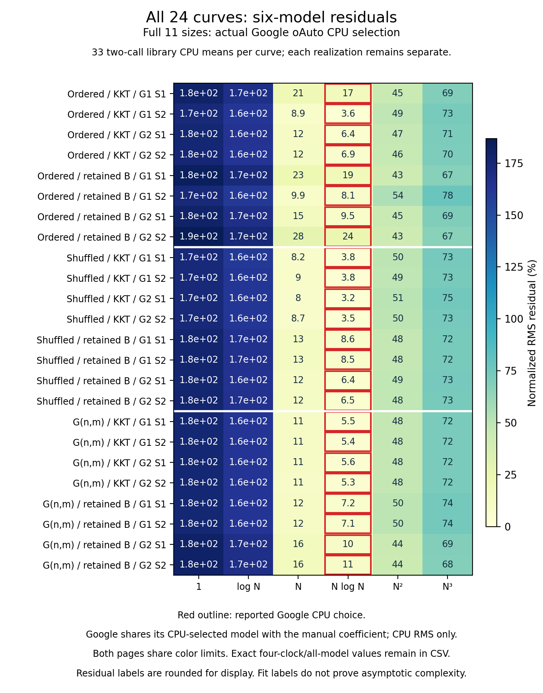

# Current KKT complexity: measured fits favor N log N

The actual Google Benchmark `oAuto` feature selected **N log N for all 24 curves**, including all twelve current KKT curves. None received the linear label. The independent six-model comparison also selects N log N for every one of the 192 curve/clock/window combinations. This is a finite measurement result, **not a proof that expected KKT work is superlinear** and not evidence that wall time is literally O(N).

This completed study uses the experimental eighth-sampling path: retained parallel edges, direct Edge verifier input, compressed requests and private p=1/8 sampling. The ordinary build has not been promoted to these options. Eight production objects are unchanged from the frozen eighth comparison; only the Google Benchmark main/library are new. No earlier campaign is pooled into these fits.

## Complete matrix and actual result

Three families use eleven doubling sizes n=1,024…1,048,576. Ordered hierarchy and its shuffled-weight twin have m=32n; connected G(n,m) has m=16n. Every registered problem size is **N=n+m**. KKT and retained-edge Borůvka each run two graph seeds (19000013,19000043) and two sampler labels (3001,3011): 24 curves. Each size has three callbacks, each containing one checked warmup and two timed calls. All **2,376 calls**, including **1,584 timed calls and 792 warmups**, and all **792 certificates** are retained.

G1/S1 through G2/S2 below identify the four label pairs, not four independent graph draws. Retained B ignores S and repeats two graph inputs; each benchmark repetition also reuses its input. G1 sizes ascend and G2 descend, confounding graph identity and size order. Algorithm order alternates by graph/sampler parity.

| Family / algorithm | G1/S1 | G1/S2 | G2/S1 | G2/S2 | Google CPU RMS range | Native CPU α, full11 | Native CPU α, upper6 |
|---|---|---|---|---|---:|---:|---:|
| Ordered hierarchy / KKT | N log N | N log N | N log N | N log N | 3.62–16.91% | 1.0981–1.1220 | 1.1267–1.1313 |
| Ordered hierarchy / Retained B | N log N | N log N | N log N | N log N | 8.11–24.11% | 1.1299–1.1593 | 1.1290–1.1962 |
| Shuffled twin / KKT | N log N | N log N | N log N | N log N | 3.22–3.77% | 1.0815–1.1233 | 1.1470–1.1591 |
| Shuffled twin / Retained B | N log N | N log N | N log N | N log N | 6.43–8.55% | 1.0985–1.1405 | 1.1613–1.1782 |
| Connected G(n,m) / KKT | N log N | N log N | N log N | N log N | 5.25–5.61% | 1.0264–1.1237 | 1.1599–1.1616 |
| Connected G(n,m) / Retained B | N log N | N log N | N log N | N log N | 7.12–10.67% | 1.0358–1.1524 | 1.1519–1.1586 |

The Google label columns retain all 24 choices. RMS is the normalized library-CPU residual, expressed as a percentage, not a confidence interval. The α columns summarize separately fitted log–log exponents across each group's four curves; they are descriptive outputs, not exported Google labels or independently re-audited slopes. All coefficients and individual values remain in [google_selection.csv](analysis-attempt01/google_selection.csv), [model_fits.csv](analysis-attempt01/model_fits.csv) and [log_log_slopes.csv](analysis-attempt01/log_log_slopes.csv).


Normalized time rises at the large end for both algorithms in all three families. Ordered KKT is practically favorable against this comparator over much of the range; shuffled and random KKT remain more expensive at the large endpoints. This two-algorithm complexity study is not an all-six comparison. It supplies no new paired crossover by dividing separately scheduled absolute medians.

Small points are not monotone. For random KKT at n=1,024, native CPU/N is 85.56–88.90 ns for G1 versus 26.11–27.17 ns for G2. The control also shows elevated G1 small points. Graph/order confounding prevents attribution to one cause, and nothing is trimmed. Full call ranges and every G/S curve remain in all figures.

## What the clocks and models mean

The four clock views are native steady elapsed time, native process CPU, Google manual time and Google process CPU. Native intervals surround the solver call; library CPU includes a different amount of loop/timer machinery. Google manual time receives the measured elapsed duration. They are distinct evidence, even when their numbers are close.

Pinned Google Benchmark v1.5.2 selects among constant, log N, N, N log N, N² and N³ **using library CPU**, then fits its manual coefficient with that same model. It exports CPU RMS only; the manual RMS in this report is reconstructed. Coefficient units are checked per row. [Pinned implementation](https://raw.githubusercontent.com/google/benchmark/v1.5.2/src/complexity.cc).



Full11 uses all 33 two-call means per curve/clock. The predetermined upper6 window uses n=32,768…1,048,576 and 18 means. Its highlighted model is a custom minimum, not another Google-exported result. It remains N log N in every case; all worse-fitting alternatives are preserved.


A zero-intercept model menu and least-squares duration residuals cannot identify an asymptotic law from a finite range. Larger-duration points influence the fit strongly; free log–log slopes answer a different fitting question. The fixed m/n families do not separate the independent effects of n and m, and two graphs do not estimate an expectation over arbitrary graphs. The theoretical expected O(m+n) operation bound and these measured runtime fits must remain separate.

## Validation, resources and scope

[Strict analysis](analysis-attempt01/provenance.json) and the [independent arithmetic audit](arithmetic-audit-attempt01/audit.json) passed. The audit independently reconstructs 3,168 two-call means, 1,152 model fits and all 24 Google selections/coefficient/RMS semantics. It uses the strict collector for provenance, not its arithmetic. Size summaries, log–log and adjacent slopes, clock flags and ordinary Google aggregates are hash-bound but not independently numerically reconstructed by that audit. Its floating comparison tolerances are declared in the audit receipt.

There are **zero clock flags, zero unavailable RSS observations and zero logged sleep overlaps**. The native campaign lasted **3,497.460239167 s (58.291004 min)**; the outer wrapper including final proof lasted 3,499.885709167 s. Peak sampled owned-group RSS was **4.3583068848 GiB**, across 1,763 RSS observations. This is sampled campaign memory, not a per-algorithm allocation measurement. All 24 native groups and the outer group were proved empty, with actual exit zero. Sleep inhibition was not verified; absence of a logged overlap does not establish controlled thermals. On this old library's macOS path, reported MHz can reflect Mach tick rate, and its scaling flag does not prove stable physical frequency.

[Build readiness](BUILD_READINESS.md) is a preserved pre-capture status document. Its successful build04 proves 59 upstream tests, exact bytes of 18 archive objects, eight unchanged production objects and the arm64 executable. The actual final-binary schema smoke contains 198 calls/66 certificates and is excluded from this study. Failed build/mock attempts and their repairs remain preserved. The production candidate's native/sanitizer and independent MSF correctness gates are linked through the frozen parent; this harness independently certifies its inputs/results as declared.

All five standalone and six paper PNGs passed original-resolution visual QA; root independently reviewed all six paper PNGs. Both render guards exited zero with empty groups. [Standalone QA](figures-attempt01/QA.md), [paper QA](paper-figures-attempt01/QA.md). The paper adapter proves exact equality of 1,056 normalized points and 288 displayed model cells against the standalone artifact, with all six models and all clock data retained. Final report page-scale legibility and the actual ≤40-page limit remain separate unfinished publication gates.

## Evidence and reproduction

- [Freeze](freeze.json): `bc0abc5f8675ce9771b6ce81f5cd933afd5d3ffd36d79bc6b34b98e4a89620c7`.
- [Capture](capture-attempt01/capture.json) and [actual outer receipt](capture-attempt01/receipt.json), with raw CSV/Google JSON/log/RSS paths and hashes.
- [Analysis](analysis-attempt01/provenance.json), [all means](analysis-attempt01/means.csv), [all fits](analysis-attempt01/model_fits.csv), [size summaries](analysis-attempt01/size_summaries.csv), [adjacent slopes](analysis-attempt01/adjacent_slopes.csv), [independent audit](arithmetic-audit-attempt01/audit.json).
- [All four clock figures and complete models](figures-attempt01/README.md), [six paper layouts](paper-figures-attempt01/README.md).
- Exact guarded invocations: [analysis](validation/analysis-attempt01.json), [audit](validation/arithmetic-audit-attempt01.json), [standalone plots](validation/standalone-plots-attempt01.json), [paper plots](validation/paper-plots-attempt01.json).

The Google source commit is `73d4d5e8d6d449fc8663765a42aa8aeeee844489`. The final binary SHA-256 is `d9db66dbb9a8509e502d9a34e9bcd9e66390305d1d1212f4e52e6af3fc3733fa`; it remains a local ignored build artifact, not an uploaded publication binary. Native provenance preserves original-machine paths and object dependencies; moving the Markdown does not create a portable native rebuild.

Read-only reanalysis, from the repository root (use a new output directory):

```sh
/usr/bin/python3 -B benchmark/current_complexity/collect.py check benchmark/results/current-complexity-2026-10-15/capture-attempt01/capture.json
/usr/bin/python3 -B benchmark/current_complexity/analyze_complexity.py --capture benchmark/results/current-complexity-2026-10-15/capture-attempt01/capture.json --collector benchmark/current_complexity/collect.py --collector-sha256 69c34734e478c43d158ecb01d2e77cdff4d1ad0274424be647723fc7e6bdc393 --output-dir /tmp/current-complexity-reanalysis
```

These commands launch no solver. The existing guarded receipts preserve the exact audit and plot commands. Any new native campaign remains separately scheduled under its bounded controller.
