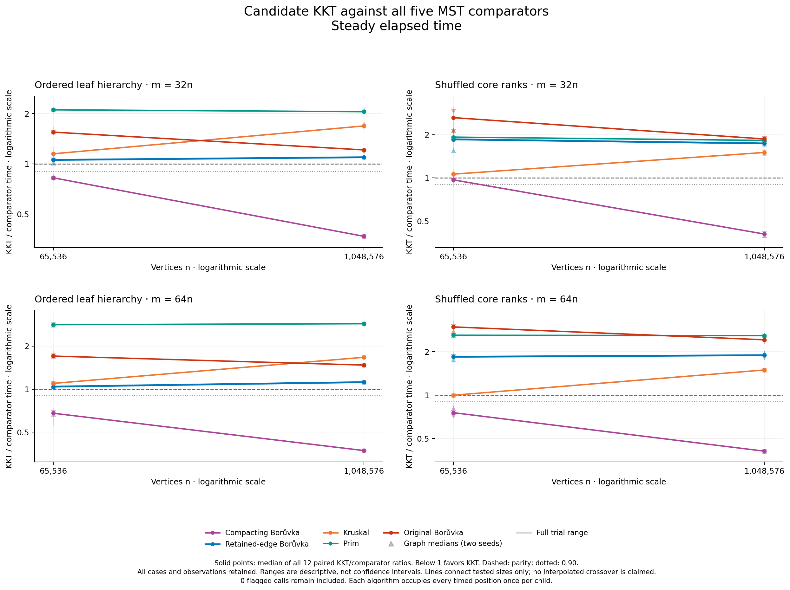
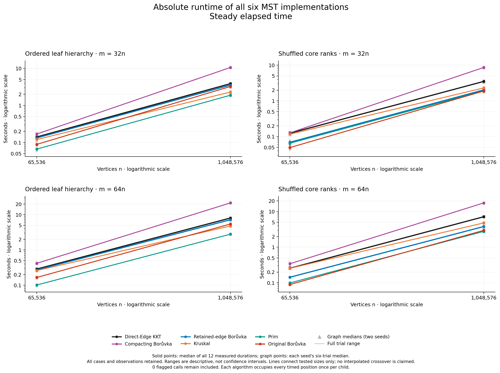

# Density does not yet produce a KKT crossover

Increasing density did **not** make experimental KKT beat retained-edge
Borůvka. That stronger control wins **all 96 paired trials on both clocks**.
KKT is 4.2–12.0% slower on the ordered hierarchy and 73.7–88.6% slower with
shuffled core weights. The hierarchy helps KKT's relative position, but its
remaining constants still exceed repeated cheap contractions in this range.

This separately declared study validates **672 outputs**: 576 timed calls and
96 warmups from sixteen serial native processes. It reaches **1,048,576 vertices
and 67,108,864 edges**, using the exact direct-Edge executable from the previous
study. No implementation, timing boundary or graph generator changed.

## Every comparison

Entries are medians of twelve paired elapsed-time ratios, KKT divided by the
named competitor; below one favors KKT. Density is m/n, not average degree.
Both graph medians, every trial and process-CPU equivalents remain in the
[complete analysis](analysis/README.md).

| Core weights | n | m/n | / deduplicating B | / retained-edge B | / Kruskal | / Prim | / original B |
|---|---:|---:|---:|---:|---:|---:|---:|
| Hierarchy | 65,536 | 32 | 0.8240 | 1.0548 | 1.1474 | 2.1064 | 1.5472 |
| Shuffled | 65,536 | 32 | 0.9682 | 1.8534 | 1.0617 | 1.9210 | 2.6241 |
| Hierarchy | 1,048,576 | 32 | 0.3672 | 1.0937 | 1.6858 | 2.0522 | 1.2106 |
| Shuffled | 1,048,576 | 32 | 0.4064 | 1.7367 | 1.5019 | 1.8224 | 1.8653 |
| Hierarchy | 65,536 | 64 | 0.6793 | 1.0417 | 1.0976 | 2.8240 | 1.7036 |
| Shuffled | 65,536 | 64 | 0.7543 | 1.8397 | 0.9970 | 2.5942 | 2.9609 |
| Hierarchy | 1,048,576 | 64 | 0.3724 | 1.1198 | 1.6705 | 2.8677 | 1.4738 |
| Shuffled | 1,048,576 | 64 | 0.4085 | 1.8858 | 1.4897 | 2.5778 | 2.4122 |



Against the deduplicating compactor, KKT wins 94 of 96 trials. Seven cases
satisfy the stronger requirement that both graph medians are at most 0.90 on
both clocks. Small shuffled d32 has only a narrow pooled lead. Three
family/density groups already lead strongly at both sizes; the fourth moves
from a narrow lead to a strong lead. None is a loss-to-strong-win crossover.

Retained-edge Borůvka, Prim and original Borůvka each beat KKT in every trial.
The only near-parity Kruskal case is small shuffled d64: KKT/Kruskal is 0.9970,
with nine of twelve trial wins; its larger counterpart loses at 1.4897.
No comparison meets the declared strong-crossover rule. The hierarchy gap
against retained-edge Borůvka widens from 1.0548 to 1.0937 at d32 and from
1.0417 to 1.1198 at d64.



## What the weight control reveals

Each hierarchy/shuffled pair has identical topology, edge IDs, labels and
physical edge order. The generator preserves three cheap leaves per core
vertex and changes only core weight ranks. The audit verifies all eight
topology-matched pairs have different weighted fingerprints. This is a
core-weight ablation, not globally independent random weights.

The ordered core contains a cheap path whose weights enforce successive
pairwise merges. Other core edges are heavier chords. Most chords continue
crossing components for many Borůvka rounds and are scanned repeatedly.
Shuffled ranks let chords determine merges, removing that fixed hierarchy
and substantially improving Borůvka's relative position. This identifies a
weight-structure effect on the comparison, not a hardware cache or allocation
cause. These are engineered stress graphs, not representative application data.

## Why more density has a limited effect

The [retention derivation](HIERARCHY_RETENTION.md) makes the mechanism precise.
Write n=4q, L=log₂q and C=m−n+1 for the number of nonpath core chords. After
the leaf contraction and k core rounds, components are aligned blocks of
b=2ᵏ vertices. Under ideal uniform distinct-chord sampling, their expected
internal fraction is

\[
f(b)=\frac{q(b-3+2/b)}{(q-1)(q-2)}.
\]

Almost all chords survive the early rounds. Including the initial leaf
contraction, expected total **contraction input-edge volume** is

\[
\mathbb E[V]=m+(2q-2-L)+C\left[L-1+
\frac{3q(L-2)+6}{(q-1)(q-2)}\right].
\]

This counts an edge once per contraction call; it is not all internal passes,
instructions or elapsed time. At fixed n, greater density raises C/m toward
one but leaves the round count unchanged. At n=2,097,152, leading per-edge
volumes for d16/d32/d64 are about 17.91/18.45/18.73. Quadrupling density adds
only about 4.6% to this particular per-edge scan measure while also increasing
KKT's edge work. Doubling n adds a core round.

For a growing ideal family with fixed density d>1, continuation volume is
Θ(m log n); KKT's argument supports expected O(m+n) under its primitive-cost
and independence assumptions. This motivates a crossover search but gives
**no finite threshold**. The compiled generator has fixed bounds and finite
PRNG seeds. The detailed note proves the partition/expectation, distinguishes
it from recorded counts, and links the retained-parallel complexity argument.

## Validation and measurement limits

The harness independently certifies the unique MST before timing and checks
every output against exact edge IDs. The executable inherits the direct-Edge
native, exhaustive, differential and ASan/UBSan/leak gates; see
[candidate validation](../edge-view-2026-10-15/validation/CANDIDATE_VALIDATION.md).
All sixteen owned process groups were verified empty after exit. Strict
reanalysis checks frozen sources, objects, build records, executable, raw
hashes, certificates, clocks, resources and exact combined CSV concatenation.

The [independent audit](validation/independent-numerical-audit/README.md)
imports no collector aggregation code. It recomputes 960 wall/CPU ratios with
exact rational arithmetic, all 80 case medians, 160 graph medians, topology
controls and twenty crossover classifications. Its
[execution record](validation/independent-audit-attempt01.json) is retained.
No observation was removed, replaced, normalized or adjusted.

Machine: Apple M3 Max, 128 GiB, macOS 26.6.2; native arm64, Apple Clang 15,
C++17, O3, march=native, assertions enabled, 512 MiB stack. Executable SHA256:
`2e2e89b7e8465e563886deff0bf2a9e62d9f08aee27a60dfd433895e8eb3318f`.
It uses experimental retained-parallel contraction and direct-Edge verification;
default production paths remain unchanged. Bindings are in [freeze.json](freeze.json).

Graph seeds: 5000011 and 5000081; every call starts KKT at seed 1217. Six
repetitions balance all six solver positions. The second graph seed reverses
the complete case schedule, including twin order; seed and schedule are
confounded. Repetitions reuse a graph/sampling realization. Two graph seeds
and one sampling seed provide limited replication. Earlier d16 data is not
pooled here, and two sizes cannot establish a durable asymptotic crossover.

Capture took **37.94 minutes**, with maximum sampled process-group RSS
**17.722 GiB** and zero unavailable samples. RSS includes generation,
certification and all solvers; it is neither a continuous peak nor KKT-only
memory. There were zero call/capture clock flags, logged-sleep overlaps,
malformed power events or reversed power events. The power query succeeded.
Three caffeinate attempts failed, so sleep prevention was **not** verified.
Unchanged occupied swap snapshots (4,578.19 MiB) do not measure paging;
absence of logged sleep does not establish stable frequency, thermals or load.

All four wall/CPU figures received [visual review](figures/QA.md). The private
full power log is excluded from publication; its receipt and hash remain.
The [protocol](PROTOCOL.md), [capture](search.csv), per-child evidence and
analysis preserve the fixed matrix. This screen does not rerun Google
Benchmark complexity fits or establish a Wikipedia classification.

Reanalysis, using recorded local artifacts and an unused output directory:

```sh
python3 -B benchmark/run_density_search.py analyze \
  --capture benchmark/results/density-search-2026-10-15/search.json \
  --output-dir /tmp/kkt-density-analysis-fresh
```

Packed private sampling is now being prepared in a separate worktree. It
preserves the public sampling API but changes seeded internal samples, so
fresh correctness gates and multiple graph/sampling seeds are required.
No speedup from that proposal is included here. Other allocation, contraction
and query-storage proposals remain separate hypotheses.
