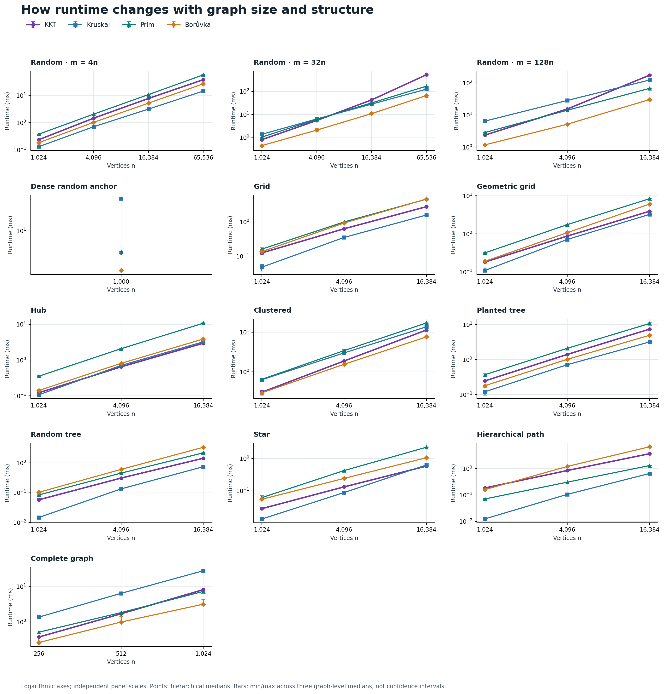
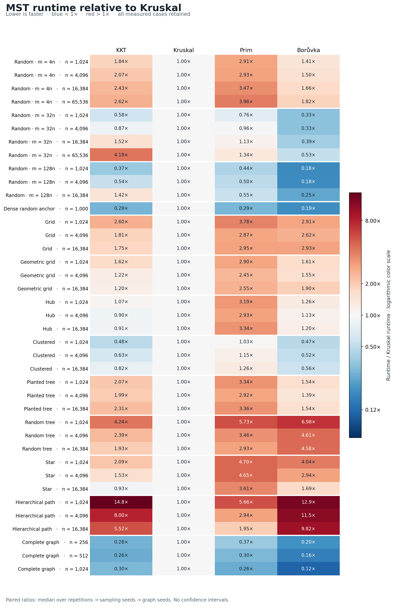
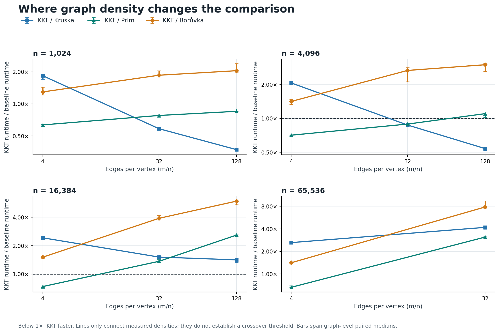

# KKT versus Kruskal, Prim, and Borůvka

Measured on an Apple M3 Max using the current repository implementations.
The expanded comparison is less favorable to KKT than the earlier two-way
comparison: **Kruskal has the lowest median in 22 of 39 configurations,
Borůvka in 14, KKT in 3, and Prim in none.** These counts describe the chosen
synthetic matrix, not the frequency of real application workloads.

All **5,616 timed outputs** passed exact comparison with independently
certified minimum spanning trees. The matrix covers 13 profiles, 39 sizes/
densities, 117 generated fixtures, up to 65,536 vertices and 2,097,152 edges.
No algorithm code was changed for this comparison.

## What the measurements show

- **Kruskal is strongest on sparse and local graphs.** It wins every m=4n
  random case, both grid families, all planted-tree and random-tree cases,
  and every hierarchical path. On paths KKT takes 5.52–14.78 times as long
  by paired medians.
- **Borůvka wins the dense comparisons.** It has the lowest median for every
  m=32n and m=128n random case, the dense anchor, all clustered cases,
  and all complete graphs. KKT beating Kruskal on these graphs does not
  make KKT the fastest of the four.
- **KKT's wins are narrow and structured.** It leads at hub n=4,096,
  hub n=16,384, and star n=16,384. Paired runtimes are about 10.0%, 8.9%,
  and 7.5% below Kruskal, respectively. The advantage appears in all three
  graph-level aggregates for each case, but this is not a significance claim.
- **Prim is often slower here.** KKT beats this repository's `std::set` Prim
  in 31/39 configurations. This does not compare KKT against an optimized
  heap-based or dense-matrix Prim implementation.
- **Large dense random inputs expose a problem worth profiling.** At
  n=65,536, m=2,097,152, KKT takes 527.3 ms, versus Kruskal 125.9 ms,
  Prim 168.8 ms, and Borůvka 66.6 ms. KKT's paired ratio against Borůvka
  is 7.84x. At fixed m/n=32, increasing n from 16,384 to 65,536 increases
  KKT's median runtime about 12.2x for 4x as many edges. This observation
  does not by itself establish an asymptotic complexity violation.

A [follow-up profile and contraction probe](PROFILE.md) helps explain the
large-case behavior. For graph seed 17, fourfold input growth leaves **7.3x
as many edges after the first two contractions**. In the largest case,
roughly **50% of samples are in the verifier** and **30% in contraction**;
path-query traversal and heavy-edge hash-set construction are prominent costs.
These identify the next optimization targets; no cache behavior was measured.

KKT beats Kruskal in **14/39** cases, Prim in **31/39**, and Borůvka in
**16/39**, using hierarchical medians of paired timing ratios. Those paired
comparisons are a different statistic from ranking the four median runtimes.

## Plots

Each figure is also available as SVG and PDF for zooming or export.

[SVG](runtime_by_family.svg) · [PDF](runtime_by_family.pdf)

[SVG](relative_runtime.svg) · [PDF](relative_runtime.pdf)

[SVG](density_comparison.svg) · [PDF](density_comparison.pdf)

## Representative times

The table shows each profile's largest measured case. Times are hierarchical
medians in milliseconds; **bold** marks the lowest median in the row.

| Profile | Vertices | Edges | KKT ms | Kruskal ms | Prim ms | Borůvka ms |
| --- | ---: | ---: | ---: | ---: | ---: | ---: |
| Random, m=4n | 65,536 | 262,144 | 38.003 | **14.524** | 57.299 | 26.818 |
| Random, m=32n | 65,536 | 2,097,152 | 527.319 | 125.873 | 168.822 | **66.584** |
| Random, m=128n | 16,384 | 2,097,152 | 174.262 | 123.512 | 67.699 | **30.399** |
| Dense random anchor | 1,000 | 400,000 | 6.005 | 21.120 | 6.166 | **3.979** |
| Grid | 16,384 | 32,512 | 2.819 | **1.607** | 4.689 | 4.711 |
| Geometric grid | 16,384 | 64,770 | 3.920 | **3.242** | 8.370 | 6.059 |
| Hub + chords | 16,384 | 65,536 | **2.963** | 3.234 | 10.723 | 3.878 |
| Clustered | 16,384 | 262,159 | 11.324 | 13.648 | 17.073 | **7.604** |
| Planted tree | 16,384 | 65,536 | 7.440 | **3.202** | 10.783 | 4.965 |
| Random recursive tree | 16,384 | 16,383 | 1.433 | **0.746** | 2.174 | 3.345 |
| Star | 16,384 | 16,383 | **0.586** | 0.634 | 2.261 | 1.066 |
| Hierarchical path | 16,384 | 16,383 | 3.661 | **0.652** | 1.300 | 6.684 |
| Complete | 1,024 | 523,776 | 8.212 | 27.908 | 7.319 | **3.201** |

## Method and evidence

Each case has three graph seeds, three KKT seeds, four repetitions, and one
warmup per algorithm/seed pair. Timed positions are balanced. We aggregate
repetitions, then sampling seeds, then graph seeds; bars show the range of
three graph-level medians, not confidence intervals. All cases and losses
are retained.

Timings start from a common tuple edge list, including KKT input conversion
and temporary-input destruction. Graph generation, correctness checks, and
returned-result destruction are excluded. This differs from the earlier
repair benchmark, so its absolute timings should not be substituted here.

See [METHODS.md](METHODS.md) for exact graph distributions, timing boundaries,
correctness certification, implementation limits, and reproduction commands.
[metadata.json](metadata.json) records the machine, compiler, flags, source
revision, and harness hashes. [raw.csv](raw.csv), [summary.csv](summary.csv),
[graph_summary.csv](graph_summary.csv), and [comparisons.csv](comparisons.csv)
preserve every observation and aggregate. [report.md](report.md) is the
machine-generated analysis, including every retained KKT loss.
