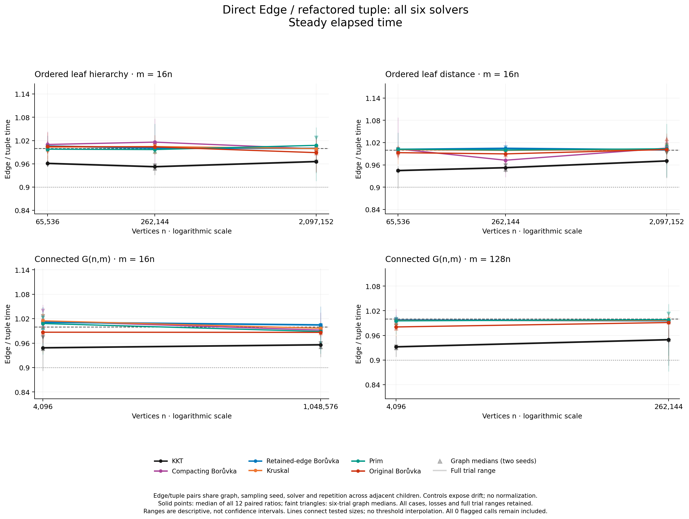
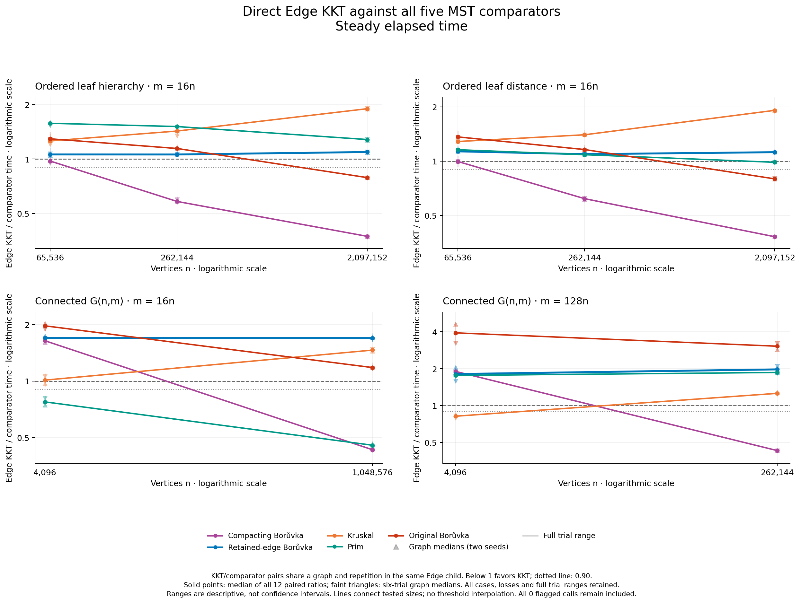

# Removing KKT's verifier-input copy

Reading the existing edge records directly improves KKT's paired case medians
by **2.9–6.8% across all ten cases**, on both elapsed and process CPU clocks.
It wins **115 of 120 individual Edge/tuple pairs** on each clock. This is a
useful constant reduction, but **retained-edge Borůvka still beats KKT in all
120 direct comparisons on both clocks**. No crossover against that stronger
baseline was found.

The complete experiment validates **1,680 outputs** from forty serial native
children: 1,440 timed results and 240 warmups. All observations remain included.
The [independent numerical audit](validation/independent-numerical-audit/README.md)
recomputes the ratios from raw children without importing the collector.

## The one implementation change

Previously, KKT copied every reduced edge into `G_tuples` immediately before
heavy-edge verification. The candidate passes the existing `vector<Edge>` to
a typed overload of the same verifier implementation. Sampling, forest creation,
edge order, mark positions, filtering and recursive lifetimes stay identical.

Implementation commit `b7aa02bfb9cc7861e068d0a265cf377a3cc4aed6`
is experimental and locally committed; remote publication is not assumed.
Both binaries use retained parallel quotient edges. The candidate additionally
enables `KKT_EXPERIMENT_EDGE_VIEW`; the default tuple path remains available.
Seven production objects and the harness object are physically shared. Only
`kkt.o` differs between these two binaries.

The reference is a **freshly refactored tuple verifier**. Both overloads reside
in the identical shared verifier object, whose generated code may differ from
the earlier control's verifier. These fresh paired timings isolate the call-site
choice within that refactor. They must not be multiplied by historical speedups
to claim a direct comparison with the old executable.

## Results, including every competitor

Ratios below one favor the numerator. The first numeric column compares Edge
KKT with the fresh tuple reference. All subsequent columns compare Edge KKT
directly with a competitor in the same child and repetition. Each entry is the
median of twelve individual paired elapsed-time ratios, not a ratio of medians.
Here `d = m/n`; it is not average undirected degree.

| Family | n | d | Edge / tuple KKT | / deduplicating B | / retained-edge B | / Kruskal | / Prim | / original B |
|---|---:|---:|---:|---:|---:|---:|---:|---:|
| Leaf hierarchy | 65,536 | 16 | 0.9611 | 0.9747 | 1.0605 | 1.2603 | 1.5782 | 1.2944 |
| Leaf hierarchy | 262,144 | 16 | 0.9526 | 0.5823 | 1.0600 | 1.4292 | 1.5141 | 1.1444 |
| Leaf hierarchy | 2,097,152 | 16 | 0.9658 | 0.3730 | 1.0938 | 1.9007 | 1.2830 | 0.7892 |
| Leaf distance | 65,536 | 16 | 0.9448 | 0.9950 | 1.1325 | 1.2841 | 1.1559 | 1.3621 |
| Leaf distance | 262,144 | 16 | 0.9525 | 0.6185 | 1.0922 | 1.3995 | 1.0851 | 1.1588 |
| Leaf distance | 2,097,152 | 16 | 0.9707 | 0.3801 | 1.1203 | 1.9132 | 0.9848 | 0.7964 |
| Connected G(n,m) | 4,096 | 16 | 0.9485 | 1.6388 | 1.6958 | 1.0107 | 0.7741 | 1.9676 |
| Connected G(n,m) | 1,048,576 | 16 | 0.9559 | 0.4302 | 1.6920 | 1.4606 | 0.4548 | 1.1792 |
| Connected G(n,m) | 4,096 | 128 | 0.9321 | 1.9009 | 1.8094 | 0.8189 | 1.7626 | 3.9229 |
| Connected G(n,m) | 262,144 | 128 | 0.9494 | 0.4294 | 1.9744 | 1.2583 | 1.8642 | 3.0536 |



The unchanged retained-edge Borůvka object's case medians range from 0.9957 to
1.0114 across the two binaries. Across all five unchanged solvers the range is
0.9726–1.0159. These controls expose drift; they are **not** used to normalize
KKT. Five individual KKT implementation comparisons lose, despite every pooled
case median improving. Full ranges, graph medians and CPU counterparts are kept.



At 2,097,152 vertices and 33,554,432 edges, KKT remains **9.4% slower** than
retained-edge Borůvka on hierarchy and **12.0% slower** on distance. Its large
lead over the deduplicating compactor therefore still does not establish an
advantage over the simpler continuation using the same cheap contraction.
Kruskal remains substantially faster on those large structured cases. The
distance result against Prim is a narrow 1.5% median lead, not a strong crossover.

The declared strong-crossover rule requires both graph medians above one at a
smaller measured size, then at most 0.90 on both clocks at a larger size, with
the same strong win at every still-larger tested point. Edge KKT has four such
brackets: both G(n,m) densities against deduplicating Borůvka, and both ordered
families against original Borůvka. It has none against retained-edge Borůvka,
Kruskal or Prim. Edge KKT already leads the deduplicating compactor by the pooled
median at the smallest ordered point, so those curves cannot be relabeled as
observed crossovers under this rule. The audit retains all forty classifications
across both variants; no exact threshold is interpolated.

## What the improvement establishes

The [earlier work diagnostics](../retention-control-2026-10-15/work/README.md)
show that KKT trades many contraction scans for verifier and query work. This
experiment removes one concrete materialization within that tradeoff. Its
paired instrumented gates require exactly two counter reductions: both
`kkt_edge_visits` and `edge_materializations` fall by `verifier_edges`. The other
63 counters and MST IDs remain identical. Initialized-slot counts do not fall:
the removed tuple vector used `reserve`, not value-initializing `resize`.

The resulting runtime reduction is measured here; it is not inferred from an
unweighted sum of heterogeneous counters. The remaining overhead needs further
investigation. A separate density search is prepared with ordered and shuffled
core weights, and a separate KKT-only profile is being prepared. Neither is a
completed result of this experiment. The [query-storage proposal](NEXT_QUERY_STORAGE_EXPERIMENT.md)
also remains unimplemented and unmeasured.

Retaining parallel edges has a defensible expected-linear recurrence under the
usual sampling and linear-verifier assumptions, as explained in the
[theory note](THEORY.md). That is our extension of the paper's argument, not its
exact stated contraction. These finite timings neither rerun Google Benchmark
complexity fits nor prove linear wall time or eventual practical dominance.

## Correctness, measurement and reproduction

Both variants passed native and native Clang 22 ASan/UBSan/leak validation,
including 1,248 positional path-walk oracle cases and 1,344 paired full-KKT
records per profile, existing exhaustive/cycle-certificate suites, and the
six-solver harness gates. The wrong-linked candidate is rejected. Details and
exact build bindings are in [candidate validation](validation/CANDIDATE_VALIDATION.md).
The collector passed eight mocked test groups and independent review before
its protocol and binary freeze were committed.

The machine is an Apple M3 Max, 128 GiB RAM, macOS 26.6.2. Measured binaries are
verified native arm64, Apple Clang 15, C++17, `-O3 -march=native`, assertions
enabled, with a 512 MiB stack. Graph seeds are 4000037 and 4000063; KKT uses the
fixed seed 1013 in every repetition. Six timed repetitions balance all six
solvers through every execution position. The second graph seed reverses both
case and adjacent variant order. Thus graph seed and order are confounded;
repetitions are not independent graph or sampling draws.

Capture took **53.55 minutes**. Maximum sampled process-group RSS was
**10.057 GiB**, including generation, certification and all solvers. One sample
was unavailable; it remained below the declared three-consecutive-failure stop
rule, and all forty owned groups were verified empty. RSS is not a continuous
peak or a KKT-only allocation measure. There were zero call/capture clock flags,
zero nominal logged-sleep overlaps and no malformed/reversed power events.
The archived power-log query succeeded, but no sleep-prevention assertion was
obtained. Absence of logged sleep does not establish stable thermals, frequency
or host load. Occupied swap changed from 4,602.19 to 4,578.19 MiB; those snapshots
do not measure paging activity.

The independent exact-rational audit matches all 1,440 cross-variant clock
pairs, 2,400 within-variant comparator pairs and 1,680 case/graph summaries.
No observations were trimmed, replaced or adjusted. All four figures were
[visually reviewed](figures/QA.md). Raw data, manifests, freezes and validation
failures remain available through the [analysis](analysis/README.md),
[protocol](PROTOCOL.md), [freeze](freeze.json) and [capture](paired.csv).

Reanalysis uses the recorded worktree/build artifacts and an unused output path:

```sh
python3 -B benchmark/run_edge_view_experiment.py analyze \
  --capture benchmark/results/edge-view-2026-10-15/paired.json \
  --output-dir /tmp/kkt-edge-analysis-fresh
```

The private power log is intentionally not published; omit it as above or supply
the locally archived file with `--power-log`. This report is unpublished
repository research, not an independent source for a Wikipedia classification.
