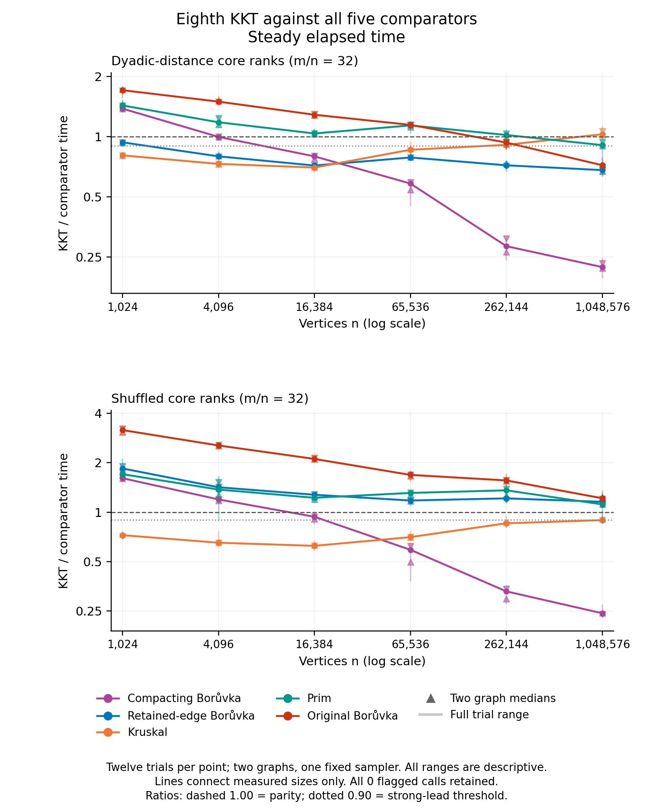

# Eighth KKT on dyadic-distance core weights

**Completed and independently audited.** KKT leads retained-edge Borůvka on every measured distance-ranked case: narrowly at 1,024 vertices and strongly from 4,096 through 1,048,576. Its largest-case wall/CPU ratios are **0.680665/0.680418**, about 31.9% less time. All 72 distance-ranked trial pairs favor KKT on both clocks. The matched shuffled family loses every retained-B pair. The smallest distance point already leads, so this is **not a measured loss-to-win crossover against retained B**.

All 24 children completed with 1,008 certified outputs: 864 timed calls and 144 checked warmups. The [independent raw audit](validation/independent-numerical-audit-attempt01/README.md) agrees with all 1,440 paired clock ratios, 792 summary rows, 60 point classifications, 150 endpoint pairs and ten family/comparator outcomes. All twelve topology twins and all final empty process groups were checked. No rows or losses were removed.

The [readiness README](PRECAPTURE_STATUS.md), [earlier preparation status](PREPARATION_STATUS.md), [protocol](PROTOCOL.md), [manifest](manifest.csv) and [seed declaration](SEED_FRESHNESS.md) preserve the prospective history. This is an experimental opt-in binary, not a change to the ordinary build.

## Retained-edge Borůvka comparison

Each entry is the median of twelve **paired trial ratios**, not the ratio of separate runtime medians. Ratios below one favor KKT. Six repetitions reuse each of two graph realizations and one fixed sampler seed; ranges are descriptive, not confidence intervals.

| Vertices | Distance wall / CPU | Distance wall trial range | Distance wins per clock | Shuffled wall / CPU |
|---:|---:|---:|---:|---:|
| 1,024 | .937703 / .937932 | .893914–.970898 | 12/12 | 1.847185 / 1.846045 |
| 4,096 | .797872 / .797999 | .791961–.843863 | 12/12 | 1.418369 / 1.418314 |
| 16,384 | .717690 / .719921 | .682543–.737906 | 12/12 | 1.276525 / 1.276478 |
| 65,536 | .787462 / .787712 | .765497–.884413 | 12/12 | 1.177434 / 1.177430 |
| 262,144 | .719496 / .720126 | .668393–.752641 | 12/12 | 1.213465 / 1.214256 |
| 1,048,576 | .680665 / .680418 | .630696–.745135 | 12/12 | 1.156119 / 1.156126 |

Every graph/clock median at the five larger distance sizes is at most .90. At 1M the four graph/clock medians span .671389–.684276; even the slowest individual ratio remains below .746. The corresponding CPU trial range is .632049–.743753. This is a clear finite-domain advantage, with a nonmonotonic gap. No larger distance input was measured, and one sampler seed does not establish robustness across sampled forests.

The [original gallery](figures-attempt01/README.md) and [paper figures](figures-paper-attempt01/QA.md) include both clocks and all six absolute-time series. All eight PNGs passed original-resolution visual review; root also independently reviewed the four paper PNGs. The canonical plotted tables are byte-identical between layouts. Final assembled-PDF placement and page-count QA remain separate.

## All five controls, both clocks

Cells are wall/CPU paired-ratio medians. Exact values, graph medians and every range remain in [comparisons.csv](analysis/comparisons.csv) and [paired_ratios.csv](analysis/paired_ratios.csv).

| Family | n | Compacting B | Retained B | Kruskal | Prim | Original B |
|---|---:|---:|---:|---:|---:|---:|
| Distance | 1,024 | 1.3835/1.3840 | .9377/.9379 | .8071/.8078 | 1.4347/1.4352 | 1.7107/1.7097 |
| Distance | 4,096 | .9985/.9986 | .7979/.7980 | .7312/.7313 | 1.1819/1.1818 | 1.4993/1.4993 |
| Distance | 16,384 | .7979/.7979 | .7177/.7199 | .7011/.7012 | 1.0386/1.0388 | 1.2889/1.2889 |
| Distance | 65,536 | .5830/.5830 | .7875/.7877 | .8608/.8607 | 1.1396/1.1439 | 1.1468/1.1468 |
| Distance | 262,144 | .2832/.2825 | .7195/.7201 | .9113/.9100 | 1.0206/1.0180 | .9350/.9350 |
| Distance | 1,048,576 | .2225/.2224 | .6807/.6804 | 1.0292/1.0313 | .9081/.9080 | .7200/.7199 |
| Shuffled | 1,024 | 1.6107/1.6093 | 1.8472/1.8460 | .7238/.7237 | 1.7042/1.7023 | 3.1655/3.1670 |
| Shuffled | 4,096 | 1.1957/1.1954 | 1.4184/1.4183 | .6511/.6511 | 1.3730/1.3727 | 2.5505/2.5511 |
| Shuffled | 16,384 | .9370/.9369 | 1.2765/1.2765 | .6231/.6232 | 1.2236/1.2235 | 2.1110/2.1094 |
| Shuffled | 65,536 | .5893/.5893 | 1.1774/1.1774 | .7042/.7042 | 1.3096/1.3096 | 1.6873/1.6872 |
| Shuffled | 262,144 | .3287/.3281 | 1.2135/1.2143 | .8552/.8553 | 1.3585/1.3559 | 1.5610/1.5606 |
| Shuffled | 1,048,576 | .2417/.2417 | 1.1561/1.1561 | .8940/.8941 | 1.1147/1.1147 | 1.2150/1.2150 |

No case leads all five controls by the declared medians. In distance-ranked inputs, early Kruskal wins reverse to a 1M loss; Prim is a loss through 65K, mixed at 262K and a narrow lead at 1M. Its four 1M graph/clock medians remain above .90, so that endpoint does not meet the strong-lead threshold. Shuffled KKT loses to retained B and original B in every trial and to Prim in every case's graph medians.

Across 144 pairs per comparator, wall/CPU win counts are 103/103 against compacting B, 72/72 against retained B, 133/132 against Kruskal, 17/16 against Prim and 24/24 against original B. Five wall repetitions and four CPU repetitions beat all five controls simultaneously, all on distance-ranked 262K or 1M inputs; isolated repetitions are not case-level dominance.

## Exactly which crossovers were observed?

The rule requires all four graph/clock medians above one at the lower endpoint, at most .90 at the upper endpoint, and at most .90 at every larger measured size. The primary bracket uses the earliest qualifying upper endpoint and closest earlier measured loss. A bracket is not an interpolated threshold or a claim beyond 1M.

| Family | Comparator | Complete observed outcome |
|---|---|---|
| Distance | Compacting B | Strong bracket (1,024,16,384], maintained through 1M |
| Distance | Retained B | Narrow at 1K, strong at every larger size; no losing endpoint |
| Distance | Kruskal | Strong through 65K, narrow at 262K, loss at 1M |
| Distance | Prim | Loss through 65K, mixed at 262K, narrow at 1M; no strong bracket |
| Distance | Original B | Strong bracket (65,536,1,048,576]; no later measured point |
| Shuffled | Compacting B | Strong bracket (4,096,65,536], maintained through 1M |
| Shuffled | Retained B | Loss throughout |
| Shuffled | Kruskal | Strong through 262K, narrow at 1M; no losing endpoint |
| Shuffled | Prim | Loss throughout by graph/clock medians |
| Shuffled | Original B | Loss throughout |

All [point states](analysis/crossover_points.csv), [150 endpoint pairs](analysis/crossover_brackets.csv) and [ten summaries](analysis/crossover_summary.csv) remain, including the reversals.

## Absolute cost and interpretation

At 1M vertices and 33,554,432 edges, separate wall/CPU runtime medians in seconds are:

| Family | KKT | Compacting B | Retained B | Kruskal | Prim | Original B |
|---|---:|---:|---:|---:|---:|---:|
| Distance | 2.4776/2.4755 | 10.9631/10.9623 | 3.6089/3.6086 | 2.3509/2.3508 | 2.6771/2.6771 | 3.5751/3.5715 |
| Shuffled | 2.1303/2.1302 | 8.7978/8.7976 | 1.8398/1.8398 | 2.3756/2.3756 | 1.8976/1.8976 | 1.7469/1.7469 |

These medians describe cost; dividing them does **not** reproduce the paired-ratio statistic. Distance KKT's wall range is 2.3464–2.6223 s and retained B's is 3.4993–3.7588 s. [summary.csv](analysis/summary.csv) retains all algorithms, sizes and ranges.

The construction attaches three cheap leaves to each core vertex. Core edges comprise a path and distinct chords; `leaf_distance4` orders all core ranks by dyadic ancestry, while the twin shuffles their association with edges. Both twins preserve endpoints, IDs, labels, physical order and cheap attachments. Unlike the path-cheaper-than-all-chords hierarchy family, distance ordering may select shortcuts into the MST. Its ordinal ranks need not satisfy the triangle inequality. This is an engineered weighted family, not evidence of prevalence in roads, nearest-neighbor data or real applications.

The completed half-policy work diagnostics support repeated contraction as a plausible family mechanism, but this timing campaign did not collect new counters or hardware profiles. The result is a second favorable weight arrangement for the current implementation. It does not isolate the effect of changing p, because no fresh half-policy control was timed here; older half/eighth campaigns are not pooled.

## Artifact identity, resource limits and reproduction

The study uses graph seeds 21000011/21000041, sampler 3203, m=32n and the exact existing eighth binary: SHA-256 `954068775a83e1c42db62ffb6777c398dc05fd5792c60d2f293df6532130951a`. Capture revision is `a6bfbdc48498f41d076d3346b3c29add3905ca51`; [freeze.json](freeze.json) SHA-256 is `3c8866b681c8133dc839dfe55a5e148c93353ee75ce1dc82499aebbed53f338a`. The [parent build record](../eighth-sampling-2026-10-15/validation/timing-build-eighth-build-record.json) binds native ARM code, compiler/flags and physical objects. No solver, domain limit or memory cap changed.

Every child checks an independent MST certificate, then requires exact unique-MST IDs for every warmup and timed call. The six solvers occupy each timed position once. The second graph's full case schedule is reversed; graph realization and schedule order remain confounded. The collector's eleven mock groups and independent audit's six groups passed before capture. Native/sanitizer, wrong-policy and final-object gates are inherited from the frozen parent.

The complete capture took **15.1378066 minutes**, with **7.4440918 GiB** maximum sampled process-group RSS, 490 observations and zero unavailable samples. All 24 groups were verified empty, with zero clock flags. The archived power audit reports zero logged sleep overlaps; sleep inhibition, stable thermals and host idleness are not established. RSS is sampled across a whole child group, not a continuous peak or per-solver memory comparison.

Recheck and analyze the retained capture with `python3 -B benchmark/run_eighth_distance.py analyze --capture benchmark/results/eighth-distance-2026-10-15/distance.json --output-dir /ABS/FRESH/analysis`. The output directory must be new; use the bounded nonnative guard documented in the [launch preparation](validation/launch-preparation/README.md). New timing requires a fresh exclusive attempt and a separate quiet release. Strict analysis, independent audit and both figure layouts preserve their commands, hashes and successful exits. The paper render's [receipt](validation/paper-plots-attempt01.json) records actual exit zero and an empty owned group. No finite study establishes asymptotic dominance or a universal fastest MST implementation.
