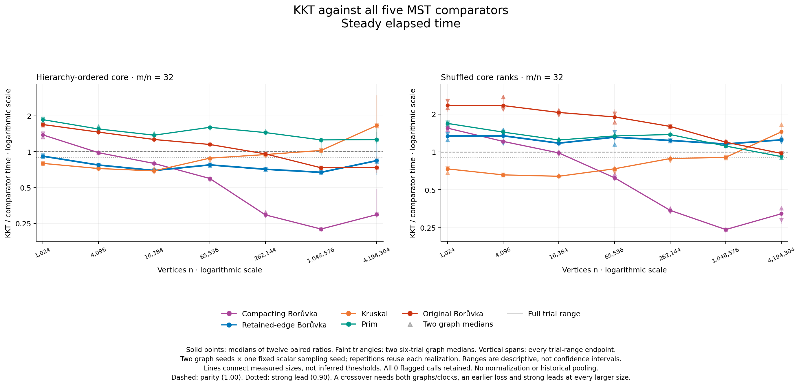
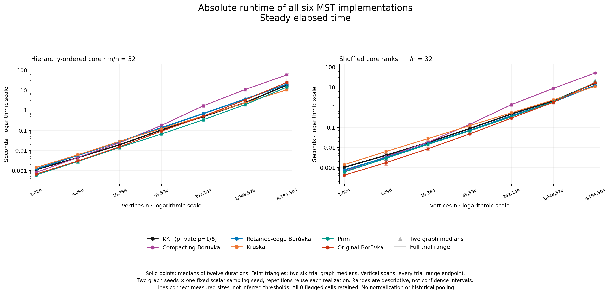

# Eighth sampling over seven hierarchy sizes

**Completed and independently audited.** On hierarchy-ordered attachment graphs, KKT beats retained-edge Borůvka at every measured size by the paired case and graph medians. The lead is narrow at 1,024 vertices and strong from 4,096 through 4,194,304. This is a useful family for the opt-in implementation, but it is **not a loss-to-win size crossover** against retained-edge Borůvka: the smallest measured point already wins. At 4M the margin shrinks and three of twelve trial pairs lose. Shuffling the core weights removes the retained-B advantage at every size.

Three of the ten family/comparator pairs meet the declared sustained strong crossover rule: ordered and shuffled graphs against compacting Borůvka, and ordered graphs against original Borůvka. KKT is not the best case-level solver across all six implementations. Complete losses, reversals and trial ranges are retained below and in the canonical tables.

## What was measured

The [protocol](PROTOCOL.md) and [manifest](manifest.csv) were declared before the preceding paired eighth study's results were inspected. The exact same frozen eighth binary then ran `leaf_hierarchy4` and `leaf_shuffled4` at n = 1,024; 4,096; 16,384; 65,536; 262,144; 1,048,576; and 4,194,304, with m=32n. Graph seeds are 17000011/17000047 and the single sampler seed is 2801. Graph one visits ascending sizes; graph two reverses the full schedule. Each child rotates all six solvers through six timed positions after one checked warmup per solver.

All **28 children and 1,176 solver outputs passed**: 1,008 timed calls and 168 warmups. Each input has an independent MST certificate; every call matches its exact unique-MST IDs, and tuple results also preserve endpoints and weights. Fourteen matched twins have identical topology/order fingerprints and different weighted fingerprints. No result was removed or adjusted.

Each comparison is the median of twelve **paired trial ratios**, retaining each graph's six-trial median. It is not a ratio of absolute-time medians. Repetitions reuse two graph/forest realizations, not twelve independent graphs. Graph seed is confounded with schedule reversal and host history. This single-binary extension cannot estimate the effect of changing half to eighth sampling; that remains the separately [paired experiment](../eighth-sampling-2026-10-15/README.md). Historical timings are not pooled.

## All five comparisons, both clocks

Each cell is KKT/comparator **wall / process CPU**. Below one favors KKT. Dedup B is compacting Borůvka; retained B uses the same retained-parallel contraction helper as KKT. Values are rounded to four decimals only here.

| Family and n | Dedup B | Retained B | Kruskal | Prim | Original B |
|---|---:|---:|---:|---:|---:|
| Ordered 1,024 | 1.3856/1.3865 | 0.9179/0.9195 | 0.7980/0.7974 | 1.8618/1.8576 | 1.6937/1.6904 |
| Ordered 4,096 | 0.9819/0.9832 | 0.7730/0.7727 | 0.7224/0.7225 | 1.5539/1.5576 | 1.4628/1.4616 |
| Ordered 16,384 | 0.7973/0.7973 | 0.6956/0.6955 | 0.6906/0.6906 | 1.3785/1.3783 | 1.2679/1.2685 |
| Ordered 65,536 | 0.5959/0.5959 | 0.7750/0.7750 | 0.8834/0.8834 | 1.6044/1.6045 | 1.1512/1.1511 |
| Ordered 262,144 | 0.2943/0.2943 | 0.7124/0.7124 | 0.9470/0.9470 | 1.4496/1.4496 | 0.9592/0.9592 |
| Ordered 1,048,576 | 0.2238/0.2238 | 0.6713/0.6713 | 1.0254/1.0252 | 1.2579/1.2579 | 0.7330/0.7330 |
| Ordered 4,194,304 | 0.2960/0.2969 | 0.8414/0.8413 | 1.6616/1.6618 | 1.2638/1.2640 | 0.7379/0.7379 |
| Shuffled 1,024 | 1.5474/1.5459 | 1.3398/1.3392 | 0.7332/0.7354 | 1.6865/1.6862 | 2.3556/2.3548 |
| Shuffled 4,096 | 1.2130/1.2150 | 1.3444/1.3441 | 0.6568/0.6575 | 1.4382/1.4389 | 2.3389/2.3383 |
| Shuffled 16,384 | 0.9822/0.9820 | 1.1752/1.1757 | 0.6405/0.6404 | 1.2450/1.2453 | 2.0618/2.0613 |
| Shuffled 65,536 | 0.6233/0.6232 | 1.3116/1.3117 | 0.7344/0.7344 | 1.3402/1.3403 | 1.8998/1.8996 |
| Shuffled 262,144 | 0.3431/0.3432 | 1.2340/1.2340 | 0.8861/0.8861 | 1.3764/1.3764 | 1.5967/1.5967 |
| Shuffled 1,048,576 | 0.2412/0.2412 | 1.1571/1.1571 | 0.9063/0.9063 | 1.1140/1.1140 | 1.1960/1.1960 |
| Shuffled 4,194,304 | 0.3222/0.3222 | 1.2482/1.2481 | 1.4461/1.4453 | 0.9182/0.9185 | 0.9734/0.9734 |



The [CPU figure](figures-attempt01/ratios_cpu.png) uses matched limits. Both figures retain every trial-range endpoint and both graph medians. The [140 comparison rows](analysis/comparisons.csv), [280 graph comparison rows](analysis/graph_comparisons.csv) and [1,680 exact-endpoint paired ratios](analysis/paired_ratios.csv) retain unrounded values. These descriptive ranges are not confidence intervals.

## Strong leads and actual crossover brackets

The rule requires both graphs on both clocks to have medians above one at a smaller measured size, at most 0.90 at a larger size, and at most 0.90 at every still-larger measured size. It does not interpolate a threshold. The primary bracket uses the earliest qualifying upper endpoint and closest measured loss below it. All [70 point states](analysis/crossover_points.csv), [210 endpoint pairs](analysis/crossover_brackets.csv) and [ten outcomes](analysis/crossover_summary.csv) remain available.

| Family | Comparator | Observed outcome |
|---|---|---|
| Ordered | Dedup B | Strong bracket **(1,024, 16,384]**, persists through 4M |
| Ordered | Retained B | Narrow lead at 1,024; strong at all six larger sizes; **no measured lower loss** |
| Ordered | Kruskal | Early strong leads become losses at 1M and 4M |
| Ordered | Prim | Loss at every size by all graph/clock medians |
| Ordered | Original B | Strong bracket **(65,536, 1,048,576]**, persists at 4M |
| Shuffled | Dedup B | Strong bracket **(4,096, 65,536]**, persists through 4M |
| Shuffled | Retained B | Loss at every size |
| Shuffled | Kruskal | Early strong leads become a loss at 4M |
| Shuffled | Prim | Loss through 1M; only a narrow lead at 4M |
| Shuffled | Original B | Loss through 1M; only a narrow lead at 4M |

The ordered retained-B lead is nonmonotonic. Its wall median improves to **0.67130 at 1M** but weakens to **0.84144 at 4M**. At 1M all twelve pairs win, with wall ratios 0.65863–0.68116. At 4M only **9/12** win on each clock: wall ratios span **0.64095–1.46180**, and CPU ratios **0.64862–1.44673**. The four graph/clock medians still lie between 0.83103 and 0.84144, satisfying the strong point classification. That does not mean every trial wins or that the advantage must grow indefinitely. At 1,024 all twelve pairs win, but the four graph/clock medians exceed 0.90, giving only a narrow lead. All 84 shuffled retained-B trial pairs lose on both clocks.

Across 168 pairs per comparator, wall/CPU KKT win counts are dedup B **127/127**, retained B **81/81**, Kruskal **134/133**, Prim **14/14**, and original B **47/47**. Prim's fourteen losses are two ordered-1M pairs and all twelve shuffled-4M pairs. One ordered-1M wall repetition beats all five controls simultaneously (graph 17000047, repetition 5); no CPU repetition does. No case establishes an all-six winner by the declared medians. The isolated wins remain in the raw results and do not justify a broader fastest-solver claim.

## Absolute times and resources

At 4,194,304 vertices and 134,217,728 edges, these are median **wall / CPU seconds**, calculated separately from paired ratios:

| Family | KKT | Dedup B | Retained B | Kruskal | Prim | Original B |
|---|---:|---:|---:|---:|---:|---:|
| Ordered | 17.752/17.747 | 57.310/57.235 | 19.683/19.682 | 10.416/10.395 | 14.116/14.113 | 24.211/24.178 |
| Shuffled | 15.620/15.611 | 50.223/49.978 | 12.298/12.292 | 10.842/10.838 | 16.971/16.959 | 16.542/16.455 |

Ordered 4M KKT wall calls range from **15.153 to 36.876 seconds**; shuffled 4M calls range from **13.008 to 19.412 seconds**. No slow call is trimmed. All six solvers, fourteen cases, graph medians and full ranges are in [summary.csv](analysis/summary.csv) and [graph_summary.csv](analysis/graph_summary.csv).



The [CPU absolute-time figure](figures-attempt01/times_cpu.png) retains the same series and matched axis limits. All four PNGs passed independent visual inspection; see [figure QA](figures-attempt01/QA.md). Final report page-scale legibility remains a separate check.

The full capture lasted **86.6785 minutes**. Sampled whole-group RSS peaked at **28.1561 GiB**, below the unchanged 40 GiB ceiling; all 2,636 RSS observations were available. This is sampled campaign memory, not a continuous or solver-specific maximum. All 28 native groups were verified empty, the actual controller exited zero, and no clock flags occurred. Archived power-log correlation found no logged sleep overlap; **verified sleep inhibition is not claimed**. Zero flags do not explain or erase the broad 4M variation.

## What the graph mechanism does and does not explain

Each ordered graph has three cheap leaves per core vertex. Cheap core path ranks force aligned dyadic Borůvka partitions while high chords remain between many components. Retained B repeatedly visits those crossing records; KKT can use a sampled forest to filter most of them. The [exact retention model](../larger-hierarchy-2026-10-15/HIERARCHY_EXPECTATION.md) and [small sampling witness](../larger-hierarchy-2026-10-15/SAMPLING_MECHANISM.md) explain that structural opportunity. They are theoretical/illustrative work, not measured counters or CPU attribution for these extension inputs.

The [paired eighth work study](../eighth-sampling-2026-10-15/work/README.md) supports a separate implementation mechanism: reducing the sample branch can lower cumulative work despite more filtered survivors. It uses different declared inputs; its numbers are not substituted for counters here. The shuffled twins directly show that cheap leaves and topology alone are insufficient for the retained-B advantage. Prim and Kruskal remain relevant strong controls; a delayed Borůvka hierarchy need not delay them similarly.

These are engineered families, not a claim about natural-graph prevalence. At n=1,024 the 256-vertex core has 32,000 of 32,640 possible edges; larger cores keep average degree 250 but become proportionally sparser. The largest case exactly reaches the supported n/m limits. No domain or memory ceiling was raised. The seven-point curve is finite evidence, not an empirical proof of expected-linear runtime or asymptotic dominance.

## Validation, provenance and reproduction

The [independent audit](validation/independent-numerical-audit-attempt01/README.md) reconstructed all 1,680 ratios, 924 comparison/absolute summary rows, seventy point states, 210 brackets and ten outcomes using exact Fraction arithmetic. It independently rechecked certificates, twins, raw concatenation, clock/resource records and empty groups without importing the collector. The strict analyzer and audit agree. The [audit receipt](validation/independent-numerical-audit-attempt01.json) and [plot receipt](validation/plots-attempt01.json) preserve actual zero exits.

The extension [freeze](freeze.json) has SHA-256 `aa2f9ae7385105eb7185b864a1f46387f8a02ebe8b967f041d3d0cef5ffa7bc5`; the unchanged eighth executable has SHA-256 `954068775a83e1c42db62ffb6777c398dc05fd5792c60d2f293df6532130951a`. Capture revision: `cb0c2089221ac5ad56f53acca2ad1e13dcd2838b`. The full parent proof checks both paired variants, source/recipe, native architecture, compiler/SDK, objects, binary and stack profile. This is an opt-in retained-edge/direct-Edge/compressed-query/eighth-sampling build; the ordinary default is not promoted or changed.

[PRECAPTURE_STATUS.md](PRECAPTURE_STATUS.md) preserves the prior readiness README exactly; [PREPARATION_STATUS.md](PREPARATION_STATUS.md) and the frozen protocol retain their historical prospective wording. Reproduce existing analysis without launching solvers, from the recorded worktree:

```text
/usr/bin/python3 -B benchmark/run_eighth_extension.py analyze \
  --capture benchmark/results/eighth-extension-2026-10-15/extension.json \
  --output-dir <NEW_EXCLUSIVE_ANALYSIS_DIRECTORY>

/usr/bin/python3 -B benchmark/plot_eighth_extension.py \
  --capture benchmark/results/eighth-extension-2026-10-15/extension.json \
  --output <NEW_EXCLUSIVE_FIGURE_DIRECTORY> --released
```

Supply the archived power log explicitly to reproduce its diagnostic correlation; no private event text is needed in the public report. A new performance run requires the frozen collector's separate bounded release and an exclusive capture. Original-machine paths and ignored binary/object dependencies remain honestly recorded: a copied report is not a portable native rebuild.
