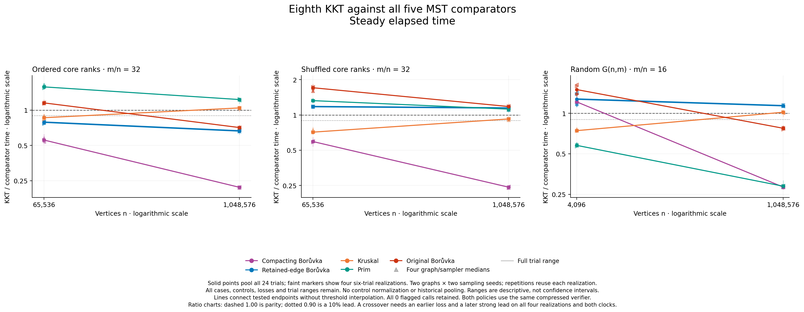
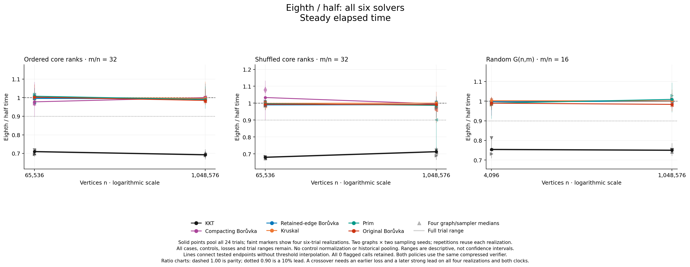

# Scalar half versus eighth sampling

**Completed: eighth sampling reduces KKT time by 24.6–32.0% across all six case
medians; all 144 paired KKT trials improve on both clocks.** On the ordered
hierarchy it takes 21.1% less time than retained-edge Borůvka at 65,536 vertices
and 33.5% less at 1,048,576. Both endpoints satisfy the declared strong-lead
rule. This is a substantial lead, but not an observed size crossover: there is
no losing endpoint in these two sizes. The shuffled-weight twin still loses to
retained-edge Borůvka. No case makes KKT fastest among all six solvers.

The complete [strict analysis](analysis/README.md) and [independent raw
audit](validation/independent-numerical-audit-attempt01/audit.json) agree on all
2,016 outputs, 4,608 paired clock ratios, 3,024 summary rows and 30 endpoint
classifications. The exact [pre-capture status](PRECAPTURE.md), [initial
preparation](PREPARATION_STATUS.md), [protocol](PROTOCOL.md) and [manifest](manifest.csv)
remain available.

## What changed and what was checked

Only a private sampling predicate changes. Both policies consume one MT19937
word per visited edge: half accepts odd words, eighth accepts low-three-bit
all-ones words. Both keep reserve(m/2), the compressed verifier, retained
parallel records, direct Edge queries and the unchanged public half sampler.
Only kkt.o differs; both final binaries physically share seven non-KKT
production objects and the harness main. This is separate from packed-bit
sampling. Equal seeds do not imply equal recursive forests across rates.

The [fixed-p note](../../../docs/kkt-report/FIXED_SAMPLING_PROBABILITY.md) gives
the expected-linear-work argument under its stated assumptions. A smaller
sample weakens the light-edge bound; neither speed nor lower memory follows
from the predicate alone.

The implementation commit is `116c31604df16c88460f4ab41cc6341b95d97a29`.
[Native](validation/native-controller-attempt01.json) and
[ASan/UBSan](validation/sanitizer-controller-attempt01.json) profiles each passed
20 positive suites and four wrong-policy negatives. Full-KKT checks preserve
1,344 input/MSF pairs; the half path replays all 65 parent counters, while 543
fixtures witness legitimately changed recursive work. Direct verifier,
private/public sampling and final linked-object checks are separate gates.
The [final-object receipt](validation/final-controller-attempt01.json) combines
actual object certificates, two byte-identical KKT recompilations and a
separate same-flags sampler oracle; it does not claim to trace private RNG
calls inside the existing timing executable. Controller/builder/collector
mocks passed 4/7/14 groups. All native groups exited and were verified empty.
The [independent readiness review](validation/INDEPENDENT_READINESS_REVIEW.md)
rechecked 331 pinned artifacts and the complete original parent proof.

[Freeze](freeze.json) SHA-256
`2be7556d15b58f3f65cc380ac22b67c57fdf8aea747d651b9d648c6a1aa59d2f`
passed preflight at `0fec3ee75d5065c776a55656a13e1062e13426c3`.
The capture ran at `d45a1c03d38a4947c3285370d28590816e06ff13` after other owned
runtime work stopped. The intervening evidence merges did not change native
source. The ordinary/default path remains unchanged; this candidate is opt-in.

## All five direct comparisons

Values are medians of 24 matched wall-time ratios, KKT divided by comparator.
Lower favors KKT. The [complete both-clock table](analysis/comparisons.csv)
retains every range, realization and loss; CPU supports the same classifications.

| Eighth case | Deduplicating B | Retained B | Kruskal | Prim | Original B |
|---|---:|---:|---:|---:|---:|
| Ordered 65,536 | 0.5564 | **0.7891** | 0.8612 | 1.5769 | 1.1523 |
| Ordered 1,048,576 | 0.2200 | **0.6648** | 1.0435 | 1.2301 | 0.7103 |
| Shuffled 65,536 | 0.5930 | 1.1794 | 0.7138 | 1.3254 | 1.7076 |
| Shuffled 1,048,576 | 0.2420 | 1.1472 | 0.9248 | 1.1216 | 1.1808 |
| G(n,m) 4,096 | 1.2157 | 1.2748 | 0.7432 | 0.5780 | 1.5003 |
| G(n,m) 1,048,576 | 0.2832 | 1.1384 | 1.0182 | 0.2875 | 0.7740 |

All 24 ordered trial pairs at each size beat retained B on both clocks. At 1M,
wall realization medians span 0.66118–0.67697 and the largest individual wall
ratio is 0.69830. At 65K the realization range is 0.76529–0.79609. This margin
is substantially larger than the earlier half candidate's narrow lead, but
persistence at 4M remains untested for this policy at this cutoff.

At 1M ordered vertices and 33,554,432 edges, eighth median wall times are
2.402 s KKT, 3.623 s retained B, 10.946 s deduplicating B, 2.298 s Kruskal,
1.957 s Prim and 3.398 s original B. Dividing these absolute medians does not
reproduce the paired-ratio statistic.



Across 144 pairs per comparator, eighth KKT wins 120 against deduplicating B,
48 against retained B, 101 against Kruskal, 48 against Prim and 48 against
original B, on each clock. All shuffled and G(n,m) trials still lose to retained
B. At 1M ordered vertices, Kruskal wins 22/24 and Prim all 24. No measured case
is an all-six winner.

## The isolated sampling-rate effect

These ratios compare fresh same-source half and eighth binaries. Historical
timings are not pooled, and unchanged-control drift is not subtracted.

| Case | Eighth/half wall | CPU | Wall realization range |
|---|---:|---:|---:|
| Ordered 65,536 | 0.70977 | 0.70977 | 0.69499–0.71926 |
| Ordered 1,048,576 | 0.69269 | 0.69270 | 0.68574–0.70214 |
| Shuffled 65,536 | 0.68019 | 0.68020 | 0.67261–0.68443 |
| Shuffled 1,048,576 | 0.71311 | 0.71311 | 0.69063–0.72391 |
| G(n,m) 4,096 | 0.75383 | 0.75380 | 0.73169–0.81339 |
| G(n,m) 1,048,576 | 0.74988 | 0.74988 | 0.74114–0.75537 |



All 144 KKT pairs improve on both clocks. Unchanged-control case ratios span
approximately 0.97735–1.03339 across both clocks. There are four graph/sampler
realizations per case, from two graphs crossed with two sampler seeds; each
realization is repeated six times. Ranges are descriptive, not confidence
intervals. The two clocks are not independent experiments.

The source tradeoff is concrete. After the ordered 1M input's first two
contractions, q=131,072 and r=32,636,928. Half sampling has expected sample size
16,318,464 and expected-light-edge bound 262,144. Eighth lowers the former to
4,079,616 while raising the latter to 1,048,576. The parent still verifies its
residual graph and both recursive executions can differ. This is theoretical
accounting, not a measured CPU breakdown. The [separately declared work
study](work/PROTOCOL.md) preserves all 48 inputs; its native capture remains
pending at this report cutoff.

## Every endpoint outcome

The exact [classification table](analysis/strong_crossover_classifications.csv)
keeps all 30 outcomes. L=loss, S=strong lead, N=narrow lead, M=mixed or tied.
An arrow goes from the smaller to larger size and uses all four realization
medians on both clocks. A strong observed crossover is L→S; S→S has no observed
losing endpoint, and S→L reverses a prior lead.

| Policy / family | Deduplicating B | Retained B | Kruskal | Prim | Original B |
|---|---|---|---|---|---|
| Half / ordered | S→S | L→N | L→L | L→L | L→L |
| Half / shuffled | N→S | L→L | L→L | L→L | L→L |
| Half / G(n,m) | **L→S** | L→L | M→L | S→S | L→M |
| Eighth / ordered | S→S | S→S | **S→L** | L→L | **L→S** |
| Eighth / shuffled | S→S | L→L | S→N | L→L | L→L |
| Eighth / G(n,m) | **L→S** | L→L | **S→L** | S→S | **L→S** |

Four strong brackets occur: G(n,m) versus deduplicating B under both rates,
G(n,m) versus original B under eighth, and ordered hierarchy versus original B
under eighth. The hierarchy bracket is (65,536,1,048,576]; G(n,m) uses
(4,096,1,048,576]. No intermediate threshold or beyond-endpoint dominance is
inferred. The seven-size extension was declared before these timings were
inspected; it will test smaller endpoints and the previous 4M reversal point.

## Completion, figures and reproduction

The [actual controller receipt](controller-execution.json) records exit zero,
48 empty native groups and 65.3455 minutes for the campaign. Sampled group RSS
peaked at 8.33675 GiB; no observations were unavailable, and no call/capture
clock checks were flagged. Power-log query exited zero, and correlation found
no logged sleep overlap with calls. Caffeinate failed to establish an
assertion: sleep inhibition, an idle host and stable thermals are not claimed.
The private power log is ignored; its query/hash receipt remains available.

Strict analysis, six independent audit mock groups, the actual raw audit and
ten figures passed on first execution, each with actual exit zero and empty
group proof. The audit reconstructs ratios/medians/thresholds using exact
Fractions without collector aggregation. [Visual QA](validation/visual-review-attempt01.json)
inspected all ten PNGs at original resolution. The [figure index](figures-attempt01/README.md)
contains both policies' all-five ratios, all-six times and all-six policy
ratios on both clocks, as PNG/SVG/PDF. Report-scale legibility remains separate.

The [raw capture](eighth.json), [combined CSV](eighth.csv), child records and all
analysis tables remain. Reanalysis launches no solver:

```sh
/usr/bin/python3 -B benchmark/run_eighth_sampling.py analyze \
  --capture benchmark/results/eighth-sampling-2026-10-15/eighth.json \
  --output-dir /tmp/kkt-eighth-reanalysis
```

Use a fresh directory. Optional power correlation requires the archived
private log. Frozen proofs reference the original local parent artifacts,
which must remain available. This study supplies neither a new Google
Benchmark fit nor a hardware profile. Public/default behavior was not
promoted by this evidence-only result.
