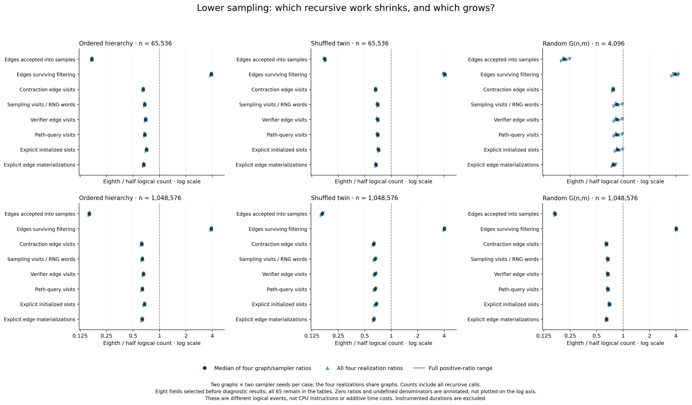

# What eighth sampling changes in the recursive work

The complete, independently audited diagnostic matrix confirms that lower
sampling reduces several major kinds of work while increasing others. On the
million-vertex ordered hierarchy, the median paired eighth/half ratio is
**0.6281 for contraction edge visits, 0.6738 for explicit initialized slots and
0.6356 for explicit edge materializations**. Cumulative edges surviving
filtering increase to **3.8808 times** the half-policy count. The smaller sample
branch more than offsets that increase for the particular counters below.
Logical events are not CPU instructions or additive time costs; the separate
[uninstrumented paired experiment](../README.md) establishes the timing gains.

This study reuses the same six cases, two graph seeds, two sampler seeds and
both policies as that experiment. All **48 native inputs, 144 certified solver
outputs, 96 replay chains and 1,000 replay-round rows** completed. The actual
controller session 51102 exited zero; every owned native group was observed
empty. Capture SHA-256 is
`b7160f59fa2b953e9cd0b55f8bccb049512568ed758870bd57b43664806ee172`.
No native or timing code changed, and no new executables were built.

## All six cases, including the cost that grows

Each entry is the median of four exact paired counter ratios, eighth divided
by half. The four realizations cross two graphs with two sampler seeds; they
are not four independent graphs. Counts include **all recursive calls**, not
just the root. These eight fields were selected before reading diagnostics;
all 65 fields remain in the companion tables.

| Case | Sampled edges | Surviving edges | Contraction visits | Sampling visits / RNG words | Verifier edge visits | Path-query visits | Initialized slots | Materializations |
|---|---:|---:|---:|---:|---:|---:|---:|---:|
| Ordered, 65,536 | 0.1699 | 3.8839 | 0.6516 | 0.6785 | 0.6958 | 0.6799 | 0.7116 | 0.6600 |
| Shuffled, 65,536 | 0.1751 | 4.0374 | 0.6629 | 0.6989 | 0.6995 | 0.6994 | 0.7150 | 0.6690 |
| Ordered, 1,048,576 | 0.1591 | 3.8808 | 0.6281 | 0.6364 | 0.6577 | 0.6382 | 0.6738 | 0.6356 |
| Shuffled, 1,048,576 | 0.1634 | 4.0161 | 0.6307 | 0.6536 | 0.6541 | 0.6541 | 0.6712 | 0.6337 |
| G(n,m), 4,096 | 0.2145 | 3.9352 | 0.7698 | 0.8476 | 0.8483 | 0.8480 | 0.8672 | 0.7771 |
| G(n,m), 1,048,576 | 0.1677 | 4.0183 | 0.6480 | 0.6709 | 0.6711 | 0.6718 | 0.7004 | 0.6488 |

Attachment cases have m/n=32; G(n,m) cases have m/n=16. Every realization
reduces the seven displayed non-filter fields, while every realization
increases surviving edges. The small G(n,m) case has much more variable savings:
its sampling-visit ratios span 0.7936 to 0.9840. No realization was removed.

[SVG](figures-attempt01/work_ratios.svg) and [PDF](figures-attempt01/work_ratios.pdf)
exports accompany the figure. The original-resolution visual review passed;
legibility inside the consolidated report still requires its own layout check.

## Why the accepted sample shrinks by more than fourfold

Both implementations draw exactly one scalar MT19937 word per visited sampling
edge. Changing the acceptance predicate from `(word & 1) == 1` to
`(word & 7) == 7` does not immediately make a single scan use fewer words.
It lowers acceptance probability, then changes the sizes and shapes of later
recursive inputs. Consequently, the total number of sampling visits also falls.

For ordered 1M, the median paired sampling-visit ratio is 0.6364 and the
accepted-edge ratio is 0.1591. The latter is close to one quarter of the former,
as expected from the changed acceptance probability, but these are measured
recursive totals from finite seeded streams, not an identity imposed on them.
The median total accepted counts normalized by original m change from 0.9034m
to 0.1437m; median sampling visits change from 1.8069m to 1.1495m. Ratios of these
marginal medians must not replace the paired estimates above.

The opposite branch becomes larger. On ordered 1M, cumulative survivors rise
from a median 0.01134m to 0.04402m. On shuffled 1M they rise from 0.00420m to
0.01685m; on random 1M from 0.00675m to 0.02718m. Those totals sum survivors over
recursive verifier calls: they are not root survival probabilities, disjoint
edge sets, or direct timings. They show why a nearly fourfold increase can
coexist with a much smaller sample branch and fewer overall contraction visits.

The unchanged initial contractions and unchanged comparator continuations are
checked separately. Changing p may legitimately change later KKT forests,
recursion depth, query counts and initialization; the earlier query-compression
study's equal-work identities do not apply across sampling rates.

## Query sharing still matters, and not every counter improves

For compressed queries, Q counts cumulative logical endpoint requests and
U=`path_query_visits - 2Q` counts the corresponding distinct per-call answers.
The diagnostic validates 0≤U≤Q. On ordered 1M, U/Q ranges from 0.7908–0.8959%
under half sampling and 1.2792–1.4944% under eighth sampling. The distinct-request
fraction increases even as total path-query visits fall by a median 36.2%.
U is summed over calls; it is not a global uniqueness count across recursion.

Across the entire **1,560 paired field records**, 774 decrease, 491 increase and
295 are equal. There are 1,501 defined ratios and 59 both-zero cases; no
half-zero/eighth-positive denominator occurs. These heterogeneous fields include
volumes, calls, depths and operational counters. Counting how many go up or
summing them into a work score cannot establish a runtime percentage. All
increases and zeros remain in [paired_kkt_work.csv](analysis-attempt01/paired_kkt_work.csv).
Comparator hash-insertion work is deliberately unmeasured: its 96 null cells
remain null, rather than being reported as zero.

## Validation and reproduction

The prospective [protocol](PROTOCOL.md), [freeze](freeze.json) and
[pre-capture status](PRECAPTURE_STATUS.md) preserve the original declaration.
Freeze SHA is `e9b556e7d92bb0c73597a185112170ed649752957e64a484f44770887a331d04`.
Its 483 artifact bindings include the instrumented source/build recipes,
unchanged physical objects and completed timing ancestry. Both diagnostic
binaries use the compressed verifier; seven non-KKT objects and the main are
physically shared. Their successful native/sanitizer/dispatch proofs predate
this capture.

The 13 collector and six independent audit mock groups passed before release.
After native completion, strict verification, analysis, independent raw-counter
audit and figure generation each passed on its first attempt, with actual zero
exits, unchanged bound inputs and empty owned groups. The independent audit
reconstructed **9,360 counter cells, 96 chains, 48 query records and 1,608 exact
ratio records** without importing collector aggregation. Its
[audit receipt](independent-counter-audit-attempt01/audit.json) includes the
complete input inventory. The five canonical tables are
[work](analysis-attempt01/work.csv), [rounds](analysis-attempt01/rounds.csv),
[round chains](analysis-attempt01/round_chains.csv),
[query work](analysis-attempt01/query_work.csv), and
[paired counters](analysis-attempt01/paired_kkt_work.csv).

The controller took 1,080.551 seconds (about 18 minutes) and sampled at most
5.6150 GiB of whole-process-group RSS, with zero unavailable observations.
These instrumented campaign/resource figures are not solver performance or a
continuous memory maximum. The actual external exit is recorded in
[controller-execution.json](controller-execution.json). The sequential commands
for strict reproduction are preserved in [POSTCAPTURE_HANDOFF.md](POSTCAPTURE_HANDOFF.md);
existing attempt paths must not be overwritten.

The mechanism is consistent with the separate timing improvement, but it does
not by itself explain cache misses, allocator costs or CPU time. The unchanged
retained-edge comparator still beats eighth KKT on the shuffled and G(n,m)
timing cases. A useful optimization of KKT need not change which complete
algorithm wins each family.
