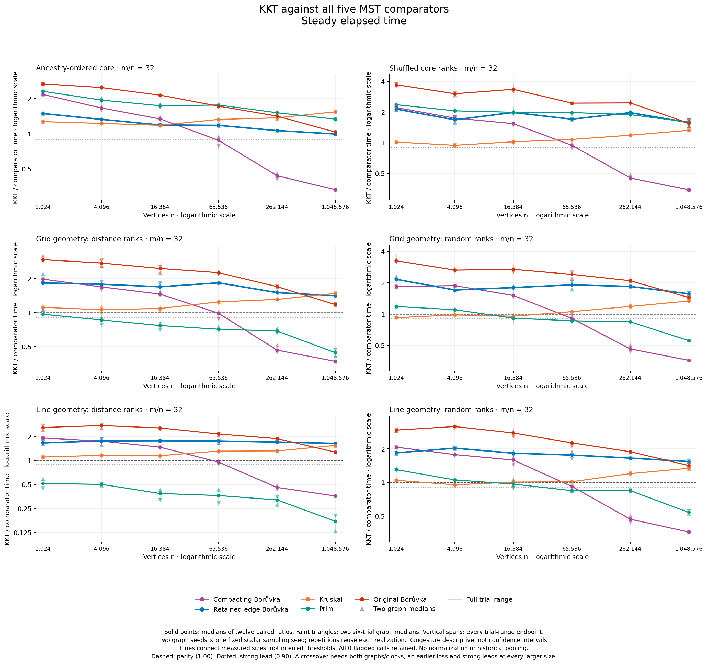
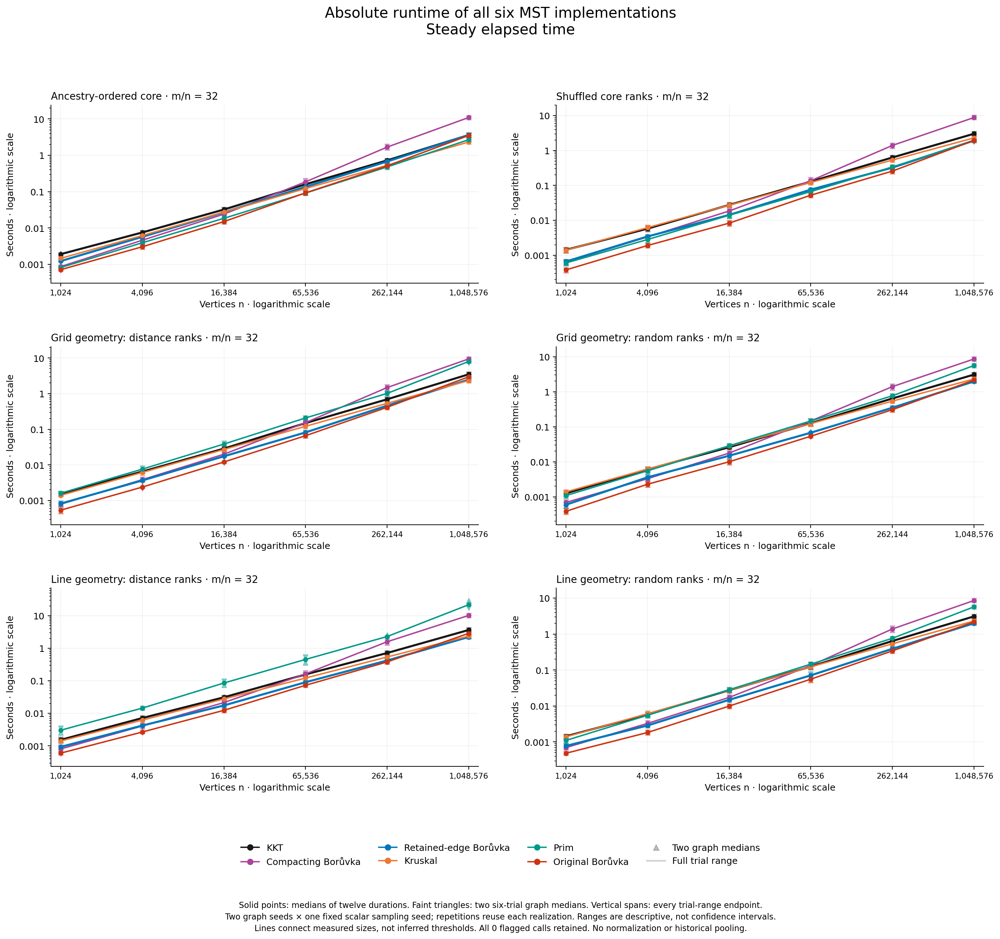

# Does the KKT improvement generalize across graph families and sizes?

**No strong crossover against retained-edge Borůvka was found.** The closest case is the ancestry-ordered leaf core at 1,048,576 vertices: KKT's pooled paired ratio is 0.9960 on wall time and 0.9959 on CPU time, with only **7 of 12 individual pairs won** on either clock. Original Borůvka beats KKT in every one of the 432 timed pairs on both clocks, so there is no all-six-solver winning trial or case.

There are substantial measured advantages against the deduplicating compactor and selected Prim cases. All **3,024 solver outputs** passed exact validation; strict analysis and an [independent raw audit](validation/independent-numerical-audit/README.md) agree. These results extend the search without weakening the stronger contraction baseline. The [pre-capture status](PRECAPTURE_STATUS.md), [source preparation](SOURCE_PREPARATION.md) and prospective protocol retain their historical wording.

This study uses the exact frozen **compressed-query KKT** binary from the [preceding implementation experiment](../compressed-query-2026-10-15/README.md). There is no new optimization, rebuild or family-specific dispatch. KKT retains parallel edges, passes Edge records directly to the verifier, compresses repeated path requests, and keeps the scalar one-draw-per-edge sampler. All five MST competitors are unchanged: deduplicating compacting Borůvka, retained-edge multigraph Borůvka, Kruskal, Prim and original Borůvka. Dijkstra is not an MST algorithm and is not included.

“Held out” describes the prospectively fixed matrix and fresh graph/sampling seeds. These family definitions have been investigated before; their earlier timings motivate this question but are not pooled into any estimate here.

## Fixed comparison

The [manifest](manifest.csv) contains all six families at **n = 1,024; 4,096; 16,384; 65,536; 262,144; 1,048,576**, with **m = 32n** and zero intrusion. Every ordered-weight family has a topology-matched random-rank control. Graph seeds are 9000011/9000049; scalar sampling seed is 2003. Six timed repetitions reuse each graph/sampling realization, following one checked warmup for every solver.

The complete campaign contains **72 children, 3,024 certified outputs, 2,592 timed calls and 432 warmups**. Within each child every solver occupies every timed position once. The second graph reverses the entire case order; adjacent weight twins and rotating family groups counterbalance order but do not remove graph-seed/order/host-state confounding. All 36 topology-twin checks passed, including different weighted fingerprints.

Retained-edge Borůvka is the main comparator for asking whether KKT's randomized continuation repays its additional work. Beating only the deduplicating compactor is insufficient. Every conclusion must retain the other four comparisons and distinguish winning against one implementation from being fastest among all six.

## What the families test

| Weight twins | Actual construction | Mechanism being tested, not a predicted winner |
|---|---|---|
| `leaf_distance4` / `leaf_shuffled4` | Random simple core with a forced path; three cheaper leaf edges per core vertex. Ancestry-tiered versus shuffled core ranks. | Cheap attachments expose a dense residual core. Ordered merges can keep many core edges crossing components for repeated rounds. |
| `grid2d_metric` / `grid2d_random` | Jittered square-grid scaffold plus uniformly sampled distinct shortcuts. Squared-distance ranks versus shuffled ranks. | Geometry separates local connections from many longer shortcuts, potentially allowing KKT to discard work that repeated contraction would retain. |
| `line_metric` / `line_random` | Positive-gap path scaffold plus uniformly sampled distinct shortcuts. Line-distance ranks versus shuffled ranks. | The metric-order path is the MST; repeated interval contractions and shortcut filtering compete, subject to a fixed-gap-alphabet limit. |

These definitions come from the existing [attachment generator](../../core_attachment_fixtures.hpp) and [spatial generator](../../crossover_fixtures.hpp). They are synthetic graph/weight models, not road networks, application datasets, k-nearest-neighbor graphs or pure planar meshes. Stored weights are distinct ordinal ranks. A distance-induced ordering does not imply the rank integers satisfy a triangle inequality.

For attachments, q=n/4 core vertices support `core_m = 32n−3q = 125q` edges, an average core degree of 250. At the smallest n, q=256 and the core contains 32,000 of 32,640 possible pairs: occupancy 50/51. The larger cases have the same average degree but a declining occupied fraction. This finite-size structural change must remain visible when interpreting a crossover.

In `leaf_distance4`, each core edge's tier is `floor(log₂(u xor v))`, with distinct ranks within tiers. The forced path ensures dyadic sibling-block merges, although shortcuts can enter the MST. These deterministic full-graph contraction partitions match the hierarchy construction on the same topology; sampled forests and verifier work may differ. The shuffled twin randomizes core ranks while retaining cheaper leaves, so both begin with star collapse. It is not a global random-weight control.

Grid instances have side lengths 32 through 1,024. Their local MST can use shortcuts and need not produce balanced or dyadic contraction. Geometry may make many long edges redundant, but that does not establish that sampling/filtering is cheaper than the competitor's actual scans. The matched random twin holds topology, IDs, labels, physical order and geometry fixed while changing the weight ranks.

The narrow line has a specific limitation. Positive path gaps are drawn from integers **1…1,024**; equal-distance path edges are ranked by increasing original edge ID, before label/order shuffles. A shortcut is longer than every path edge it spans, making the forced path the unique MST. Full-graph Borůvka components remain contiguous intervals. Each round removes all boundaries at the smallest remaining gap; within an equal-gap run the right-hand component chooses its lower-ranked left boundary. Thus there are at most 1,024 rounds, in addition to the usual halving bound. This fixed alphabet cannot support an unbounded logarithmic round separation as n grows. It neither identifies a finite runtime winner nor applies to arbitrary sampled subgraphs inside KKT.

The expected benefit of KKT is avoiding repeated consideration of edges that its sampled-forest verifier can reject. The cost is sampling, recursive solving, preprocessing and query lookups. Query compression can reduce duplicate answer work, but a control that rapidly collapses components may still be cheaper. These are source-grounded hypotheses. New work counts or hardware-causal explanations are not measured by this timing campaign.

## See the constructions on separate small graphs


This existing [line/grid export](../crossover-2026-10-13/graph-views-final/README.md) contains complete **n=128, m=512, graph-seed 3037** fixtures, with actual coordinates, certified MSTs and two older deduplicating contraction rounds. It is not this study's density, seed, timed input, compressed-query trace or retained-parallel quotient. Line-edge curvature is visual routing; the vertices themselves remain on a line.

The [attachment atlas](../search-2026-10-13/attachment-atlas-figures/README.md) shows separate **n=1,024, d=16, graph-seed 5009** fixtures. All MST edges and a fixed 192-core-edge context set are displayed; the full background graph is not drawn. Positions are illustrative, not edge costs. The [interactive distance/shuffled views](../search-2026-10-13/attachment-views-d16/README.md) expose actual older compacting rounds, with an explicit unresolved browser-rendering QA limitation. None of these small illustrations is a downsampled timing graph or evidence of a crossover in the current campaign.

## Measured outcomes

The table summarizes all **30 family/comparator outcomes**. “Loss throughout” means all four graph/clock medians exceed one at every measured size. A bracket is the prespecified strong crossover, not an interpolated threshold. Full point states, individual losses and all 450 possible endpoint pairs remain in [the canonical analysis](analysis/README.md).

| Family | vs dedup B | vs retained B | vs Kruskal | vs Prim | vs original B |
|---|---|---|---|---|---|
| Leaf distance | (16,384, 262,144] | Narrow lead only at 1M | Loss throughout | Loss throughout | Loss throughout |
| Shuffled core | (16,384, 262,144] | Loss throughout | Small lead reverses | Loss throughout | Loss throughout |
| Grid distance ranks | (16,384, 262,144] | Loss throughout | Mixed at 4K; otherwise losses | Strong from 16K; no earlier strict loss | Loss throughout |
| Grid random ranks | (16,384, 262,144] | Loss throughout | Narrow through 16K; then losses | (4,096, 65,536] | Loss throughout |
| Line distance ranks | (16,384, 262,144] | Loss throughout | Loss throughout | Strong at every size | Loss throughout |
| Line random ranks | (16,384, 262,144] | Loss throughout | Small lead/mixed results reverse | (4,096, 65,536] | Loss throughout |

Thus eight of the thirty comparisons qualify: all six families against the deduplicating compactor, and the two spatial random-rank families against Prim. The grid-distance Prim lead starts without a strict losing endpoint; the line-distance lead already exists at the smallest size. Neither is an observed strong crossover under the declared rule. No retained-edge, Kruskal or original-Borůvka comparison qualifies.

Across 432 paired trials per comparator, KKT wins **206** against deduplicating Borůvka, **7** against retained-edge Borůvka, **81** against Kruskal and **0** against original Borůvka on each clock. Against Prim it wins **231 wall / 230 CPU** pairs. These totals retain repeated trials and small-size losses; they are not independent-graph probabilities.



The [CPU ratio figure](figures-attempt01/ratios_cpu.png) preserves the same axes and all observations. Solid points are medians of twelve trial ratios; graph medians use six. These are two graph realizations and one fixed sampler, not twelve independent graphs or forests. Ranges are descriptive, not confidence intervals. [Both reviewers' visual QA](figures-attempt01/QA.md) passed for all four original-resolution figures and all 24 panels.

At **n=1,048,576, m=33,554,432**, the full five-way comparison is:

| Family | Clock | KKT / dedup B | KKT / retained B | KKT / Kruskal | KKT / Prim | KKT / original B |
|---|---|---:|---:|---:|---:|---:|
| Leaf distance | Wall | 0.3307 | 0.9960 | 1.5426 | 1.3348 | 1.0336 |
| Leaf distance | CPU | 0.3307 | 0.9959 | 1.5426 | 1.3348 | 1.0336 |
| Shuffled core | Wall | 0.3433 | 1.5772 | 1.3238 | 1.5920 | 1.5550 |
| Shuffled core | CPU | 0.3433 | 1.5772 | 1.3238 | 1.5920 | 1.5550 |
| Grid distance | Wall | 0.3691 | 1.4106 | 1.4791 | 0.4405 | 1.1762 |
| Grid distance | CPU | 0.3691 | 1.4106 | 1.4791 | 0.4405 | 1.1762 |
| Grid random | Wall | 0.3589 | 1.5645 | 1.3327 | 0.5553 | 1.4406 |
| Grid random | CPU | 0.3589 | 1.5645 | 1.3327 | 0.5553 | 1.4406 |
| Line distance | Wall | 0.3581 | 1.6387 | 1.5460 | 0.1723 | 1.2717 |
| Line distance | CPU | 0.3581 | 1.6387 | 1.5460 | 0.1723 | 1.2717 |
| Line random | Wall | 0.3600 | 1.5402 | 1.3380 | 0.5389 | 1.4166 |
| Line random | CPU | 0.3600 | 1.5402 | 1.3380 | 0.5389 | 1.4166 |

Ratios below one favor KKT; these are paired-ratio medians, not ratios of separate time medians. The ancestry-ordered case's four retained-edge graph/clock medians span **0.9935527–0.9988706**. Its seven individual wins and five losses make this a near-parity result, far short of the 0.90 threshold. The other five large families are **41–64% slower** than retained-edge Borůvka.

The strong Prim results are real implementation comparisons: line-distance KKT uses about 17.2% of Prim's time at the largest point. They do not establish that KKT is the best MST choice there: retained-edge Borůvka, Kruskal and original Borůvka all remain faster. Likewise, core ordering matters relative to the retained-edge control, but the timing observations alone do not identify a hardware cause or assign the difference to sampling.



The [CPU absolute-time figure](figures-attempt01/times_cpu.png) completes the view. On the largest ancestry case, wall-time medians are KKT **3.622 s**, retained-edge Borůvka **3.630 s**, original Borůvka **3.519 s**, Prim **2.696 s** and Kruskal **2.333 s**; the deduplicating compactor takes **11.009 s**. All sizes and both graph medians are retained in [summary.csv](analysis/summary.csv) and [graph_summary.csv](analysis/graph_summary.csv). Their individual medians do not algebraically reproduce the paired-ratio median.

## Reading a crossover without overstating it

The [prospective rule](PROTOCOL.md) classifies each size from its **four exact graph/clock medians**: all ≤0.90 is a strong lead; all <1 without meeting that threshold is a narrow lead; all >1 is a loss; everything else is mixed or tied. Exact rational arithmetic prevents rounding a value just above 0.90 into a pass.

A strong bracket requires a measured loss at an earlier size, a strong lead at a later size, and a strong lead at **every still-larger measured size**. All 180 point states, 450 earlier/later endpoint pairs and 30 family/comparator summaries are retained. The representative bracket takes the earliest qualifying upper endpoint, then the closest measured loss below it. Earlier reversals remain visible.

A small lead that later disappears is not a sustained crossover. A lead at every size supplies no observed losing endpoint. A last-point lead establishes no persistence beyond the sampled range. Lines connect observations; they do not interpolate a crossing or demonstrate monotonicity. Even a passing strong bracket is not an asymptotic-dominance proof or a Google Benchmark complexity fit.

This campaign does not run a Google Benchmark complexity fit. GoogleTest-style correctness gates and finite timing ratios cannot prove expected linear complexity. At fixed m=32n, an empirical size trend can motivate another prospectively declared measurement; it cannot establish an eventual dominant algorithm outside these sizes, distributions, seeds and implementations.

## Evidence and reproduction

The [preparation validation](validation/VALIDATION.md) retains first-attempt owner and independent **nine-group mocked passes**, exact command/source receipts and empty process-group evidence. These tested the collector and strict reload without executing native solvers. [Preflight](validation/preflight-attempt01.json), [seed nonreuse scope](validation/seed-nonreuse-check.json), [freeze](freeze.json) and [parent native correctness](../compressed-query-2026-10-15/validation/NATIVE_VALIDATION.md) remain linked. Their historical status text is not a current performance result.

The independent audit's five synthetic groups passed on [attempt 02](validation/independent-audit-preparation-attempt02.json). [Attempt 01](validation/independent-audit-preparation-attempt01.json) failed one synthetic raw-fixture check because a temporary `/var` path was compared with its canonical `/private/var` spelling. The original test source and logs remain; only the fixture root gained `Path.resolve()`. No audit arithmetic, collector or native code changed. The [actual raw audit](validation/independent-numerical-audit-attempt01.json) passed first attempt, without importing collector aggregation: all 4,320 exact paired ratios, 2,376 summary medians and 180/450/30 crossover tables agree.

Measured revision is `005d5492a7a91be8e1366edadc62530c38d3a75e`. Capture ran **2026-10-15 11:15:59.933442–12:10:07.559810 UTC**, taking **54.12786596 minutes** by the monotonic clock. The [freeze](freeze.json) SHA-256 is `6b120affb241e447ce5875645e7b746dfd1164a03aeabefffd4d42f5a01ba28f`; the unchanged compressed binary is `74e604830c4c730395cd6c9e9dc61287a6d88a34cc89983bb4ee61dc3272a1b2`. The complete native/toolchain/source ancestry is bound by that freeze, including the parent native correctness and final-object proofs.

On the same Apple M3 Max host/native arm64 profile, all 72 owned groups were verified empty. Peak **sampled whole-child RSS was 8.2377 GiB**, with zero unavailable observations, zero solver clock flags and zero capture/child UTC flags. The ceiling was 40 GiB; two-second sampling is not a continuous memory peak. The postflight power query exited zero, but sleep inhibition was **not verified**; caffeinate attempts failed. No absence-of-sleep, thermal-stability or causal hardware claim follows. All rows remain untrimmed and unnormalized.

From the worktree, the read-only audit and plots reproduce into fresh output directories:

```sh
/usr/bin/python3 -B benchmark/results/heldout-families-2026-10-15/validation/independent_numerical_audit.py \
  --capture benchmark/results/heldout-families-2026-10-15/heldout.json \
  --analysis-dir benchmark/results/heldout-families-2026-10-15/analysis \
  --output-dir /tmp/heldout-audit-new
/usr/bin/python3 -B benchmark/plot_heldout_families.py \
  --capture benchmark/results/heldout-families-2026-10-15/heldout.json \
  --output /tmp/heldout-figures-new --released
```

The [render receipt](validation/figures-attempt01.json) records `/usr/bin/python3`, source hashes, matplotlib 3.9.4 and the empty validation group. PNG, SVG and PDF artifacts are retained. The earlier HTML/PDF report edition is preserved; these linked results do not rewrite historical measurements. A larger-size search or another implementation requires its own declaration.

## Completed work-count follow-up

The [fresh diagnostic capture](work-spatial-v2/README.md) validates all 72 inputs and independently reconstructs every counter and contraction replay. At one million vertices, ordered attachment weights require 19 retained-edge Boruvka rounds versus 8–9 for the shuffled twin. The report includes all six families and sizes, separates scan counts from runtime, and retains the original frontend failure and its minimal repair.
