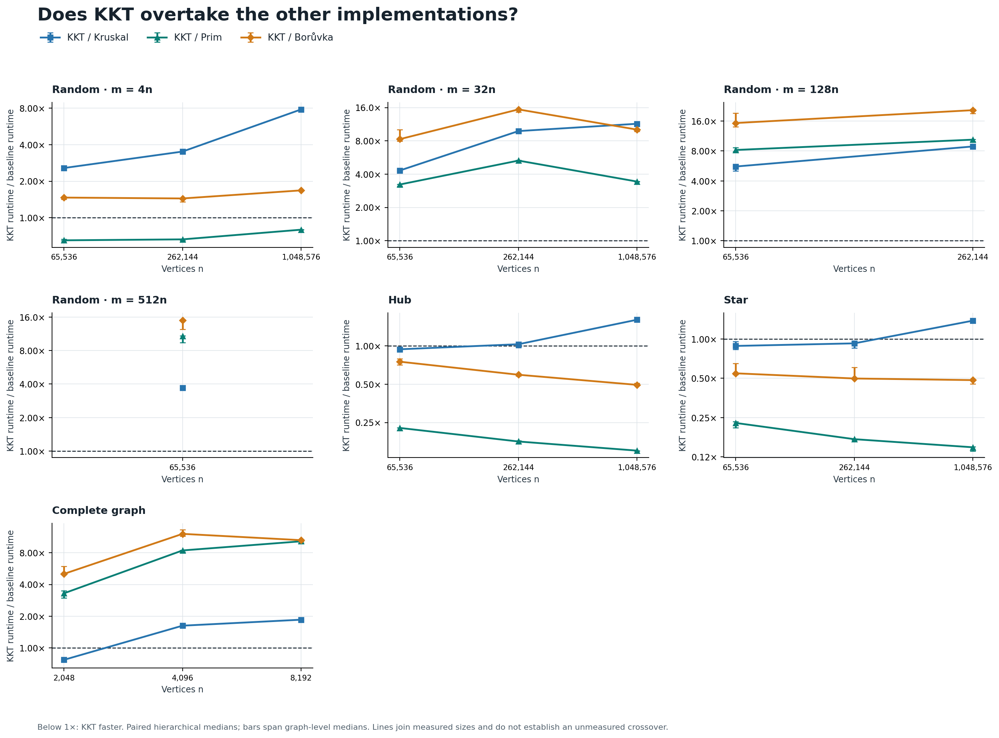
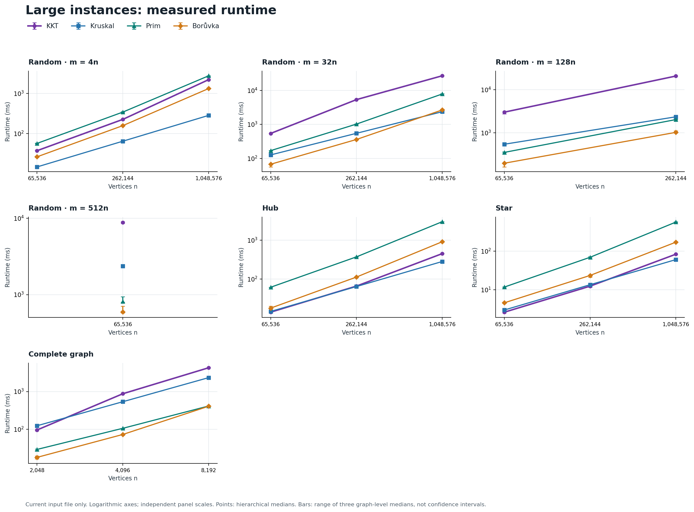
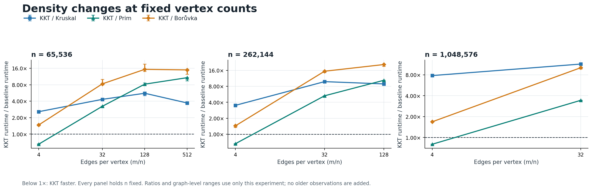
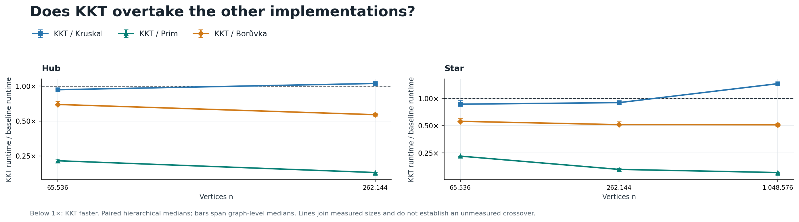

# KKT on larger instances

**No larger-size takeover was observed.** This sweep reaches 1,048,576 vertices
and 33,554,432 edges on the same Apple M3 Max and the same MST implementations
as the earlier diverse comparison. KKT's small hub/star wins do not extend to
one million vertices. No tested random or complete graph makes KKT fastest
across all four implementations.

The main sweep covers 18 configurations, 54 graph fixtures, and 648 validated
timed outputs. It varies three graph seeds and three KKT seeds, with one
measurement per pair and no dedicated warmups. Five close or adjacent hub/star
configurations receive a separate repeated confirmation described below.

## Large cases

Times are hierarchical medians, in **seconds**, from the main sweep:

| Case | Vertices | Edges | KKT | Kruskal | Prim | Boruvka |
| --- | ---: | ---: | ---: | ---: | ---: | ---: |
| random_4_n1048576 | 1,048,576 | 4,194,304 | 2.228 | 0.285 | 2.778 | 1.336 |
| random_32_n1048576 | 1,048,576 | 33,554,432 | 27.223 | 2.373 | 7.912 | 2.681 |
| random_128_n262144 | 262,144 | 33,554,432 | 20.839 | 2.355 | 2.031 | 1.025 |
| random_512_n65536 | 65,536 | 33,554,432 | 8.789 | 2.366 | 0.816 | 0.593 |
| complete_n8192 | 8,192 | 33,550,336 | 4.281 | 2.341 | 0.414 | 0.408 |

On the million-vertex, 33.6-million-edge random case, the paired KKT/Kruskal
runtime ratio is **11.42x**, KKT/Prim is **3.43x**, and KKT/Boruvka is **10.11x**.
Paired ratios are aggregated from matched trials; they need not equal ratios
of the displayed aggregate times.

## How the gap changes

Below 1x means KKT is faster. Bars span the three graph-level medians; they are
not confidence intervals. Lines connect measured points, not an interpolated
crossover estimate. Each panel has its own logarithmic scales.

- At fixed `m = 4n`, KKT/Kruskal increases from **2.57x** at 65,536 vertices to
  **3.51x** at 262,144 and **7.80x** at 1,048,576.
- At fixed `m = 32n`, the corresponding ratios are **4.32x**, **9.81x**, and
  **11.42x**. Boruvka is fastest at the first two sizes; Kruskal is fastest at
  one million vertices. KKT's gap to Boruvka is not monotonic, but remains large.
- Complete graphs also lose KKT's advantage over Kruskal as they grow:
  KKT/Kruskal is **0.77x**, **1.62x**, and **1.85x** at 2,048, 4,096, and 8,192
  vertices. Boruvka remains faster than KKT at all three sizes.
- Holding vertices fixed at 65,536 and increasing edges to 33,554,432
  (`m/n = 512`) still leaves KKT **3.70x** slower than Kruskal and **14.93x**
  slower than Boruvka.

The main sweep's lowest runtime medians are Boruvka in 8 configurations,
Kruskal in 7, KKT in 3, and Prim in 0. KKT's three are the 65,536-vertex hub and
65,536-/262,144-vertex stars. These counts describe the chosen matrix, not
representative workload frequencies. The confirmation below takes precedence
for interpreting the close races.

## Repeated confirmation of the close cases

All 720 timed outputs and 180 warmups passed validation. Each seed pair has
one warmup and four measured repetitions, with exactly balanced algorithm
positions. These results are separate from the main sweep above. Times here
are **milliseconds**; lower ratios favor KKT.

| Case | KKT | Kruskal | Paired KKT/Kruskal | Graph-level ratio range |
| --- | ---: | ---: | ---: | ---: |
| hub_n65536 | 13.621 | 14.428 | 0.931x | 0.931–0.947x |
| hub_n262144 | 68.196 | 64.927 | 1.055x | 1.029–1.058x |
| star_n65536 | 2.619 | 3.033 | 0.862x | 0.854–0.945x |
| star_n262144 | 11.724 | 13.478 | 0.896x | 0.856–0.904x |
| star_n1048576 | 89.642 | 61.444 | 1.450x | 1.392–1.463x |

KKT's measured wins hold on the 65,536-vertex hub and both smaller stars;
it also beats Prim and Boruvka on those cases. But the direction reverses
with size: at 262,144 hub vertices KKT takes about **5.5% longer** than
Kruskal, and at 1,048,576 star vertices it takes about **45% longer**.
All three graph-level median ratios are on the same side of 1 for each
confirmed case, though individual timing observations can differ.

Thus the observed crossings are losses of KKT's earlier advantage, not the
start of domination. This brackets changes between tested sizes; it does not
locate an exact threshold. Confirmation was targeted after seeing the main
sweep, and these ranges are descriptive rather than confidence intervals.

[Confirmation raw data](confirmation/raw.csv), [analysis](confirmation/report.md),
and [commands, selection, and process metadata](confirmation/metadata.json).

## Evidence and limits

Every measured output matches an independently certified unique MST, including
complete edge IDs and source tuples where returned. Generation, certification,
and output checks are outside timing. KKT's conversion from the common tuple
edge list is inside timing. Full protocol: [METHODS.md](METHODS.md).

The main run took 1,393.66 seconds including generation and validation. Its
whole-process peak resident set was 13.10 GiB, with zero swaps reported by
`/usr/bin/time -l`; this includes fixtures and validation storage and is not
an algorithm-specific memory measurement. Machine RAM is 128 GiB.

This is evidence about these implementations, synthetic graph profiles,
platform, and measured sizes. It does not prove that a crossover can never
occur at still larger sizes or on different graphs, nor does it prove or
refute an asymptotic complexity bound. Larger inputs alone did not deliver
the hoped-for practical advantage here. The experiment does not isolate a
cause for increasing per-edge cost; the earlier 65,536-vertex profile cannot
be extrapolated into a causal breakdown of these million-vertex runs.

## Reproduce or inspect

- [Exact methods and commands](METHODS.md), [machine/source metadata](metadata.json).
- [Raw measurements](raw.csv), [runtime summaries](summary.csv),
  [graph-level summaries](graph_summary.csv), [paired comparisons](comparisons.csv).
- [Generated analysis](report.md), [process log](run.log).
- [Ratio plot PDF](large_ratios.pdf), [runtime plot PDF](large_scaling.pdf),
  [density plot PDF](density.pdf); SVG and PNG versions are alongside them.
- [Excluded single-fixture pilot](pilot.csv) and [pilot metadata](pilot_metadata.json).

Algorithm revision: `93406577df5653572c1d795fcf471202145071f1`; MST source code is
unchanged since `bed1842`. This experiment changes only the benchmark harness,
analysis, and documentation. Source hashes identify the extended harness.
