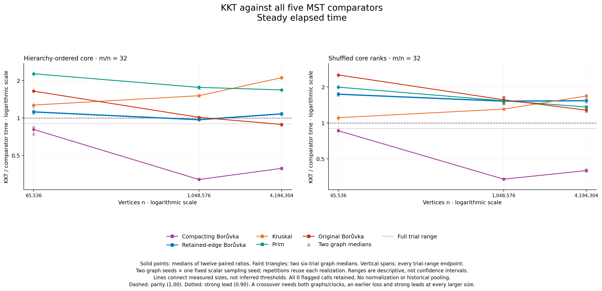
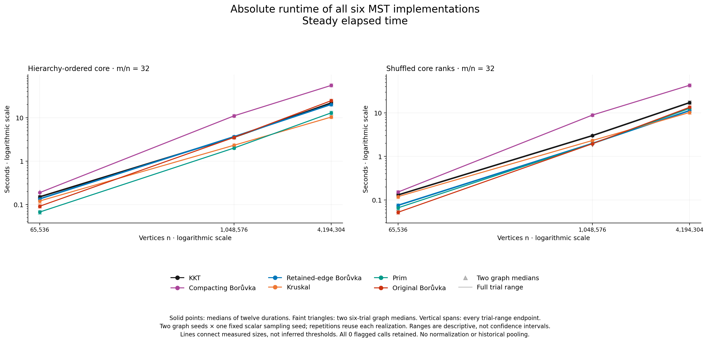
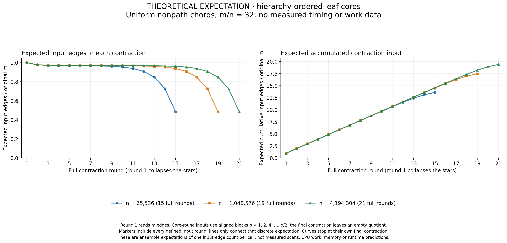
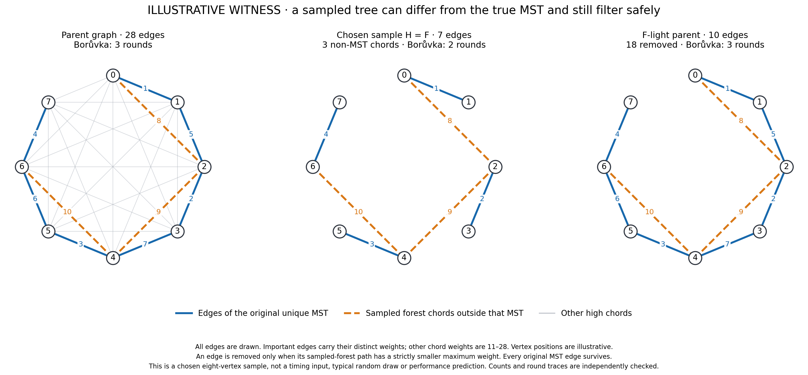

# Larger hierarchy graphs: a crossover, and a reversal

**KKT's narrow lead over retained-edge Borůvka at 1,048,576 vertices disappears at 4,194,304.** Its wall-time ratio changes from **1.1181 → 0.9674 → 1.0786** across the three sizes. There is a strong observed crossover against **original Borůvka** on the ordered family: **1.6442 → 1.0111 → 0.8861**. At the largest point, KKT uses about 11.4% less time than that implementation, but retained-edge Borůvka, Kruskal and Prim remain faster. No case is an all-six-solver win.

All **12 children and 504 solver outputs passed**, including 432 timed calls and 72 checked warmups. The [strict analysis](analysis/README.md) and separate [raw numerical audit](validation/independent-numerical-audit-attempt01/README.md) agree on all 720 clock ratios, 396 summary rows, 30 point states, 30 endpoint pairs and 10 family/comparator outcomes. Nothing was removed or adjusted. Earlier prospective status is preserved verbatim in [PRECAPTURE_STATUS.md](PRECAPTURE_STATUS.md); preparation wording in frozen protocols and source notes remains historical.



The [prospective protocol](PROTOCOL.md) fixed two existing weight twins, three sizes, density `m/n=32`, graph seeds `11000009/11000027` and scalar sampling seed `2203`. This campaign reuses frozen compressed-query KKT: retained parallel edges, direct Edge verifier input and compressed verifier requests, with ordinary half sampling. Packed sampling is disabled. Historical timing is not pooled.

These are engineered attachment graphs, not road-network or generic real-world samples. Three cheap leaves surround every core vertex. In `leaf_hierarchy4`, a forced core path has dyadically ordered weights, all cheaper than the nonpath chords. `leaf_shuffled4` permutes the core ranks. All six size/graph twin pairs passed: topology, IDs, labels and physical edge order agree, while weighted fingerprints differ. This isolates weight arrangement within this construction; it does not establish its prevalence in applications.

Each child measures all six solvers, with one checked warmup and six timed repetitions each. Rotation places each solver in every timed position once. Ratios below are medians of **12 paired trial ratios**, not ratios of runtime medians. Each graph median contains six trials. Repetitions reuse their graph and sampled forest; there are only two graph realizations and one sampler seed. Reversing the full case order for graph two counterbalances ordering, but graph seed remains confounded with order and host history.

| Family | Vertices | Clock | KKT / compacting B. | KKT / retained B. | KKT / Kruskal | KKT / Prim | KKT / original B. |
|---|---:|---|---:|---:|---:|---:|---:|
| Hierarchy | 65,536 | wall | 0.8077 | 1.1181 | 1.2702 | 2.2681 | 1.6442 |
| Hierarchy | 65,536 | CPU | 0.8077 | 1.1181 | 1.2702 | 2.2681 | 1.6442 |
| Shuffled | 65,536 | wall | 0.8607 | 1.7382 | 1.1059 | 1.9909 | 2.5197 |
| Shuffled | 65,536 | CPU | 0.8607 | 1.7382 | 1.1059 | 1.9909 | 2.5197 |
| Hierarchy | 1,048,576 | wall | 0.3191 | 0.9674 | 1.5101 | 1.7631 | 1.0111 |
| Hierarchy | 1,048,576 | CPU | 0.3191 | 0.9674 | 1.5101 | 1.7630 | 1.0111 |
| Shuffled | 1,048,576 | wall | 0.3386 | 1.5199 | 1.3048 | 1.5310 | 1.5613 |
| Shuffled | 1,048,576 | CPU | 0.3386 | 1.5199 | 1.3047 | 1.5309 | 1.5612 |
| Hierarchy | 4,194,304 | wall | 0.3924 | 1.0786 | 2.1109 | 1.6817 | 0.8861 |
| Hierarchy | 4,194,304 | CPU | 0.3923 | 1.0784 | 2.1106 | 1.6816 | 0.8860 |
| Shuffled | 4,194,304 | wall | 0.3994 | 1.5337 | 1.6799 | 1.3598 | 1.2785 |
| Shuffled | 4,194,304 | CPU | 0.3991 | 1.5342 | 1.6796 | 1.3586 | 1.2778 |

Below one favors KKT. [Exact estimates](analysis/comparisons.csv), [both graph medians](analysis/graph_comparisons.csv) and [integer-endpoint pairs](analysis/paired_ratios.csv) retain full precision and ranges. The [CPU ratio figure](figures-attempt01/ratios_cpu.png) uses matching wall/CPU panel bounds.

The declared strong-crossover rule requires a loss on **both graph medians and both clocks** at an earlier size, a ratio at most 0.90 later, and that strong lead at every still-larger measured size. A narrow sign change is insufficient. All ten outcomes follow; sizes run left to right from 65,536 to 1,048,576 to 4,194,304.

| Family | Comparator | Three point states | Strong measured bracket |
|---|---|---|---|
| Hierarchy | Compacting Borůvka | strong → strong → strong | None: already ahead |
| Hierarchy | Retained-edge Borůvka | loss → narrow lead → loss | None: reversal |
| Hierarchy | Kruskal | loss → loss → loss | None |
| Hierarchy | Prim | loss → loss → loss | None |
| Hierarchy | Original Borůvka | loss → loss → strong | **(1,048,576, 4,194,304]** |
| Shuffled | Compacting Borůvka | strong → strong → strong | None: already ahead |
| Shuffled | Retained-edge Borůvka | loss → loss → loss | None |
| Shuffled | Kruskal | loss → loss → loss | None |
| Shuffled | Prim | loss → loss → loss | None |
| Shuffled | Original Borůvka | loss → loss → loss | None |

Against retained-edge Borůvka, ordered 1M wins 11/12 trial pairs on each clock; its four graph/clock medians lie between 0.96375 and 0.97358. At 4M it wins **0/12**, with medians between 1.07229 and 1.08749. The small lead did not grow with size.

Against original Borůvka, all four ordered 1M medians exceed one; all four ordered 4M medians lie between 0.88254 and 0.88614. KKT wins all 12 largest-case trial pairs on each clock, although not every individual trial has a 10% margin. The bracket identifies measured endpoints, not an interpolated threshold. Its upper endpoint is the largest supported input: there is **no observation of persistence beyond 4M**. The [complete endpoint table](analysis/crossover_brackets.csv) also retains the wider qualifying 65,536-to-4M bracket.

Across 72 timed pairs per comparator and clock, KKT wins 72 against compacting Borůvka, 11 against retained-edge Borůvka, zero against Kruskal, zero against Prim and 15 against original Borůvka. The latter includes three ordered 1M trials despite that case's median loss. Keeping the stronger baselines changes the practical conclusion.



At 4M vertices and 134,217,728 edges, ordered-family median wall times are **21.818 s KKT, 55.312 s compacting Borůvka, 20.249 s retained-edge Borůvka, 10.313 s Kruskal, 12.894 s Prim and 24.604 s original Borůvka**. Shuffled KKT takes 17.232 s, versus 11.325 s retained-edge Borůvka and 10.236 s Kruskal. Absolute medians describe runtime; comparisons still use paired ratios. [CPU times](figures-attempt01/times_cpu.png), [all absolute summaries](analysis/summary.csv) and [graph summaries](analysis/graph_summary.csv) retain every solver. All four timing PNGs passed [original-resolution visual QA](figures-attempt01/QA.md); SVG/PDF counterparts and exact plotted values are alongside them.

The hierarchy offers a concrete filtering opportunity. Write original `n=4q`. The star round removes 75% of vertices but only 2.34375% of edges. After KKT's two initial contractions, 87.5% of vertices are gone while **97.265625% of edges remain**. Core blocks merge in powers of two, and most random chords keep crossing them until late. Repeated contraction can therefore revisit a large edge set many times.



This is a **theoretical expectation over uniformly chosen distinct nonpath chords**, not measured counters from this capture. At block size `b`, internal eligible pairs are `I_b=(q/b)·choose(b,2)−(q−q/b)`, excluding path pairs. With `D=choose(q,2)−(q−1)` and `C=m−n+1`, expected remaining core edges are `q/b−1+C(1−I_b/D)`. Summing the star and core inputs gives expected volumes **13.6115m, 17.4846m and 19.4219m**, across 15, 19 and 21 full contractions. Increasing size adds rounds; increasing density alone does not.

The [derivation](HIERARCHY_EXPECTATION.md) preserves assumptions, formulas and finite-generator limits. Independent enumeration of 18 pair partitions and 1,592 fixed-size chord subsets passed before rendering; [checks](hierarchy-figure-attempt01/enumeration_checks.json) and [QA](hierarchy-figure-attempt01/QA.md) accompany the figure. The ideal half-sampling light-edge bound is at most `m/128` in expectation after the initial contractions, whereas the sampled branch has expected size `249m/512`. The small bound concerns the later filtered branch; KKT must still solve and verify the large sample. Neither bound predicts runtime or a crossover.



This hand witness makes the distinction visible. From 28 edges, the chosen seven-edge sampled forest contains three edges absent from the true MST. Its path maxima safely remove 18 heavy edges and leave ten light edges containing the MST. Independent Kruskal, forest-path and Borůvka checks derive these labels and full/sample/filtered round counts **3/2/3**. It illustrates how non-MST sampled edges can connect across hierarchy levels; it is neither a typical random draw nor a timed instance. See the [explanation](SAMPLING_MECHANISM.md), [checks](sampling-witness-attempt01/independent_checks.json) and [visual QA](sampling-witness-attempt01/QA.md).

Logical volume differs from implementation cost. [Source accounting of the baselines](BASELINE_MECHANISM.md) shows original Borůvka scans original tuples once per iteration, including a final no-op iteration: exactly **16m/20m/22m** edge-loop iterations here. Retained-edge Borůvka rebuilds quotients; for summed input volume `V` and terminal input `t`, its helper performs `3V−2t` edge-loop iterations and emits `V−m` quotient records. These exclude vertex, hash, allocation and instruction costs. They explain why input volume alone cannot rank implementations; they do not establish cache, bandwidth or CPU causality. This campaign includes no same-input measured work-counter study or profiler attribution.

Execution used the existing native arm64 binary on an **Apple M3 Max, 128 GiB, macOS 26.6.2**, with Apple Clang 15, `-O3 -march=native` and the inherited 512 MiB main-stack profile. The [freeze](freeze.json), SHA-256 `d4600df2dee18c98d263a9bc043d2881c16a6cc253d9c99047aede4aaa334f27`, binds binary SHA-256 `74e604830c4c730395cd6c9e9dc61287a6d88a34cc89983bb4ee61dc3272a1b2`, source/object/build records and the complete parent proof. [Parent native validation](../compressed-query-2026-10-15/validation/native-validation-summary.json) remains applicable because the binary was not rebuilt. Each input's reference MST was independently certified; every captured result matched its exact edge IDs outside the timing boundary.

Capture took **82.4218 minutes**. Maximum sampled owned-group RSS was **29.7508 GiB**, below the unchanged 40 GiB ceiling, with zero unavailable RSS observations, zero clock flags and every group verified empty. The largest case exactly reaches existing `n=2²², m=2²⁷` limits. RSS is sampled whole-child usage, not a continuous peak or KKT-only measurement. [Before](machine-before.json)/[after](machine-after.json) metadata and [resource records](analysis/resources.csv) remain. Archived power-log correlation found no logged sleep overlaps, but sleep inhibition was not verified; unrelated host activity and thermal conditions were not controlled. Neither clock is normalized using competitor drift.

To reproduce analysis without rerunning solvers, use fresh output paths from the worktree root:

```sh
/usr/bin/python3 -B benchmark/run_larger_hierarchy.py analyze \
  --capture benchmark/results/larger-hierarchy-2026-10-15/larger.json \
  --output-dir /tmp/larger-analysis-new
/usr/bin/python3 -B benchmark/results/larger-hierarchy-2026-10-15/validation/independent_numerical_audit.py \
  --capture benchmark/results/larger-hierarchy-2026-10-15/larger.json \
  --analysis-dir /tmp/larger-analysis-new --output-dir /tmp/larger-audit-new
/usr/bin/python3 -B benchmark/plot_larger_hierarchy.py \
  --capture benchmark/results/larger-hierarchy-2026-10-15/larger.json \
  --output /tmp/larger-figures-new --released
```

The optional private archived power log adds diagnostic correlation; omitting it leaves timing estimates unchanged. Exact invocations, source hashes, stdout/stderr and empty-group proofs remain for [audit](validation/audit-actual-attempt01.json), [timing figures](validation/figures-attempt01.json), [analytic figure](validation/hierarchy-figure-attempt01.json) and [witness](validation/sampling-witness-attempt01.json). No Google Benchmark complexity fit is made here: three finite sizes, a runtime reversal and one comparator-specific crossover neither prove nor refute the expected-linear theoretical work bound.
