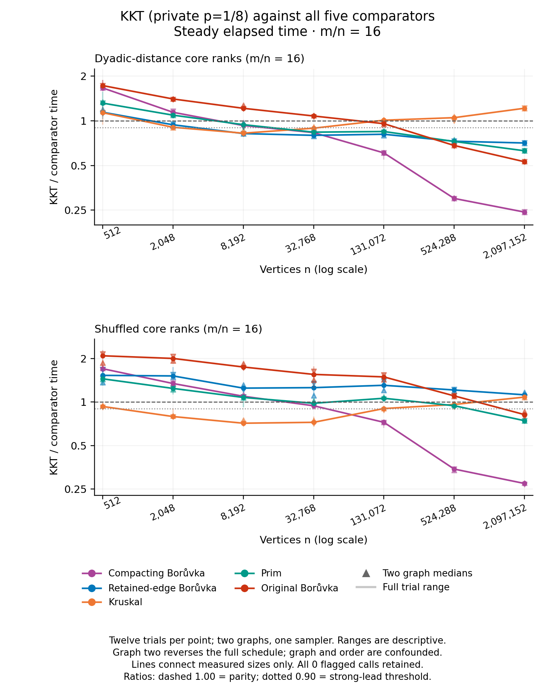

# Lower-density KKT crossover results

The density-16 dyadic-distance family shows a sustained **measured crossover
against retained-edge Borůvka**: KKT loses at 512 vertices, has a narrower lead
at 2,048, and is at least 10% faster on both graph medians and both clocks at
every measured size from 8,192 through 2,097,152. At the largest size, its
pooled paired wall ratio is **0.7088**. It also beats the deduplicating comparator
there, at **0.2425** of its time.

The limits matter. At density 8 the retained-edge lead at 262,144 and 1,048,576
vertices fails to persist at 4,194,304: one graph wins and the other loses.
Both shuffled ladders lose to retained-edge Borůvka at every measured size.
Kruskal beats KKT at all four largest endpoints. No case has pooled median
leads against all five controls on both clocks; this does not exclude isolated
individual trials. These results establish useful finite cases against named
implementations, not general or asymptotic dominance.

## Fixed matrix and validation

The [protocol](PROTOCOL.md) and [manifest](manifest.csv) were fixed before
capture. Both `leaf_distance4` and `leaf_shuffled4` use every size below.
There was no new implementation, generator, domain relaxation or omitted case.

| Fixed m/n | Every vertex count n | Largest m |
|---:|---|---:|
| 16 | 512; 2,048; 8,192; 32,768; 131,072; 524,288; 2,097,152 | 33,554,432 |
| 8 | 256; 1,024; 4,096; 16,384; 65,536; 262,144; 1,048,576; 4,194,304 | 33,554,432 |

Graph seeds are **23000003/23000029**, sampler seed **3407**. Every child runs
KKT, deduplicating Borůvka (`compacting_boruvka`), retained-edge Borůvka
(`multigraph_boruvka`), Kruskal, Prim and original Borůvka. One checked warmup
and six timed rotations put each solver in every timed position. All **60
children and 2,520 outputs passed**: 2,160 timed calls and 360 warmups, with
independent input/MST certification and exact result-ID checks. Every native
and outer process group was verified empty. The unchanged candidate uses
retained contractions, direct Edge verification, compressed verifier requests
and private scalar sampling at p=1/8.

The [independent arithmetic audit](independent-audit-attempt01/audit.json)
reconstructed all 3,600 paired ratios, 1,980 summary medians, 30 topology twins,
150 point classifications, 490 earlier/later endpoint pairs and 20 comparison
outcomes. No rows were removed or adjusted. The complete [raw CSV](lower-density.csv),
[capture](lower-density.json), [strict tables](analysis-attempt01/README.md),
[per-graph ratios](analysis-attempt01/graph_comparisons.csv) and
[all individual pairs](analysis-attempt01/paired_ratios.csv) remain available.

A ratio is KKT time divided by comparator time, paired within the same child
and repetition. The pooled median uses twelve ratios, while each graph median
uses six. These are two graph/sampling realizations, not twelve independent
graphs. Ranges are descriptive, not confidence intervals. Both steady wall
and process CPU clocks are retained separately. The second graph reverses the
full schedule, so graph and order effects are confounded.

## Every crossover outcome and largest-point range

A strong point requires all **four graph/clock medians ≤0.90**; a loss requires
all four >1. A qualifying bracket has an earlier loss, a later strong point,
and strong points at every still-larger measured size in the same ladder.
The table shows the earliest qualifying upper endpoint and its closest earlier
loss. Parentheses/brackets identify measured endpoints, not an interpolated
crossing location. “None” preserves losses, mixed outcomes and reversals.
There are **13 qualifying comparison outcomes and 102 qualifying endpoint
pairs**; all 490 candidate pairs remain in the canonical table.

The final three columns refer to each ladder's largest n. “Graph/clock range”
spans its four medians; “wall trial range” spans all twelve paired wall ratios.
All CPU trial endpoints and every intermediate point remain in the linked tables.

| Family; d | Comparator | Primary measured bracket | Largest state | Largest pooled wall / CPU | Graph/clock range | Wall trial range |
|---|---|---|---|---:|---:|---:|
| Distance; 16 | Deduplicating Borůvka | (2,048, 32,768] | strong | 0.2425 / 0.2425 | 0.2417–0.2429 | 0.2343–0.2476 |
| Distance; 16 | Retained-edge Borůvka | (512, 8,192] | strong | 0.7088 / 0.7088 | 0.7066–0.7116 | 0.6858–0.7311 |
| Distance; 16 | Kruskal | None | loss | 1.2152 / 1.2152 | 1.2126–1.2173 | 1.1826–1.2394 |
| Distance; 16 | Prim | (2,048, 32,768] | strong | 0.6281 / 0.6281 | 0.6279–0.6281 | 0.6069–0.6469 |
| Distance; 16 | Original Borůvka | (32,768, 524,288] | strong | 0.5299 / 0.5299 | 0.5291–0.5317 | 0.5143–0.5437 |
| Distance; 8 | Deduplicating Borůvka | (4,096, 262,144] | strong | 0.3509 / 0.3509 | 0.3396–0.3668 | 0.3357–0.3715 |
| Distance; 8 | Retained-edge Borůvka | None | mixed/tied | 0.9726 / 0.9726 | 0.9414–1.0159 | 0.9311–1.0233 |
| Distance; 8 | Kruskal | None | loss | 1.8485 / 1.8485 | 1.7843–1.9202 | 1.7624–1.9429 |
| Distance; 8 | Prim | (256, 4,096] | strong | 0.5267 / 0.5267 | 0.5159–0.5608 | 0.5049–0.5699 |
| Distance; 8 | Original Borůvka | (4,096, 65,536] | strong | 0.4484 / 0.4484 | 0.4316–0.4722 | 0.4260–0.4752 |
| Shuffled; 16 | Deduplicating Borůvka | (8,192, 131,072] | strong | 0.2729 / 0.2729 | 0.2687–0.2753 | 0.2681–0.2764 |
| Shuffled; 16 | Retained-edge Borůvka | None | loss | 1.1219 / 1.1219 | 1.0786–1.1662 | 1.0712–1.1920 |
| Shuffled; 16 | Kruskal | None | loss | 1.0815 / 1.0815 | 1.0787–1.0815 | 1.0537–1.1049 |
| Shuffled; 16 | Prim | (131,072, 2,097,152] | strong | 0.7431 / 0.7431 | 0.7399–0.7431 | 0.7163–0.7680 |
| Shuffled; 16 | Original Borůvka | (524,288, 2,097,152] | strong | 0.8186 / 0.8186 | 0.7869–0.8573 | 0.7670–0.8660 |
| Shuffled; 8 | Deduplicating Borůvka | (16,384, 262,144] | strong | 0.3199 / 0.3199 | 0.3192–0.3203 | 0.3049–0.3245 |
| Shuffled; 8 | Retained-edge Borůvka | None | loss | 1.1558 / 1.1558 | 1.1529–1.1750 | 1.0925–1.1790 |
| Shuffled; 8 | Kruskal | None | loss | 1.3355 / 1.3355 | 1.3301–1.3361 | 1.2426–1.3496 |
| Shuffled; 8 | Prim | (256, 16,384] | strong | 0.5253 / 0.5253 | 0.5223–0.5311 | 0.5056–0.5355 |
| Shuffled; 8 | Original Borůvka | (65,536, 1,048,576] | strong | 0.5419 / 0.5419 | 0.5414–0.5430 | 0.5198–0.5502 |

The two density-16 shuffled brackets against Prim and original Borůvka reach
strong status only at the final 2,097,152 point; there is no measured persistence
beyond that endpoint. Density-16 distance versus retained Borůvka instead has
five consecutive strong sizes. Its largest wall graph medians are
0.7066–0.7116, with 12/12 individual wins on each clock. At density 8 and
4,194,304, the corresponding wall graph medians are **0.9414 and 1.0159**;
its pooled 0.9726 ratio and 7/12 wins on each clock cannot satisfy the declared
strong-crossover condition.

Kruskal's absence from the qualifying set is not just a threshold near miss:
density-8 distance loses at every point, and earlier leads in the other
ladders reverse. Shuffling can shorten KKT's own time without making it more
competitive with retained Borůvka, whose time also changes. The paired ratios,
not the shape of KKT's absolute-time curve alone, answer that comparison.

## Absolute times at the four largest endpoints

Seconds below are pooled duration medians, shown as **wall / CPU**. A ratio of
these medians is not the median paired ratio used for crossover classification.
The density-16 endpoints have 2,097,152 vertices and the density-8 endpoints
4,194,304; all four have exactly 33,554,432 edges.

| Family; d | KKT | Deduplicating B. | Retained B. | Kruskal | Prim | Original B. |
|---|---:|---:|---:|---:|---:|---:|
| Distance; 16 | 2.831 / 2.831 | 11.704 / 11.704 | 3.983 / 3.983 | 2.333 / 2.333 | 4.506 / 4.506 | 5.351 / 5.350 |
| Shuffled; 16 | 2.528 / 2.528 | 9.243 / 9.242 | 2.270 / 2.270 | 2.316 / 2.316 | 3.433 / 3.431 | 3.068 / 3.068 |
| Distance; 8 | 4.478 / 4.478 | 12.794 / 12.794 | 4.605 / 4.605 | 2.439 / 2.436 | 8.454 / 8.454 | 9.996 / 9.996 |
| Shuffled; 8 | 3.207 / 3.207 | 10.040 / 10.040 | 2.767 / 2.767 | 2.412 / 2.412 | 6.083 / 6.083 | 5.932 / 5.932 |

## Figures and retained presentation attempts

The four standalone figures retain all four family/density panels:
[wall ratios](figures-attempt01/ratios_wall.png),
[CPU ratios](figures-attempt01/ratios_cpu.png),
[wall times](figures-attempt01/times_wall.png),
[CPU times](figures-attempt01/times_cpu.png).
Paper pages separate density while preserving the full data:

| Density | Wall ratios | CPU ratios | Wall times | CPU times |
|---:|---|---|---|---|
| 16 | [PNG](paper-figures-attempt02/paper_d16_ratios_wall.png) | [PNG](paper-figures-attempt02/paper_d16_ratios_cpu.png) | [PNG](paper-figures-attempt02/paper_d16_times_wall.png) | [PNG](paper-figures-attempt02/paper_d16_times_cpu.png) |
| 8 | [PNG](paper-figures-attempt02/paper_d8_ratios_wall.png) | [PNG](paper-figures-attempt02/paper_d8_ratios_cpu.png) | [PNG](paper-figures-attempt02/paper_d8_times_wall.png) | [PNG](paper-figures-attempt02/paper_d8_times_cpu.png) |

Every PNG has SVG/PDF counterparts. Solid points are pooled medians, faint
triangles retain the two graph medians, and spans show every trial-range
endpoint. Ratio axes include parity and the 0.90 threshold; matched wall/CPU
axes preserve comparisons. All **660 pooled points, 1,320 graph medians and
1,320 range endpoints** are retained, with all crossover tables in
[plotted_values.json](paper-figures-attempt02/plotted_values.json).

All twelve accepted PNGs passed original-resolution visual inspection:
[QA receipt](validation/figure-visual-qa-attempt02.json). The first paper
attempt passed numerical checks but its bottom x-label overlapped the legend.
[That failure](validation/figure-visual-qa-attempt01.json), the original source
and output remain preserved. A separate v2 adapter changed only the subplot
bottom margin from 0.24 to 0.28. Both `paper_points.json` and
`plotted_values.json` are byte-identical before/after; no data, labels or fonts
were changed. Use **paper attempt02**, not attempt01, for publication. Final
assembled-page QA is a separate step; these pages are 7.1×8.8 inches with
minimum 8.5-point labels.

## Mechanism and limits

These are engineered core-and-leaf graphs, not Euclidean metrics or application
prevalence evidence. Each core vertex has three cheap leaves; the core contains
a forced path plus distinct random pairs. Distance ranks organize core edges
by dyadic ancestry. The shuffled twin preserves topology, IDs, labels, tuple
order, cheap leaves and the weight multiset while changing core rank placement.
The rank weights need not satisfy the triangle inequality.

Source reasoning fixes the distance family's first two retained contractions
at n/8 vertices and (d−7/8)n edges: cheap stars merge first, then the forced
lowest-tier sibling pairs. Parallel crossing records remain. This makes edge
volume, sampling/filtering and the continuation important even after a large
vertex reduction. Deduplication has different construction costs and subsequent
edge volumes. The separate [completed untimed companion](work/README.md) now
certifies all 60 matching inputs and 180 solver outputs, with all 11,700
counter cells and 120 full comparator replays independently audited. It
measures the growing ordered-family contraction volume and the shorter
shuffled continuations. At distance d8/4M, exact counter bounds also distinguish
a connected root verifier on graph 23000003 from a disconnected root on graph
23000029; cumulative partition visits differ by 67,347,598. Logical visits
still cannot measure CPU instructions, cache misses, bandwidth or the fraction
of elapsed time explained. This mechanism evidence changes none of the timing
ratios or crossover classifications above.

Each ladder is a valid fixed-parameter family: m=dn and n+m=(d+1)n. Relative
core occupancy nevertheless falls with size. At the smallest valid power of
two, core occupancy is 122/127 for d16 and 58/63 for d8. Those nearly complete
small cores, growing storage, allocator behavior and host history are finite-size
features; this sweep does not isolate them from asymptotic growth. One fixed
sampler seed does not test sampling robustness. This single-policy study also
does not estimate the effect of changing p. The density-8 reversal is retained
rather than extending or retuning the matrix after seeing it.

## Provenance and environment

The source declaration was committed as `5844ac45218cd1003f87432af1f677b6c2c9690d`;
capture records revision `a19c9df2ff192bd28527ff4a9f534d0be93eafef`.
The [freeze](freeze.json) SHA-256 is
`0c49ed1d046d402ebccb6978ef5f9cdea02865758a1578a43003b189025aa520`.
The unchanged executable SHA-256 is
`954068775a83e1c42db62ffb6777c398dc05fd5792c60d2f293df6532130951a`.
Its complete inherited source/object/build proof remains bound, including all
five controls; no older timing is pooled. Native Apple clang 15.0.0 uses C++17,
-O3 and -march=native, arm64, the recorded Apple SDK and a 512 MiB stack.
The host was an Apple M3 Max with 128 GiB RAM on macOS 26.6.2.

There were zero flagged calls, zero capture/child UTC flags and zero associated
logged sleep/wake overlaps. No observation was removed. Two isolated RSS
observations were unavailable; they are retained, and the stop rule did not
trigger. The largest sampled process-group RSS was **7,813,872 KiB (7.452 GiB)**,
under the unchanged 40 GiB ceiling. Sampling does not establish a continuous
peak. Machine queries and the private-log query completed, but sleep inhibition,
thermal stability and absence of unrelated host activity are not established.
Raw private power events are not published.

All original preparation and failed layout evidence remain. Historical
[PRECAPTURE_STATUS.md](PRECAPTURE_STATUS.md) is unchanged. Guarded render
commands, source hashes, actual zero exits and empty groups are in
[standalone receipt](validation/plots-attempt01.json) and
[paper receipt](validation/paper-plots-attempt02.json). The installed handoff
records exact command spellings; use fresh output paths for reproduction,
including the v2 paper adapter. Reproducing native timings requires a separate
quiet release and must retain the frozen matrix and all controls.
