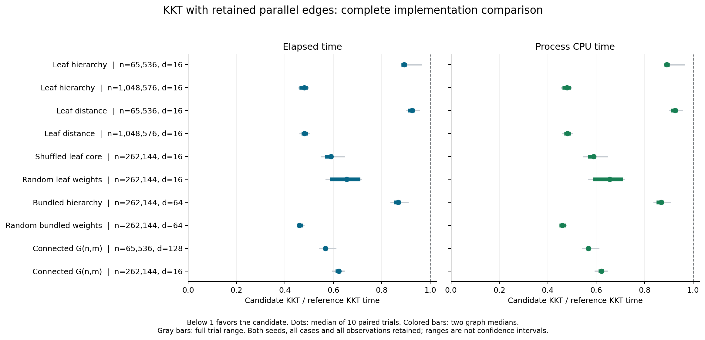
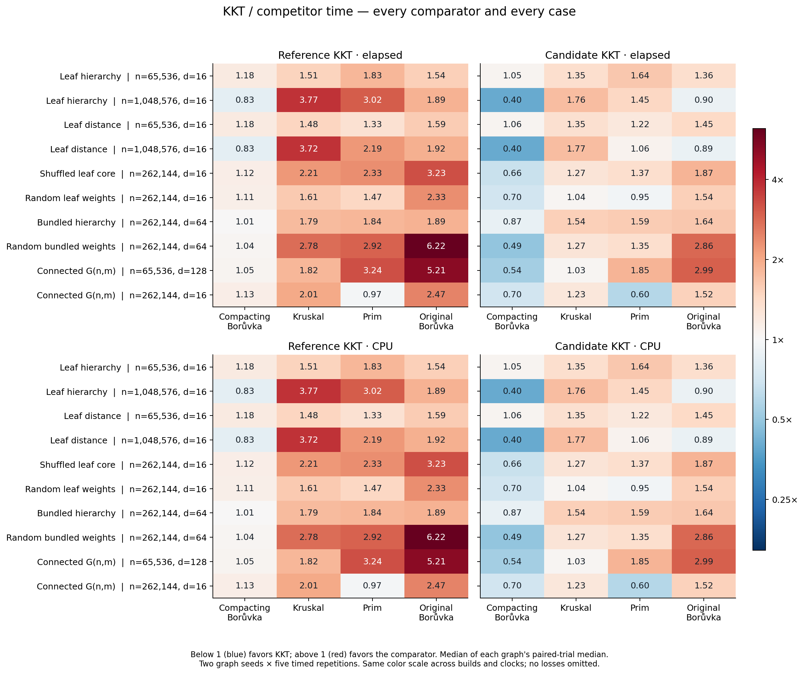

# A cheaper KKT contraction, and what the crossover actually means

The opt-in multigraph variant makes a substantial practical difference. In the
completed ten-case screen, it reduced KKT time on **every case and all 100 paired
timed trials**, on both elapsed and process CPU clocks. At 1,048,576 vertices
and 16,777,216 edges, the two ordered attachment families used about **48% of
reference KKT's time** and **40% of compacting Boruvka's time**. They also beat
the repository's original Boruvka, though Kruskal and Prim remained faster.

This is an experimental implementation, enabled only with
`KKT_EXPERIMENT_RETAIN_PARALLEL`. Default KKT is unchanged. The paired source
and validation commit is `ae03ec6`; the screen protocol and freeze were
committed at `36b8ea7` before timing. A fresh-seed six-solver follow-up has been
[completed separately](../retention-control-2026-10-15/README.md);
its results must not be pooled with this screen. It gives repeated
Boruvka the same cheap contraction, to test how much of KKT's lead depends on
random filtering rather than the shared contraction implementation. The earlier
five-solver follow-up draft was superseded before any freeze or native timing.

## What changed

The public contraction first selects safe cheapest incident edges and contracts
their components. Its simple-quotient implementation then groups remaining
edges into buckets and keeps only the cheapest edge for each quotient pair.
The bucket links occupy one integer per input edge; output construction follows
those links to visit crossing records in bucket order.

The candidate preserves the safe selection and component numbering, removes
new self-loops and isolates, and emits **every crossing edge in input order**.
It reserves the exact crossing count collected during the existing degree
pass. It removes the deduplication arrays and linked traversal. The public
simple-quotient step is untouched, and the default build still uses it.

The independent contraction gate checks at most **three input-edge scans**
per candidate step, versus up to four in the reference, together with exact
selected IDs, component numbering and output records. This is more than an
allocation tweak: output order, sampling draws assigned to edges, recursive
subproblems and downstream work can change. The results measure the complete
variant, not the isolated cost of allocating buckets.

The published KKT algorithm explicitly removes parallel quotient edges. This
variant retains them. Its correctness follows the same cut and cycle reasoning:
contracted safe edges belong to the unique MST, and a heavier parallel edge
can still be discarded by the sampled-forest filter. The sampling proof also
extends to separately sampled parallel records because accepted edges still
form a forest. That extension is an inference from the proof, not a claim that
the published step is identical or that a finite PRNG supplies ideal independent
coins. See [Karger, Klein and Tarjan, sections 2–4](https://people.csail.mit.edu/karger/Papers/mst.pdf).

## Complete screen results

The experiment used native arm64 Apple Clang 15, `-O3 -march=native`, assertions
enabled, and a 512 MiB main stack on an Apple M3 Max with 128 GiB RAM. All seven
non-KKT production object files are byte-identical across builds. The five-solver
native harness, graph generators, validation and timing boundaries are unchanged.
Graph seeds are 2000003/2000029 and the starting sampling seed is 607. Each input
has five timed repetitions and one checked warmup for every solver in both builds.
The second graph seed reverses case order and adjacent variant order.

The implementation column below is the median of ten paired trial ratios.
Within-build competitor columns preserve the existing analyzer's median of
the two graph medians. All ratios are candidate KKT time divided by the stated
comparison time; **below 1 favors candidate KKT**. The complete CPU table,
each graph's median, every individual pair and all ranges remain in
[screen-analysis](screen-analysis/README.md).

| Family | n | d=m/n | Reference KKT | Compacting Boruvka | Kruskal | Prim | Original Boruvka |
|---|---:|---:|---:|---:|---:|---:|---:|
| Leaf hierarchy | 65,536 | 16 | 0.892 | 1.045 | 1.353 | 1.644 | 1.362 |
| Leaf hierarchy | 1,048,576 | 16 | 0.479 | 0.398 | 1.762 | 1.455 | 0.900 |
| Leaf distance | 65,536 | 16 | 0.925 | 1.055 | 1.348 | 1.220 | 1.445 |
| Leaf distance | 1,048,576 | 16 | 0.482 | 0.397 | 1.770 | 1.063 | 0.892 |
| Shuffled leaf core | 262,144 | 16 | 0.590 | 0.663 | 1.266 | 1.369 | 1.866 |
| Random leaf weights | 262,144 | 16 | 0.655 | 0.701 | 1.035 | 0.953 | 1.537 |
| Bundled hierarchy | 262,144 | 64 | 0.868 | 0.870 | 1.538 | 1.590 | 1.638 |
| Random bundled weights | 262,144 | 64 | 0.460 | 0.485 | 1.275 | 1.352 | 2.865 |
| Connected G(n,m) | 65,536 | 128 | 0.568 | 0.540 | 1.032 | 1.853 | 2.986 |
| Connected G(n,m) | 262,144 | 16 | 0.622 | 0.701 | 1.232 | 0.597 | 1.525 |

The large ordered cases beat original Boruvka in all ten paired trials on
both clocks. Kruskal wins every case median; no case wins against all four
comparators. The random-weight attachment's small case-level lead over Prim
is mixed across graph seeds, so it is weaker evidence than the large ordered
leads over compacting Boruvka.

Unchanged code does not mean identical timings. On the large ordered cases,
compactor candidate-build/reference-build ratios are 0.993 and 1.003, much
smaller shifts than KKT's roughly 52% reduction. In dense G(n,m), however, the
unchanged compactor shifts by **+8.39%** at case level and up to **+16.35%** at
graph-median level. Every such observation remains in the results; no control
normalization or trimming is applied. Two graph seeds and one starting sampling
seed are a limited screen. Ranges describe observed variability, not confidence
intervals, and order reversal is confounded with graph seed.

## Why these graph shapes help, and what counters reveal

Ordered leaf attachments combine cheap local stars with a core whose cheap
edges induce many balanced merge levels. Many heavier shortcuts remain crossing
edges during these levels. Repeated compacting Boruvka must process them again;
KKT can remove many after a sampled forest supplies cycle certificates. The
[previous attachment study](../search-2026-10-13/README.md) explains that graph
structure and includes actual graph views. The new change reduces the cost of
constructing KKT's quotient before that filtering begins.

On the large hierarchy input, the root quotient after two rounds has 131,072
vertices and 15,848,603 deduplicated edges. Keeping parallels leaves 15,859,712
edges: only about 0.07% more. Deduplication therefore removes very little at
that point, despite paying for buckets and traversing nearly sixteen million
crossing records. At larger working sets, replacing a linked traversal with a
contiguous pass is a plausible additional explanation for the increasing gain.
We did not isolate cache misses or hardware bandwidth, so this is a mechanism
hypothesis supported by source and measurements, not a hardware-counter result.

The [separate untimed work study](work/README.md) matches every input fingerprint
to the screen and requires identical compactor counters across builds. On the
two large ordered cases, candidate contraction edge visits fall to **0.860× and
0.885×**, while sampling/verifier input actually rises to **1.276× and 1.337×**.
The speedup is not explained by fewer queried edges.

The bundled hierarchy control makes the tradeoff especially clear. Retaining
parallels produces **16.011×** as many root quotient edges and **20.342×** as
much cumulative sampling/verifier input; initialized slots grow **5.225×**.
Nevertheless, its measured KKT time falls by about 13%. Counting scans or
initialized elements alone is not a calibrated runtime model: access order,
allocation, record copies and different operations have different costs.
These amplified counts identify a risk for other inputs, not an observed
runtime regression in this screen.

This motivated the [stronger six-solver control](../retention-control-2026-10-15/README.md):
repeat the candidate's same retained-parallel step until the graph is empty.
That completed fresh-seed study finds retained-edge Boruvka faster than KKT
in all 120 paired comparisons, on both clocks. The screen's 2.5× lead is
specifically over the unchanged **deduplicating** compactor; it does not
establish superiority over the shared-contraction Boruvka variant or isolate
the contribution of random sampling.

## Correctness, complexity and retained evidence

Native optimized and native Clang 22 ASan/UBSan/leak checks passed **770 quotient
cases, 13,681 full KKT calls, 117 exhaustive tiny cases and 240 existing
simple-input cycle certificates**, plus the existing regression, contraction
and attachment suites. A negative test rejects a deliberately wrong-linked
default KKT object, proving the instrumented test actually reaches retention
mode. See [candidate validation](validation/CANDIDATE_VALIDATION.md).

The measured screen independently certified each input reference MST and
validated **all 1,200 solver outputs**, including 200 warmups. Reanalysis rereads
the raw children, certificates, commands, clocks, RSS observations and hashes.
An independent audit recomputed every ratio without importing the analyzer.
No clock flags or nominal logged-sleep overlaps occurred. `caffeinate` failed,
including an explicit arm64 retry; no sleep-inhibition assertion is claimed.
Power-log absence does not prove stable frequency or a quiet host. Before/after
occupied swap was unchanged at 4,626.19 MiB; that is not evidence of zero paging.
The screen took 23.49 minutes; its largest sampled process-group RSS was
4.776 GiB, including graph generation, certification and all five solvers.
That is neither a continuous peak nor a KKT-only memory measurement.

This experiment measures constants and finite crossover behavior. It does not
rerun Google Benchmark complexity fits or establish linear wall time. Google
Test checks correctness; Google Benchmark fits specified growth models to
finite measurements. The original expected-linear KKT argument and the
implementation's remaining model assumptions must be assessed separately from
a fit. The [earlier report](../../../docs/kkt-report/REPORT.md) covers the original
superlinear bookkeeping defects, their repairs, and the historical complexity
fits. This variant changes contraction and order, so those historical timings
must not be relabeled as measurements of this code.

The [screen protocol](PROTOCOL.md), [freeze](freeze.json), [raw capture](screen.csv),
[strict analysis](screen-analysis/README.md), [work counters](work/README.md), and
[superseded, unexecuted follow-up draft](FOLLOWUP_PROTOCOL.md) retain both wins and
losses. The six-solver follow-up was selected after this screen and is reported
separately. These are unpublished repository experiments, not independent
sources for a Wikipedia classification.
