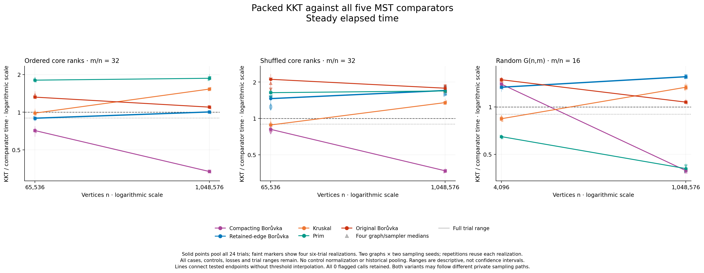
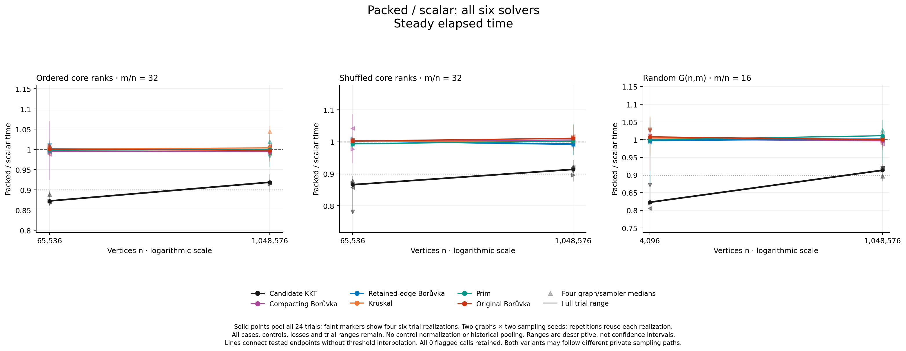

# Using all the random bits reduces KKT's constants

Private packed sampling reduces KKT's paired case-median time by **8.1–17.7%** across all six tested cases. It is faster than the fresh scalar reference in **all 144 paired trials on both elapsed and process CPU clocks**. The small ordered-attachment case now beats retained-edge Borůvka in all 24 trials, with a pooled ratio of **0.8957**. At the larger endpoint the ratio is **1.0048**, approximately parity. This is a useful implementation improvement, but **not a crossover toward KKT dominance as size increases**.

Original Borůvka still beats both KKT variants in every direct comparison. All six solvers, five KKT competitors, losses, clocks and individual observations remain included. This study validates **2,016 outputs** from 48 serial native children and reaches **1,048,576 vertices and 33,554,432 edges**. The [independent numerical audit](validation/INDEPENDENT_NUMERICAL_REVIEW.md) reconstructs the results without importing the collector.

## The implementation change

The previous private sampler draws one `mt19937` word per edge and uses only its lowest bit. The [packed helper](../../../docs/kkt-report/source-archives/packed-sampling-4bb476e/experimental_packed_sampling.hpp) consumes all 32 bits, from low to high, selecting records in their existing order. A nonempty sampling call on m records draws exactly `ceil(m/32)` words; an empty call draws none. An unused suffix is discarded at each call boundary, and recursion continues with the same engine.

Only private recursive sampling opts in through `KKT_EXPERIMENT_PACKED_SAMPLING`. Public sampling retains its exact one-draw-per-edge stream. Both variants keep `reserve(m/2)`, retained-parallel contraction and direct-Edge verifier queries. No comparator, graph generator, timing boundary or result representation was weakened. The scalar reference is freshly built with the **same callback refactor**; it is not a historical timing reused from another experiment.

Under ideal independent uniform 32-bit words, both policies produce independent Bernoulli half samples. That is not a claim of literal independence over finite deterministic MT19937 seeds. Identical seed numbers produce different private subsets, recursion paths and work between variants. The measured improvement therefore belongs to the complete sampling-policy change; timing alone does not isolate engine cost from changed recursive work.

Local source commit: `4bb476edd38420c2d0fe6aff2f37028cbece7e9f`. The default remains scalar. Seven non-KKT production objects and the six-solver harness object are physically shared; only `kkt.o` differs. This remains an opt-in experiment, not a production promotion.

## Results against every baseline

Each entry is a median of **24 paired wall-time ratios**, packed KKT divided by the named competitor in the same child and repetition. Below one favors KKT. Density d is **m/n**, not average degree. “Deduplicating B” repeats the existing compaction step; “retained-edge B” repeats the same cheaper contraction used by experimental KKT. “Original B” is the repository's original public Borůvka implementation.

| Family | n | d | / deduplicating B | / retained-edge B | / Kruskal | / Prim | / original B |
|---|---:|---:|---:|---:|---:|---:|---:|
| Leaf hierarchy | 65,536 | 32 | 0.7134 | 0.8957 | 0.9837 | 1.8042 | 1.3200 |
| Shuffled core | 65,536 | 32 | 0.8120 | 1.4596 | 0.8825 | 1.6350 | 2.1096 |
| Leaf hierarchy | 1,048,576 | 32 | 0.3357 | 1.0048 | 1.5313 | 1.8675 | 1.0983 |
| Shuffled core | 1,048,576 | 32 | 0.3684 | 1.7041 | 1.3524 | 1.6901 | 1.7806 |
| Connected G(n,m) | 4,096 | 16 | 1.3959 | 1.3338 | 0.8421 | 0.6480 | 1.4881 |
| Connected G(n,m) | 1,048,576 | 16 | 0.3949 | 1.5553 | 1.3332 | 0.4064 | 1.0737 |



CPU comparisons give the same classifications and individual win counts. Across 144 trials per comparator, packed KKT wins **120** against the deduplicating compactor, **33** against retained-edge Borůvka, **63** against Kruskal, **48** against Prim, and **zero** against original Borůvka, on each clock. Scalar KKT's corresponding counts are 116, zero, five, 48 and zero. Neither variant is an all-six-solvers winner in any trial.

The [complete comparison tables](analysis/comparisons.csv) retain both variants and clocks. The [independent review](validation/INDEPENDENT_NUMERICAL_REVIEW.md) also tabulates every packed wall/CPU comparison. Ratios are medians of individual ratios, not ratios of median runtimes.

## How much did packed sampling help?

| Case | Packed/scalar wall | Packed/scalar CPU | Packed median wall time |
|---|---:|---:|---:|
| Hierarchy, 65,536, d32 | 0.872729 | 0.872726 | 0.1191 s |
| Shuffled, 65,536, d32 | 0.866087 | 0.866084 | 0.1073 s |
| Hierarchy, 1,048,576, d32 | 0.918966 | 0.918965 | 3.5280 s |
| Shuffled, 1,048,576, d32 | 0.913831 | 0.913831 | 3.1596 s |
| G(n,m), 4,096, d16 | 0.822856 | 0.822974 | 0.002550 s |
| G(n,m), 1,048,576, d16 | 0.913378 | 0.913378 | 1.5062 s |



Every case improves on both clocks, including every one of its four graph/sampler realization medians. The five unchanged solvers' pooled cross-variant wall ratios jointly span **0.9926–1.0112**; their CPU range is almost identical. KKT's 8.1–17.7% reductions are much larger than that measured control drift. This does not eliminate host/order effects. Controls expose drift and **never normalize KKT's results**.

The [ten figures](figures/README.md) provide wall/CPU versions of implementation ratios, all-five-comparator ratios for both variants, and absolute times for all six solvers. Faint markers show four realization medians; spans include every individual-trial endpoint. These are descriptive ranges, not confidence intervals. SVG and PDF counterparts preserve export quality. All ten PNGs passed [visual review](figures/QA.md).

## A small hierarchy win is not a size crossover

On the smaller hierarchy, packed KKT/retained-edge Borůvka has wall realization medians **0.8791–0.9071**. All 24 trials favor KKT, but the prespecified strong-lead rule requires every realization median to be at most 0.90 on both clocks. The pooled 0.8957 cannot override the realization above 0.90: this is classified as a **narrow lead**.

At 1,048,576 vertices, realization medians straddle parity, **0.9962–1.0074**, and only nine of 24 trials favor KKT. The favorable small-case result weakens at the larger endpoint. Shuffled-core and connected-random cases continue to lose clearly to retained-edge Borůvka.

Exactly two of the thirty prespecified classifications are strong observed crossover brackets: scalar and packed KKT versus the **deduplicating compactor** on connected G(n,m), between 4,096 and 1,048,576 vertices at d16. There is no strong crossover against retained-edge Borůvka, Kruskal, Prim or original Borůvka. KKT already strongly leads Prim on connected G(n,m) at both endpoints; that is not a crossover. Its small packed G(n,m)/Kruskal lead becomes a large-case loss. [All classifications](analysis/strong_crossover_classifications.csv) remain visible.

## Graph structure and the work diagnosis

The [attachment generator](../../core_attachment_fixtures.hpp) places three cheap leaves on each core vertex. The hierarchy core has a still-cheap path whose weight levels force successive pairwise merges; heavier random chords tend to survive many Borůvka rounds. The shuffled twin changes core weight ranks while preserving topology, labels, edge IDs, physical order and cheap attachments. It is **not** globally random weighting. The four matched topology pairs were verified by fingerprints. These are engineered stress graphs, not application datasets.

The [connected G(n,m) generator](../../crossover_fixtures.hpp) starts without a forced backbone, samples distinct unordered pairs, and rejects disconnected whole topologies, subject to a finite attempt cap. Weights are distinct shuffled ranks. It tests a broader random model alongside the deliberately ordered cores.

The [earlier retention derivation](../density-search-2026-10-15/HIERARCHY_RETENTION.md) explains why repeated contractions revisit chords in the hierarchy. Packed sampling reduces a different local cost: engine calls while constructing recursive samples. It still scans each candidate edge, tests a bit and appends selected records. Fewer engine calls do not imply a 32-fold solver speedup, and the changed sampled subgraphs can increase or decrease later work.

The separately declared [untimed work matrix](work/analysis-attempt01/README.md) completed **48 children and 144 certified solver outputs**, reproducing the timing-input fingerprints. Strict reanalysis passed, all owned groups were verified empty, and both unchanged Borůvka continuations had exactly equal counters and replay rounds for each fixed graph across variants and sampling seeds. [All 65 counters](work/analysis-attempt01/counter_difference_summary.csv) and [1,560 individual field comparisons](work/analysis-attempt01/paired_kkt_work.csv) are retained, including zeros and increases.

Recursive sampling-input volume decreased in **13 of 24 pairs** and increased in **11**. Its packed/scalar median ratio was **0.999378**, with individual ratios **0.883022–1.037908**. Six case medians range from 0.987090 to 1.010041. Verifier-query volume likewise decreased in 13 pairs and increased in 11, with median ratio 0.999379. These counts show no consistent collapse of recursive edge/query volume that could by itself explain every timing improvement.

Engine consumption changes much more. Scalar sampling uses exactly one word per sampled-input edge. For a packed run with total sampling-input volume M and C sampling calls, the existing counters establish only

`ceil(M/32) ≤ W ≤ min(M, floor((M + 31*C)/32))`.

The [24 paired engine-word intervals](work/analysis-attempt01/paired_engine_word_bounds.csv), divided by their own scalar run's exact word count, are jointly enclosed by approximately **[0.02760348, 0.03243477]**. These are bounds, not directly observed aggregate packed word counts; individual recursive call sizes were not recorded. This supports the mechanism of sharply lower engine consumption with roughly preserved median edge/query volume. It does **not** assign a fraction of the CPU improvement to RNG, exclude effects from changed samples, or measure allocation/cache costs. Logical materialization counters omit implicit vector-growth relocation. [Diagnostic provenance](work/analysis-attempt01/report.json) remains separate from runtime evidence.

## Correctness and provenance

All timed and warmup outputs match an independently certified unique MST by exact edge IDs. Tuple-returning solvers additionally retain endpoint and cost validation. Graph generation, certification and returned-result checking are outside timing. The unchanged tuple-input boundary includes KKT/continuation input construction and temporary-input destruction; no common output conversion is imposed on the other solvers.

Native Apple Clang 15 and Clang 22 ASan+UBSan profiles each passed eight suites for both variants. Gates include scripted bit masks and partial-word boundaries, public-stream regression, actual private-dispatch witnesses, 1,248 positional verifier cases, 1,344 paired full-KKT cases, independent contraction/exhaustive checks, and rejection of wrong-policy or substituted scalar records. Final uninstrumented object sets separately passed the native six-solver harness tests before timing. [Validation details](validation/CANDIDATE_VALIDATION.md) describe the pre-capture stage; the completed capture supersedes its then-correct statement that timing executables had not yet run.

The [independent audit](validation/independent-numerical-audit/README.md) agrees with strict analysis for all **4,608 ratios, 3,024 medians and 30 classifications**, using exact rational reconstruction. It rechecks raw certificates, fingerprints, schedule, hashes, exact raw/combined concatenation, clocks, resource records and empty process groups. Its [first execution receipt](validation/independent-audit-attempt01.json) records exit 0 and empty stderr. No observation was removed, replaced or adjusted.

Native arm64 measurement used Apple M3 Max, 128 GiB, macOS 26.6.2, C++17, Apple Clang 15, `-O3 -march=native`, assertions enabled and a 512 MiB stack. The controller's ambient architecture is not evidence of the binary architecture; the build proof checks native Mach-O arm64 explicitly. Freeze/release commit: `610e9c21c3ad5e10c79a8e529e8a2edd24fe878a`. The freeze records source revision `c84e35929af82349d7acd18c51248a8c312a3c19` before that metadata commit.

| Artifact | SHA-256 |
|---|---|
| [Freeze](freeze.json) | `a7c42edbf1dc13c46385ba020c641b0fe3a520c8b8328d573e5a128c90158f10` |
| Scalar executable | `9b53b74751bf4ff68383b36989223bc3ffa5a070b61fc1eba763429e264d1ac2` |
| Packed executable | `89aceec1793323d0d6756c5cc191ac2f1f8a77e69324ade1d7d53abaca51974b` |

Exact compiler/SDK/link commands, source/recipe/object hashes and original-parent proof are bound by the freeze and build receipts. Historical measurements are not pooled or multiplied into a cumulative speedup.

## What this experiment can establish

The [prospective protocol](PROTOCOL.md) fixes six cases, graph seeds **7000003/7000017**, sampling seeds **1601/1613**, one warmup and six balanced solver rotations per child. Case medians pool all 24 ratios. Six repeats reuse each graph/sampling realization; four crossed realizations share only two graphs. Variant order is confounded with graph-by-sampler combination, and case reversal with graph seed. Counterbalancing does not remove that confounding.

Capture lasted **64.69 minutes**, with maximum sampled owned-group RSS **8.838 GiB**, zero unavailable observations and zero call/UTC flags. All 48 groups were verified empty after exit. RSS includes generation, certification and all solvers; it is neither continuous peak memory nor KKT-only memory. The archived power query succeeded and found no logged sleep overlap, but **three caffeinate attempts failed and sleep inhibition was not verified**. Unchanged occupied swap snapshots do not measure paging. Absence of a logged overlap establishes neither stable thermals nor an idle host.

This is not a new Google Benchmark complexity fit. The theoretical target is expected **O(m+n)** in represented input size, which becomes O(n) for fixed-density families. Two measured sizes, finite seeds and these machine-dependent constants cannot establish literal linear runtime, asymptotic dominance or a crossover threshold. Correctness testing and Google Benchmark model fitting answer different questions. This experiment alone does not justify changing a Wikipedia classification.

## Reproduction

From the recorded worktree with its bound parent artifacts, use new output directories:

```sh
python3 -B benchmark/run_packed_sampling.py analyze \
  --capture benchmark/results/packed-sampling-2026-10-15/paired.json \
  --output-dir /tmp/kkt-packed-reanalysis-new
python3 -B benchmark/results/packed-sampling-2026-10-15/validation/independent_numerical_audit.py \
  --capture benchmark/results/packed-sampling-2026-10-15/paired.json \
  --analysis-dir benchmark/results/packed-sampling-2026-10-15/analysis \
  --output-dir /tmp/kkt-packed-audit-new
python3 -B benchmark/plot_packed_sampling.py \
  --capture benchmark/results/packed-sampling-2026-10-15/paired.json \
  --output /tmp/kkt-packed-figures-new --released
```

The first command omits the private power log; it reproduces numerical analysis, not its logged-sleep association. [Captured build commands](validation/CANDIDATE_VALIDATION.md#captured-commands), [manifest](manifest.csv), [raw capture](paired.csv), [per-child evidence](paired_cases/), [strict provenance](analysis/provenance.json) and [figure provenance](figures/provenance.json) preserve the original experiment. Fresh native timing requires new evidence paths and a newly verified release; these reanalysis commands launch no solver.
