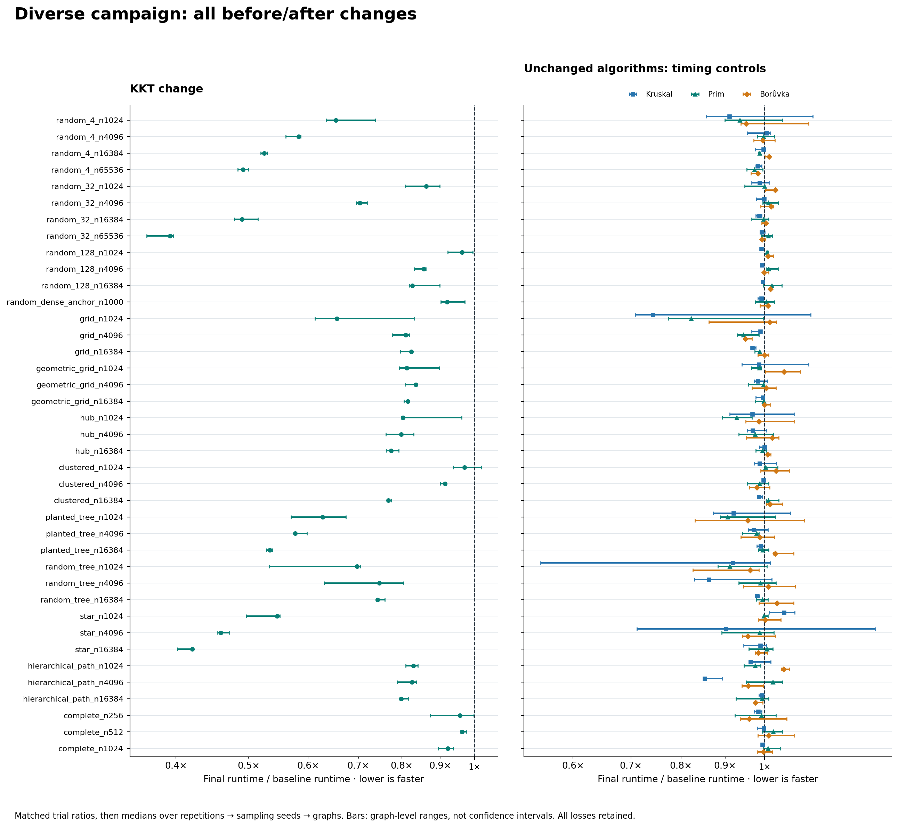
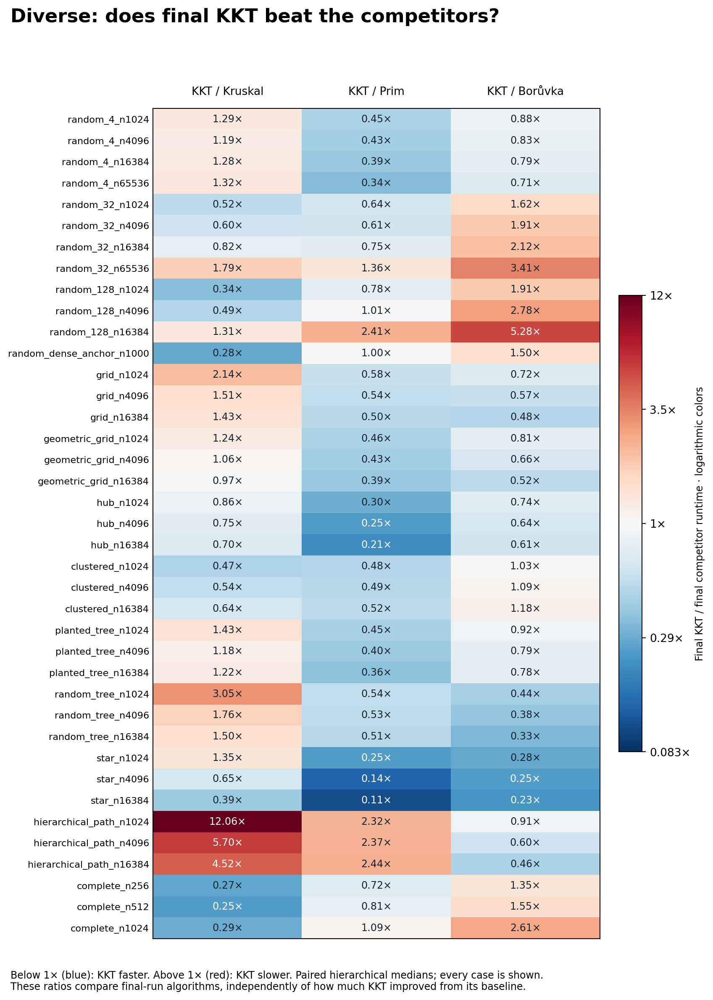
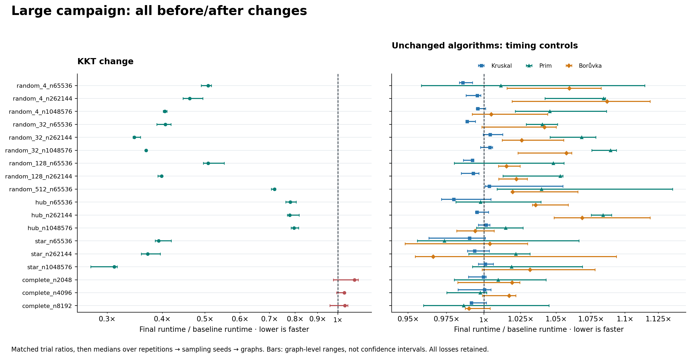
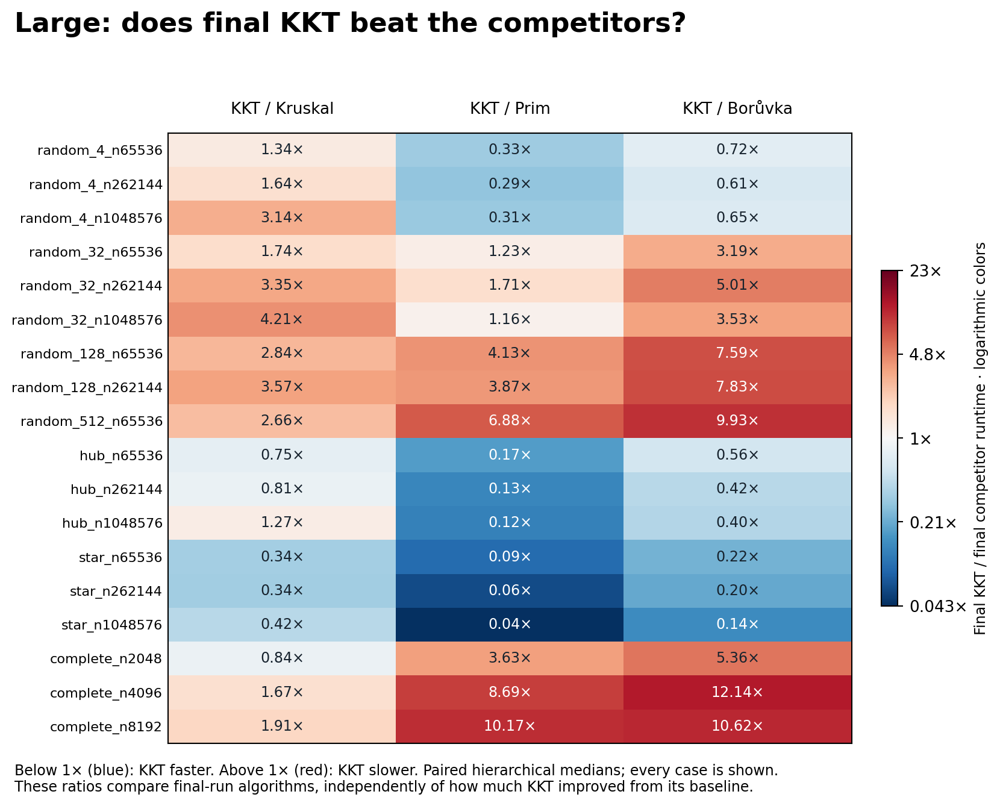

# KKT optimization: before/after evidence

Match by case, graph seed, KKT seed, repetition, and algorithm; divide final elapsed time by baseline elapsed time for each matched trial. Take the median over repetitions, then sampling seeds within each graph, then graph seeds. Final-run KKT/competitor ratios use the same hierarchy on contemporaneous four-algorithm trial blocks. Values below one favor final KKT for its before/after comparison or KKT versus its competitor. Graph ranges span three graph-level medians and are not confidence intervals.

Improving KKT and beating another MST implementation are separate outcomes. This report retains all cases, including regressions and final-run losses. There is no pooled mean speedup or workload-frequency interpretation of case counts.

## Diverse suite

Validated 39 identical cases and 5,616 complete, matched timed observations per phase (4 repetitions, 1 warmups per seed pair and algorithm). [baseline raw CSV](../baseline.csv) · [final raw CSV](../reserve.csv).

KKT has a lower matched median runtime in **39/39 cases**, a higher runtime in **0**, and equal runtime in **0**. Final/baseline ratios range from **0.393× to 0.969×**.

| Unchanged timing control | Final/baseline case-ratio range | Cases outside ±5% |
|---|---:|---:|
| Kruskal | 0.742–1.053× | 8 |
| Prim | 0.822–1.023× | 6 |
| Borůvka | 0.950–1.053× | 3 |

The ±5% screen is a descriptive stability check, not a significance threshold or an automatic correction. Control movement can reflect scheduling, cache, allocator, thermal, or clock effects. It does not uniquely identify their cause.

Final KKT is below all three competitors by paired case medians in: `geometric_grid_n16384`, `hub_n1024`, `hub_n4096`, `hub_n16384`, `star_n4096`, `star_n16384`.

The stronger descriptive check—below every competitor on every graph-level median—holds in: `geometric_grid_n16384`, `hub_n1024`, `hub_n4096`, `hub_n16384`, `star_n4096`, `star_n16384`. Neither check establishes statistical certainty or performance on unmeasured inputs.

| Case | KKT final/baseline | Graph range | Final KKT/Kruskal | Final KKT/Prim | Final KKT/Borůvka |
|---|---:|---:|---:|---:|---:|
| random_4_n1024 | 0.653 | 0.634–0.738 | 1.288 | 0.452 | 0.878 |
| random_4_n4096 | 0.583 | 0.560–0.587 | 1.193 | 0.428 | 0.825 |
| random_4_n16384 | 0.525 | 0.519–0.529 | 1.279 | 0.390 | 0.789 |
| random_4_n65536 | 0.491 | 0.483–0.499 | 1.321 | 0.340 | 0.709 |
| random_32_n1024 | 0.863 | 0.808–0.899 | 0.520 | 0.638 | 1.618 |
| random_32_n4096 | 0.703 | 0.696–0.719 | 0.598 | 0.614 | 1.905 |
| random_32_n16384 | 0.490 | 0.479–0.515 | 0.820 | 0.754 | 2.117 |
| random_32_n65536 | 0.393 | 0.366–0.397 | 1.795 | 1.362 | 3.409 |
| random_128_n1024 | 0.963 | 0.921–0.995 | 0.344 | 0.783 | 1.908 |
| random_128_n4096 | 0.856 | 0.832–0.862 | 0.486 | 1.014 | 2.775 |
| random_128_n16384 | 0.826 | 0.819–0.899 | 1.310 | 2.409 | 5.277 |
| random_dense_anchor_n1000 | 0.920 | 0.902–0.970 | 0.282 | 0.996 | 1.499 |
| grid_n1024 | 0.656 | 0.613–0.831 | 2.143 | 0.579 | 0.718 |
| grid_n4096 | 0.810 | 0.777–0.819 | 1.508 | 0.537 | 0.571 |
| grid_n16384 | 0.823 | 0.797–0.826 | 1.433 | 0.504 | 0.480 |
| geometric_grid_n1024 | 0.812 | 0.793–0.898 | 1.240 | 0.456 | 0.805 |
| geometric_grid_n4096 | 0.835 | 0.808–0.838 | 1.056 | 0.432 | 0.665 |
| geometric_grid_n16384 | 0.815 | 0.805–0.815 | 0.966 | 0.391 | 0.521 |
| hub_n1024 | 0.803 | 0.798–0.961 | 0.865 | 0.295 | 0.741 |
| hub_n4096 | 0.798 | 0.762–0.830 | 0.752 | 0.246 | 0.644 |
| hub_n16384 | 0.775 | 0.764–0.793 | 0.703 | 0.215 | 0.612 |
| clustered_n1024 | 0.969 | 0.937–1.020 | 0.467 | 0.478 | 1.034 |
| clustered_n4096 | 0.914 | 0.900–0.916 | 0.543 | 0.493 | 1.092 |
| clustered_n16384 | 0.768 | 0.765–0.775 | 0.642 | 0.517 | 1.177 |
| planted_tree_n1024 | 0.627 | 0.569–0.674 | 1.432 | 0.449 | 0.916 |
| planted_tree_n4096 | 0.577 | 0.575–0.598 | 1.175 | 0.397 | 0.790 |
| planted_tree_n16384 | 0.534 | 0.528–0.538 | 1.218 | 0.357 | 0.777 |
| random_tree_n1024 | 0.698 | 0.533–0.705 | 3.051 | 0.537 | 0.436 |
| random_tree_n4096 | 0.747 | 0.631–0.805 | 1.763 | 0.527 | 0.381 |
| random_tree_n16384 | 0.743 | 0.741–0.759 | 1.500 | 0.506 | 0.327 |
| star_n1024 | 0.546 | 0.496–0.550 | 1.346 | 0.249 | 0.278 |
| star_n4096 | 0.459 | 0.455–0.471 | 0.647 | 0.139 | 0.249 |
| star_n16384 | 0.421 | 0.402–0.421 | 0.395 | 0.109 | 0.228 |
| hierarchical_path_n1024 | 0.829 | 0.809–0.840 | 12.063 | 2.319 | 0.913 |
| hierarchical_path_n4096 | 0.826 | 0.789–0.837 | 5.704 | 2.369 | 0.603 |
| hierarchical_path_n16384 | 0.798 | 0.795–0.815 | 4.516 | 2.444 | 0.457 |
| complete_n256 | 0.956 | 0.873–0.999 | 0.273 | 0.723 | 1.348 |
| complete_n512 | 0.962 | 0.958–0.976 | 0.251 | 0.810 | 1.552 |
| complete_n1024 | 0.921 | 0.895–0.937 | 0.292 | 1.087 | 2.611 |

## Large suite

Validated 18 identical cases and 648 complete, matched timed observations per phase (1 repetitions, 0 warmups per seed pair and algorithm). [baseline raw CSV](../../large-2026-10-10/raw.csv) · [final raw CSV](../large_final.csv).

KKT has a lower matched median runtime in **15/18 cases**, a higher runtime in **3**, and equal runtime in **0**. Final/baseline ratios range from **0.311× to 1.090×**.

| Unchanged timing control | Final/baseline case-ratio range | Cases outside ±5% |
|---|---:|---:|
| Kruskal | 0.980–1.004× | 0 |
| Prim | 0.974–1.089× | 5 |
| Borůvka | 0.966–1.087× | 4 |

The ±5% screen is a descriptive stability check, not a significance threshold or an automatic correction. Control movement can reflect scheduling, cache, allocator, thermal, or clock effects. It does not uniquely identify their cause.

Final KKT is below all three competitors by paired case medians in: `hub_n65536`, `hub_n262144`, `star_n65536`, `star_n262144`, `star_n1048576`.

The stronger descriptive check—below every competitor on every graph-level median—holds in: `hub_n65536`, `hub_n262144`, `star_n65536`, `star_n262144`, `star_n1048576`. Neither check establishes statistical certainty or performance on unmeasured inputs.

| Case | KKT final/baseline | Graph range | Final KKT/Kruskal | Final KKT/Prim | Final KKT/Borůvka |
|---|---:|---:|---:|---:|---:|
| random_4_n65536 | 0.508 | 0.490–0.517 | 1.336 | 0.328 | 0.717 |
| random_4_n262144 | 0.461 | 0.446–0.494 | 1.639 | 0.287 | 0.610 |
| random_4_n1048576 | 0.406 | 0.402–0.410 | 3.143 | 0.312 | 0.645 |
| random_32_n65536 | 0.406 | 0.389–0.418 | 1.740 | 1.232 | 3.187 |
| random_32_n262144 | 0.346 | 0.343–0.357 | 3.353 | 1.713 | 5.009 |
| random_32_n1048576 | 0.367 | 0.367–0.369 | 4.206 | 1.155 | 3.534 |
| random_128_n65536 | 0.508 | 0.495–0.553 | 2.839 | 4.132 | 7.591 |
| random_128_n262144 | 0.399 | 0.391–0.399 | 3.571 | 3.871 | 7.829 |
| random_512_n65536 | 0.718 | 0.707–0.722 | 2.660 | 6.878 | 9.935 |
| hub_n65536 | 0.780 | 0.762–0.805 | 0.748 | 0.173 | 0.556 |
| hub_n262144 | 0.778 | 0.768–0.816 | 0.810 | 0.127 | 0.419 |
| hub_n1048576 | 0.796 | 0.784–0.815 | 1.269 | 0.119 | 0.401 |
| star_n65536 | 0.393 | 0.385–0.419 | 0.341 | 0.089 | 0.225 |
| star_n262144 | 0.370 | 0.358–0.396 | 0.337 | 0.060 | 0.201 |
| star_n1048576 | 0.311 | 0.275–0.316 | 0.416 | 0.043 | 0.140 |
| complete_n2048 | 1.090 | 0.977–1.112 | 0.841 | 3.631 | 5.362 |
| complete_n4096 | 1.034 | 0.993–1.037 | 1.666 | 8.685 | 12.135 |
| complete_n8192 | 1.037 | 0.959–1.053 | 1.914 | 10.173 | 10.623 |

The large suite is exploratory: one call per graph/sampling-seed pair cannot estimate repeatability for that exact stream. Close races require separate repeated confirmation. Its points are not pooled with the four-repetition diverse suite.

## Interpretation and provenance

- Three graph seeds are the independent graph-level units. Sampling seeds and repetitions do not create additional independent graphs. Star sampling-seed labels do not change its KKT path.
- Before/after pairing aligns graph and sampling-seed labels plus repetition/order labels. It does not pair clock noise, temperature, or simultaneous machine state. Ratios of separately aggregated runtimes need not equal the matched-ratio medians reported here.
- Both phases retain the common tuple-edge-list timing boundary, including KKT conversion and temporary-input destruction. Source/certificate validation and returned-result destruction remain outside timing. The CSVs validate exact MST results through the unchanged harness.
- CSV validation cannot establish compiler, binary, fixture-source, or core-source identity. Consult the campaign metadata for exact revisions, hashes, flags, executable order, and host. Any algorithm intentionally changed beyond KKT must be identified before treating it as an unchanged control.
- These are repository implementations on synthetic graphs. A lead over Kruskal alone is not a lead over Prim and Borůvka. Small observed advantages warrant confirmation; neither these ratios nor fitted curves prove asymptotic complexity or an eventual crossover.

## Derived data

- `before_after.csv` and `graph_before_after.csv`: changes for all four algorithms, including losses.
- `matched_trials.csv`: every matched pair of raw durations and its final/baseline ratio.
- `phase_summary.csv`, `phase_graph_summary.csv`, and `phase_comparisons.csv`: reusable per-phase aggregates.
- `assessment.csv`: KKT changes and final-run comparisons against all three competitors for every case.
- `analysis.json`: input hashes, counts, retained regressions, descriptive winners, and control movement.
- Figures are also saved as SVG and PDF. The raw input CSVs are linked above; no old-run values are silently added.
