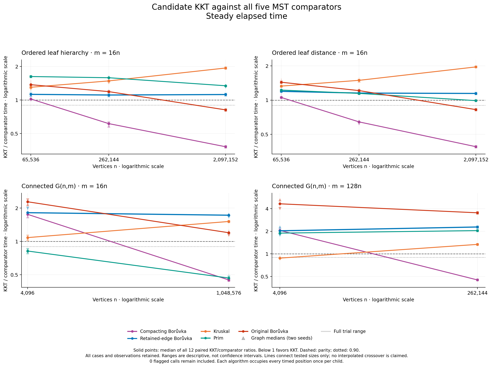
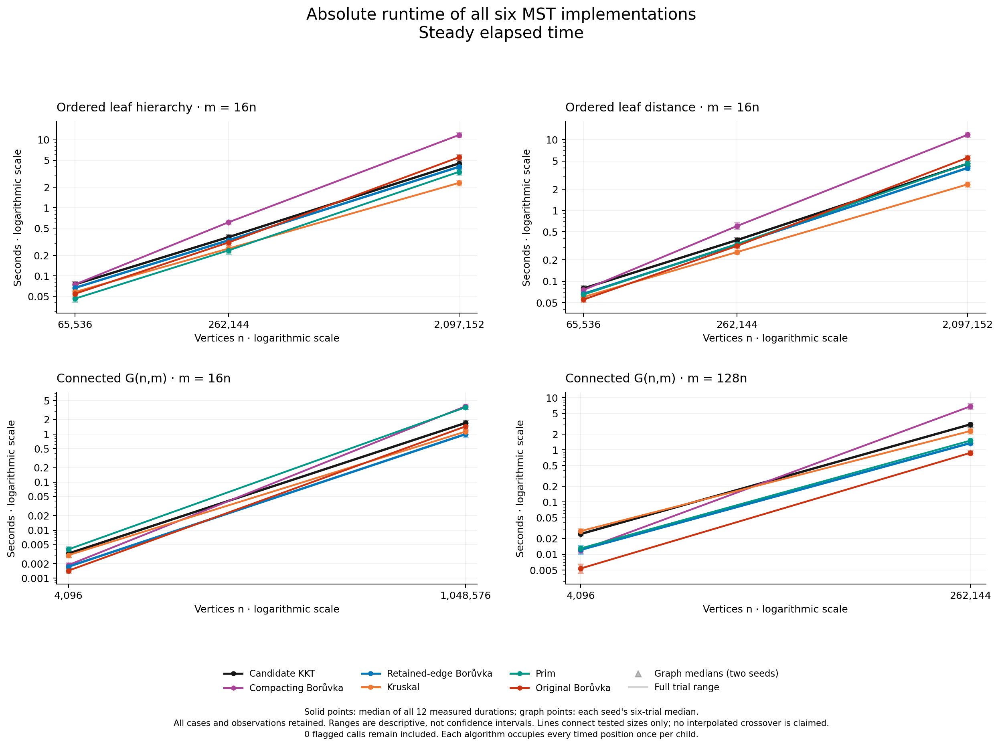

# The crossover survives one comparator—and disappears with a cheaper Boruvka

Giving Boruvka the same retained-parallel contraction changes the conclusion.
In this fresh-seed study, **retained-edge Boruvka beats candidate KKT in every
one of the 120 paired timed comparisons, on both elapsed and CPU clocks**.
At 2,097,152 vertices and 33,554,432 edges, KKT takes **1.120×** its time on
ordered leaf hierarchies and **1.145×** on ordered leaf-distance graphs.

KKT still has strong measured crossovers against the existing deduplicating
compactor: its large ordered cases take only **0.381× and 0.389×** that solver's
time. It also crosses and beats original Boruvka there. Those are real results,
but they do not establish a practical advantage over the stronger compactor.
No case in this study makes KKT the fastest of all six implementations.

This is a complete follow-up to the [ten-case implementation screen](../multigraph-2026-10-14/README.md),
not a replacement for its measurements. The earlier screen showed a substantial
KKT improvement from retaining parallel edges. The present experiment asks what
happens when a competing algorithm receives the same improvement. All new native
sources and the protocol were committed at `1bc827d`; the freeze was committed
at `727d43c` before timing. Default production KKT remains unchanged.

## The stronger comparison

The existing compacting Boruvka repeatedly selects safe edges, contracts their
components and deduplicates the quotient. The new
[retained-edge continuation](../../retention_boruvka.hpp) does the same thing
with KKT's experimental contraction: remove self-loops, preserve every crossing
parallel record in input order, and repeat until empty. Its selected-ID vector,
quotient move and final reserved hash set mirror the existing compactor.
Only the contraction call changes. It performs no random sampling or filtering.

All eight production object files—including candidate KKT—are byte-identical
to the earlier screen's candidate build. The new six-solver harness keeps the
three comparable ID-returning APIs on the same timing boundary: input conversion
and temporary input destruction are included; result validation and destruction
are excluded. Kruskal, Prim and original Boruvka retain their existing APIs and
boundaries. All comparators remain in the results.

The shared step removes a major confound: both KKT and retained-edge Boruvka now
receive the cheaper contraction and its edge order. They still differ in their
entire continuations, including recursion, forest construction, verification,
allocation and result accumulation. This is not an isolated measurement of the
verifier or a claim that every possible Boruvka implementation has been optimized.

## Every result, including the losses

Each cell below is the median of **twelve paired KKT/comparator ratios**:
six repetitions on each of two fresh graph seeds. Below one favors KKT. This
pooled statistic was declared before timing; the earlier screen's competitor
summaries used a different declared aggregation and are not pooled with these.

| Family | n | m/n | Deduplicating compactor | Retained-edge compactor | Kruskal | Prim | Original Boruvka |
|---|---:|---:|---:|---:|---:|---:|---:|
| Ordered leaf hierarchy | 65,536 | 16 | 1.022 | 1.124 | 1.302 | 1.625 | 1.373 |
| Ordered leaf hierarchy | 262,144 | 16 | 0.614 | 1.109 | 1.485 | 1.586 | 1.190 |
| Ordered leaf hierarchy | 2,097,152 | 16 | 0.381 | 1.120 | 1.938 | 1.343 | 0.816 |
| Ordered leaf distance | 65,536 | 16 | 1.055 | 1.194 | 1.328 | 1.225 | 1.437 |
| Ordered leaf distance | 262,144 | 16 | 0.643 | 1.153 | 1.493 | 1.145 | 1.212 |
| Ordered leaf distance | 2,097,152 | 16 | 0.389 | 1.144 | 1.959 | 0.989 | 0.825 |
| Connected G(n,m) | 4,096 | 16 | 1.756 | 1.817 | 1.082 | 0.819 | 2.280 |
| Connected G(n,m) | 1,048,576 | 16 | 0.448 | 1.724 | 1.513 | 0.467 | 1.197 |
| Connected G(n,m) | 4,096 | 128 | 2.053 | 2.029 | 0.878 | 1.890 | 4.640 |
| Connected G(n,m) | 262,144 | 128 | 0.451 | 2.280 | 1.337 | 2.040 | 3.523 |

The [CPU figure](figures/ratios_cpu.png) and [complete tables](analysis/README.md)
retain both clocks, every graph median and every paired trial. The figures show
full trial ranges and two graph medians; these are descriptive ranges, not
confidence intervals. Lines join measured sizes, not estimated thresholds.

The strongest new negative result is the nearly flat hierarchy comparison with
retained-edge Boruvka: **1.124, 1.109, 1.120** as n grows from 65,536 through
262,144 to 2,097,152. That is no observed trend toward KKT dominance. The distance
family improves from **1.194 to 1.145**, but never reaches parity. In random
graphs, KKT is **1.72–2.28×** slower than the retained-edge compactor at the two
large endpoints.

Kruskal wins nine of ten case medians. Its one loss is the small dense random
case, and KKT loses that comparison at the larger size: increasing input size
does not consistently help KKT even against a sorting-based solver. KKT leads
Prim on the density-16 random cases; the roughly 1% large leaf-distance lead
is much weaker than a ten-percent win and should not be advertised as a strong
crossover. The full record retains those distinctions.

Absolute times make the practical scale visible: these are milliseconds to
seconds per solver call, not an extrapolation to astronomical graph sizes.
The [CPU-time counterpart](figures/times_cpu.png) uses identical panel limits.

## What counts as a crossover

The [prospective rule](PROTOCOL.md) requires a smaller measured point where
**both graph medians exceed one on both clocks**, then a larger point where
**both graph medians are at most 0.90 on both clocks**, with every still-larger
tested point satisfying that win rule. This reports a measured bracket, not an
exact transition or a guarantee about all intermediate/future sizes.

The [independent audit](validation/independent-numerical-audit/README.md) finds
six strong brackets, with the same classification on both clocks:

| Family | m/n | Comparator | Smaller losing n | Larger winning n |
|---|---:|---|---:|---:|
| Ordered leaf hierarchy | 16 | Deduplicating compactor | 65,536 | 262,144 |
| Ordered leaf distance | 16 | Deduplicating compactor | 65,536 | 262,144 |
| Connected G(n,m) | 16 | Deduplicating compactor | 4,096 | 1,048,576 |
| Connected G(n,m) | 128 | Deduplicating compactor | 4,096 | 262,144 |
| Ordered leaf hierarchy | 16 | Original Boruvka | 262,144 | 2,097,152 |
| Ordered leaf distance | 16 | Original Boruvka | 262,144 | 2,097,152 |

The exact [point states and every comparator's classification](validation/independent-numerical-audit/strong_crossover_brackets.csv)
include all losses and inconclusive cases.
No crossover against retained-edge Boruvka exists in this sweep: every individual
paired observation favors that comparator. A favorable big-O bound cannot change
that observed result.

## Why the old compactor loses, and why the new one wins

The attachment families combine cheap local stars with an ordered core that
merges through many levels. Numerous heavier shortcuts remain crossing edges
through those levels. Repeated deduplication constructs buckets and follows
linked edge records each time; its cost can grow substantially with a large
working set. KKT filters many heavy edges, while its retained-parallel variant
also avoids that deduplication machinery.

The stronger Boruvka control avoids the same machinery. Its later component
arrays can become small while its edge access remains sequential. KKT may visit
fewer records overall yet spend more time on sampling, recursive sample forests,
path queries and additional copies. A graph scan, a random array lookup and an
allocation are not interchangeable units of time. These source-backed mechanisms
explain why counting contraction rounds alone is insufficient; no cache-miss or
bandwidth profile has isolated their individual runtime contributions.

For connected G(n,m), random cheapest edges can merge much larger groups quickly.
There may be relatively little repeated work left for KKT to avoid. These inputs
are sampled uniformly without replacement, with whole-topology rejection for
connectivity and a finite attempt cap; no spanning-tree scaffold is planted.
The structured attachment cases are controlled families, not a claim that all
real-world networks have their merge hierarchy. The earlier
[actual graph views](../search-2026-10-13/attachment-views-d16/README.md) illustrate
the construction; they do not depict the million-vertex timing inputs in full.

A separate, untimed counter investigation is being collected for all three
continuations. Its counts will be reported independently of these elapsed-time
measurements. They must not be treated as calibrated instruction counts or as
proof that any single memory operation caused the observed difference.

## What this says about complexity and the next repair

The original implementation's superlinear bookkeeping defects and subsequent
repairs are documented in the [main report](../../../docs/kkt-report/REPORT.md).
The [retained-parallel screen](../multigraph-2026-10-14/README.md) then showed that
another linear-time phase could still have unnecessarily high constants. This
control extends that lesson: improving shared infrastructure can benefit a
simpler competing algorithm just as much, or more.

The [expected-linear KKT analysis](https://people.csail.mit.edu/karger/Papers/mst.pdf)
bounds work under its algorithmic assumptions;
it does not guarantee the lowest finite runtime on every family. A competing
worst-case upper bound is not a tight lower bound for every input. On some
families, Boruvka needs only a few effective passes. On slow-merging families,
extra inexpensive streaming passes can still beat a more elaborate filter at
all measured sizes. None of this contradicts the expected-complexity argument.

This study does **not** rerun Google Benchmark complexity fits or establish
linear wall time. Google Test checks correctness; Google Benchmark fits selected
growth models to finite data. These selected two- or three-point curves are
insufficient to establish asymptotic dominance. At fixed m/n, scaling n also
scales m, but the constants and memory effects still matter.

Source review identified a concrete next experiment: KKT copies every edge in
the reduced graph into `G_tuples` immediately before its positional verifier.
An internal overload could read the existing edge records directly. The proposed
experiment will preserve sampling, forest construction, filter marks and edge
order, and compare newly built tuple and Edge paths on fresh paired timings.
It is not yet a measured improvement. Early temporary release and in-place
filtering are separate possible repairs, not silently bundled changes.

## Correctness, resources and limits

The new harness passed native and native Clang 22 ASan/UBSan/leak gates:
**819 solver outputs**, **35 exhaustive multigraph optima**, **140 damaged-result
rejections** and **10 invalid repetition rejections**. The original unsupported
G(n,m) test fixture failure remains archived; correcting it did not weaken the
generator. See [native validation](validation/NATIVE_VALIDATION.md).

The timed campaign then validated **840 outputs**, including 120 warmups, on
independently certified inputs. Six repetitions place each solver once in every
execution position. The collector and its independent review pass seven mocked
test groups that reject missing results, changed sources, altered certificates,
wrong schedules and unverified child exits. Strict reanalysis rereads raw files,
commands, hashes, certificates, clock endpoints and resource observations.
An independent audit used exact rational arithmetic on all twenty raw children,
without importing the collector, and matched all 1,200 paired ratios, 100 case
medians and 200 graph medians.

The machine is an Apple M3 Max with 128 GiB RAM and macOS 26.6.2. Measured code
is verified arm64, built with Apple Clang 15, C++17, `-O3 -march=native`, assertions
enabled and a 512 MiB stack. The Python controller's inherited process personality
is translated; it is not the measured solver binary. Graph seeds are
3000001/3000029 and the starting KKT seed is 809. The second seed reverses case
order. This is limited replication on one machine, and graph seed is confounded
with case order.

The serial capture took **26.47 minutes**. Its largest sampled process-group RSS
was **9.550 GiB**; this includes generation, certification and all six solvers,
and is neither a continuous peak nor KKT-only memory. **One RSS observation was
unavailable**; it remained in the evidence, did not reach the three-consecutive-
failure stop rule, and every child exit was independently verified. There were
zero call/capture clock flags, zero nominal logged-sleep overlaps and no malformed
or reversed power events. The archived power query itself succeeded.

Both `caffeinate` attempts failed, including the explicit native attempt; no
sleep-inhibition assertion is claimed. Absence of logged sleep does not establish stable
frequency, thermals or a quiet host. Occupied swap changed from 4,626.19 to
4,618.19 MiB; those snapshots do not measure paging activity. No observations
were trimmed, adjusted, replaced or normalized against controls.

The [protocol](PROTOCOL.md), [freeze](freeze.json), [raw capture](followup.csv),
[strict analysis](analysis/README.md), and [figures with visual QA](figures/QA.md)
remain available. The prepared five-solver follow-up was superseded **before any
freeze or timing**; this complete six-solver campaign is the executed follow-up.
These repository experiments are unpublished original research, not independent
sources for a Wikipedia classification.
