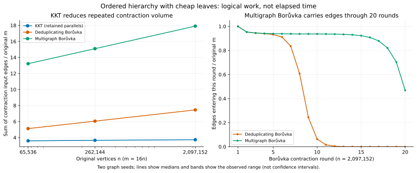

# Supplementary work diagnostics for the retention control

The 20 declared inputs all passed: 60 instrumented solver results matched independently certified MST IDs, and both Borůvka round replays matched their exact helper counters and final IDs. Every weighted and topology fingerprint matches the corresponding [frozen timing capture](../followup.json). The counters confirm that KKT avoids much repeated contraction work. They do **not** establish that its remaining operations are cheaper than the retained-edge Borůvka continuation.

This is a separate, untimed diagnostic run after native performance capture finished. It uses the same graph seeds 3,000,001 and 3,000,029, KKT seed 809, and all ten declared cases. No observations were dropped or pooled with the earlier failed collector attempt. Process-wrapper durations exist only for lifecycle/resource evidence and must not be interpreted as solver performance.



## What the counters show

The following entries are medians across the two graph seeds. `m` is the original edge count; `m/n` is the benchmark density, not average undirected degree. KKT contraction calls include its two recursive branches, whereas Borůvka calls are sequential rounds.

| Input | KKT contraction input / m | Retained-edge Borůvka input / m | Borůvka rounds | KKT path-query visits / m | KKT initialized slots / m | Borůvka initialized slots / m |
|---|---:|---:|---:|---:|---:|---:|
| Hierarchy, n = 65,536, m = 16n | 3.594 | 13.220 | 15 | 13.156 | 8.870 | 0.250 |
| Hierarchy, n = 262,144, m = 16n | 3.658 | 15.094 | 17 | 13.669 | 9.189 | 0.250 |
| Hierarchy, n = 2,097,152, m = 16n | 3.733 | 17.907 | 20 | 14.115 | 9.469 | 0.250 |
| Distance, n = 2,097,152, m = 16n | 3.830 | 17.907 | 20 | 14.824 | 9.927 | 0.250 |
| G(n,m), n = 1,048,576, m = 16n | 3.563 | 7.373 | 8 and 9 | 13.056 | 8.462 | 0.203 |
| G(n,m), n = 262,144, m = 128n | 3.621 | 6.635 | 7 | 13.489 | 8.469 | 0.025 |

The complete [30-row comparison](WORK_TABLE.md), [all 65 counters for all 60 solver runs](raw_work.csv), [two-seed counter ranges](case_counter_summary.csv), and [every Borůvka round](rounds.csv) retain the smaller and non-winning cases too.

The ordered families are engineered weighted stress tests. Their [generator](../../../../benchmark/core_attachment_fixtures.hpp) gives each core vertex three cheaper leaves, then connects the core with dyadically ordered edges and many random shortcuts. The first contraction collapses the stars; later cheapest edges join adjacent dyadic blocks. At n = 2,097,152, both KKT and retained-edge Borůvka therefore begin the continuation after two steps with 262,144 vertices and 31,719,424 edges: 94.53125% of the original m. The driver checks that equality on each input.

The retained-edge continuation carries shortcuts through many more rounds. On hierarchy graph seed 3,000,001, it still has 31,453,830 edges at 4,096 quotient vertices (93.740% of original m), and 15,733,331 at two vertices (46.889%). Across all twenty rounds its contraction input totals 17.907m. KKT samples, solves the sample, and filters; its corresponding total is 3.727m for this seed. Its sampling/verifier input is 1.759m in total, and only 0.0227m filtered edge records proceed into its final-recursion branches. These are cumulative volumes across the recursion, not one root-level retention ratio.

The kernel explains why a scan count alone is insufficient. The [retained-edge step](../../../../kkt/experimental_multigraph_contraction.hpp) scans the edge vector in physical order, maintains vertex-sized component arrays, and emits crossing edges in that same order. Once the quotient has few vertices, its endpoint arrays are small even while m remains large. Its final one-component round exits after the cheapest-edge pass. The [deduplicating step](../../../../kkt/kkt.cpp) additionally builds an edge-sized next-link array and traverses endpoint buckets, keeping only the cheapest parallel representative. On the large hierarchy it reduces total input to 7.454m but initializes 7.798m slots, compared with retained-edge Borůvka's 0.250m. This is a concrete shared-kernel advantage; a lead over the deduplicating baseline cannot by itself be credited to KKT sampling.

KKT trades repeated contractions for different work. Its [sample/filter recursion](../../../../kkt/kkt.cpp) includes random draws, sample construction, forest reconstruction, query-record conversion, verification, and filtering. The [verifier](../../../../verifier/verifier_v2.cpp) builds edge-indexed ancestors, endpoint query ranges, path maxima and marks. A queried non-loop edge normally contributes two endpoint queries; counting, filling, initialization traversal and answer traversal each visit those queries. This accounts for about eight path-query visits per verifier edge here. These operations have different dependency and memory-access patterns from a sequential contraction scan. Better locality for the simpler continuation is a plausible mechanism, not a measured cache result.

Indeed, adding the existing heterogeneous event counters with equal weights would mislead: on the first large hierarchy seed, excluding final hash inserts, that sum is about 57.35m for KKT and 72.53m for retained-edge Borůvka, although the separate timing experiment favors Borůvka. An edge read, a path-query update, a vector initialization, and an edge materialization are not interchangeable CPU instructions. The counter totals demonstrate work reduction and composition; profiling or controlled implementation experiments are needed to attribute elapsed time.

For connected uniform G(n,m), the cheapest-edge forest collapses the graph in fewer rounds. The sparse million-vertex graphs need eight and nine retained-edge rounds, versus twenty for the large ordered cases. KKT therefore saves fewer scans while retaining substantial verifier/query overhead. The two graph seeds and one sampling seed do not establish an expected-complexity theorem, a future crossover, or a result for application graphs.

## Validation and provenance

The [driver](driver.cpp) and [build recipe](diagnostic.mk) are supplementary sources outside the frozen native inventory. They are explicitly hash-bound separately; no timed C++ source, original Makefile, contraction helper, or frozen collector helper was modified. The [build record](build-record.json) records native arm64 Apple Clang, exact flags, SDK, binary, eight separate instrumented objects, and all frozen source hashes. The diagnostic adds `KKT_ENABLE_WORK_STATS` to the retained-parallel configuration.

Each exact solver invocation includes tuple-to-problem conversion, as in the timed boundary. KKT and the two Borůvka continuations must match an independent cycle-property MST certificate checked on the original graph. The retained-edge solver invokes the unchanged [frozen helper](../../../../benchmark/retention_boruvka.hpp); the deduplicating solver copies the frozen harness body exactly. Separate deterministic replays of the two exact contraction steps collect round boundaries outside the work-stat scope. Their round counts, aggregate input/output vertex and edge volumes, and final IDs must agree with the actual helper invocation. They are never labeled native timing.

Final result-set insertion is **unmeasured** for both Borůvka continuations because their frozen helpers do not emit that hook. Raw JSON records `hash_insert_items: null` and an explicit `unmeasured` status; CSV leaves the field empty. It must not be interpreted as zero. The production hooks also do not count allocator internals, vector reallocations, instructions, bytes transferred, cache misses or all library work.

Four small input gates passed before the full schedule, followed by eight rejected raw-output corruptions covering fingerprints, seeds, missing algorithms/counters, negative counters, round totals, and the unmeasured-versus-zero distinction. See [gate evidence](gate-v2.json) and [negative validation](negative-validation-v2.json). The first capture attempt stopped after one successful native child because the collector incorrectly required the manifest-only `intrusion_per_mille` field in native JSON. [Its failed sidecar](capture.json), raw output/resource logs, and [original collector source](collect-v1.py) are retained. The corrected collector excludes that one field; the frozen manifest and explicit analysis guard require it to be zero. The small gate was rerun and a fresh complete capture was collected. Earlier native output is not reused in the complete data.

The [complete capture](capture-v2.json) verifies all twenty owned process groups empty after wrapper exit. There were 249 bounded RSS observations, zero unavailable observations and no cleanup failures; sampled maximum group RSS was 7,291,528 KiB, below the 40 GiB ceiling. This maximum includes generation, certification, all solvers and diagnostic replay; it is not an algorithm-specific peak. The [strict reanalysis](analysis.json) rechecks raw hashes, fingerprints, counters, replay aggregates, certificates, resource observations and source identities. The [resource table](resources.csv) retains every child.

Reproduction from the recorded worktree, with the recorded native binary and build artifacts present:

```sh
python3 benchmark/results/retention-control-2026-10-15/work/collect.py verify
/usr/local/bin/python3.10 benchmark/results/retention-control-2026-10-15/work/analyze.py
```

Analysis used the existing Python 3.10 runtime with Matplotlib 3.9.2; the default Python lacked Matplotlib, so the first plotting attempt stopped before writing analysis provenance. The PNG was visually checked for labels, ranges and clipping. The frozen native timings remain the evidence for runtime comparisons; these supplementary artifacts explain logical work only.
