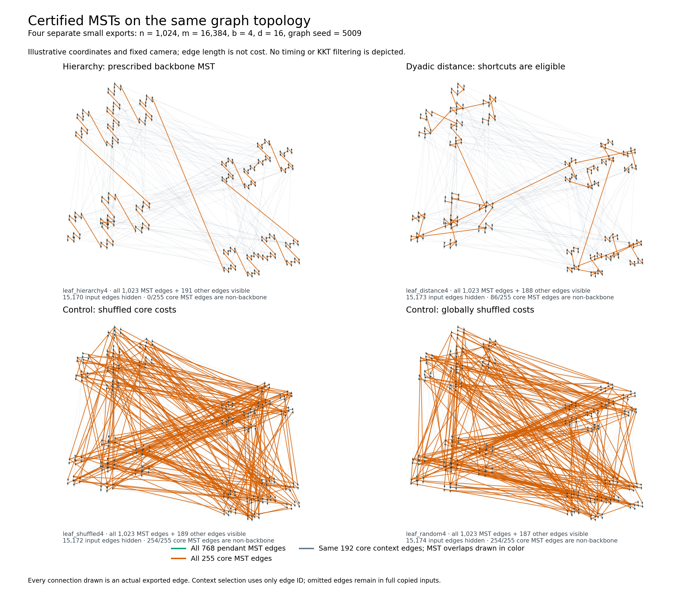

<!-- Focused follow-up: link complete figure appendices rather than embedding
     every panel. Printed pagination has not yet been checked. -->

# Searching for a KKT crossover against five MST solvers

The completed discovery screens find a size-dependent KKT lead over compacting
Borůvka, but **none of their 143 cases has KKT ahead of all four competitors**.
The attachment families cross from a loss at 65,536 vertices to a lead at
262,144, then save about 17–19% at 2,097,152–4,194,304. The strongest paired
ratio is **0.8082**, at 2,097,152 vertices and 33,554,432 edges. On that input
KKT takes about **4.32 times Kruskal's time**. These are discovery observations
from one graph seed, with captures kept separate. Fresh-seed campaign A is
complete: its upper selected cases save 16–19% against the compactor.
Campaign B was interrupted by a stalled resource monitor after 60 native
children. Its failed capture is retained, and a separately declared
[recovery](ATTACHMENT_RECOVERY.md) will finish only the remaining cases.
Full two-campaign confirmation is not claimed.

This is a focused follow-up to the [implementation and complexity report](../../../docs/kkt-report/REPORT.md)
and the [previous large-instance study](../crossover-2026-10-13/README.md).
Those reports contain the repairs, Google Benchmark results, earlier graph
families and detailed work diagnostics. Here the question is narrower: can a
graph family make KKT competitive with **all five implementations measured in
the same campaign**, while also exhibiting a clear size-dependent advantage?
Production solvers are unchanged. The full [protocol](PROTOCOL.md) was frozen
before timing.

| Part of this search | Current evidence status |
|---|---|
| Complete-bundle lifted pilot | Complete: 28 cases, 700 timed calls, 140 checked warmups |
| Existing-family density pilot | Complete: 25 cases, 625 timed calls, 125 checked warmups |
| Single-edge attachment pilot | Complete: 80 cases, 2,000 timed calls, 400 checked warmups |
| Larger attachment discovery sizes | Complete: ten cases, 250 timed calls, 50 checked warmups |
| Attachment work counters and contraction traces | Complete: 16 discovery inputs, 254 compactor rounds, separate instrumented binary |
| Fresh-seed campaign A | Complete: 1,800 timed calls and 360 checked warmups |
| Fresh-seed campaign B | **INTERRUPTED**; all 60 completed native children validated (1,500 timed calls, 300 warmups); separately declared 12-child recovery pending |

## Measurement rules and the original two pilots

The [28-case manifest](lifted-pilot.csv) contains four ordered families at
65,536, 262,144 and 1,048,576 vertices with `d=m/n` equal to 16 or 64, plus four
random-weight control cases at the largest size. Each case uses graph seed
5009 and KKT sampling seed 149. Five timed repetitions rotate each algorithm
through all five execution positions; one checked warmup precedes them.
These five repetitions reuse one graph realization. They do not supply five
independent graph samples.

All algorithms receive the same shuffled, relabeled edge tuples with unique
weight ranks. KKT is compared with repeated production `boruvka_step`
(**compacting Borůvka**), and with the existing public Kruskal, Prim and
**original Borůvka** implementations. The two Borůvka implementations are
distinct: original Borůvka repeatedly scans its original edge array, while
the compactor constructs and deduplicates quotient graphs.

Both captures use revision `d4da64ceca0667b7e637b913cc7668b4e467052a`, native
Apple clang C++17 `-O3 -march=native`, assertions enabled, and no work counters.
All five algorithms use the same 512 MiB main-thread stack profile. This
supports original Borůvka's recursive traversal; it changes no solver source.
The [build audit](validation/HARNESS_VALIDATION.md) checks byte identity of
the normal and enlarged-stack executables' instruction sections. Exact
source, helper, Makefile, binary and input hashes are retained in the
[lifted metadata](lifted-timing.json) and [density metadata](density-timing.json).
Their binary SHA-256 is identical. They remain separate captures and tables;
their durations are not pooled. Together they retain 1,325 timed calls and
265 checked warmups.

The original public-call boundaries are preserved. Tuple-to-problem
conversion, temporary-input destruction and output construction are inside
the KKT/compactor steady-clock interval. Returned-result destruction and
validation are outside it. Classical solvers retain their tuple-returning
APIs; no common output conversion is inserted into their timed bodies.
Generation, reference MST computation and its independent cycle certificate
are outside all solver timing. Every timed output and warmup matches that
certified unique MST.

A reported ratio is `KKT time / competitor time`, paired within the same
repetition before taking medians over repetitions, sampling seeds and graph
seeds in that order. Thus 0.9274 means approximately 7.3% less elapsed time,
while 2.4906 means approximately 2.49 times the elapsed time. Ratios of
separately aggregated runtime medians are a different statistic. Process CPU
is a separate enclosing diagnostic interval. Trial ranges describe observed
variation; they are not confidence intervals.

## The complete-bundle models

Each of `q=n/b` core vertices is replaced by a star of `b=2` or `b=4`
vertices. Its `n-q` local star edges receive the cheapest ranks. Each core
edge becomes a complete `b`-by-`b` bundle, with a disjoint interval of unique
ranks above all star edges. The expanded graph has exactly `m=nd` edges.

The core is a path plus distinct randomly proposed shortcuts. In
`lifted_hierarchy{b}`, path ranks increase by dyadic merge level and all
shortcuts are heavier, so the core MST is deliberately prescribed. In
`lifted_distance{b}`, every core edge is ranked by its endpoints' dyadic
separation, then shuffled within that tier. Shortcuts can enter the MST;
these are hierarchical ranks, not Euclidean distances. The independent
fixture suite includes a certified distance example using seven non-backbone
core bundles. The global-random twins permute all expanded weight ranks,
including local stars, while preserving topology, IDs, labels and edge order
at fixed `b,n,d,seed`. All solvers see only the expanded graph, not core
metadata. These are engineered constructions, not application datasets.

The [schematic](lifted-figures/illustrative_lifted_hierarchy.png) illustrates
the construction; it is explicitly an invented small layout, not a measured
fixture or a downsampled large input.

## Size trends: a modest parity crossing, not the target separation

Every entry below is a paired **KKT / compacting-Borůvka wall-time ratio**.
Values below one favor KKT. All ordered family/density combinations are
included; random controls measured at one size appear in the next table.

| Lifted core ordering | Block size b | d=m/n | n=65,536 | n=262,144 | n=1,048,576 |
|---|---:|---:|---:|---:|---:|
| Hierarchy | 2 | 16 | 1.2404 | 1.1000 | 1.0246 |
| Hierarchy | 2 | 64 | 1.0513 | 0.9741 | 0.9274 |
| Hierarchy | 4 | 16 | 1.1671 | 1.0667 | 1.0469 |
| Hierarchy | 4 | 64 | 1.0250 | 1.0155 | 1.0048 |
| Dyadic distance | 2 | 16 | 1.2238 | 1.0786 | 1.0319 |
| Dyadic distance | 2 | 64 | 1.0625 | 0.9817 | 0.9293 |
| Dyadic distance | 4 | 16 | 1.2256 | 1.0915 | 1.0554 |
| Dyadic distance | 4 | 64 | 1.0273 | 1.0002 | 1.0025 |

For the two `b=2,d=64` groups, this screen brackets an **observed parity
crossing between 65,536 and 262,144 vertices**. It does not locate an exact
crossover size or show that every larger input wins. At the largest hierarchy
case, all five paired ratios favor KKT, ranging from 0.9121 to 0.9356;
their median is 0.927429. The corresponding CPU median is 0.927437.
The largest distance case has wall median 0.929345 and CPU median 0.929344.
Neither reaches 0.90, and the screen contains only one graph seed.

Increasing the block size to four does not improve the compactor comparison
here. Its largest dense cases remain near parity on the losing side. The
observed curves also need not be monotone: `distance4,d=64` changes from
1.0002 to 1.0025 across its last two points.

The [complete figure bundle](lifted-figures/README.md) retains all four
comparators, absolute runtimes, wall and CPU panels, and every control.
Its [visual audit](lifted-figures/QA.md) covers all nine PNGs. Points are
measured sizes, lines merely connect them, and error bars show individual
trial ranges. There is no fitted extrapolation.

## The classical losses remain decisive

The largest size makes the tradeoff visible. These are all twelve
`n=1,048,576` cases, including every random control. Each cell is a paired
wall-time ratio with KKT in the numerator.

| Ordering | b | d | Compactor | Kruskal | Prim | Original Borůvka |
|---|---:|---:|---:|---:|---:|---:|
| Hierarchy | 2 | 16 | 1.0246 | 2.3780 | 0.9014 | 0.8279 |
| Hierarchy | 2 | 64 | 0.9274 | 2.4906 | 1.7777 | 1.5534 |
| Hierarchy | 4 | 16 | 1.0469 | 1.8521 | 0.8220 | 0.7205 |
| Hierarchy | 4 | 64 | 1.0048 | 1.9501 | 1.6409 | 1.4675 |
| Dyadic distance | 2 | 16 | 1.0319 | 2.3733 | 0.7253 | 0.8355 |
| Dyadic distance | 2 | 64 | 0.9293 | 2.4386 | 1.4135 | 1.6361 |
| Dyadic distance | 4 | 16 | 1.0554 | 1.8541 | 0.7110 | 0.7136 |
| Dyadic distance | 4 | 64 | 1.0025 | 1.9564 | 1.3373 | 1.4745 |
| Global random | 2 | 16 | 1.0195 | 3.0694 | 0.9446 | 2.4168 |
| Global random | 2 | 64 | 1.0367 | 3.5900 | 2.4151 | 5.2035 |
| Global random | 4 | 16 | 1.0276 | 2.5981 | 0.8260 | 2.0983 |
| Global random | 4 | 64 | 1.0351 | 3.4253 | 2.3502 | 4.7270 |

Kruskal beats KKT by case median at every largest-size input. Across all
28 cases, KKT's four case-median wins over Kruskal occur at the smallest
size and `d=16`; all four lose to the compactor. Conversely, its four wins
over the compactor occur in the two ordered `b=2,d=64` groups at the larger
sizes; all four lose to Kruskal. Their intersection is empty, so KKT is
never ahead of all four comparators by case median in this pilot.

At the best compactor case, KKT's wall ratios against Kruskal, Prim and
original Borůvka are 2.4906, 1.7777 and 1.5534. All five individual trials
lose to each of those three algorithms. All five also lose to those three
at the largest `distance2,d=64` case. CPU results preserve these outcomes.
The [full analysis](lifted-analysis/report.md) and
[individual paired ratios](lifted-analysis/paired_ratios.csv) retain every
smaller-size result and loss; these tables do not hide unsuccessful controls.

This is consistent with the previous study's central limitation: beating
the compactor does not establish being the fastest MST implementation. That
study's separate classical adjunct also lost to Kruskal and original Borůvka
in every trial on its three selected inputs. Those old times are context,
not observations pooled into this five-solver campaign.

## Why the bundled lift reduces the opportunity for filtering

The first ordered contraction selects every cheap star edge. Each complete
bundle then collapses to its cheapest representative, leaving exactly

`M = [nd − n(1−1/b)] / b²`

core edges. The fraction of original edges remaining after this one round
is therefore `[1 − (1−1/b)/d] / b²`:

| b | d | Edges retained after the first ordered contraction |
|---:|---:|---:|
| 2 | 16 | 24.21875% |
| 2 | 64 | 24.8046875% |
| 4 | 16 | 5.95703125% |
| 4 | 64 | 6.1767578125% |

These are exact consequences of the generator and contraction rules,
supported by the independent small-fixture oracle. They are **not measurements
of KKT's heavy-edge filtering fraction or large-input work counters**.
They apply to the two ordered modes, not the globally shuffled controls.

Both KKT and the compactor pay for the original first contraction, and both
already remove roughly 75–94% of input edges in that round. KKT then performs
its second contraction before sampling. The construction reduces its vertex
count, but also reduces the edge volume on which later sampling might save
repeated work. Thus it dilutes the opportunity for filtering to pay for its
additional work. It does not establish that filtering itself becomes less
effective, nor identify which allocator, cache or verifier cost accounts for
the measured seconds. Large-input counters for the bundled lifts remain pending;
the attachment diagnostics below concern a different construction.

For fixed b, this reduction is a constant factor. It neither refutes KKT's
expected linear bound nor proves a wall-time advantage at sufficiently large
inputs. Operation counts, measured crossover points and asymptotic theorems
answer different questions. The earlier [hierarchy work bound](../crossover-2026-10-13/HIERARCHY_BOUND.md)
concerns its stated model and contraction volume; it is not a timing lower
bound for all comparators or an extrapolated crossover for this new model.

## Density pilot: stronger compactor leads, larger classical losses

The [25-case density manifest](density-pilot.csv) tests the existing
`hierarchical_tree` and `distance_tree` families at densities 16, 64 and 128
and three sizes, plus density512 at the two smaller sizes. The backbone
joins the halves of each aligned dyadic block using sampled endpoints.
Hierarchy ranks make that tree cheaper than every shortcut; distance ranks
apply dyadic ordering to all edges, allowing a different MST. Two globally
random-weight tree controls and a connected G(n,m) control retain the
negative comparisons. These are separate models from the bundled lifts.
The seed, repetition, order, certificate and clock rules are the same as
the lifted pilot; the largest input has 33,554,432 edges.

All entries below are paired KKT/compactor wall-time medians. A dash means
that size/density was not measured, not that a result was omitted.

| Core ordering | d | n=16,384 | n=65,536 | n=262,144 |
|---|---:|---:|---:|---:|
| Hierarchical tree | 16 | 1.3109 | 1.1854 | 0.9242 |
| Hierarchical tree | 64 | 1.2287 | 0.9989 | 0.8665 |
| Hierarchical tree | 128 | 1.1800 | 0.9684 | 0.8878 |
| Hierarchical tree | 512 | 1.0738 | 0.9913 | — |
| Distance tree | 16 | 1.2740 | 1.1995 | 0.9412 |
| Distance tree | 64 | 1.2542 | 1.0325 | 0.8724 |
| Distance tree | 128 | 1.1865 | 0.9548 | 0.8817 |
| Distance tree | 512 | 1.0956 | 1.0043 | — |

Ten of 25 cases have compactor ratios below one. Four reach 0.90 or less
on both wall and CPU time: both ordered families at n=262,144 and d=64/128.
All five repetitions of each of those four cases are individually below
0.90 as well. The best case, hierarchy/d64, has wall median 0.866514 and
CPU median 0.866511; its observed wall range is 0.8590–0.8999. That is a
13.3% elapsed-time reduction against this compactor on this realization.

Each of those four groups has a measured smaller-size loss and a larger
lead, so the screen contains observed parity crossings. It does **not**
pass the confirmation criterion: only one size in each group reaches the
10% threshold, only one graph seed has been used, and these density groups
were not selected for fresh-seed confirmation. Near-ties remain mixed:
hierarchy/d64 at n=65,536
has three winning and two losing repetitions; hierarchy/d512 at the same
size has four wins and one loss. Distance/d512 has two wins and three losses.

Increasing density is not uniformly helpful to KKT's relative runtime.
At n=262,144 both ordered families have a better compactor ratio at d=64
than at d=128. The d=512 cases at n=65,536 are near parity rather than
decisive wins. These are observed comparisons, not a hardware-cause claim.

The strongest compactor cases and all three random controls still lose to
every classical baseline by case median:

| Input | n | d | Compactor | Kruskal | Prim | Original Borůvka |
|---|---:|---:|---:|---:|---:|---:|
| Hierarchical tree | 262,144 | 64 | 0.8665 | 3.4424 | 3.4632 | 3.6752 |
| Hierarchical tree | 262,144 | 128 | 0.8878 | 3.6317 | 5.3360 | 4.3335 |
| Distance tree | 262,144 | 64 | 0.8724 | 3.4834 | 2.4510 | 3.6916 |
| Distance tree | 262,144 | 128 | 0.8817 | 3.6410 | 3.7393 | 4.3080 |
| Global-random tree | 262,144 | 128 | 1.0319 | 3.1467 | 4.7787 | 8.1376 |
| Global-random tree | 65,536 | 512 | 1.0152 | 2.3643 | 7.4991 | 8.1192 |
| Connected G(n,m) random | 262,144 | 128 | 1.0415 | 3.1464 | 4.6976 | 8.2317 |

Across the complete density pilot, KKT loses **all 125 paired timed trials
to Kruskal and all 125 to original Borůvka**, on both wall and CPU time.
It beats Prim by median on five cases, but no case wins against all four.
Thus stronger filtering opportunities on these dense ordered graphs have
not supplied the practical all-comparator crossover being sought.
The [complete table](density-analysis/report.md),
[individual pairs](density-analysis/paired_ratios.csv),
[all size/runtime figures](density-figures/README.md), and
[eight-PNG visual audit](density-figures/QA.md) retain every case and loss.

## Single-edge attachments: a larger compactor lead, still classical losses

The [80-case attachment manifest](attachment-pilot.csv) implements the
[declared extension](ATTACHMENT_PROTOCOL.md). Each core edge becomes just
one original edge. In the leaf model it joins the centers of two local
stars; in the community model its endpoints are independently selected
within the corresponding blocks. The core is again a path plus distinct
random shortcuts, with `q=n/b` core vertices and exactly
`E=nd−n+q` core edges. There are `n−q` local star edges and `m=nd` total edges.
These are engineered weighted models, not sampled application networks.

Hierarchy and dyadic-distance modes put the local stars first, with the
same respective core-weight rules as before. The **shuffled-core control**
keeps those cheap stars but permutes core ranks. The **global-random control**
also randomizes local-star ranks. Within an endpoint model and block size,
all four modes preserve topology, IDs, labels and input order. Leaf and
community inputs intentionally differ in original endpoints, but are
coupled through the same core graph. They are not independent replications.
For the ordered and shuffled-core modes, the first quotient is exactly
that core. At d=16 it retains 95.3125% of original edges for b=4 and
94.140625% for b=16, while reducing vertices by those block factors.
This creates more residual edge volume than the bundled lift. It is a
structural property, not a measurement of heavy-edge filtering or its cost.

The screen measures all eight ordered families at n=16,384, 65,536,
262,144 and 1,048,576, for d=2 and d=16. All eight shuffled/global-random
controls are measured at the largest size and both densities. It uses the
same graph seed 5009, sampling seed 149, five balanced timed repetitions
and one checked warmup per solver. Revision
`c53a7887fc6268b13476e2a1b4d9a50e4eafeb41` adds the fixtures and dispatch;
the five solver implementations and public-call timing rules are unchanged.
The [capture metadata](attachment-timing.json) records its separate binary,
source inventory and commands under the same native compiler/stack profile.

All d=16 ordered size trends appear below. Values are paired KKT/compactor
wall-time medians; the d=2 losses and every control remain in the linked
complete tables and figures.

| Endpoint model and core ordering | b | n=16,384 | n=65,536 | n=262,144 | n=1,048,576 |
|---|---:|---:|---:|---:|---:|
| Leaf, hierarchy | 4 | 1.2559 | 1.1445 | 0.9292 | 0.8309 |
| Leaf, dyadic distance | 4 | 1.2612 | 1.2143 | 0.9323 | 0.8386 |
| Community, hierarchy | 4 | 1.2366 | 1.1415 | 0.9276 | 0.8387 |
| Community, dyadic distance | 4 | 1.2602 | 1.2096 | 0.9283 | 0.8469 |
| Leaf, hierarchy | 16 | 1.2544 | 1.1833 | 1.0152 | 0.9184 |
| Leaf, dyadic distance | 16 | 1.2423 | 1.2637 | 1.0256 | 0.9138 |
| Community, hierarchy | 16 | 1.2395 | 1.2639 | 1.0324 | 0.9198 |
| Community, dyadic distance | 16 | 1.2589 | 1.2328 | 1.0239 | 0.9266 |

The four b=4 groups bracket an observed parity crossing between 65,536 and
262,144 vertices. All five largest-size repetitions in each group have
ratios below 0.90. For leaf/hierarchy, the observed range is 0.8176–0.8438,
with wall median 0.830921 and CPU median 0.830882. Nevertheless only one
measured size per group reaches the 10% threshold, and each uses one graph.
The discovery screen does not meet the fresh-seed confirmation criterion.
At 262,144 vertices, leaf/distance retains one losing compactor trial despite
its winning median; no trial has been removed.

The larger lead remains specific to the compactor. These are the four
strongest compactor cases, all at n=1,048,576 and d=16:

| Family | Compactor | Kruskal | Prim | Original Borůvka |
|---|---:|---:|---:|---:|
| leaf_hierarchy4 | 0.8309 | 3.9591 | 3.0725 | 1.9091 |
| leaf_distance4 | 0.8386 | 3.6644 | 2.1523 | 1.9254 |
| community_hierarchy4 | 0.8387 | 4.0381 | 0.9724 | 1.4081 |
| community_distance4 | 0.8469 | 3.8602 | 0.7206 | 1.4146 |

All four lose every trial to Kruskal and original Borůvka. For scale, the
separate runtime medians for leaf/hierarchy are 4.414 s for KKT, 5.281 s
for the compactor and 1.111 s for Kruskal; dividing those separate medians
does not reproduce the paired statistic. Every million-vertex attachment
case loses to Kruskal by median. Across all 80 cases, KKT has 15 case-median
wins over the compactor, four over Kruskal, 58 over Prim and 40 over original
Borůvka, with no all-four winner. Wall and CPU classifications agree.

Losses also constrain the mechanism. **All 40 d=2 cases lose to both the
compactor and Kruskal** by median. At d=16, million-vertex leaf/shuffled4
is near parity with the compactor (0.9877; three winning and two losing
trials), while leaf/global-random4 loses (1.0429). The corresponding
community controls are 0.9926 and 0.9925; the latter also retains two losing
trials. The b=16 controls all lose to the compactor. Cheap initial vertex
reduction alone therefore does not reproduce the ordered cases' observed
15–17% leads on these inputs. This weight intervention supports investigating
the later core ordering; it does not isolate sampling from every other
implementation cost or establish a hardware cause.

The [complete analysis](attachment-analysis/report.md),
[individual ratios](attachment-analysis/paired_ratios.csv) and
[24-figure appendix](attachment-figures-fixed/README.md) retain all 80 cases,
both clocks and every comparator. Its [visual audit](attachment-figures-fixed/QA.md)
records the corrected final-page layout; no numerical observation changed.

## The larger attachment screen retains the lead

The [prospective extension](ATTACHMENT_CONFIRMATION.md) declared these ten
cases before execution. All use b=4, d=16, discovery graph seed 5009 and
sampling seed 149. The capture uses revision
`5badf24acbff4de067a278cd69cb9e6a2f2cc6fd`, with the same native binary,
solver/fixture sources and public-call boundaries as the attachment pilot.
The full binary SHA-256 is
`8188f6b8717a0a4b4261369ac589ca0a65f2247ebfbfb8c56f98a544bd156faf`.
The two captures retain separate durations and provenance.

Each cell is a paired wall-time ratio with KKT in the numerator. All ten
extension cases and all four comparators appear here.

| Core weights | n | Compactor | Kruskal | Prim | Original Borůvka |
|---|---:|---:|---:|---:|---:|
| Hierarchy | 524,288 | 0.8751 | 3.9821 | 2.8476 | 2.1323 |
| Hierarchy | 2,097,152 | 0.8134 | 4.2378 | 2.9120 | 1.7972 |
| Hierarchy | 4,194,304 | 0.8251 | 4.7739 | 2.3814 | 1.4849 |
| Dyadic distance | 524,288 | 0.8885 | 3.1511 | 2.1085 | 2.0259 |
| Dyadic distance | 2,097,152 | 0.8082 | 4.3166 | 2.0678 | 1.7307 |
| Dyadic distance | 4,194,304 | 0.8302 | 4.7103 | 1.9181 | 1.4900 |
| Shuffled core | 2,097,152 | 0.9892 | 4.6720 | 1.8352 | 2.4026 |
| Shuffled core | 4,194,304 | 0.9913 | 4.4554 | 2.3024 | 2.4909 |
| Global random | 2,097,152 | 1.0190 | 3.6006 | 1.1105 | 2.1610 |
| Global random | 4,194,304 | 1.0447 | 3.6249 | 1.2439 | 2.2050 |

Both ordered variants remain below 0.90 through the largest tested size,
67,108,864 edges. Their advantage decreases slightly from 2.1 to 4.2 million
vertices, so it is not monotonically increasing. Both controls remain close
to parity or lose. The same-topology shuffled-core control keeps the cheap
stars, isolating the contribution of core ordering more closely than global
randomization does. These are observed size points, not a guarantee for all
intermediate or larger graphs.

KKT loses **all 50 paired trials to each classical solver**, on both wall and
CPU metrics. The KKT continuation as a whole is faster than repeated quotient
compaction on these inputs; this does not isolate the cost of each internal
phase or make KKT the best of the five implementations.

The [strict analysis](attachment-large-analysis/report.md) retains all 250
timed calls and 50 warmups, with matching certified MST outputs. Two calls
on the 2.1-million-vertex shuffled control have elapsed-time-versus-CPU flags:
one original-Borůvka warmup and one timed KKT call. Both remain unchanged in
the raw and derived data. The KKT call took 24.016 seconds elapsed versus
14.564 seconds CPU. The [power audit](attachment-large-power-audit/audit.json)
found no logged sleep overlap or capture/child UTC interval flags. This does
not identify the cause of descheduling or establish an otherwise quiet host.
Sampled process-group RSS peaked at 16.808 GiB; observed swap decreased from
643.81 to 459.81 MiB. The [figures](attachment-large-figures/README.md) retain
wall and CPU results, all competitors and all controls.

## Why the attachment crossover is plausible

The [untimed capture](attachment-work/capture.json) measures 16 discovery
inputs, joined to the completed timing data by exact input fingerprints and
native source hashes. Its [validated report](attachment-work-analysis/report.md)
retains all 254 compactor rounds and both complete counter records. Timing
and instrumentation use different executables; no instrumented duration is
used as performance evidence.

At n=1,048,576, b=4, d=16, both ordered modes send **6.9865m** edges into
successive compactor calls. KKT's contraction volume is about **3.249m**.
Shuffling only core weights lowers these figures to **3.8050m** and
**2.9331m**; global random weights lower them to **2.8572m** and **2.4588m**.
The compactor makes 19 rounds on either ordered input, versus eight for
either control. These counters explain an opportunity for KKT, while its
sampling, recursive calls and verification still carry additional costs.
They are not equal-cost instructions or a complete timing model.

The ordered ranks make core components merge into aligned pairs, doubling
their sizes each round. Many expensive shortcuts continue to cross those
components, so deduplication saves relatively little in early rounds. KKT's
sampled forest lets its verifier remove heavy edges sooner. Across recursive
verifier incidences, the ordered d=16 runs reject about 98.36%; this is not
the fraction of distinct original edges rejected at the root.

There is also a useful first-filter bound. On the ordered b=4,d=16 inputs,
the first contraction forms the four-vertex stars and the second pairs
aligned core blocks. Sampling therefore starts with exactly n'=n/8 vertices.
Under independent half-sampling and a correct sampled minimum spanning
forest, the expected number of remaining F-light edges is at most
2(n'-1)<n/4, less than 1/64 of the original m=16n edges. This excludes safe
edges already selected by the contractions. It is a theoretical residual
bound, distinct from the measured statistic over recursive verifier incidences.

The [ideal uniform-shortcut model and proof](ATTACHMENT_BOUND.md) explicitly
count occupied quotient pairs. It predicts **6.9862m** compactor input volume
at the largest b=4,d=16 case, close to the observed **6.9865m**. For fixed
b and integer d>=2, its expected compactor input volume is Θ(m log n).
This mathematical statement neither proves the finite PRNG samples uniform
shortcut subsets nor estimates elapsed time. It is a lower bound on the
repeated compactor's work on this ideal family, not on every MST algorithm.
The original KKT theorem concerns expected O(m+n) work with the required
linear-cost subroutines; the counts here do not independently prove this
implementation's asymptotic complexity.

There is a useful conditional conclusion here. KKT's theorem bounds expected
work uniformly for each connected input, over valid independent algorithmic
randomness; averaging over the ideal input family preserves O(m). The proved
compactor edge-volume lower bound forces at least Ω(m log n) expected work
on that family. Thus a KKT implementation satisfying all theorem assumptions
has an asymptotic separation in expected work from this compactor under the
same RAM model. This compares a ratio of expectations, not the expectation
of a per-instance time ratio. It does not establish an elapsed-time crossover
on this machine, a Kruskal lower bound, or unlimited scaling of finite IDs,
seeds and storage. Unlike comparing two upper bounds, it does identify a
specific source of avoidable asymptotic work in the comparator.

The [complete work figures](attachment-work-figures/README.md) show predicted
and observed round occupancy, both controls and all sixteen records. At b=16,
the largest ordered compactor volume falls to 5.1001m while KKT falls to about
2.94m: larger stars also remove the compactor's opportunity to do repeated
work. The d=2 losses remain in the same tables; contraction savings alone do
not pay for KKT's full costs.

The classical losses put these counters in perspective. At n=1,048,576 and
b=4, the original Borůvka source makes 20 full original-edge scans, including
its terminal scan, yet runs faster than KKT on the measured leaf cases.
That scan count is source-derived; a simple scan and a contraction or
verification pass have different costs. The
[separate classical work bounds](CLASSICAL_BOUNDS.md) explain the original
Borůvka bound and the independent-permutation assumption needed for a
comparison-sort Kruskal lower bound. Neither supplies a finite runtime
crossover against those implementations.

The [static graph atlas](attachment-atlas-figures/README.md) shows four actual
n=1,024,d=16 graphs with the same topology, coordinates and context-edge
selection. Every MST edge is shown. The ordered hierarchy uses its prescribed
core backbone; distance allows shortcuts to enter the MST, while shuffled
and random weights largely replace that backbone. Coordinates illustrate
the construction; geometric edge length is not the edge cost.

For an interactive view, open the [four small density-16 graphs](attachment-views-d16/README.md)
or the [sixteen density-2 illustrations](attachment-round-views/README.md).
Their round sliders reconstruct actual compacting Borůvka contractions and
certified MST edges. The first two contractions are shared with KKT; its
sampling and filtering are not depicted. These are separate small inputs,
with illustrative coordinates, not downsampled timing inputs. Native and
Python certificate/round checks passed. Browser rendering and interaction
QA remains incomplete because both isolated browsers aborted at startup;
the [failure evidence](attachment-round-views/QA.md) is retained.

The construction has plausible ingredients, but their exact conjunction is
engineered. Published [weighted community models](https://arxiv.org/abs/0904.3940)
and [hierarchical network models](https://arxiv.org/abs/1412.5918) motivate
testing correlated weights; neither establishes KKT performance on this
attachment family. The [relevance notes](REAL_RELEVANCE_NOTES.md) distinguish
those analogies from actual weighted data and identify further tests. At
fixed b=4,d=16 the core's average degree is 122, so it is relatively high
degree but asymptotically sparse. No real-network timing claim is made here.

## Fresh-seed confirmation and interrupted recovery

The [selection and confirmation declaration](ATTACHMENT_CONFIRMATION.md)
selects **leaf_hierarchy4 and leaf_distance4, both d=16**, whose largest
cases have the two lowest compactor wall ratios among the 133 completed
pilot cases. Because no case wins all four comparisons, selection uses the
protocol's compactor-specific fallback. The selected cases lose to all
three classical solvers. This is explicitly selection on discovery data.

The ten completed additional discovery cases add 524,288, 2,097,152 and 4,194,304 vertices
for those two groups, plus both leaf weight controls at the upper two sizes.
The 4,194,304-vertex stress points are excluded from the confirmation grid
by the declaration made before their outcomes. The two prospective
confirmation campaigns each contain 12 cases: the two selected groups at
65,536, 262,144, 524,288, 1,048,576 and 2,097,152 vertices, plus both controls
at 2,097,152. They use graph seeds 1000039, 1000081 and 1000099 and sampling
seeds 401 and 503, with five repetitions and one checked warmup per solver.
The second campaign reverses case order while repeating the same graphs;
it is not another independent graph sample. Each complete campaign is
scheduled to retain 1,800 timed calls and 360 warmups.

Campaign A completed and passed its strict analysis and power audit. At the
two upper sizes, all 120 paired KKT/compactor trials favor KKT. Its paired
case medians are 0.8355 and 0.8153 for hierarchy, and 0.8416 and 0.8122 for
distance. All three graph medians win in each case; CPU results preserve
the direction and threshold. The
[complete A analysis](attachment-confirmation-a-analysis/report.md) retains
every smaller case, control and classical loss. This alone does not fulfill
the declared two-campaign criterion.

The original B capture failed after a stalled `ps` sampler prevented its
60th native child from finalizing. That child's 30 outputs and native exit
status zero survive, but the wrapper/controller correctly remain failed.
The [recovery declaration](ATTACHMENT_RECOVERY.md) preserves this evidence
and fixes a separate continuation for only the remaining 12 native children.
No successful original B controller will be manufactured. A numerical
assessment of interrupted B plus recovery will be reported separately from
the failure to complete the frozen execution as declared.

B also contains severe elapsed-time/CPU gaps, including a Prim call taking
805.14 seconds elapsed and 3.63 seconds CPU. The
[scoped power audit](attachment-confirmation-b-prefix-power-audit/audit.json)
finds a recorded 803-second clamshell sleep overlapping that call. It
distinguishes actual wake transitions from scheduled `Wake Requests` records.
The prefix retains 149 flagged calls; this one sleep interval does not
explain the broader disturbance.
Those observations and the RSS-monitor gaps must remain visible; a completed
recovery cannot retroactively establish quiet host conditions.

A clear
advantage requires paired case medians at most 0.90 at two adjacent largest
selected sizes in both campaigns, every graph-level median below one, and
the same threshold/direction in CPU diagnostics. Success against each
competitor and against all four must be reported separately. An observed
smaller-size loss/tie is additionally needed to bracket an onset. This is a
predeclared descriptive criterion, not a significance test.

## Evidence quality and reproducibility

Strict validation passed all 840 lifted calls, including 140 retained
warmups; all 750 density calls, including 125 warmups; and all 2,400
attachment calls, including 400 warmups. The separate
[fixture correctness gate](validation/SEARCH_FIXTURES_TEST.md)
passed 167 fixtures, 917 complete contraction stages and 1,169 independently
certified solver outputs, with explicit malformed-dimension and edge-cap
checks. Those untimed tests are correctness evidence, not timing samples.
The [harness review](validation/PEER_REVIEW.md) records boundary, schedule,
certificate and provenance checks, including the corrected log-parser smoke
failure and its retained evidence.

None of the first three campaigns has diagnostic call-clock or capture/child
UTC flags. The large attachment extension retains the two call flags described
above and has no capture/child UTC flags.
The [lifted power audit](lifted-power-audit/audit.json) and
[density power audit](density-power-audit/audit.json), together with the
[attachment power audit](attachment-power-audit/audit.json), find no logged
Sleep/Wake/DarkWake event in their capture intervals or overlapping calls.
However, both `caffeinate` assertion attempts **failed**: these were not
verified sleep-inhibited runs. Absence of logged events does not establish constant
frequency, thermal state, contention or core placement. All observations
remain unchanged. Periodic process-group RSS is a sampled sum, not a
continuous peak or a count of unique physical pages.

The [raw CSV](lifted-timing.csv), [capture metadata](lifted-timing.json),
[validated analysis provenance](lifted-analysis/provenance.json),
[all case comparisons](lifted-analysis/comparisons.csv),
[separate runtime summaries](lifted-analysis/summary.csv), and
[figure provenance](lifted-figures/provenance.json) preserve the lifted commands,
hashes and observations needed to inspect this screen. Future campaigns
must retain their own revisions and data rather than replace these losses.
The density campaign's corresponding [raw CSV](density-timing.csv),
[metadata](density-timing.json), [analysis provenance](density-analysis/provenance.json)
and [figure provenance](density-figures/provenance.json) remain separate.
The attachment campaign retains its [raw CSV](attachment-timing.csv),
[metadata](attachment-timing.json), [analysis provenance](attachment-analysis/provenance.json)
and [figure provenance](attachment-figures-fixed/provenance.json).
These repository experiments establish bounded implementation observations;
they do not establish independent published consensus about whether KKT is
universally practical or “galactic.”

Full machine power-history logs and parsed event lists remain local and ignored;
their hashes, campaign-specific overlap counts and per-call associations are
retained in the published audit summaries. They are not required to read the
performance results.

## What the primary literature establishes

The original [Karger–Klein–Tarjan paper](https://people.csail.mit.edu/karger/Papers/mst.pdf)
proves expected O(m+n) total input work (O(m) for connected graphs) under its
comparison-RAM model and linear-cost subroutines. The expectation is over algorithmic randomness, not random
input weights. It does not supply a practical timing constant or guarantee
that KKT eventually beats every comparator on each graph family. Comparing
Big-O upper bounds alone cannot establish such a crossover.

[Bazlamaçcı and Hindi's 2001 empirical study](https://www.sciencedirect.com/science/article/abs/pii/S0305054800000071)
did implement KKT and found it uncompetitive in its tested range, with
recursive graph processing/copying overhead. Its Pascal implementation,
HP735 hardware, graphs up to 16,384 vertices and exclusion of dynamic-memory
management time limit direct comparison with this study. The available
author-linked full-text transcription does not identify its exact verifier;
no historical timing ratios are reconstructed here.

The [2009 Filter-Kruskal paper](https://ae.iti.kit.edu/documents/teaching/algorithm-engineering/ss22/fkruskal.pdf)
also criticizes the engineering costs of expected-linear MST algorithms,
but its experiments do not include full KKT. Filter-Kruskal remains a
relevant additional practical competitor, beyond the five measured here.
The [2022 implementation report](https://chico.dev/Linear-Time-MST/) makes
its enormous fitted crossover conditional on extrapolating its equations.
Neither that extrapolation nor the present finite measurements establish a
universal “galactic” classification. These are distinct theorem, historical
implementation and current-machine claims; none should substitute for the
others.
