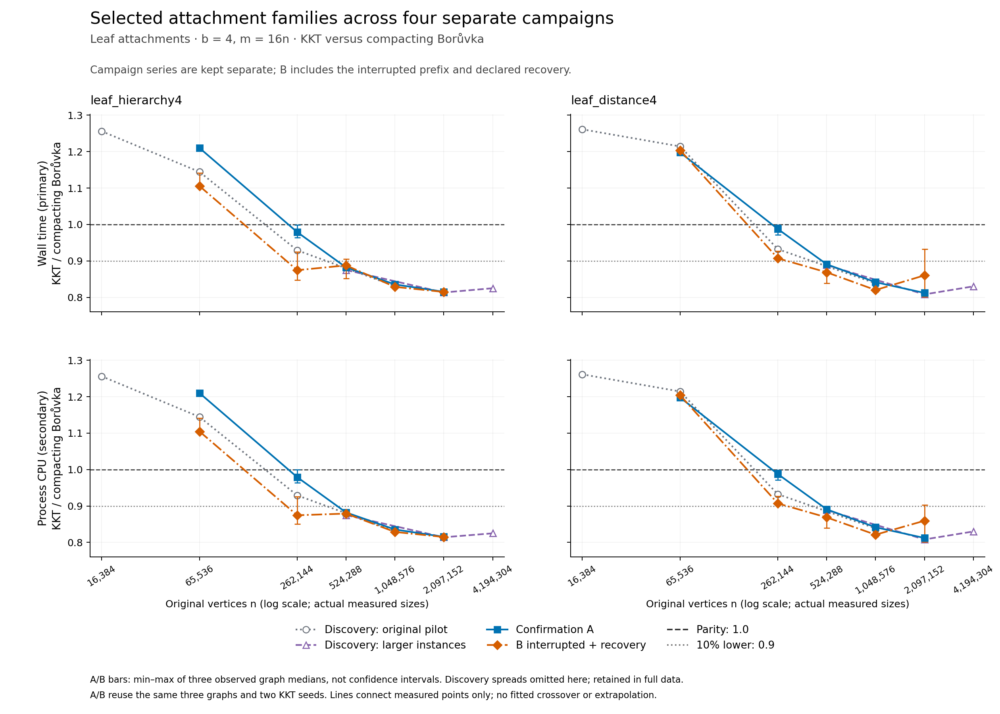
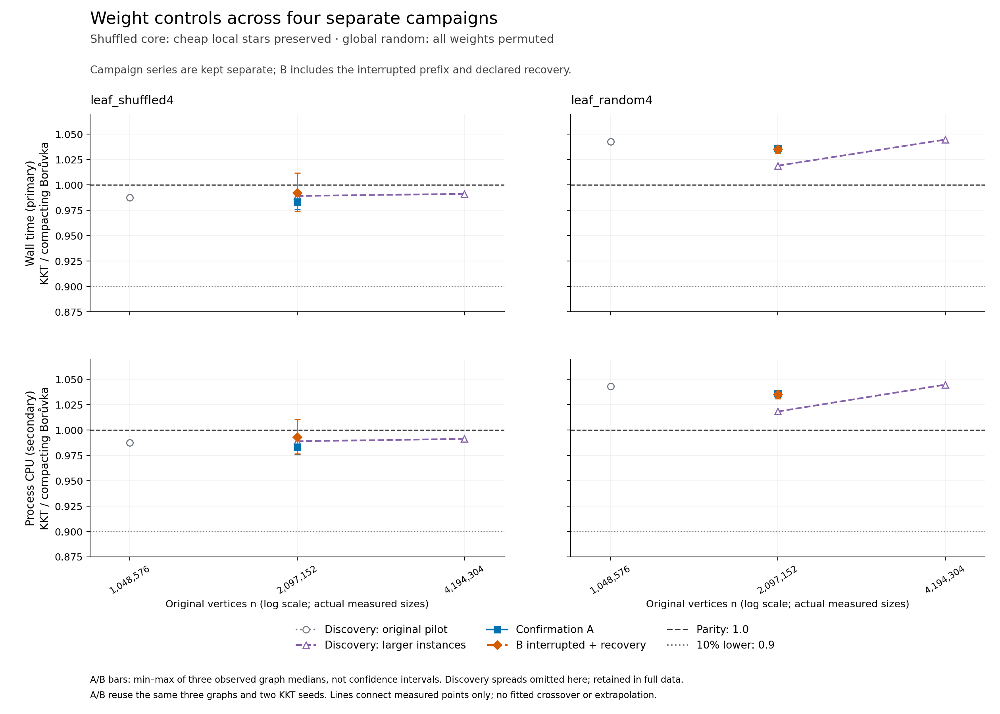

# Separate-campaign attachment summary

These figures retain each campaign's paired medians separately. Confirmation A/B bars span observed graph medians, not confidence intervals. Discovery ranges are uniformly omitted from these compact figures and retained in the copied complete tables.

The actual n axis includes only measured sizes. Connecting lines are visual guides, not fitted crossovers. A/B reuse the same graph seeds; their repetitions are not new independent graphs. This script does not declare that the prospective confirmation criterion passed.

| Capture | Complete cases | Graph seeds | KKT seeds | Timed calls | Checked warmups | Flagged calls retained | Complete appendix |
|---|---:|---:|---:|---:|---:|---:|---|
| Discovery: original pilot | 80 | 1 | 1 | 2000 | 400 | 0 | [All five solvers and all cases](../attachment-analysis/report.md) |
| Discovery: larger instances | 10 | 1 | 1 | 250 | 50 | 2 | [All five solvers and all cases](../attachment-large-analysis/report.md) |
| Confirmation A | 12 | 3 | 2 | 1800 | 360 | 0 | [All five solvers and all cases](../attachment-confirmation-a-analysis/report.md) |
| B interrupted + recovery | 12 | 3 | 2 | 1800 | 360 | 149 | [All five solvers and all cases](../attachment-confirmation-b-composite-analysis/README.md) |

[Full five-solver A and B-composite figures](all-solvers/README.md) retain individual-trial ranges for both clocks, including control losses.

All comparator results and diagnostic flags remain in each appendix and unfiltered `data/<campaign>/` tables. For interrupted B, the copied original combined CSV is explicitly incomplete (59 children); the source ledger and all 72 copied native child CSVs cover its 60 completed prefix children plus 12 recovery children. The original B capture/controller remain failed. A and recovery have their complete combined CSVs. Full child logs/resource archives remain at the original study paths; these copies are not a relocated standalone raw capture.

The compact axes include every A/B graph-median range endpoint. Individual trials can have much wider ranges, including very large wall/CPU discrepancies; those are retained in the full all-comparator appendices and copied tables. No flagged observation is removed or adjusted, and no previous campaign's winner is assumed to remain the winner. Clock flags do not by themselves identify the cause of a disturbed call.

**PNG visual QA complete:** both compact summaries and all eight five-solver appendix pages were opened and inspected. Labels, legends and all observed ranges are visible without clipping. [QA evidence](QA.md) records the validation and limitations. SVG/PDF were generated but not separately rendered for format-specific QA; use the inspected PNGs in the report.
