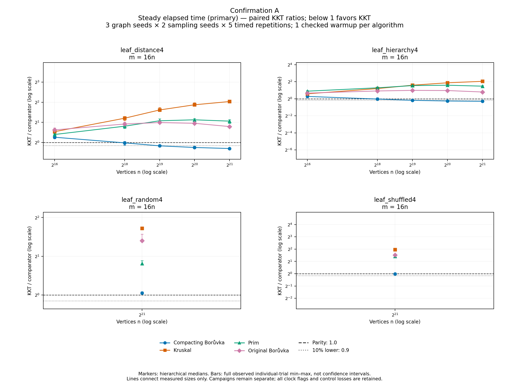
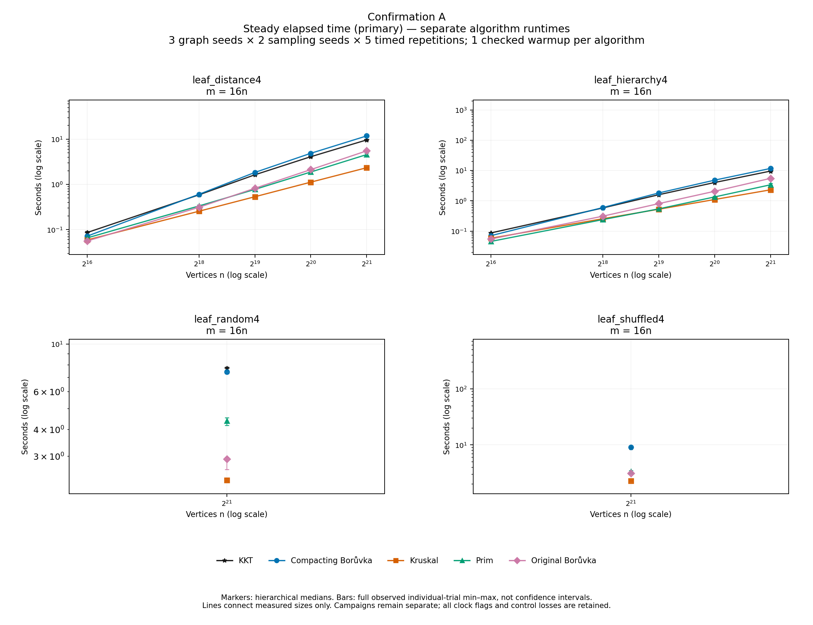
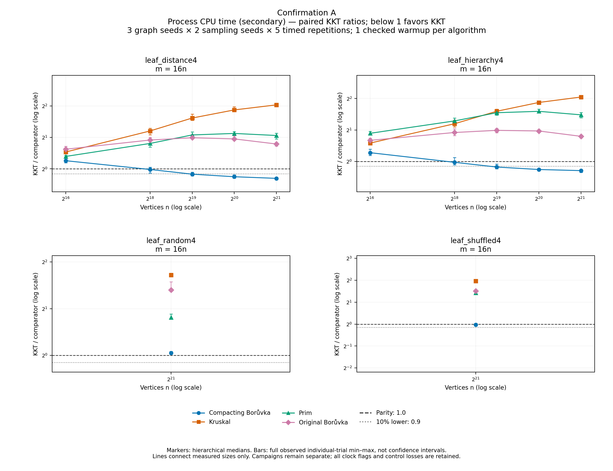
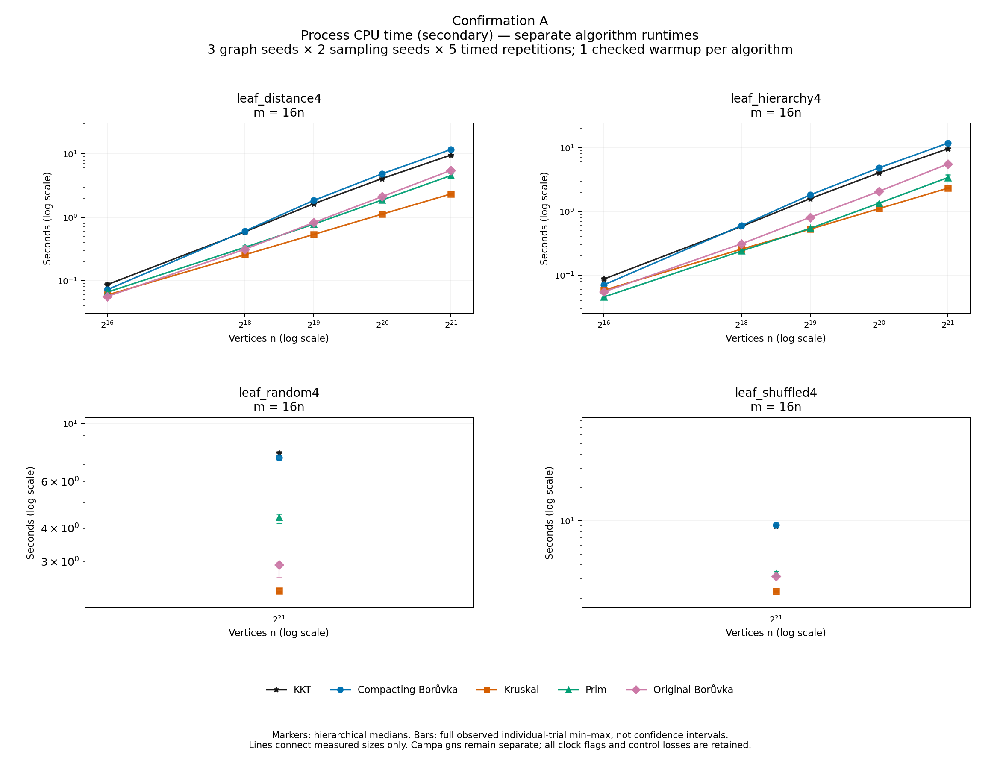
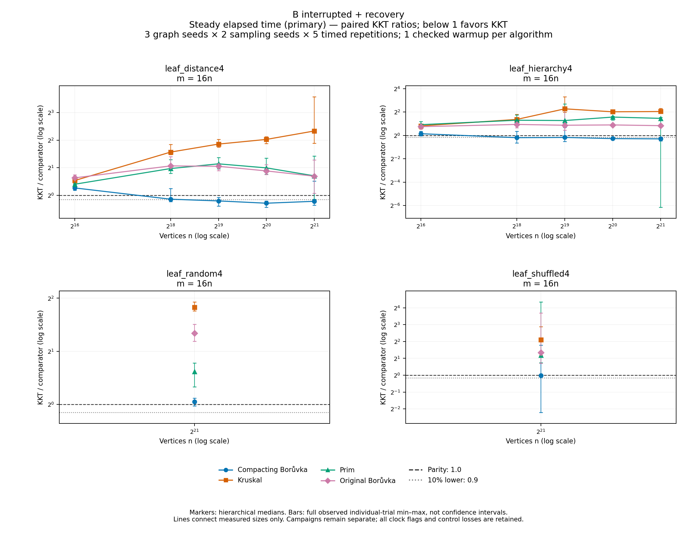
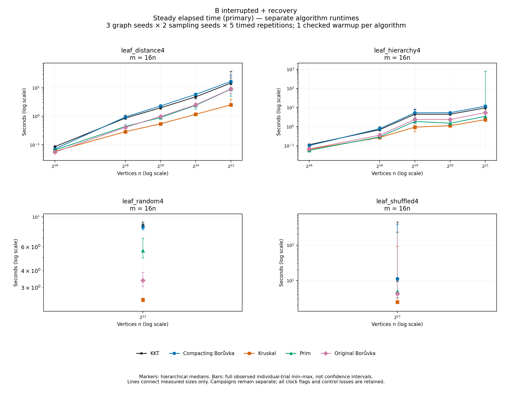
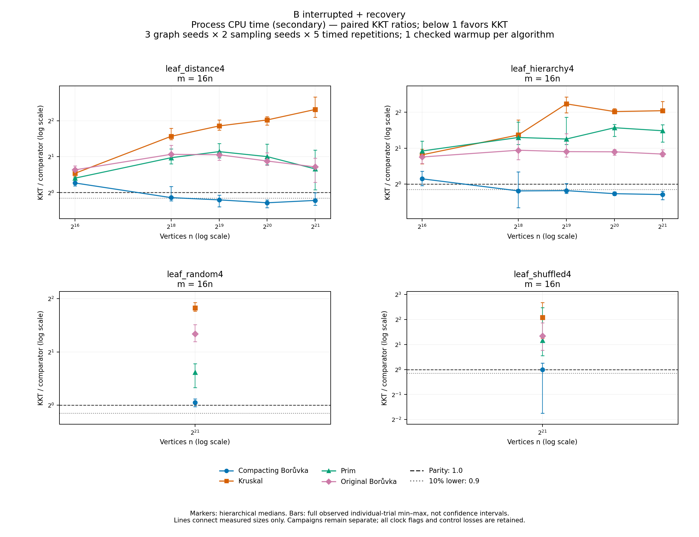
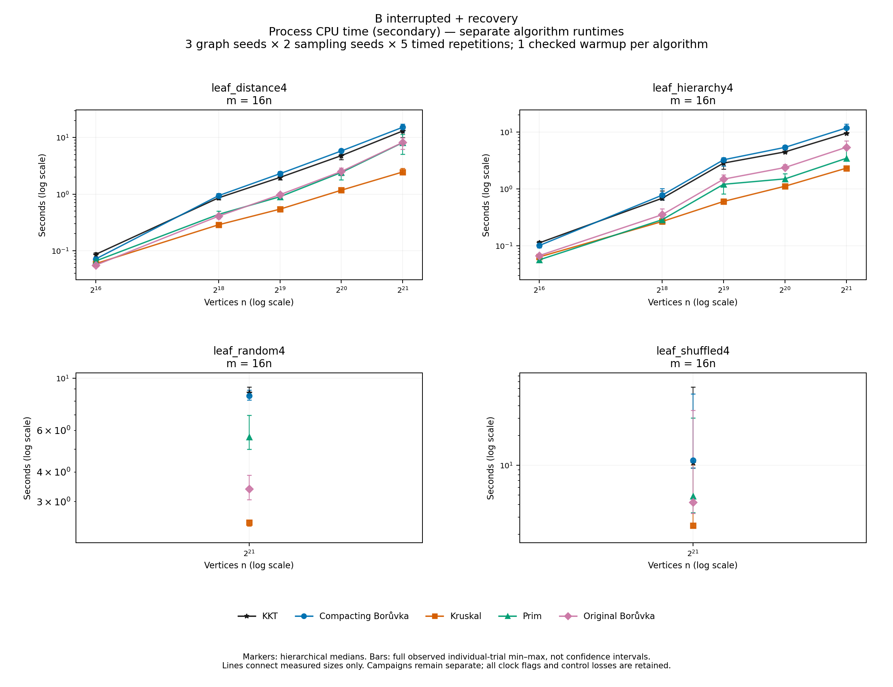

# Complete five-solver confirmation appendices

A and interrupted B plus recovery remain separate. Every measured family, size, solver and control is shown. Bars span full individual-trial min–max ranges, not confidence intervals. The same family has matching axes across captures. No flagged observation is removed or adjusted. Large wall/CPU discrepancies remain visible. Original B failed its frozen execution; the composite contains its 60 completed children plus 12 separately declared recovery children.

## Confirmation A: wall / paired_ratios

[PNG](campaign_01_wall_paired_ratios_01.png) · [SVG](campaign_01_wall_paired_ratios_01.svg) · [PDF](campaign_01_wall_paired_ratios_01.pdf)

## Confirmation A: wall / runtimes

[PNG](campaign_01_wall_runtimes_01.png) · [SVG](campaign_01_wall_runtimes_01.svg) · [PDF](campaign_01_wall_runtimes_01.pdf)

## Confirmation A: cpu / paired_ratios

[PNG](campaign_01_cpu_paired_ratios_01.png) · [SVG](campaign_01_cpu_paired_ratios_01.svg) · [PDF](campaign_01_cpu_paired_ratios_01.pdf)

## Confirmation A: cpu / runtimes

[PNG](campaign_01_cpu_runtimes_01.png) · [SVG](campaign_01_cpu_runtimes_01.svg) · [PDF](campaign_01_cpu_runtimes_01.pdf)

## B interrupted + recovery: wall / paired_ratios

[PNG](campaign_02_wall_paired_ratios_01.png) · [SVG](campaign_02_wall_paired_ratios_01.svg) · [PDF](campaign_02_wall_paired_ratios_01.pdf)

## B interrupted + recovery: wall / runtimes

[PNG](campaign_02_wall_runtimes_01.png) · [SVG](campaign_02_wall_runtimes_01.svg) · [PDF](campaign_02_wall_runtimes_01.pdf)

## B interrupted + recovery: cpu / paired_ratios

[PNG](campaign_02_cpu_paired_ratios_01.png) · [SVG](campaign_02_cpu_paired_ratios_01.svg) · [PDF](campaign_02_cpu_paired_ratios_01.pdf)

## B interrupted + recovery: cpu / runtimes

[PNG](campaign_02_cpu_runtimes_01.png) · [SVG](campaign_02_cpu_runtimes_01.svg) · [PDF](campaign_02_cpu_runtimes_01.pdf)
