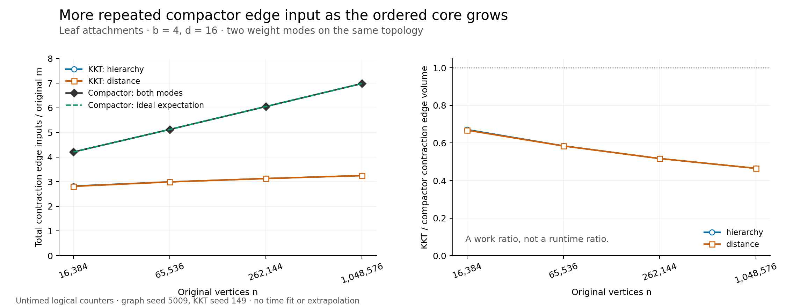
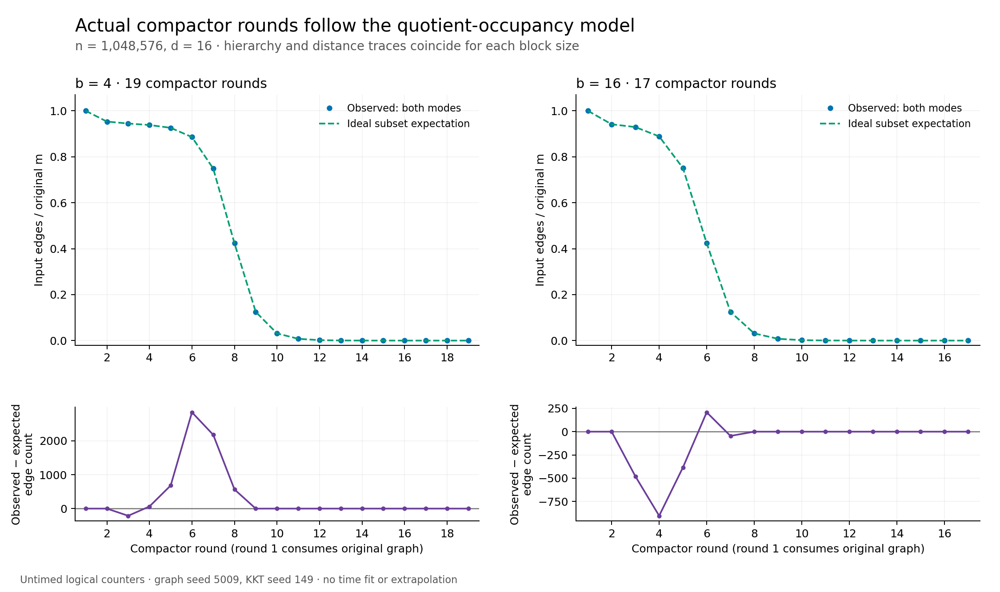
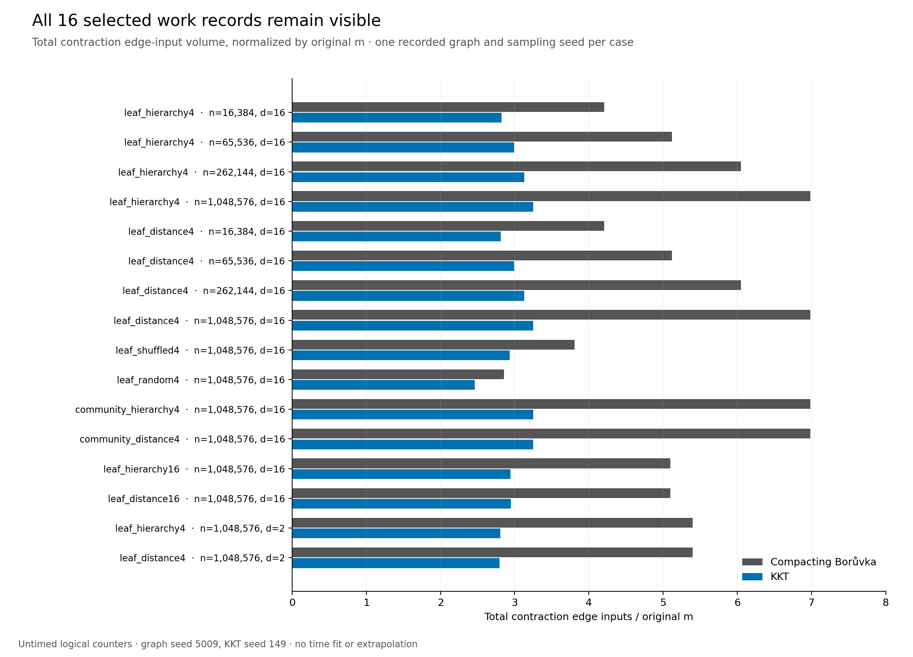

# Attachment logical-work figures

Untimed logical counters · graph seed 5009, KKT seed 149 · no time fit or extrapolation.

All 16 selected records are retained in [data.csv](data.csv), with every observed round in [round_data.csv](round_data.csv).
The complete case table and checked provenance are in [the analysis report](../attachment-work-analysis/report.md).
This figure set does not estimate wall-clock speed, fit asymptotic time complexity, or pool repeated graph seeds.

All eight ordered leaf b=4,d=16 size records. Compactor hierarchy/distance volumes are identical; overlapping KKT curves are retained. The ideal model predicts edge counts only.

The original-input and terminal counts are exact. Intermediate signed deviations are retained; they are ordinary single-graph variation, not significance scores. Model truncation bounds do not cover floating-point roundoff or random-graph variation.

Hierarchy and distance share the ordered compactor trajectory. Core-only shuffle preserves the first star contraction; global shuffle may change it. No occupancy-model curve is assigned to the controls. The logarithmic axis shows all positive input counts through completion.

All 16 selected records, including community endpoint twins, b=16, d=2 and both shuffled controls. These are operation counts, not performance measurements; every record also remains in data.csv and the analysis report table.
