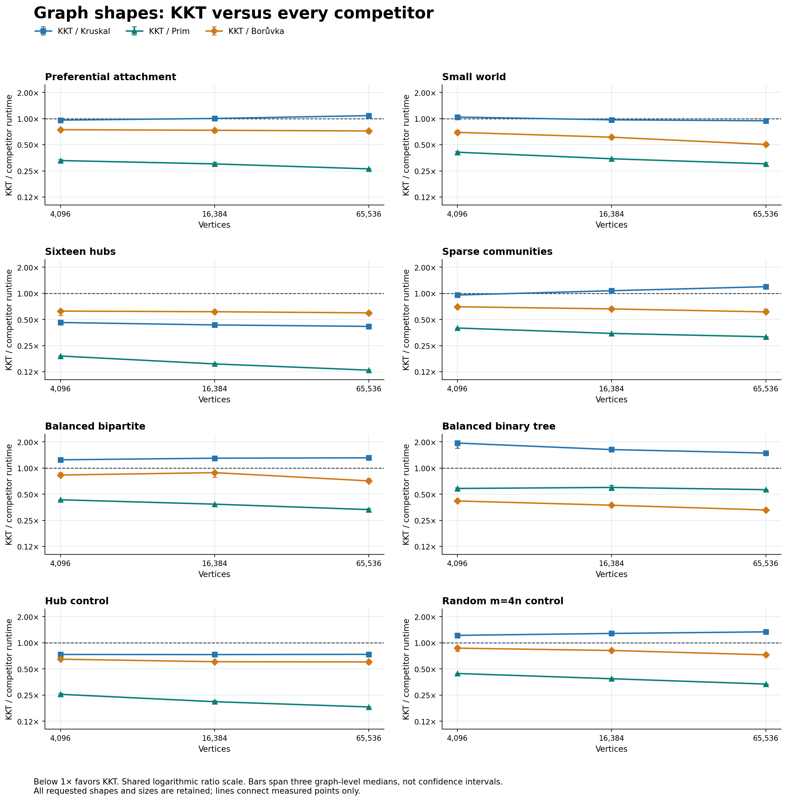

# Testing additional graph shapes with unchanged MST implementations

This bounded experiment adds six topology families and reruns two existing
controls. It asks whether KKT's practical behavior extends beyond the earlier
hub and star examples, while keeping KKT, Kruskal, Prim, Borůvka, certification,
and the timing boundary unchanged from `c6c8bbd`. The family matrix and two
complete timing campaigns were fixed before collecting their results. The
[boundary audit](boundary_audit.json) records the unchanged sources and harness
bodies; [metadata](metadata.json) records commands, build profiles, binary
hashes, and run status.

## Measured results

**Sixteen hubs give a substantial repeatable lead; the connected small-world
variant gives a smaller lead at the two larger sizes.** KKT leads all three
competitors in the same **10 of 24 cases** in both campaigns, including every
graph-level median in those cases. Seven are new cases: all three `multi_hub`
sizes, `small_world` at 16,384 and 65,536 vertices, and
`preferential_attachment` and `community_sparse` at 4,096. The remaining three
are the unchanged single-hub controls. This is a result for these defined
models, seeds, sizes, implementations, and machine.

At 65,536 vertices, multi-hub KKT takes **5.85 ms** in the primary run and
**5.86 ms** in the repeat. Borůvka is the fastest alternative at 9.96 and
9.88 ms; paired KKT/Borůvka runtime ratios are **0.596 and 0.592**. Small-world
KKT takes 14.03 and 14.00 ms against Kruskal's 14.80 ms in each run. Its paired
ratios imply 5.6% and 4.6% less time, a modest measured advantage. Individual
small-world trials still lose to Kruskal: 1/36 in the primary and 4/36 in the
repeat at this size.

The table retains every added family's largest case. Ratios are paired
KKT/Kruskal runtimes; **below 1 favors KKT**. The final column is the separate
untimed arithmetic mean of root edges remaining after up to two contractions,
as a percentage of original edges.

| Added family, `n=65,536` | Primary KKT/Kruskal | Repeat KKT/Kruskal | Root edges remaining |
| --- | ---: | ---: | ---: |
| Preferential attachment | 1.081 | 1.097 | 49.443% |
| Connected small-world variant | 0.944 | 0.954 | 10.975% |
| Sixteen hubs | 0.416 | 0.416 | 0.00153% |
| Sparse communities | 1.192 | 1.196 | 48.230% |
| Balanced bipartite | 1.311 | 1.318 | 72.878% |
| Balanced binary tree | 1.487 | 1.504 | 6.804% |

Preferential attachment and sparse communities lose their small-size lead as
the graphs grow. At the largest size they, balanced bipartite graphs, and the
binary tree all lose to Kruskal while beating Prim and Borůvka. The binary tree
also shows why early shrinkage alone is insufficient: only 6.8% of its root
edges remain, but KKT still takes roughly 1.5 times Kruskal's time. Kruskal sorts
only `n−1` edges on this input, while KKT still performs contraction, vertex,
and recursive work. These observations do not support a general preference for
KKT on arbitrary scale-free, community, bipartite, or tree graphs.

The complete [primary report](primary_analysis/report.md) and
[repeat report](repeat_analysis/report.md) retain all 24 cases, all four
algorithms, graph-level ranges, and individual loss counts. Raw
[primary timings](primary.csv), [repeat timings](repeat.csv), and
[untimed work](work.csv) are retained separately. Both campaigns validated all
3,456 timed outputs and 864 warmups; all 216 work observations passed.



The [repeat plot](repeat_analysis/shape_ratios.png) shows the same case-level
winner set; the [work plot](primary_analysis/shape_work.png) shows how much
graph reaches recursion without treating those counters as clock time.

## Fixed protocol

Eight families at `n={4096,16384,65536}` give **24 cases**. Each timing campaign
uses graph seeds `{17,42,999}`, KKT seeds `{0,1,7}`, four repetitions, and one
warmup per algorithm/seed pair. That is **3,456 timed outputs and 864 checked
warmups per campaign**, with all four algorithms occupying every timed position
equally within each seed pair. Case order is shuffled deterministically and
reused; it is not independently randomized between campaigns. The primary and
repeat campaigns use the same binary and remain separate, without selecting
the better result or dropping losing cases.

All algorithms start from the same tuple edge list. Timing includes KKT's
conversion, temporary-input destruction, and each algorithm's returned-result
construction. Graph generation, certified-reference computation, result checks,
CSV output, and returned-result destruction stay outside timing. Distinct
weights make the reference MST unique: every result must match its independently
certified edge IDs, and returned edge tuples must match the source graph.

The separate [untimed probe](../../shape_work.cpp) records **216 observations
from 72 certified graphs**, covering every case and all graph/sampling seed
pairs. It records input fingerprints, degree/leaf counts, contraction and
sampling regimes, recursive volumes, and work counters. It runs before timing;
instrumented execution is not used as a runtime measurement. The runner executes
the probe, primary campaign, and repeat serially. Ordinary desktop background
activity, allocator state, caches, and thermal state are not controlled.

Timing summaries take medians over repetitions, then sampling seeds within
each graph, then graph seeds. Competitor ratios are computed within matched
trial blocks before that aggregation; they need not equal ratios of displayed
runtime medians. Work summaries use arithmetic sampling-seed means, then
arithmetic graph means. The three graph seeds are the independent graph samples;
repeated timings and sampling seeds are not additional graphs. Graph ranges are
descriptive min/max values, not confidence intervals. A second run of the same
graphs checks timing repeatability, not generalization to new graphs.

The smoke matrix uses all eight families at `n=256`. The
[validation record](validation.json) and [fixture checks](../../shapes_test.cpp)
cover deterministic replay, simple connected graphs, exact edge counts,
weight/ID permutations, structural invariants, and unchanged control inputs.
Smoke data is validation evidence and is not pooled with the main matrix.

## Exact graph models

The [new fixture header](../../extended_graph_fixtures.hpp) accepts only the
smoke and three main sizes. All new graphs are simple, connected, and undirected.
Weights are a single shuffled permutation of `1..m` across all edges; vertex
labels and edge order are shuffled too. Separate seeded streams keep these
assignments out of topology construction. No spokes, bridges, or tree edges are
given a planted light/heavy weight class. These are specified synthetic model
variants, not uniform samples from all connected graphs or representative
application datasets.

| Family | Edges | Construction before label/weight shuffling |
| --- | ---: | --- |
| `preferential_attachment` | `4n−10` | Start with `K5`; each new vertex selects four distinct older vertices with degree-proportional urn sampling without replacement, then adds those four edges. Each edge contributes one urn ticket to each endpoint. |
| `small_world` | `4n` | Start with ring offsets 1–4. Protect offset 1 as a connected cycle; independently consider each original offset-2–4 edge for rewiring with probability `0.1`. Keep its source and choose a current non-neighbor, excluding its old target; skip a saturated source. |
| `multi_hub` | `4n−49` | Connect 16 hubs by a random recursive tree of 15 edges. Every other vertex chooses four distinct hubs uniformly; there are no edges between nonhubs. |
| `community_sparse` | `4n` | Make 16 equal communities, each seeded by a random recursive tree. Connect communities by a random recursive tree with random endpoints. Add random cross-community pairs until there are `max(15,n/64)` cross edges, then random internal pairs until total `m=4n`. |
| `balanced_bipartite` | `4n` | Split vertices into equal even/odd partitions. Each new vertex attaches to a uniformly selected older opposite-partition vertex; add uniformly selected missing cross-partition pairs to reach `4n`. |
| `balanced_binary_tree` | `n−1` | Heap-indexed tree with `parent(v)=floor((v−1)/2)`. The final level may be incomplete. Labels, weights, and edge order vary; the topology is fixed. |
| `hub` control | `4n` | Existing star backbone plus random missing edges, with weights randomized together. Calls the original fixture unchanged. |
| `random_4` control | `4n` | Existing random recursive spanning tree plus random missing edges, with weights randomized together. Calls the original fixture unchanged. |

The preferential-attachment mechanism is motivated by
[Barabási and Albert's original paper](https://barabasi.com/media/Emergence-Barabasi-1999_gN74Tws.pdf).
The protected-cycle generator is a connected variant inspired by
[Watts and Strogatz's small-world model](https://doi.org/10.1038/30918), not an
exact draw from the unrestricted model. The explicit seed graph, attachment
rules, and protected edges above are part of this experiment's definition.

## What the work counters explain

Degree heterogeneity may let many vertices select edges toward a small core
during the first Borůvka contractions. Preferential attachment and sixteen hubs
test whether the earlier single-hub behavior generalizes. Local ring structure,
sparse community links, a bipartite constraint, and a branching tree provide
different challenges at similar sparse edge counts. Their weights remain
randomized globally, so topology and weight correlation are not confounded by
deliberately cheap backbone edges. These were hypotheses for the fixed matrix,
not criteria for retaining results.

The multi-hub construction has a stronger property than high degree: its
16 hubs form a **vertex cover**, so every edge touches a hub and nonhub vertices
have no edges between them. In the first Borůvka round, each nonhub's selected
edge goes to a hub. Every selected-edge component therefore contains a hub,
leaving at most 16 supervertices after contraction. Removing loops and keeping
only the minimum edge per supervertex pair leaves at most 120 edges. The same
argument gives at most `k` supervertices for a connected graph with a vertex
cover of size `k`, including an unbalanced bipartite graph whose small partition
has size `k`; it does not require the randomized weights used here.

At 65,536 vertices, the probe observes **3–4 vertices and 3–6 edges** after the
second multi-hub contraction. Every sample reaches one randomized sampling
call, but the remaining graph is tiny. The 0.00153% mean above is positive,
not a contraction-only finish. The connected small-world variant reaches
seven sampling calls and retains about 11% of root edges, so its measured lead
also extends beyond a star that finishes immediately.

The key diagnostics answer different questions:

- **Early shrinkage:** root edges remaining after up to two contractions,
  divided by original `m`. Zero includes an earlier one-round finish. This
  measures how much graph reaches sampling; it does not count work already
  spent scanning and contracting the original graph.
- **Heavy removal:** heavy-edge incidences divided by verifier input incidences
  over the recursion, computed per observation and then averaged. This is not
  the fraction of distinct original edges removed. A high percentage can still
  cost substantial time if many edges must first be sampled, verified, and
  copied. If verification never executes, the CSV's zero fraction is a sentinel;
  the execution regime distinguishes it from actual zero heavy removal.
- **Recursive volume:** the sum of KKT subproblem edge counts, including the
  root, divided by original `m`. It counts recursive inputs, not every internal
  edge pass, hash probe, allocation, or CPU instruction.

KKT borrows its initial contraction steps from Borůvka. Therefore a measured
lead is a result for these complete repository implementations and their data
structures; observing sampling does not establish that sampling caused the
lead. This KKT implementation compacts the contracted graph and merges parallel
edges; the repository's Borůvka baseline does not perform the same compaction.
A causal claim would require a controlled algorithm variant that changes
sampling while preserving the other implementation choices and correctness.

The [original KKT paper](https://people.csail.mit.edu/karger/Papers/mst.pdf)
proves expected linear time in its unit-cost random-access model, using
linear-time verification. Its expectation is over the algorithm's random
choices for an input. The theorem hides constants and does not predict allocator
or cache costs, nor does comparing Big-O upper bounds alone guarantee a
practical crossover. This finite graph matrix cannot prove the bound for the
implementation or establish a general application ranking.

## Coverage still missing

Useful follow-ups include road graphs and exact geometric-neighborhood graphs
with distance-based weights, to test spatial locality and correlated weights;
unbalanced bipartite graphs with a varying small partition, to test the
vertex-cover argument as the core grows; hierarchical communities and sparse
cores with many attached leaves, to vary
contraction depth and concentration beyond a flat 16-group model; and regular
or expander-like graphs as deliberately homogeneous counterexamples to the hub
hypothesis. These are untested proposals, not predicted wins. Each would need
its own defined connectivity, weight, and sampling rules, a fixed matrix, and
retained negative results.

## Reproduction

From the repository root on macOS, build and check first, then run the fixed
campaign serially into a fresh output directory. The runner refuses to overwrite
existing evidence. Do not run builds, tests, or plotting alongside the timings.

```sh
make -j4 diverse-benchmark shape-work bin/shapes_test
./bin/shapes_test
python3 benchmark/results/shapes-2026-10-11/run_campaign.py ./bin/diverse_benchmark ./bin/shape_work /tmp/kkt-shapes-new
python3 benchmark/analyze_shapes.py --input-csv /tmp/kkt-shapes-new/primary.csv --work-csv /tmp/kkt-shapes-new/work.csv --output-dir /tmp/kkt-shapes-new/primary_analysis
python3 benchmark/analyze_shapes.py --input-csv /tmp/kkt-shapes-new/repeat.csv --work-csv /tmp/kkt-shapes-new/work.csv --output-dir /tmp/kkt-shapes-new/repeat_analysis
```

The [Bazel log](bazel.log) records all nine executed passing test targets;
the [UBSan fixture log](fixtures-ubsan.log) records all 96 structural checks.
The [analyzer self-check record](analyzer_selftest.json) retains three positive
checks and 20 malformed inputs rejected before measurement. Raw logs and CSVs
are preserved byte-for-byte, including generated whitespace and line endings.
