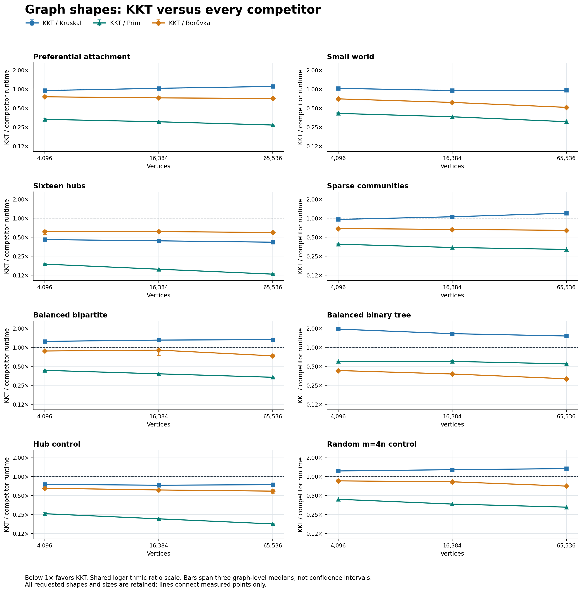
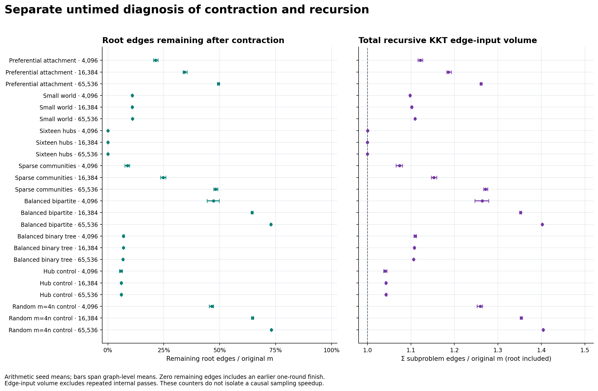

# Graph-shape experiment

Validated **24 cases and 3,456 timed observations**, with three graph seeds, three sampling-seed labels, 4 repetitions, and one warmup per algorithm/seed pair. The complete requested matrix retains all eight families at sizes 4096, 16384, 65536. Six added shapes and the hub/random-4 controls were selected before these measurements; no family is dropped according to its result.

Median of repetitions for each graph/sampling-seed pair; median of the three sampling-seed values per graph; median of the three graph values. Paired ratios apply the same hierarchy to matched algorithm/reference elapsed-time ratios. Error bars span graph-level medians and are not confidence intervals.

Lower ratios favor KKT. Displayed runtime medians and paired ratios are aggregated separately; dividing displayed times need not reproduce the paired ratios.

| Case | KKT ms | Kruskal ms | Prim ms | Borůvka ms | KKT/Kruskal | KKT/Prim | KKT/Borůvka |
|---|---:|---:|---:|---:|---:|---:|---:|
| preferential_attachment_n4096 | 0.651 | 0.690 | 2.022 | 0.898 | 0.945× | 0.331× | 0.752× |
| preferential_attachment_n16384 | 3.278 | 3.234 | 10.701 | 4.305 | 1.024× | 0.303× | 0.723× |
| preferential_attachment_n65536 | 15.704 | 14.501 | 58.525 | 22.067 | 1.097× | 0.269× | 0.708× |
| small_world_n4096 | 0.724 | 0.710 | 1.723 | 1.041 | 1.023× | 0.411× | 0.698× |
| small_world_n16384 | 3.108 | 3.264 | 8.975 | 5.196 | 0.946× | 0.363× | 0.613× |
| small_world_n65536 | 13.996 | 14.798 | 46.460 | 27.384 | 0.954× | 0.304× | 0.512× |
| multi_hub_n4096 | 0.314 | 0.693 | 1.664 | 0.506 | 0.457× | 0.187× | 0.610× |
| multi_hub_n16384 | 1.372 | 3.140 | 8.895 | 2.193 | 0.437× | 0.155× | 0.612× |
| multi_hub_n65536 | 5.862 | 14.057 | 45.812 | 9.883 | 0.416× | 0.130× | 0.592× |
| community_sparse_n4096 | 0.694 | 0.732 | 1.822 | 1.023 | 0.953× | 0.387× | 0.684× |
| community_sparse_n16384 | 3.391 | 3.242 | 9.886 | 5.076 | 1.049× | 0.343× | 0.662× |
| community_sparse_n65536 | 17.407 | 14.635 | 54.617 | 27.367 | 1.196× | 0.320× | 0.640× |
| balanced_bipartite_n4096 | 0.883 | 0.710 | 2.023 | 0.981 | 1.237× | 0.431× | 0.871× |
| balanced_bipartite_n16384 | 4.140 | 3.242 | 11.054 | 4.612 | 1.297× | 0.380× | 0.900× |
| balanced_bipartite_n65536 | 19.318 | 14.670 | 57.951 | 26.594 | 1.318× | 0.335× | 0.731× |
| balanced_binary_tree_n4096 | 0.258 | 0.130 | 0.450 | 0.617 | 1.933× | 0.596× | 0.428× |
| balanced_binary_tree_n16384 | 1.204 | 0.734 | 2.033 | 3.187 | 1.638× | 0.597× | 0.377× |
| balanced_binary_tree_n65536 | 5.124 | 3.418 | 9.448 | 15.791 | 1.504× | 0.545× | 0.317× |
| hub_n4096 | 0.526 | 0.706 | 2.050 | 0.787 | 0.746× | 0.257× | 0.649× |
| hub_n16384 | 2.380 | 3.239 | 11.031 | 3.842 | 0.724× | 0.213× | 0.609× |
| hub_n65536 | 10.740 | 14.541 | 59.827 | 18.427 | 0.738× | 0.177× | 0.584× |
| random_4_n4096 | 0.858 | 0.709 | 2.014 | 1.001 | 1.217× | 0.434× | 0.848× |
| random_4_n16384 | 4.099 | 3.268 | 11.416 | 5.015 | 1.274× | 0.364× | 0.820× |
| random_4_n65536 | 19.324 | 14.672 | 58.687 | 27.751 | 1.325× | 0.326× | 0.701× |

KKT leads all competitors by paired case medians in: `preferential_attachment_n4096`, `small_world_n16384`, `small_world_n65536`, `multi_hub_n4096`, `multi_hub_n16384`, `multi_hub_n65536`, `community_sparse_n4096`, `hub_n4096`, `hub_n16384`, `hub_n65536`.
The stricter descriptive check, a lead on every graph-level median against every competitor, holds in: `preferential_attachment_n4096`, `small_world_n16384`, `small_world_n65536`, `multi_hub_n4096`, `multi_hub_n16384`, `multi_hub_n65536`, `community_sparse_n4096`, `hub_n4096`, `hub_n16384`, `hub_n65536`.

All individual loss counts, ties, and graph-level ratio ranges remain in [comparisons.csv](comparisons.csv). [summary.csv](summary.csv) retains every algorithm's runtime, and [graph_summary.csv](graph_summary.csv) retains every graph seed.

## Separate logical-work diagnosis

The untimed probe certifies its reference MST independently and checks exact KKT IDs. Work summaries use arithmetic means across sampling seeds within each graph and then across the three graphs. They are separate from timing medians and cannot establish that sampling caused a runtime advantage.

At n=65,536, root reduction and recursion are:

| Family | Mean maximum degree | Mean leaves | Root edges retained | Sampling calls, range | Σm/m, mean | Heavy fraction, mean |
|---|---:|---:|---:|---:|---:|---:|
| Preferential attachment | 820.3 | 0.0 | 49.44% | 3–3 | 1.2612 | 97.07% |
| Small world | 12.7 | 0.0 | 10.97% | 7–7 | 1.1096 | 74.35% |
| Sixteen hubs | 16533.7 | 0.0 | <0.01% | 1–1 | 1.0000 | 14.81% |
| Sparse communities | 25.3 | 81.7 | 48.23% | 7–7 | 1.2716 | 94.34% |
| Balanced bipartite | 25.7 | 79.0 | 72.88% | 4–7 | 1.4018 | 96.41% |
| Balanced binary tree | 3.0 | 32768.0 | 6.80% | 4–5 | 1.1065 | 0.00% |
| Hub control | 65535.0 | 166.7 | 6.05% | 2–3 | 1.0429 | 79.06% |
| Random m=4n control | 26.0 | 80.0 | 73.08% | 6–7 | 1.4041 | 96.40% |

Zero root-retained edges includes a finish after the first contraction. Heavy fractions divide summed heavy-edge incidences by verifier input incidences within each observation before averaging; they are not fractions of distinct original edges. Σm includes every recursive KKT input, including the root, but omits repeated internal passes. [work_summary.csv](work_summary.csv) retains all sizes and execution regimes; [graph_work_summary.csv](graph_work_summary.csv) retains graph-level means.

## Limits

These are synthetic models, not representative application datasets or a workload-weighted ranking. Three graph seeds are the independent graph samples; sampling labels and repetitions are not extra graphs. Graph ranges are descriptive, not confidence intervals, and no statistical significance or asymptotic crossover is claimed. Lines connect measured sizes only. Family weights are distinct and randomized; topology labels alone do not describe every real graph with a similar name.

All four algorithms use the common tuple-edge-list boundary. KKT conversion and temporary input destruction are included; fixture generation, reference certification, result checks, and returned-result destruction are excluded. The rotating order is balanced within each graph/sampling pair. Ordinary desktop scheduling, cache/allocator state, and power/thermal variation can still affect measurements. Consult campaign metadata for binary, source, and build provenance.
