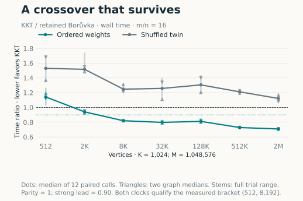
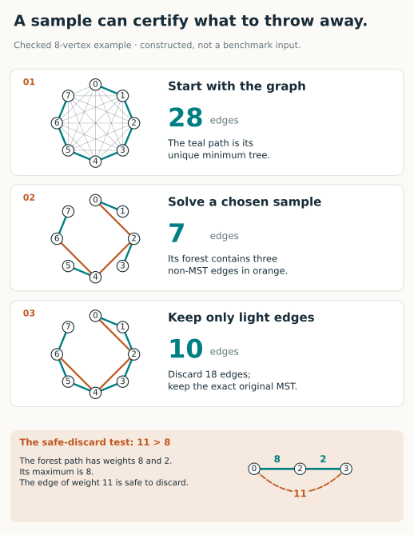
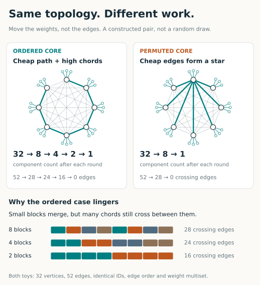
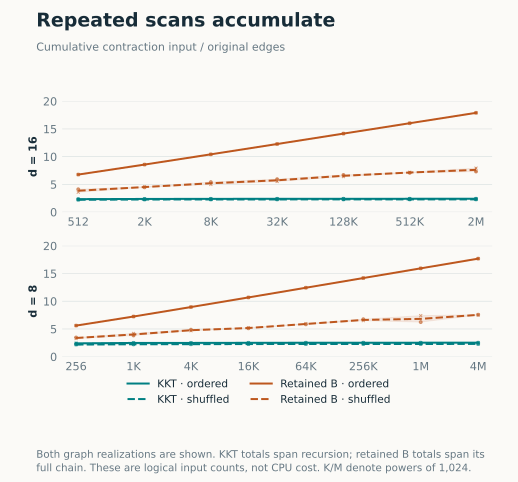
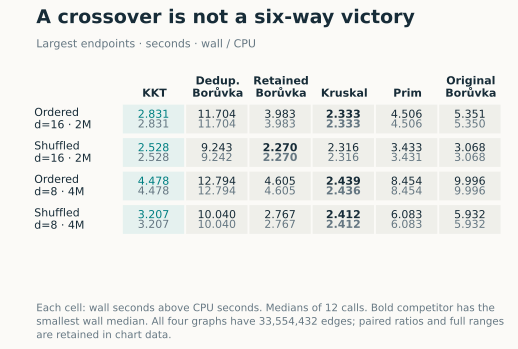
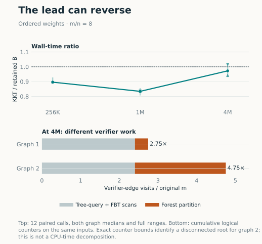
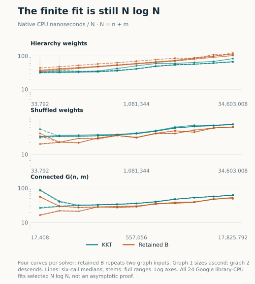

In [my 2022 post](https://chico.dev/Linear-Time-MST/), I compared my implementation of the Karger–Klein–Tarjan minimum spanning tree algorithm with simpler alternatives. KKT has an expected linear-time bound. My code was very slow. Extrapolating the fitted curves put its crossover with Borůvka at roughly **9 × 10¹⁵¹**.

That is a memorable number. It is also much more precision than that experiment deserved.

I revisited the code, including changes made since that post. Two pieces of supposedly linear work were superlinear. Other choices made every edge unnecessarily expensive. After repairs, stronger controls, and a search across graph families, there is a much more interesting result:

**KKT crosses from losing to a sustained lead over a Borůvka implementation using the same optimized contraction kernel. At about two million vertices and 34 million edges, it uses 29% less time. Shuffle the core weights on exactly the same topology, and the advantage disappears.**

Kruskal still wins at that endpoint. That matters. The interesting discovery is a specific place where KKT's filtering earns its cost—and a reasonably clear explanation of why.

<figure class="kkt-figure">
<picture><source media="(max-width: 600px)" srcset="assets/quantitative-attempt04/quant-crossover-mobile.svg"></picture>
<figcaption>Lower is better for KKT. Lines join measured points; they do not predict the crossover between them. Each point combines two graph instances and six repetitions per instance. Triangles show the two graph medians; vertical stems show every trial's range.</figcaption>
</figure>

## A sample can tell you what to discard

A minimum spanning tree connects every vertex with the least possible total edge weight. Write **n** for vertices and **m** for edges. Assume distinct weights here, so the answer is unique.

Kruskal sorts edges and accepts them when they connect different components. Prim grows a tree through its cheapest outgoing edge. Borůvka lets every component choose its cheapest outgoing edge, then merges the resulting groups. One Borůvka round at least halves the number of nontrivial components.

KKT adds a different way to make progress: **use a small random graph to certify unnecessary edges in the large one**.

Its recursive recipe is surprisingly short:

```text
contract two Borůvka rounds; save their safe edges
randomly sample the remaining edges
recursively find the sample's minimum spanning forest F
discard edges heavier than the maximum on their path in F
recursively solve what remains; combine the safe answers
```

The discard rule is the key. Suppose an edge weighs 11, but its endpoints are already connected by a forest path whose heaviest edge weighs 8. Adding the 11-edge creates a cycle in which it is strictly the heaviest edge. An MST cannot need it: a lighter connection crosses the same cut.

The forest **does not have to be part of the original MST**. It only has to supply enough cheap paths. If its endpoints are disconnected, an edge survives the test.

<figure class="kkt-figure">
<picture><source media="(max-width: 600px)" srcset="assets/concept-sample-filter-mobile.svg"></picture>
<figcaption>A constructed, independently checked example. The chosen sample is illustrative, not a claim about a typical random draw. All 18 discarded edges are certified unnecessary.</figcaption>
</figure>

Now the probabilistic payoff. After contraction, suppose there are **q** vertices and **r** edges. Sampling each edge with probability **p** gives **pr** edges on average. The sampling lemma bounds the expected number surviving the filter by **q/p**. Two Borůvka rounds shrink the vertex budget; sampling and filtering shrink the edge budgets of the two recursive calls. With a linear-time verifier, the accounting gives expected **O(m + n)** work. The [original KKT algorithm](https://www.cs.cmu.edu/~guyb/paralg/papers/KargerKleinTarjan95.pdf) uses half sampling and deduplicates quotient edges; the retained-edge, eighth-sampling variant below has a separate conditional work argument in the [evidence notes](downloads/EVIDENCE.md).

The difficult part of the implementation is hiding inside “linear-time verifier.” The other difficult part is making every recursive call pay for its own input.

## Where my implementation broke the argument

These defects have different histories. The bitmap regression below came from a January 2026 change; it cannot explain the 2022 timings. The verifier's table construction and recursive random-stream restart were already present in the earlier code.

### 1. The graph shrank. Its bookkeeping did not.

Edges carried their original IDs through contractions. A later attempt to replace sets with bitmaps used the original ID range to size arrays and merge selected-edge marks inside recursive calls.

A child with twelve edges could therefore clear and scan storage sized for millions. Sparse IDs made this worse: cost depended on the largest label, even if the graph itself was tiny.

<figure class="kkt-figure">
<picture><source media="(max-width: 600px)" srcset="assets/concept-id-budget-mobile.svg"></picture>
<figcaption>The proof charges work to the current graph. An implementation that keeps charging the root graph cannot use that proof.</figcaption>
</figure>

This is an asymptotic bug. A suitably weighted path produces logarithmically many contraction levels, while a tree offers no heavy edges to filter away. Repeating root-sized bookkeeping along that chain defeats the intended linear bound.

The repair uses **current edge positions for local storage** and keeps original IDs as payload. Selected IDs accumulate in vectors; the public result set is built at the end. Identity and storage position now have different jobs.

### 2. A “small” lookup table took too much work to build

The verifier precomputes a table containing the median set bit of each depth mask. The old code repeatedly enumerated the bits in every mask.

Across all masks on **h** bits, there are **h·2ʰ⁻¹** set-bit occurrences. In the relevant equal-depth binary case, the number of leaves is **L = 2ʰ**. That preprocessing slice alone therefore costs **Ω(L log L)**.

The repair removes the lowest and highest set bits and reuses the already computed median of the interior mask. Removing both extremes preserves the upper median. Maintaining the highest bit while visiting masks makes this constant word work per entry.

Why is the table itself small enough? The reduction gives equal-depth leaves and at least two children per internal node, so **L ≥ 2ʰ**. The table's **2ʰ⁺¹** slots are at most **2L**. Both halves matter: a linear number of entries, and constant work per entry.

### 3. Recursive calls restarted the same random stream

The sampler called `srand(seed)` each time. Recursive subproblems reused prefixes of a global random sequence instead of consuming a continuing stream.

The repair creates one private seeded generator per complete solve and passes it through recursion. Repeating an entire experiment remains reproducible; recursive calls no longer restart it.

This repairs the intended random-choice discipline and removes global-state interference. It does not, by itself, prove that old answers were wrong. Sampling controls the expected amount of work; safe contractions and cycle tests determine correctness. A deterministic PRNG also remains an implementation of the ideal independent-coin model, not a literal proof of it.

### 4. The experiment supported less than I inferred

The original benchmark fixed **n = 10,000** and increased **m** from 1.25 million to 20 million. That is principally a density sweep. Extrapolating it to astronomical inputs concealed changes in graph structure and machine behavior. A reused default graph seed also gave less coverage than the repetitions suggested.

There were separate correctness hazards. Prim and KKT defined incompatible global C++ `Edge` types; linking them together violated the one-definition rule. A legacy cost helper accumulated into `int`. Matching total weights, especially through overflowing arithmetic, is no substitute for certifying the returned tree.

The current study checks exact MST edge IDs, input metadata, and independent tree/cycle conditions. It also includes KKT's input conversion inside the measured solver interval; the original timer excluded it, which actually favored KKT. These repairs make the comparison more meaningful, rather than supplying another speedup to multiply into the result.

One historical distinction: the parenthesization typo in Hagerup-derived code discussed in my original post was already fixed in **2020**. It was not a new discovery in this investigation.

## Then the constants started to matter

Repairing the work bound still left an expensive implementation. The next changes removed concrete work:

| Expensive operation | Replacement |
|---|---|
| Per-vertex allocation and endpoint-pair hashing during contraction | Flat adjacency and stamped endpoint buckets |
| Hashing IDs to mark heavy edges | Byte marks indexed by current edge position |
| Linked query lists and duplicate query arrays | Contiguous endpoint ranges |
| Building adjacency just to label selected-edge components | Direct cheapest-neighbor walks |
| Hashing and rescanning to recover sampled forest edges | Sample IDs that directly identify parent positions |
| Copying temporary graphs and repeatedly growing result storage | Reused owned buffers and one final reserve |
| Copying verifier inputs and retaining redundant tree structures | Borrowed edge records, dense arrays, direct child links |

Later experiments retained parallel edges after contraction instead of immediately deduplicating them, shared repeated verifier requests, and changed the private sampling probability from **1/2 to 1/8**.

That last change is a tradeoff. A smaller sample costs less to solve, but the **q/p** survivor bound gets larger. It helps when contraction leaves relatively few vertices and many edges. In the six-case paired policy experiment, eighth sampling reduced KKT's median time by about **25–32%**, with every measured pair improving on both clocks. It is a measured policy choice, not a universally optimal probability.

The headline executable combines retained edges, direct verifier inputs, compressed requests, and scalar eighth sampling. These are **opt-in experimental paths**, not the repository's ordinary default build. A separate packed-bit sampler also helped its own experiment; its gains are not combined here. An attempted minimum-edge cache regressed the largest tested case by about 6% and was rejected.

There was another essential improvement: making the competitor better.

Once KKT stopped deduplicating every quotient graph, comparing it only with a deduplicating Borůvka was too easy. I gave a Borůvka continuation the same cheap retained-edge contraction kernel. It repeatedly contracts until done, with no sampling or filtering. This **retained-edge Borůvka** beat the earlier KKT variant throughout that comparison.

It is the control KKT eventually had to beat.

## The useful shape is in the weights

Start with a core graph and attach three very cheap leaves to every core vertex. One Borůvka round absorbs the leaves: three quarters of the vertices disappear.

Add many extra core edges. Rank each edge by the smallest hierarchical block containing both endpoints: connections inside small blocks are cheap; connections across larger blocks are expensive. Cheap edges encourage neighboring components to merge in stages, while many long edges continue to cross between those components.

After two contractions in the headline **m = 16n** family, only **n/8** vertices remain, but **94.5% of the original edge records remain**.

This is the opportunity. Borůvka has fewer components but still scans a large edge array round after round. KKT can use cheap paths in a sampled forest to discard expensive crossing edges *before* those components finally merge.

<figure class="kkt-figure">
<picture><source media="(max-width: 600px)" srcset="assets/concept-weight-order-mobile.svg"></picture>
<figcaption>A small constructed pair exposes the mechanism. Its deliberate star permutation is easier to read than a random shuffle. The benchmark uses much larger cores and randomly shuffled twins, not this toy.</figcaption>
</figure>

The measured distance-ranked family assigns all core edges weights by their hierarchical separation; shortcuts can enter its MST. A related family forces a cheap hierarchical path beneath the chords. Neither is a road network or a Euclidean nearest-neighbor graph. “Distance” here means a constructed rank, not necessarily a metric.

The work counters support the explanation. At the headline **m = 16n, n = 2,097,152** endpoint, retained Borůvka's cumulative contraction input is **17.91m** edge records. KKT's is **2.40m**, summed across its entire recursion.

<figure class="kkt-figure">
<picture><source media="(max-width: 600px)" srcset="assets/quantitative-attempt04/quant-work-mobile.svg"></picture>
<figcaption>Untimed logical work, not CPU fractions. Repeated appearances of an edge count repeatedly. KKT's verifier and other operations still have to be paid for.</figcaption>
</figure>

Many rounds alone are insufficient. A tree can take many rounds while its edge count shrinks geometrically; there is little redundant edge work for filtering to save. The useful combination is **slow component coalescence, persistent crossing edges, and cheap paths that certify those edges as unnecessary**.

Shuffling the core weights preserves topology, labels, input order, and the exact weight multiset. It disrupts that organization. In the lower-density study, KKT lost **every one of the 180 shuffled trial pairs** against retained Borůvka, on both clocks.

That control explains more than a picture of a graph with lots of leaves ever could.

## A real crossover, with the other algorithms still in view

At **512 vertices**, KKT takes about **14% more time** than retained Borůvka on the ordered m = 16n family. At **2,048**, it has a narrow lead. At **8,192**, every graph's median on both clocks is at least 10% lower. That stronger condition holds at every measured larger size through **2,097,152 vertices**.

The measured bracket for that sustained strong lead is therefore **(512, 8,192]**. There is no fitted crossover hidden between the points. At the endpoint, all twelve wall-time ratios lie between **0.686 and 0.731**; their pooled median is **0.709**.

The full comparison is less triumphant and more useful:

<figure class="kkt-figure">
<picture><source media="(max-width: 600px)" srcset="assets/quantitative-attempt04/quant-alternatives-mobile.svg"></picture>
<figcaption>All six implementations, including the original Borůvka and both compacting controls. Cells give separate wall and process-CPU medians. The ratios elsewhere are medians of paired ratios, so they need not equal ratios of these cells.</figcaption>
</figure>

At the headline endpoint, KKT takes roughly **2.83 seconds**, retained Borůvka **3.98 seconds**, and Kruskal **2.33 seconds**. KKT also beats Prim and the original Borůvka there. Kruskal wins all twelve paired trials at each of these four endpoints. There is no case-level winner over all five alternatives in this study.

The broader search found other useful results, but they belong to separate experiments:

| Family | What the experiment supports |
|---|---|
| Hierarchical and distance-ranked cores, m = 32n | About 32–33% less time than retained Borůvka near one million vertices. The smallest measured cases already led, so these are wins without an observed losing-to-winning crossover. |
| Bipartite graphs with one side fixed at 16 vertices | An earlier repaired build beat all three classical solvers: 28.5 ms versus 62.0 for Kruskal, 290.4 for Prim, and 55.6 for original Borůvka at 262,144 vertices. The later retained-edge control was absent. |
| Shortcut lines and grids | In a separate half-sampling study, KKT took 17% and 44% of Prim's time on the largest distance-ranked line and grid. Retained Borůvka and Kruskal were still faster. |
| Random-weight, regular, and ordinary grid controls | No general KKT advantage over the strongest alternatives emerged. |

The bipartite result has a particularly clean explanation. A vertex cover of size **k** touches every edge. After one Borůvka round, every component contains a cover vertex, so there are at most **k** components. Deduplicating leaves at most **k(k−1)/2** quotient edges. With k = 16, contraction almost finishes the problem.

That helps KKT, but it also helps a good Borůvka. In an earlier continuation ablation, compacting Borůvka won 18 of 20 cases. A family that makes KKT look good against textbook implementations need not demonstrate a benefit from random filtering.

## The reversal that taught me more than another win

Halving density to **m = 8n** produced a promising progression: loss, narrow lead, then a strong lead. At four million vertices, that lead became mixed again.

<figure class="kkt-figure">
<picture><source media="(max-width: 600px)" srcset="assets/quantitative-attempt04/quant-reversal-mobile.svg"></picture>
<figcaption>The timing reversal and a separate work-counter diagnosis. The counts identify extra work; they do not assign a fraction of runtime to it.</figcaption>
</figure>

At the final point, one graph's median ratio is **0.941**; the other's is **1.016**. Source-derived bounds on the counters establish that the root sampled forest is connected in the first case and disconnected in the second. The disconnected-forest wrapper partitions queries by component, introducing extra passes and copying.

Across the complete solve, that partitioning accounts for **11.5 million versus 78.8 million edge visits**. The remaining verifier edge-accounting terms are almost identical. This is a concrete implementation cost to investigate next: reduce query partitioning and copying when the sample is disconnected.

It is not yet a measured optimization. Nor does the counter difference prove the CPU time it consumed. It does explain why “the curves crossed, so the lead must grow forever” would have been another bad extrapolation.

## Did Google Benchmark call it linear?

**No.** GoogleTest checks correctness; Google Benchmark provides the empirical complexity fitter.

In a separate experiment—hierarchical cores and shuffled twins at **m = 32n**, plus connected random graphs at **m = 16n**—I supplied **N = n + m** and eleven sizes from 1,024 to 1,048,576 vertices. Google Benchmark's automatic model selection chose **N log N for all 24 curves**, including all twelve KKT curves. Independent fits over the declared clocks and size windows agreed on that class. The library's automatic choice uses CPU time; its manual-time coefficient is then fitted to that chosen class. [Pinned Google Benchmark fitting implementation](https://raw.githubusercontent.com/google/benchmark/73d4d5e8d6d449fc8663765a42aa8aeeee844489/src/complexity.cc).

<figure class="kkt-figure">
<picture><source media="(max-width: 600px)" srcset="assets/quantitative-attempt04/quant-complexity-mobile.svg"></picture>
<figcaption>Separately recorded process CPU divided by n + m; Google's automatic label uses its library CPU interval. Flat curves would show constant measured cost per represented item over these sizes. These curves are not flat.</figcaption>
</figure>

There are three different claims here: an expected operation bound under a computational model, a fitted runtime model over finite inputs, and a win against a particular implementation. None substitutes for the others.

The repaired expected-linear accounting assumes a linear verifier, the intended sampling model, expected hash costs, and the relevant machine-word bounds. The timings include allocation, memory traffic, and representation costs. The fit is evidence about these measurements; it neither proves an asymptotic lower bound nor licenses calling the observed runtime linear.

Likewise, O(m + n) versus O(m log n) does not give a hardware crossover. The latter is a worst-case upper bound, and a competitor need not attain it on the family where KKT is fast.

I would no longer use my old implementation and its extrapolated crossover as evidence that KKT is galactic. The new result is narrower and better: filtering can pay for itself at ordinary, measurable sizes, even against a strong contraction baseline. It pays when the weights leave Borůvka repeatedly examining edges that a sampled forest can already rule out.

The most valuable repair was learning to ask where every unit of work gets charged.

---

### Measurements and materials

The headline study ran on an Apple M3 Max with 128 GiB RAM, macOS 26.6.2, Apple Clang 15, C++17, `-O3 -march=native`, and assertions enabled. Inputs were connected undirected graphs with distinct IDs and weights. All solvers started from the same tuple list; their public return representations were retained. Generation and certification were outside the timed intervals; input adaptation and answer construction were inside.

Each input had a checked warmup and six timed repetitions, rotating solver order. The lower-density study used two graph seeds and one sampler seed, reusing that sample across repetitions: twelve ratios are **not twelve independent random forests**. The first graph ran sizes upward and the second downward, so graph identity and schedule remain confounded. Both wall and process-CPU results and all losses are retained. The 2,520 returned forests in that study passed certification. These are measurements on one machine, not confidence intervals or a population-wide performance claim.

The declared strong-crossover rule requires every graph median on both clocks to be at most 0.90, with an earlier loss and no later measured reversal. This was a targeted search after earlier family results, not a random survey of real-world graphs. Separate campaigns and implementations are labeled rather than pooled; exact revisions and the tested binary hash are in the evidence notes.

[Download the chart data and figure sources](downloads/kkt-blog-data.zip) · [Methods, revisions, and evidence map](downloads/EVIDENCE.md) · [Project repository](https://github.com/FranciscoThiesen/karger-klein-tarjan).

*Prepared with AI assistance for code review, experiments, visualization, and writing.*
