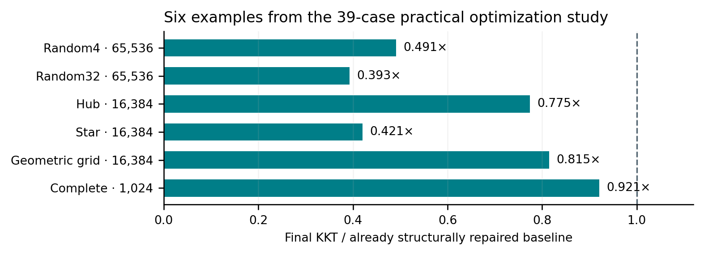
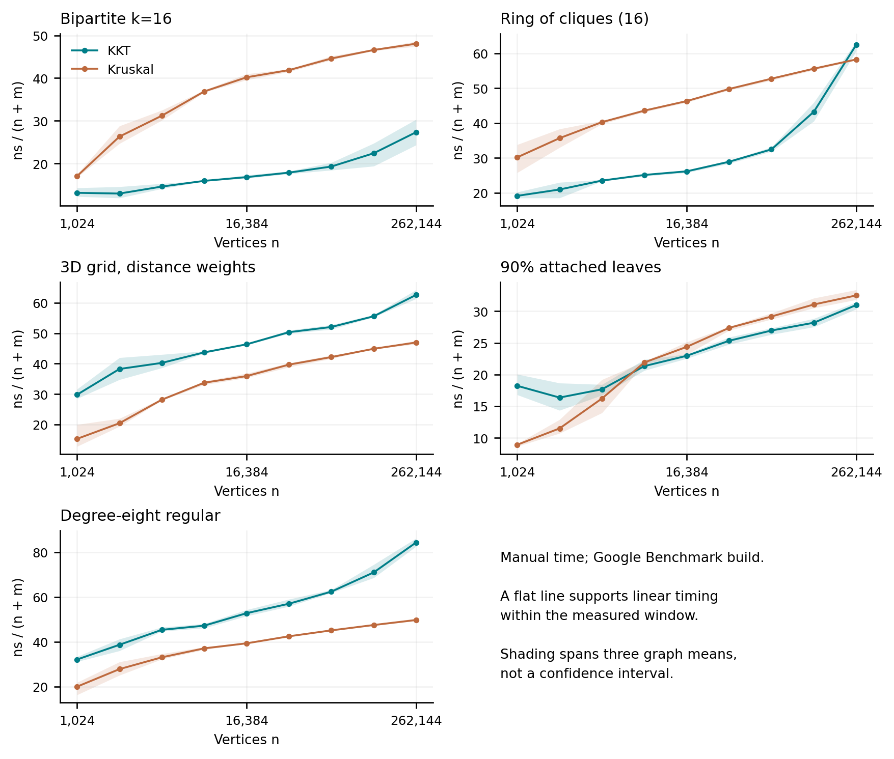
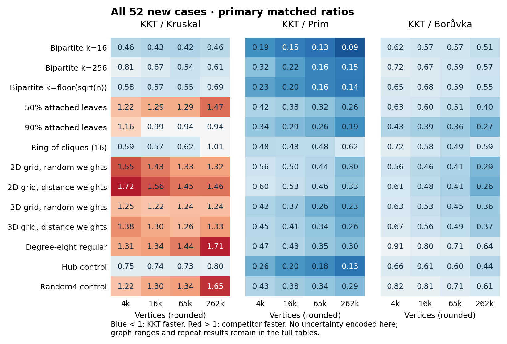
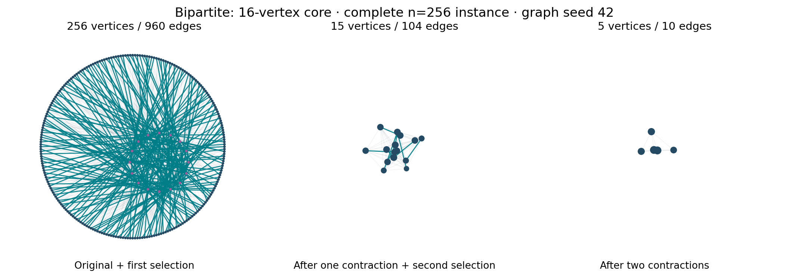
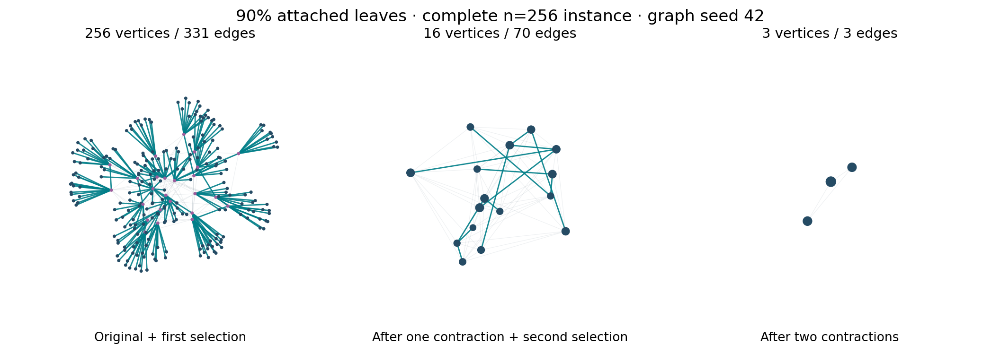
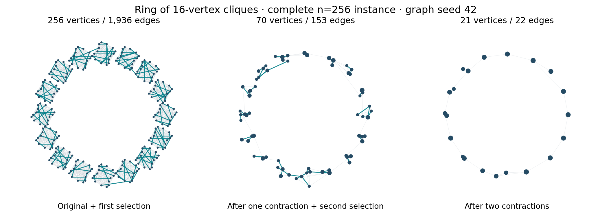
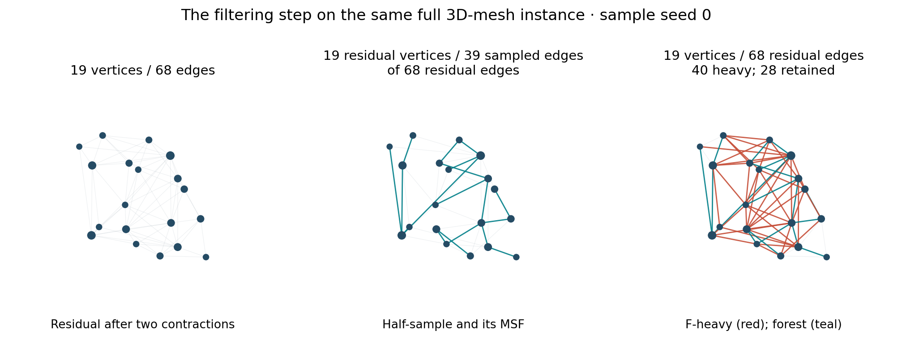
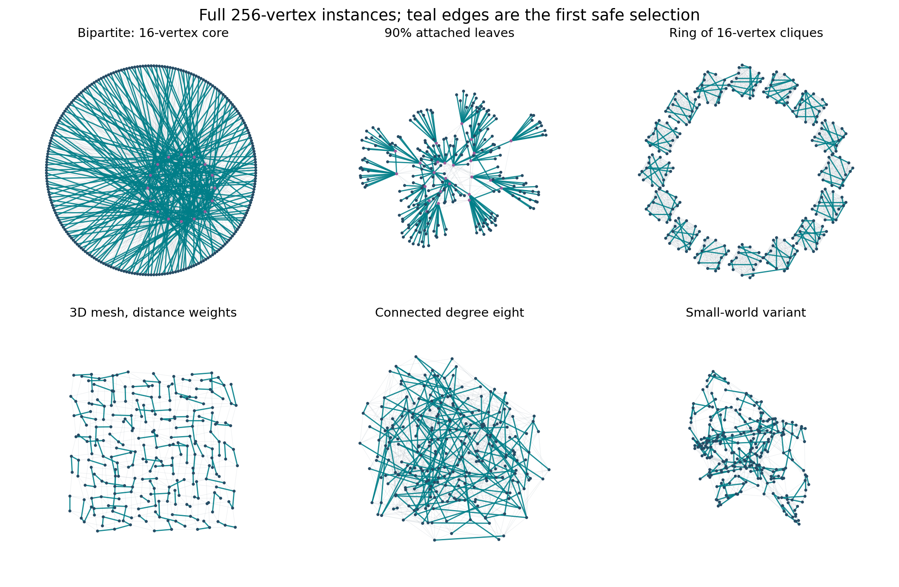
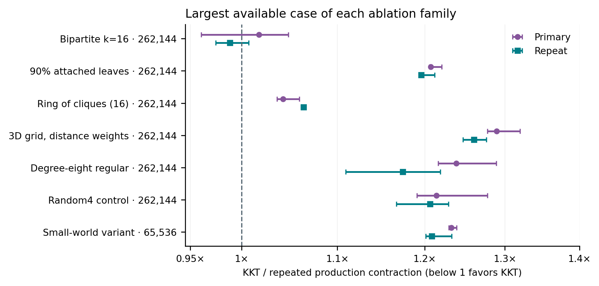

# Making KKT practical

**Implementation archaeology, measured scaling, and graph structure**  
Francisco Thiesen's Karger–Klein–Tarjan repository · 10–11 October 2026

This report asks three distinct questions: whether the original implementation faithfully realized KKT's local complexity bounds; whether the current implementation *measures* like linear time; and which graph structures make it competitive in practice. The answers come from source inspection, certified benchmark outputs, separate work counters, two complete new timing campaigns, and a controlled comparison with repeated compacting Borůvka steps.

The main document is this Markdown file. The [HTML edition](report.html) adds a fully offline, interactive 3D graph explorer. The [standalone explorer](graph-explorer.html) exposes actual contraction and filtering results for seven complete small graphs. A paginated companion checks the requested 40-page limit.

**Measured source.** New benchmark infrastructure is revision `c9ed4ca`. The production KKT algorithm is unchanged from `2d4fbf1`; all four algorithm implementations, the earlier fixtures, and the original timing boundary were checked against `1a3fc3c`. Raw evidence, precise commands, binary/source hashes and validation records are retained in [the new experiment directory](../../benchmark/results/common-2026-10-11/).

{{EXECUTIVE_RESULTS}}

These are results for the repository's implementations on one Apple M3 Max, using the stated build profiles and fixtures. The report retains losses, historical limitations, and the distinction between an algorithmic explanation and a measured causal effect.

<!-- PAGE -->

## 1. Which problem are we comparing?

KKT, Kruskal, Prim and Borůvka solve the minimum spanning tree problem: connect every vertex while minimizing the **sum of selected edge weights**. The user's reference to Dijkstra was clarified to mean Borůvka. Dijkstra instead minimizes the distance from one source to each other vertex.

A three-vertex example makes the distinction concrete. Let `AB=2`, `BC=3`, `AC=4`, with source A. Dijkstra's shortest-path tree contains AB and AC, total weight 6. The MST contains AB and BC, total weight 5, but its A-to-C route costs 5 rather than the shortest possible 4. Ranking those outputs as competing MST solutions would compare different objectives.

Throughout this report:

| Symbol | Meaning |
|---|---|
| `n`, `m` | Input vertices and undirected edges |
| `N = n + m` | Represented input size used for complexity fits |
| `k` | Size of a designated small vertex cover/core |
| `L`, `B`, `Q` | Original verifier-tree leaves, full-branching-tree vertices, directed path queries |
| `T(KKT)/T(A)` | Matched runtime ratio; below 1 favors KKT |

For a fixed-density sparse family, `m = Θ(n)`, so linear in N is also linear in n. For a complete graph, `m = Θ(n²)`: a linear-in-input algorithm necessarily takes quadratic work in the vertex count. Calling both experiments “O(n)” obscures what is being measured.

The comparison starts from a tuple edge list. That is a useful public API boundary, but a program already holding a tuned adjacency representation could obtain a different Prim ranking. Algorithm names alone do not specify a practical implementation.

<!-- PAGE -->

## 2. The old implementation broke local accounting

The measured original is [`693c6a5`](https://github.com/FranciscoThiesen/karger-klein-tarjan/commit/693c6a5f0945982ef3460e27632687e55cfb8de9). It already followed the recognizable KKT outline. The problem was that several local operations did not have the cost required by that outline.

The clearest defect was **edge tracking sized by original IDs**. Let `R = 1 + max(original edge ID)`. Contractions initialized R-sized bitmaps; recursive calls allocated result storage of that size; result merging scanned the same range. Children inherited the original range even when their own graphs had become tiny.

For compact original IDs, `R ≈ m_root`. A child with 12 edges could still pay for bookkeeping sized to millions of original edges. With sparse IDs, R was not even bounded by the graph's represented size. Negative IDs also made direct indexing invalid; computing `INT_MAX+1` in an int was another boundary defect.

This is stronger than “a slow container.” The recurrence requires local work proportional to the **current** subproblem. Repeated root-scale scans invalidate that premise. A hierarchical weighted path makes the issue concrete: its surviving main branch needs Θ(log n) contractions, and a tree has no F-heavy edges to remove. Scanning an original dense-ID range R≈n at those levels contributes Ω(n log n) bookkeeping. Sparse IDs can make R even larger without adding any graph edges.

[`60c65b4`](https://github.com/FranciscoThiesen/karger-klein-tarjan/commit/60c65b4d5cb8747822a08d73c528ade6e46150fa) changed accumulation to selected-ID vectors and local tracking to current edge positions. Original IDs became payload, rather than capacities. Legacy maximum-ID metadata was widened and ceased controlling algorithm storage.

**Engineering lesson:** recursive data structures must shrink with recursive inputs. Replacing a hash set with a bitmap is beneficial only when the bitmap's domain is appropriate.

<!-- PAGE -->

## 3. A lookup table was not linear to construct

The verifier uses a full branching tree and a lookup table over depth masks. A small final table does not imply cheap preprocessing.

In the old median-table builder, repeated subset enumeration rebuilt related information many times. Consider only its outer iteration `s=h`, where h is the branching-tree height. Across all subsets of an h-element set, the total number of included elements is `h·2^(h−1)`. The old code explicitly visited those included bits. That slice alone therefore costs `Ω(h·2^h)`.

A full binary branching tree can have `L=2^h` original leaves. The lower bound becomes `Ω(L log L)`, before counting the other repeated enumeration. This was a genuine asymptotic defect in preprocessing, not merely recursion overhead.

[`312954e`](https://github.com/FranciscoThiesen/karger-klein-tarjan/commit/312954efa42f2b386f0b45347a9e085bfe3aa9f5) replaced enumeration with a recurrence: remove the highest and lowest set bits and reuse the already-computed median for the inner mask. Every nonzero mask takes constant word operations.

Why does the resulting table stay linear? In this particular reduction, every original leaf receives one parent per round, all leaves have the same depth, and every internal node has at least two children. Thus `L ≥ 2^h`. The `2^(h+1)−1` nonzero masks require fewer than `2L` nonzero-mask iterations (and at most `2L` allocated entries including zero).

The equal-depth condition matters. An arbitrary tree in which every internal node has two children can still be highly unbalanced; that property alone would not justify logarithmic height. The current source and regression invariants rely on the stronger structure produced by the reduction.

The source-level repair is in [median_table.hpp](../../verifier/median_table.hpp). Its tests check the relationship between preprocessing work and valid branching-tree size; a timing fit is unnecessary to detect this class of error.

<!-- PAGE -->

## 4. Randomness, correctness and the old benchmark

A third issue concerned the sampling argument. Each old recursive sample called `srand(seed)` again with the same seed. That replayed masks and changed process-global RNG state. The standard sampling analysis assumes fresh suitable random choices conditional on the current subproblem.

[`ccb833f`](https://github.com/FranciscoThiesen/karger-klein-tarjan/commit/ccb833f109349f3f2204c345c019f3bf0ef06d7b) introduced one private, continuing `mt19937` stream per invocation. This removes repeated RNG prefixes at each recursive sample and caller interference; replaying an entire invocation with the same seed remains intentional. A finite PRNG is still not a mathematical source of independent random bits; the usual randomized model remains an assumption. Reusing a seed was a problem for the complexity argument, **not evidence by itself that the resulting MST was wrong**.

The earlier benchmark also asked a narrower question than its curve suggested. It fixed `n=10,000` and increased m from 1.25 million to 20 million. That was primarily a density sweep, not a vertex-scaling experiment. Generation reused a default seed, measured outputs were not independently validated, and KKT input conversion sat outside its loop. Those facts restrict interpretation; they do not make every recorded duration meaningless.

Additional repairs fixed a Prim/KKT global `Edge` type collision when linked together, made test iterations generate distinct seeded graphs, compared exact unique MST edge sets, and made the local build reproducible. These were correctness or evidence-quality repairs, not KKT speedups.

The present benchmark certifies a reference tree using source-edge membership, connectivity/acyclicity and the cycle-optimality property, independently of the measured algorithms' logic. Every timed result and warmup must match that unique MST. Exact IDs avoid relying on the legacy `int`-returning cost helper, which can overflow on large sums.

<!-- PAGE -->

## 5. Then we reduced the constants

After the structural repairs, the practical series began from `0820435`. Six retained changes improved the implementation without changing graph distributions or switching algorithms.

| Repair | Avoided work | Preserved invariant |
|---|---|---|
| `4eb3ca1`: local heavy-edge marks | Internal heavy-edge hash sets and per-edge membership probes | Each mark refers to a position in the current graph |
| `2749ced`: contiguous path-query ranges | Linked query lists and duplicate metadata | Same ancestor queries and maxima |
| `2e37b4e`: cheapest-neighbor walks | Selected-edge adjacency and an m-sized duplicate bitmap | Same selected IDs and component numbering |
| `af12309`: temporary parent-position IDs | Hash-based sampled-forest recovery | Caller IDs and RNG draws preserved |
| `ba39977`: consume temporary vectors | Extra graph copies during isolate removal | Edge order, weight and ID preserved |
| `2d4fbf1`: reserve final ID-set buckets | Repeated bucket growth | Same output membership |

The first three structural fixes and these six constant-factor changes are different categories. Flat storage can reduce allocations and improve locality while remaining the same asymptotic algorithm. Its benefit must be measured, not inferred from Big-O.

One proposed optimization was **rejected**. Caching each minimum edge's cost beside its index enlarged the per-vertex working set from four to eight bytes. It produced small gains in some cases and a roughly 6% regression on the largest tested `random_32` case. The current code retains only indices; the rejected patch and all results remain in [`db0717e`](https://github.com/FranciscoThiesen/karger-klein-tarjan/commit/db0717e).

Reserving the final hash table does not eliminate its node allocations. The public output representation remains a meaningful constant, especially when the graph collapses almost immediately.

<!-- PAGE -->

## 6. How much did those repairs matter?

Two experiments answer different historical questions. They must not be multiplied into a synthetic end-to-end speedup: their inputs, timing boundaries and observation structures differ.

{{HISTORICAL_TABLES}}

The first repair study measured 13 cases, with 27 observations per case, phase and algorithm. Its original-to-repaired timings excluded input construction. The practical study used the later common tuple-input boundary, 39 cases, three graph seeds, three KKT seeds and four repetitions. The complete results preserve cases whose individual trials or intermediate optimization stages became slower.

The practical primary campaign improved the KKT case-level paired median on all 39 cases, with final/baseline ratios approximately 0.393–0.969. That statement is about those case medians, not every graph or trial. Dense complete graphs in the separate large campaign still regressed relative to its historical baseline. Making KKT much faster did not make it universally fastest.

<!-- PAGE -->

## 7. What “expected linear” requires now

The [original KKT paper](https://www.cs.cmu.edu/~guyb/paralg/papers/KargerKleinTarjan95.pdf) establishes a randomized linear-time MST algorithm in a unit-cost comparison RAM. Its key sampling lemma bounds the expected number of F-light edges by `n/p`, where F is the minimum spanning forest of an independently sampled p-subgraph. The implementation uses `p=1/2`, two initial Borůvka contractions, and a linear-time heavy-edge classifier.

A compact way to check the implementation's intended accounting is to assign each recursive input the potential `Φ = m + 2n`. After two contractions, its vertex count is at most `n/4`. The sampled child has at most m/2 edges in expectation; the light-edge child has at most n/2 in expectation. Together their vertex counts are at most n/2. Therefore:

`E[Σ Φ(children) | current input] ≤ m/2 + 3n/2 ≤ (3/4)·Φ(input)`.

If every local phase costs at most `C·Φ`, expected total local work is bounded by a geometric series, at most `4C·Φ(root)` in this accounting. This is a source-audit explanation under the stated model, not a formal verification of every C++ path. It also shows exactly why root-ID-sized bookkeeping was unacceptable: no constant C could tie that work to an arbitrarily small current input.

For explicitly represented isolated vertices, `O(n+m)` is the sensible claim. Hash output construction assumes average/expected constant-cost operations; integer counts, masks and memory must be representable. The current benchmark domain has connected simple graphs, distinct integer weights and unique edge IDs. Arbitrary tied weights and invalid verifier forests are outside what this evidence establishes.

<!-- PAGE -->

## 8. Auditing the verifier's less obvious costs

The recursive shape is only half the story. A heavy-edge classifier with a hidden logarithmic factor would change the bound.

| Phase | Current accounting | Practical cost still present |
|---|---|---|
| Contraction | At most four current-edge visits and a constant number of vertex passes; stamped buckets merge parallel edges | Multiple arrays and full scans |
| Forest decomposition | Each forest arc, vertex and within-component query edge is grouped once | Component metadata and materialization |
| Full branching reduction | Active trees shrink geometrically; fewer than `2L` output vertices | Intermediate arrays and hierarchy construction |
| Median masks | Constant work per mask; fewer than `2L` masks | Table initialization |
| LCA preprocessing | Block sparse table and ±1 microtables have linear aggregate size | Nested allocations and nonuniform small-input constants |
| Path queries | Aggregate comparison/search bound, not constant work for each individual search | Query storage, bit operations and branch behavior |

For LCA, an Euler tour has length E. Blocks of roughly `(log₂ E)/2` give `O(E/log E)` block minima, whose sparse table costs O(E). At most `2^(b−1)` block masks each need O(b²) work; `O(√E·log²E)` is O(E) asymptotically. Small finite ranges can still have awkward constants.

For the path-search bound, keep notation precise. [Komlós's verification analysis](https://scispace.com/pdf/linear-verification-for-spanning-trees-3h8xralfeo.pdf) uses **B full-tree vertices**, not L original leaves: `3B + B·log₂((Q+B)/B)` comparisons. This is O(B+Q). Hagerup's [tree-path-maxima implementation](https://link.springer.com/chapter/10.1007/978-3-642-11409-0_16) addresses implementation overhead as well. The current audit checked the code's structural correspondence; it did not formally prove equivalence to all details of those algorithms.

No obvious additional asymptotic factor remains in the audited phases. That conclusion is more defensible than claiming that a fitted timing curve proves the implementation linear.

<!-- PAGE -->

## 9. GoogleTest is not a complexity estimator

**GoogleTest** runs correctness and structural regression tests. Here those include local scan bounds, sparse-ID counter invariance, collector scoping, star termination, geometric forest-reduction work and median-table size bounds. Those tests can detect a return of the known defects. They do not infer a wall-clock exponent.

**Google Benchmark** provides the requested fitting feature. The harness calls `SetComplexityN(n+m)` and `Complexity(benchmark::oAuto)`, using manual steady-clock intervals. Each family and graph seed gets its own registration. Families of different density are never pooled into one fit.

There is an important version-specific detail. The repository pins **Google Benchmark 1.5.2**. Its [actual implementation](https://github.com/google/benchmark/blob/v1.5.2/src/complexity.cc) chooses the automatic model using CPU time, then fits manual/real time to that selected model. `UseManualTime` does not change the clock used to select the label in that version. The model is a zero-intercept least-squares fit; its printed RMS is normalized by the mean observed cost.

The library searches a small menu: constant, log N, N, N log N, N² and N³. An N² label over a short range does not prove quadratic complexity, and an N label does not certify linearity. Mixtures of costs, setup intercepts, changing graph reduction, memory behavior and noise can favor the wrong asymptotic-looking label.

The analysis therefore retains the built-in labels **and** independently fits exported manual times. It reports `N`, `N log N`, `N(log N)²`, `N²`, and a free power `cN^p`, with full-window and upper-half fits and residuals. The [current user guide](https://google.github.io/benchmark/user_guide.html#calculating-asymptotic-complexity-big-o) describes the API; the pinned source determines this run's semantics.

A free-power fit is also a finite summary. Its upper-half window emphasizes the largest five timing sizes, but it is still only five points. The four-size work sweep has only two points in its upper half, so that value is simply a two-point slope.

Google Benchmark registrations run in fixed order and do not use the rotating paired schedule of the main comparison. Its algorithm ratios are ratios of arithmetic mean times. The main campaign instead aggregates matched trial ratios with hierarchical medians. Those summaries answer related but different questions and are not pooled.

<!-- PAGE -->

## 10. Does the current implementation measure as O(N)?

**There is no single affirmative answer across families.** The earlier final-source diagnostics found approximately linear behavior on stars, but visibly superlinear finite-range timing and rising work per input on random graphs.

| Earlier final-source family | KKT full-range timing p | Upper-half p | Counted work/N, smallest → largest |
|---|---:|---:|---:|
| Random, `m=4n` | 1.175 | 1.120 | 17.69 → 31.38 |
| Random, `m=32n` | 1.379 | 1.527 | 11.80 → 36.12 |
| Star | 1.001 | 1.024 | 6.001 → 6.000 |
| Hierarchical path | No timing fit | No timing fit | 36.35 → 36.00 |

These are [preserved final-source diagnostics](../../benchmark/results/practical-2026-10-10/complexity/report.md): timing uses seven sizes `n=1,024…65,536`; work uses five sizes through 262,144. The built-in KKT labels were N for all three star seeds, N log N for sparse random, and N² for dense random. That disagreement with the abstract bound is a reason to inspect mechanisms, not to reinterpret a fit as a proof.

{{NEW_COMPLEXITY_TABLE}}

The new fits use nine doubling sizes through 262,144, five preselected mechanisms, two algorithms, three graph seeds and three batches of three calls: **810 raw timing records representing 2,430 calls**. They use Bazel `-O3/NDEBUG`, separately from the native `-march=native` comparison campaigns. Sampling seeds and repeated batches do not create additional independent graphs.

<!-- PAGE -->

## 11. See where linear timing stops being a good description

A flat `time/N` curve supports linear timing *over this window*. A rising curve means cost grows faster than N over the observed range. The shaded ranges span the three graph means; they are descriptive ranges, not confidence intervals.

{{COMPLEXITY_INTERPRETATION}}

<!-- PAGE -->

## 12. Why Big-O does not give us a practical crossover

If two exact cost models were `aN` and `bN log N`, with stable positive constants and an unlimited domain, the linear one would eventually win. But Big-O **upper bounds alone** do not establish those exact models or a usable crossover. Even in the idealized model, the threshold grows exponentially with `a/b` when natural logarithms are used.

KKT performs contraction scans, samples, recursion, verifier preprocessing, path queries, graph materialization and output construction. Kruskal mostly performs a contiguous sort and union-find scan. Several linear passes with allocation and indirect accesses can cost more than an optimized sort over the sizes the machine can hold.

The work counters explain another finite-range effect. A small dense graph may collapse almost completely during contraction; as n grows at fixed average degree, more distinct component pairs remain and fewer parallel edges disappear. Thus the amount of recursion and verification **per original input edge** can rise before any asymptotic envelope becomes visible. In the earlier random32 sweep, root retention after two rounds grew from about 4.2% to 87.4%.

The counters are a deliberately limited proxy. They count visits, explicit initializations, table writes, edge materializations and hash API items. They do not count allocator internals, implicit vector growth copies, deallocation, hash collisions, cache misses or CPU instructions. We can observe changing work mix and time per proxy event; we cannot name a hardware bottleneck as measured fact without profiling it.

The correct practical question is therefore: **which inputs get cheap, substantial reduction before expensive recursive work, and can a simpler competitor exploit the same reduction?** The next experiments test exactly that.

<!-- PAGE -->

## 13. The additional common families

The new matrix contains **52 cases: 13 model variants at four sizes**, `n={4,096,16,384,65,536,262,144}`. Eleven are new; hub and random4 are unchanged controls. These are explicitly defined synthetic models, not claims to reproduce every application graph with the same informal name.

| Group | Variants and edge count | Question tested |
|---|---|---|
| Unbalanced bipartite | Small side k=16,256,⌊√n⌋; every peripheral degree 4; `m=4(n−k)` | Does a small cover force useful contraction as its size grows? |
| Leaf-rich sparse core | Core c=⌊n/2⌋ or ⌊n/10⌋; core has 4c edges; `m=n+3c` | How much do forced leaf edges help when a hard core remains? |
| Ring of cliques | 16-vertex cliques linked in a cycle; `m=121n/16` | Does strong local redundancy help without artificially cheap local edges? |
| Open 2D mesh | Four-neighbor grid, random versus distance ranks | Same topology, different weight correlation |
| Open 3D mesh | Six-neighbor near-cubic grid, same paired weighting | Higher local connectivity and physical geometry |
| Degree-eight regular | Protected Hamiltonian cycle plus degree-preserving switches; `m=4n` | Homogeneous negative control for the hub hypothesis |
| Existing controls | Hub and random4, both `m=4n` | Preserve continuity with earlier studies |

New nonspatial families receive a global permutation of distinct weights `1…m`; no leaf, bridge, core or spanning-tree edge is deliberately made cheap. Labels and edge order are shuffled independently of topology. Distance variants rank exact squared geometric lengths, breaking ties by original edge ID; their paired random variants share every other input attribute.

The regular generator is connected and exactly degree eight. It is **not** claimed to be a uniform random-regular draw, a rapidly mixed sample, or a proven expander. Likewise the meshes are not nearest-neighbor graphs of independently scattered points and are not road-network datasets.

<!-- PAGE -->

## 14. Protocol fixed before the results

The [pre-timing plan](../../benchmark/results/common-2026-10-11/PROTOCOL.md) fixes the families, sizes, diagnostics and reporting rules. This is exploratory follow-up motivated by the earlier shape study; it is not an independent confirmation using newly chosen graph seeds.

Each of two complete campaigns contains **7,488 timed outputs and 1,872 checked warmups**: 52 cases × three graph seeds × three KKT seeds × four repetitions × four algorithms. Every algorithm occupies each timed position equally within a graph/seed block. Case order is shuffled once and reused. A separate instrumented campaign contains 468 observations from 156 case/seed combinations.

Generation, certification, output checks and destruction of the returned result are outside timing. KKT's tuple conversion and temporary-input destruction are inside timing. Every algorithm includes its own result construction. No instrumented execution is used as a runtime observation.

Timing summaries take medians across repetitions, then sampling seeds within a graph, then graph seeds. Ratios are formed **inside matched trial blocks before aggregation**. A ratio of displayed median milliseconds need not equal the displayed matched ratio. Graph min/max ranges describe three graphs; they are not confidence intervals or a significance test. Repeated calls and sampling seeds are not additional graphs.

The two campaigns remain separate. A win that repeats on all three graph medians is stronger descriptive evidence than a single median crossing 1, but it still does not establish application-wide dominance. All losing cases remain in the tables and raw files.

Builds and tests finished before timing; analysis and rendering ran outside the timed phases. Only one timed process ran at a time. This is an ordinary desktop with no core affinity or controlled thermal/power state. Native comparisons use Apple clang 15, `-O3 -march=native`, assertions enabled, on an Apple M3 Max with 128 GiB RAM.

<!-- PAGE -->

## 15. All new families, all three competitors

{{NEW_OVERVIEW}}

Ratios below 1 favor KKT. The [repeat campaign](../../benchmark/results/common-2026-10-11/repeat_analysis/report.md) is retained separately; the appendix gives both runs. Near-ties are described as such rather than converted into broad algorithm recommendations.

<!-- PAGE -->

## 16. The largest new instances

At `n=262,144`, densities vary by model. Comparisons are within a graph; the table is not a fixed-m contest between graph shapes. Milliseconds below are primary hierarchical medians. The final column compares KKT with the fastest competing case-median implementation, using its matched ratio in each campaign.

{{LARGEST_TABLE}}

{{LARGEST_INTERPRETATION}}

The labels identify the model parameters, not a claim that every graph with leaves, cliques, geometry or hubs will behave similarly. In particular, a fixed small cover and a cover that grows with n are different asymptotic families.

<!-- PAGE -->

## 17. Why a genuinely small core helps

The useful structural property is a **small vertex cover**, not simply a large maximum degree. Suppose a connected graph has a cover C of size k: every edge touches C. Vertices outside C have no edges between them. Each chooses its cheapest edge to C in the first Borůvka selection. Every selected-edge component therefore contains a cover vertex, so at most k components remain.

After loops and parallel edges are removed:

`n₁ ≤ k`, and `m₁ ≤ min(m − n + k, k(k−1)/2)`.

The edge-count term also uses the selected forest's at least `n−k` edges. A second contraction leaves at most `⌊k/2⌋` vertices. This argument is independent of the weight order, as long as the selection consistently produces the safe forest assumed here.

For fixed `k=16`, the first residual has at most 16 vertices and 120 edges, regardless of how many peripheral vertices were present. The remaining randomized part is then tiny. For `k=256`, the corresponding bound is 32,640 edges; at smaller n it can be loose. For `k=⌊√n⌋`, the generic first residual edge bound is O(n), not a constant-size tail. A growing core can therefore consume much more of the saved work.

{{CORE_RESULTS}}

At `n=65,536`, the k=256 and k=⌊√n⌋ generators produce **identical seeded weighted inputs**. Their separate timing observations are useful repeatability data at that parameter intersection, but are not independent evidence for two different topologies.

An appropriately implemented Borůvka can exploit the same bound. The property does not belong uniquely to KKT's randomized step; the ablation later measures that distinction.

<!-- PAGE -->

## 18. Watch the core disappear

This full 256-vertex instance is generated by the same bipartite16 model, graph seed 42. The production first round leaves 15 vertices and 104 edges; the second leaves five vertices and ten edges. These are actual exported outputs, checked against an independent disjoint-set reconstruction and minimum-parallel-edge reduction.

Teal edges in the first two panels are selected safe edges. Purple vertices identify the designated 16-vertex core. Supervertex positions are **centroids of their original member vertices**, with a common scale across stages; the drawing does not silently spread a tiny residual back out to fill the page. Node size increases with the number of original members.

The small instance illustrates the mechanism. It is not substituted for a timed large instance, and its residual counts should not be quoted as the 262,144-vertex case's counts.

[Open the interactive 3D explorer](graph-explorer.html) to rotate this graph, inspect member counts, step through contraction, and view the sampled forest and removable heavy edges. The explorer includes seven full graphs, including a regular negative control. Nothing is downsampled from a large graph and presented as the full input.

<!-- EXPLORER -->

The output verifier's heavy-edge labels are independently checked by explicit maximum-edge searches on forest paths. Edges between forest components remain light because no path exists. The visual therefore illustrates the actual classification, not a guessed coloring.

<!-- PAGE -->

## 19. Leaves: cheap output, but a residual problem

Every degree-one vertex forces its incident edge into the MST. KKT's first selection accepts those edges regardless of their weights. A star finishes immediately: every edge is selected, one component remains, and there is no sampling or verification.

A graph with many leaves is different. The attached leaves vanish, but the random sparse core still requires an MST. For a core of c vertices with 4c edges and `n−c` attached leaves, the graph has `m=n+3c`. A 90% attached-leaf model leaves a much smaller core than a 50% model, but both must still read the original input and construct roughly n output IDs.

{{LEAF_RESULTS}}

The “90%” name is rounded: `c=⌊n/10⌋`. The designated attachments are exactly leaves, while core vertices can also have degree one. The reported measured leaf count comes from the actual graph rather than the nominal percentage.

The earlier balanced binary tree is a useful counterexample to “trees favor KKT.” At 65,536 vertices it took roughly 1.49–1.50 times Kruskal's time despite substantial contraction. Kruskal sorts only `n−1` edges there; KKT still pays repeated vertex passes and output costs. Tree shape and termination depth matter.

<!-- PAGE -->

## 20. Small dense communities without planted weights

A ring of cliques separates two effects. Each 16-vertex clique contains 120 internal edges, providing substantial local redundancy. Only one edge joins each consecutive pair of cliques around a cycle. Internal and inter-clique edges share the same global random weight assignment.

The inter-clique connections are **not individually forced bridges**: contracting each clique turns them into a cycle. With globally mixed weights, an MST may keep every inter-clique connection and instead omit an internal edge on the corresponding original cycle. We cannot assume that solving each clique independently and dropping one external connection gives the global MST. This generator also avoids making all local edges artificially cheap.

{{CLIQUE_RESULTS}}

This family tests bounded-size dense neighborhoods repeated as n grows. It differs from the previous model with a fixed number of 16 communities whose individual sizes grow. “Community structure” alone therefore does not predict the same scaling: the size and number of communities, the number of external edges, and weight correlations all change the residual problem.

The figure retains all 256 vertices and all 1,936 original edges. Its first contraction leaves 70 vertices and 153 edges, and the second 21 vertices and 22 edges. Near-tree residuals also explain why simply continuing contraction could be inexpensive; that hypothesis is tested rather than credited automatically to sampling.

<!-- PAGE -->

## 21. Geometry and edge weights are separate variables

The paired meshes are the most controlled new weight experiment. At each n and graph seed, random and distance variants have identical endpoints, IDs, labels, input order and jittered coordinates. Only their weight ranking differs. Distance ranks preserve exact integer squared-distance order, with deterministic tie-breaking. The minimum spanning tree is therefore the one for those distances under that tie order.

The 2D meshes use open four-neighbor square grids. The 3D meshes use open six-neighbor dyadic grids: `16³`, `32×32×16`, `64×32×32`, and `64³` at the four main sizes. Active coordinates are lattice positions plus bounded jitter; geometric proximity does not create extra edges.

{{SPATIAL_RESULTS}}

Here the residual has 19 vertices and 68 edges. A half-sample uses the same seed-zero root sampling bits as production KKT. Teal is the sample's minimum spanning forest; red edges are F-heavy. On this particular explanatory instance, 40 edges are heavy. That count demonstrates filtering activity; by itself it says nothing about whether the activity saves time compared with another continuation strategy.

These are spatial mesh workloads, not measured road networks, Delaunay graphs or k-nearest-neighbor graphs. Results should not be transferred to those application families without obtaining and validating appropriate instances.

<!-- PAGE -->

## 22. Keep the counterexamples visible

{{NEGATIVE_RESULTS}}

The regular graph controls degree heterogeneity while remaining connected and simple. Random4 provides continuity with the older random sparse workload. Their behavior tests whether the proposed mechanism explains losses as well as wins.

Earlier shape results also constrain the story. At 65,536 vertices, preferential attachment and sparse communities lost to Kruskal by about 8–10% and 19–20%, respectively. Balanced bipartite graphs lost by 31–32%, and balanced binary trees by 49–50%. Small-world graphs showed a modest 4.6–5.6% matched advantage over Kruskal, with individual losses in both campaigns. Sixteen hubs were substantially stronger, but their 16 vertices form a fixed cover, which is a more specific property than a heavy-tailed degree distribution.

<!-- PAGE -->

## 23. Does going much larger rescue general-purpose KKT?

The prior large campaign used this same final production algorithm through **1,048,576 vertices and 33,554,432 edges**. It remains relevant context; the new matrix does not replace those losses with smaller favorable inputs.

| Preserved large input | KKT | Kruskal | Interpretation |
|---|---:|---:|---|
| Random4, n=1,048,576 | 893.7 ms | 284.7 ms | Matched KKT/Kruskal ≈3.14 |
| Random32, same n | 10.014 s | 2.385 s | Matched ratio ≈4.21 |
| Hub, same n | 358.5 ms | 283.6 ms | The smaller-size KKT lead disappeared |
| Star, same n, focused confirmation | 27.42 ms | 62.37 ms | Matched ratio ≈0.442 |
| Complete, n=8,192 | 4.456 s | 2.328 s | Prim ≈0.432 s; Borůvka ≈0.404 s |

The broad large campaign used one repetition and no warmup for all graph/sampling seed combinations; focused hub/star confirmations used four repetitions and one warmup. They are labeled separately in [the retained evidence](../../benchmark/results/practical-2026-10-10/large_analysis/report.md) and [focused confirmation](../../benchmark/results/practical-2026-10-10/large_confirmation_analysis/report.md). Rounded milliseconds here are case medians; matched ratios need not equal their quotient.

These results reject a practical “just increase n” strategy on the tested random families. A strong star result does not repair that generality gap. The new structural families instead ask whether there are useful shapes where large-input processing remains cheap.

<!-- PAGE -->

## 24. The decisive ablation: continue compacting Borůvka

The repository's ordinary Borůvka baseline repeatedly scans the original edge set and recomputes components on the original vertices. It does not physically compact and deduplicate the graph as KKT does. Beating that implementation cannot establish a benefit from randomized sampling.

The ablation repeatedly calls **the exact production `boruvka_step`** until no edges remain, accumulates selected IDs, and constructs the same reserved ID hash set as KKT. Both start from the same tuple list and include conversion, temporary-input destruction and result construction. Every output receives the same exact-ID correctness check against a certified MST.

The fixed matrix contains 20 cases: six common families at 4,096/65,536/262,144 vertices, plus the existing small-world family at 4,096/65,536. Each of two campaigns has 1,440 timed outputs and 360 checked warmups. Sixty deterministic untimed contraction traces record the residual graph after every round.

{{ABLATION_RESULTS}}

This measures the **net change of continuation strategy**. It includes iterative storage release versus recursive lifetimes, RNG setup, recursion and output accumulation behavior. It does not isolate the cost of verifier instructions alone, and it is not a claim to have produced the best possible Borůvka implementation.

<!-- PAGE -->

## 25. What the combined evidence supports

{{SYNTHESIS}}

Useful predictors are measurable properties of the early residual, rather than an informal graph label:

1. **Residual vertices and edges after contraction.** A small cover provides a strong deterministic bound; a large degree alone does not.
2. **How quickly residual edge volume keeps shrinking.** A tiny, sparse tail may make additional compacting Borůvka rounds very cheap.
3. **Verifier workload before and after filtering.** Deleting 95% of a large residual can still cost more than avoiding that verifier pass.
4. **Unavoidable input and output work.** A leaf-rich graph may eliminate search while retaining linear conversion and hash-node construction costs.
5. **The competing implementation and input representation.** A tuned Prim heap, prebuilt CSR, radix-sorting Kruskal, or compacting Borůvka could change the practical frontier.

This is a more useful diagnosis than searching for a universal “KKT-friendly” graph name. Topology, weight correlation, representation and residual size jointly determine the observed constants.

<!-- PAGE -->

## 26. What I would improve next

The benchmark work does not silently alter the production algorithm to make these results look better. It identifies implementation experiments worth doing next, each with its own correctness gate and complete before/after evidence.

**First, strengthen the baseline.** Promote the compacting Borůvka continuation into a carefully reviewed competitor, including appropriate disconnected-input semantics. That tests whether future KKT changes improve upon the shared efficient preprocessing rather than upon an avoidably expensive old baseline.

**Second, make residual handling cheaper.** Profile allocations, retained buffers and path-query work on the common failures before choosing a change. A small-subproblem base case or fewer copies might lower constants, but thresholds must be selected on a training set and evaluated on withheld graph seeds and families. A hybrid should be labeled a hybrid and its asymptotic accounting rechecked.

**Third, test sampling where it has a plausible cost advantage.** The useful target is a residual with many expensive edges that are cheaply certifiable as heavy, while continued contraction shrinks them slowly. Tune or redesign the verifier using measured profiles; do not plant an easy weight hierarchy and call it representative.

**Fourth, obtain application data.** Road networks, physical meshes, geometric neighborhood graphs, and weighted infrastructure/network datasets would test whether the synthetic mechanisms occur in practice. Record preprocessing and weight semantics, preserve disconnected components where appropriate, and use independent certification. More graph seeds and a second architecture would then test generalization.

The goal remains making KKT useful. Honest losses against a stronger continuation provide concrete engineering direction and prevent us from optimizing toward a favorable benchmark name.

<!-- PAGE -->

## 27. Correctness, limitations and reproducibility

{{VALIDATION_RESULTS}}

The MST certificate is independent of the timed routines: it checks edge membership/weights, acyclic connectivity, and maximum-edge cycle optimality. Distinct weights give a unique MST, so exact edge-ID equality transfers that certificate to every measured output. The graph exporter independently checks contractions and sampled-forest path maxima as well.

This is substantial evidence over the specified domain, not a proof for arbitrary malformed inputs, repeated IDs, every tied-weight graph or every integer size. The standalone verifier assumes a valid forest. Older UBSan checks passed; ASan failed before main even for an empty control program in the earlier environment, so no ASan success is claimed here. The current new-family study did not rerun that failing runtime.

All new primary and repeat data are retained. There is no selection of the faster run, no removal of losing families, and no synthetic combination of incompatible historical protocols. Desktop noise, only three graph seeds, repeated use of those seeds across related campaigns, shared generated instances at the bipartite parameter intersection, and synthetic-model specificity remain real limits.

To reproduce: build the Make timing/work/ablation/export binaries and Bazel Google Benchmark target; run fixture and correctness checks; then run `run_campaign.py` and `run_diagnostics.py` **serially into fresh output directories**. Run the strict analyzers afterward. Exact commands, profiles, hashes and logs are in the experiment metadata and [results README](../../benchmark/results/common-2026-10-11/README.md). Report/view generation is deliberately separate from measurement.

<!-- PAGE -->

## 28. Complete new-case table: core and community models

Each cell is `primary / repeat` matched KKT-to-fastest-competing-case-median ratio. The named competitor is selected within each campaign; a changed name is shown explicitly. Below 1 favors KKT. Full pairwise comparisons to all three algorithms, graph ranges and individual loss counts remain in the linked analysis tables.

{{APPENDIX_CORE_TABLE}}

The k=256 and k=√n rows at n=65,536 refer to the same generated weighted graphs. This table keeps both observations and does not count them as independent topology evidence.

<!-- PAGE -->

## 29. Complete new-case table: spatial and control models

Same aggregation and ratio convention as the preceding page. Spatial random/distance rows share topology, IDs, order and coordinates within each seed. The pairing isolates the weight assignment on this mesh model; it does not turn three graph seeds into a large statistical sample.

{{APPENDIX_SPATIAL_TABLE}}

For every row, [primary analysis](../../benchmark/results/common-2026-10-11/primary_analysis/report.md) and [repeat analysis](../../benchmark/results/common-2026-10-11/repeat_analysis/report.md) retain KKT/Kruskal, KKT/Prim and KKT/Borůvka ratios, all four runtime summaries, graph-level ranges and individual losses. The detailed CSVs are the numerical source of this report, not values read back from figures.

<!-- PAGE -->

## 30. Source and evidence map

| Evidence | Location / role |
|---|---|
| New raw campaigns, work, plan and metadata | [common-2026-10-11](../../benchmark/results/common-2026-10-11/README.md) |
| New Google Benchmark JSON and every fitted model | [complexity analysis](../../benchmark/results/common-2026-10-11/diagnostics/complexity_analysis/report.md) |
| New continuation-strategy experiment | [ablation analysis](../../benchmark/results/common-2026-10-11/diagnostics/ablation_analysis/report.md) |
| Exact new graph generators and structural checks | [fixtures](../../benchmark/common_graph_fixtures.hpp), [tests](../../benchmark/common_test.cpp) |
| Original structural repair campaign | [repair-2026-10-09](../../benchmark/results/repair-2026-10-09/README.md) |
| Six accepted practical optimizations and rejected experiment | [practical-2026-10-10](../../benchmark/results/practical-2026-10-10/README.md) |
| Earlier six additional shapes and controls | [shapes-2026-10-11](../../benchmark/results/shapes-2026-10-11/README.md) |
| Standalone offline visual inspection | [graph explorer](graph-explorer.html), [checked raw exports](../../benchmark/results/common-2026-10-11/graph_views.json) |

Primary algorithm and tooling references:

- Karger, Klein and Tarjan, *A Randomized Linear-Time Algorithm to Find Minimum Spanning Trees*, JACM 42(2), 1995. [Author-hosted paper](https://www.cs.cmu.edu/~guyb/paralg/papers/KargerKleinTarjan95.pdf).
- Komlós, *Linear Verification for Spanning Trees*, Combinatorica 5, 1985. [Paper text](https://scispace.com/pdf/linear-verification-for-spanning-trees-3h8xralfeo.pdf).
- Hagerup, *An Even Simpler Linear-Time Algorithm for Verifying Minimum Spanning Trees*, WG 2009. [Publisher record](https://link.springer.com/chapter/10.1007/978-3-642-11409-0_16). The audit read the abstract, not a newly obtained full implementation proof.
- Google Benchmark [complexity API guide](https://google.github.io/benchmark/user_guide.html#calculating-asymptotic-complexity-big-o) and [pinned v1.5.2 fitting code](https://github.com/google/benchmark/blob/v1.5.2/src/complexity.cc).

The Markdown is the editable report. Static figures show exact retained data or explicitly identified full small instances; the HTML adds local interactions. Neither presentation changes the measured graph inputs, solver code, or correctness requirements.

<!-- PAGE -->

## 31. Complete continuation-strategy comparisons

Every ablation case is retained below. Ratios are KKT / repeated production contraction, primary and repeat; below 1 favors KKT. Range columns span the three graph-level ratios, not confidence intervals. The smallest-size observations matter even when the main figure emphasizes the largest tested case.

{{ABLATION_APPENDIX}}

Both solvers return the same ID-set representation and use the same production contraction. Compacting Borůvka is deterministic; its sampling-seed labels identify repeated matched trials, not distinct randomized executions.
