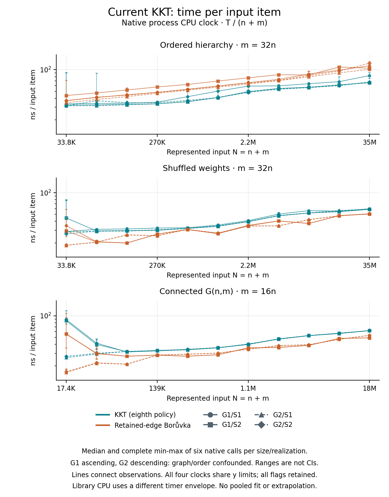
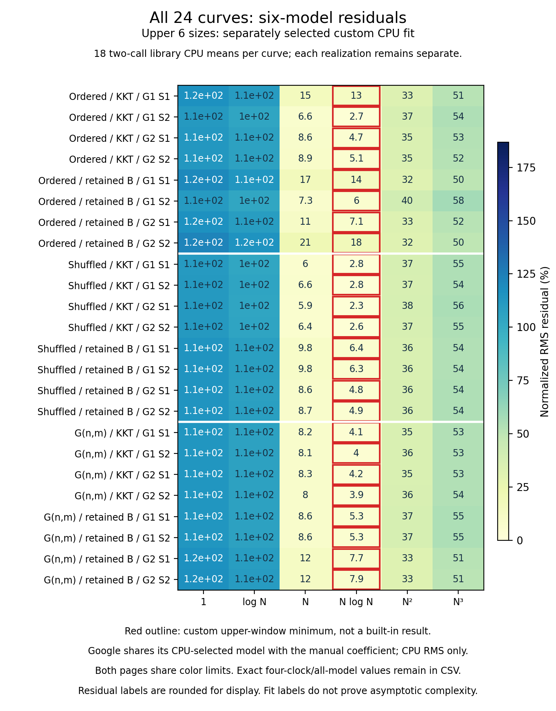
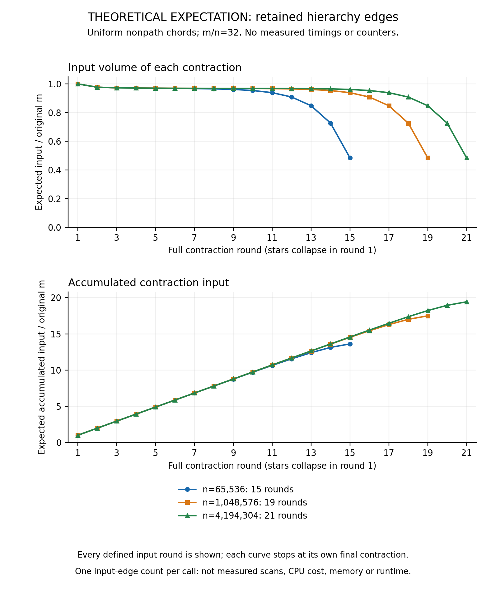
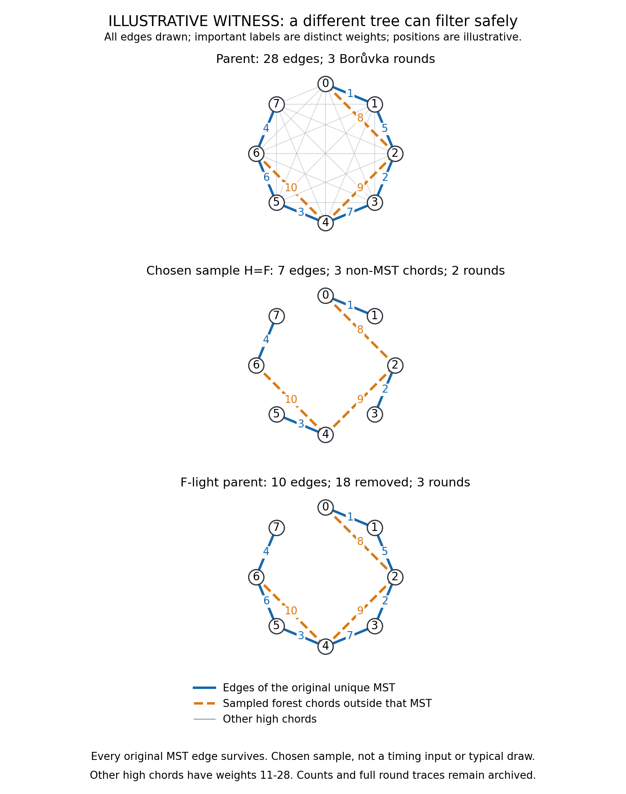
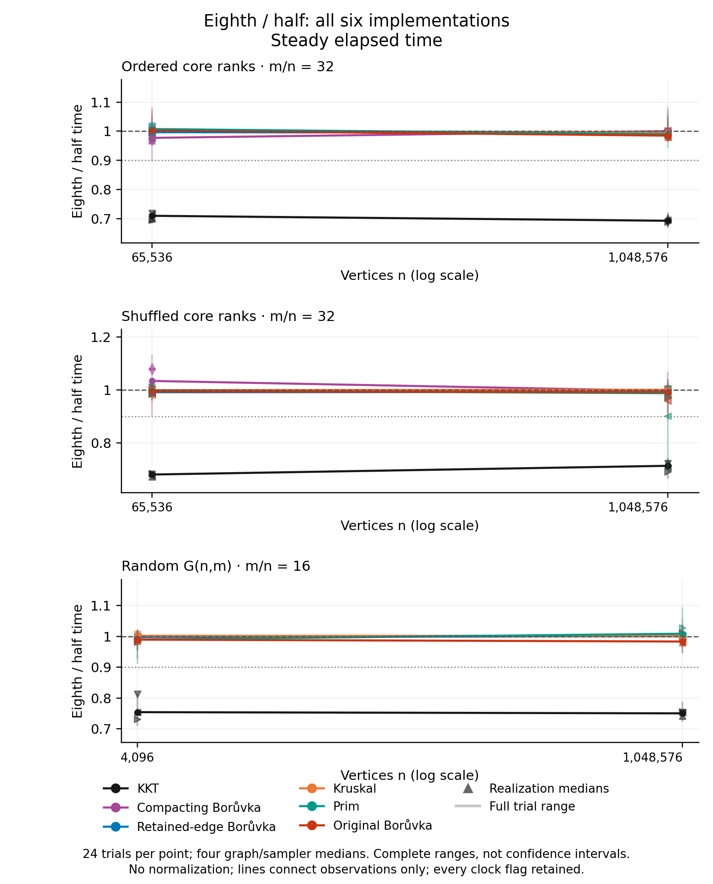
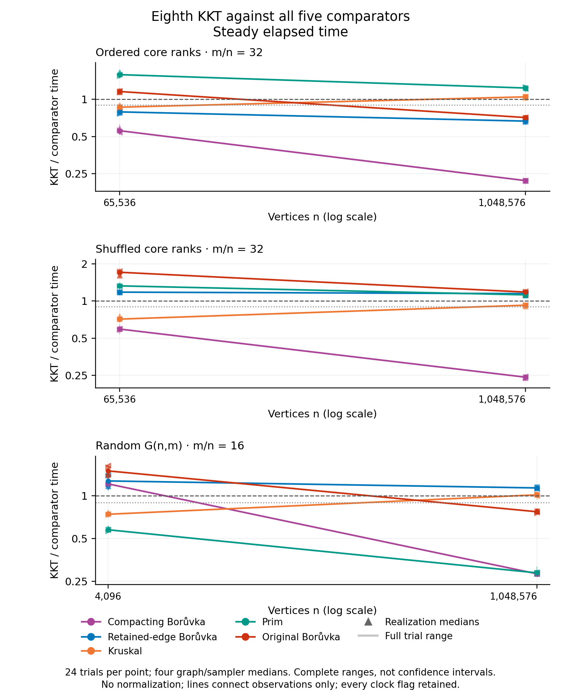
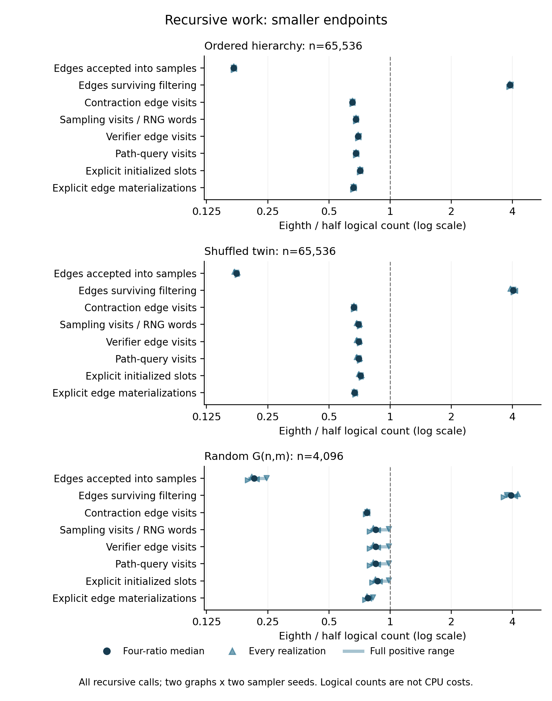
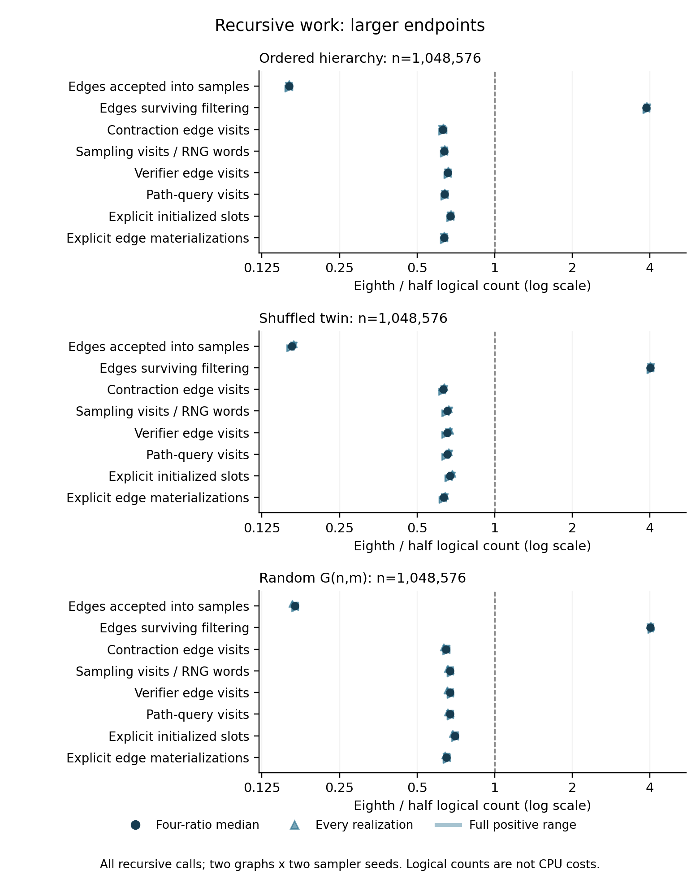
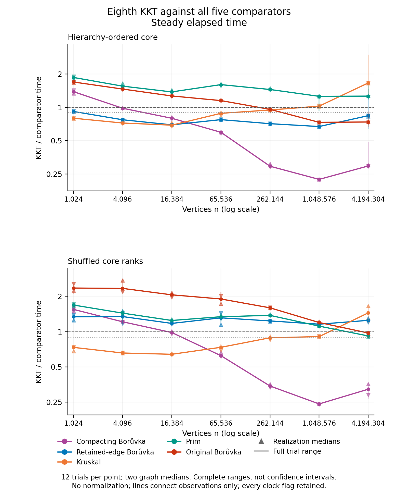
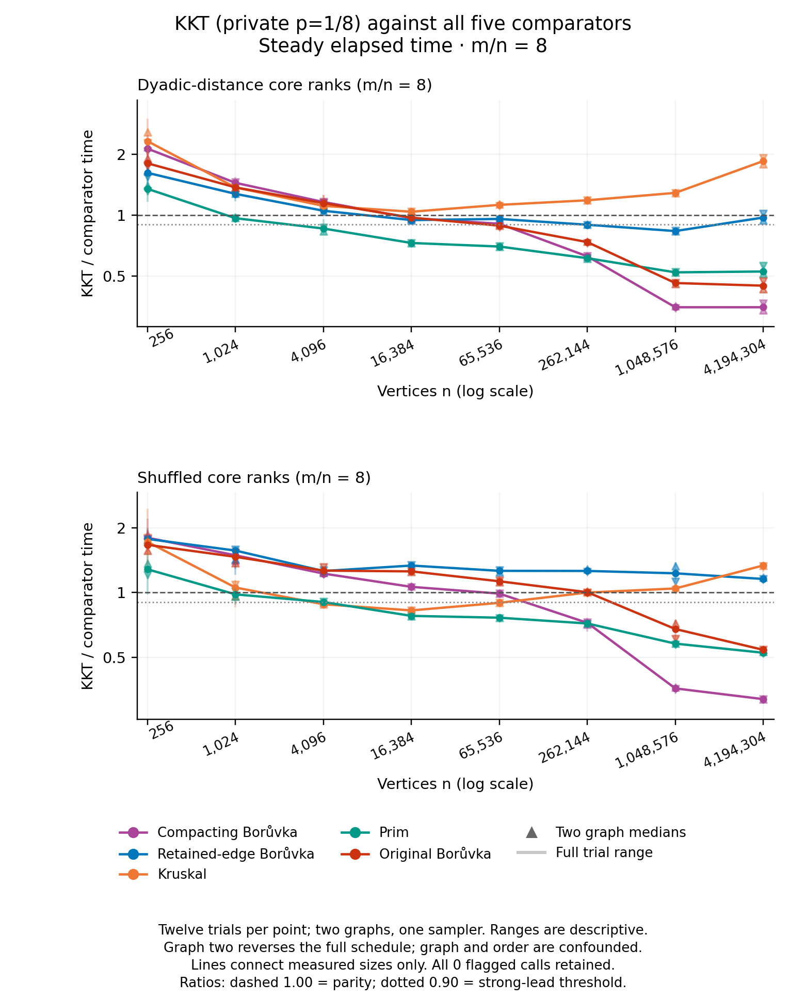

# KKT in practice: implementation repairs, measured scaling, and the graph structures that change the comparison

**Evidence cutoff: 15 October 2026.** This edition covers the completed implementation experiments, hierarchy and distance size ladders, current Google Benchmark campaign, and lower-density timing and untimed work studies. Their full captures passed strict reanalysis and independent numerical or counter audits. No partial campaign is used as evidence. Historical Markdown, HTML and PDF editions remain unchanged.

The original implementation had defects that prevented its operations from matching the local accounting behind KKT's expected-linear bound. Those defects were repaired. Subsequent experiments also found substantial reductions in constants. However, being much faster than the original KKT program is different from being the fastest MST implementation on a particular graph.

The lower-density follow-up now finds the requested **sustained strong crossover against retained-edge Borůvka** on distance-ranked attachments at m=16n: **(512,8,192]**, maintained through every measured size up to 2,097,152. Its largest-size wall/CPU ratio is **0.708792/0.708792**. The density 8 ladder reverses to mixed graph results at 4M; shuffled twins lose throughout. Kruskal beats all largest endpoints, so this is a specific useful KKT family, not an all-solver or universal asymptotic victory.

The completed hierarchy size extension confirms a practical retained-edge Borůvka lead for private-eighth-sampling KKT on ordered attachment graphs: narrow at **1,024 vertices**, strong at every measured size from **4,096 through 4,194,304**. Wall ratios are **0.67130 at 1M and 0.84144 at 4M**. The margin weakens at the largest size, where only nine of twelve trials win despite strong graph medians. The smallest point already wins, so this is not an observed losing-to-winning crossover against retained B. Shuffled twins lose to retained B throughout, and no case makes KKT the fastest of all six solvers by the declared medians.

The new distance-ranked attachment campaign adds a second favorable synthetic weight arrangement: **0.68067 wall and 0.68042 CPU** against retained B at 1M, with all 72 distance-ranked trial pairs winning on both clocks. It again starts with a narrow 1K lead, so no retained-B loss-to-win crossover is observed. Its topology-identical shuffled twins lose every retained-B pair. Weight organization, not graph shape alone, selects these favorable cases; the broader spatial/random losses remain part of the evidence.

The preceding half-policy size extension remains an essential caution. Its KKT/retained-B ratios were **1.1181, 0.9674 and 1.0786** at 65,536, 1,048,576 and 4,194,304 vertices: a narrow intermediate lead disappeared. Against original Borůvka, that same study found **1.6442, 1.0111 and 0.8861**, a strong bracket against that comparator. The separate eighth extension now reaches 4M with the strong but variable median lead described above. Different policies and campaigns cannot be spliced into one curve; the half-policy reversal remains part of the evidence.

The requested complexity estimator was used historically: **Google Benchmark**, rather than GoogleTest, supplies that feature. Its earlier results do not support a universal statement of linear measured runtime. Five later historical family fits have finite-window exponents between 1.113 and 1.185, and none receives the built-in linear label. Those measurements precede the current retained-edge, direct-input and compressed-query experimental path. The completed current-executable study also selects N log N for every KKT curve; none receives a linear label. This finite runtime observation remains separate from the expected operation bound.

These conclusions are about exact implementations, inputs and measurement boundaries. The report does not infer an astronomical universal crossover from Big-O, extrapolate a three-point curve indefinitely, or treat a local implementation study as an independently published verdict about whether KKT belongs on an encyclopedic list of galactic algorithms.

## 1. Which implementation, input size and problem?

All comparisons solve the minimum spanning tree problem: find a connected acyclic set of edges with minimum total weight. Disconnected correctness fixtures use the corresponding minimum spanning forest objective. Dijkstra was explicitly replaced by Borůvka in the requested comparison. Dijkstra minimizes distances from a source, which is a different objective: with AB=2, BC=3 and AC=4, the shortest-path tree from A uses AB and AC, while the MST uses AB and BC.

Let **n** be the represented vertex count, **m** the number of undirected edge records, and **N=n+m** the input size. On a fixed-density family with m=dn, linear in N is also linear in n. On a complete graph, m=n(n−1)/2, so linear input work is quadratic in vertices. The distinction also matters after contraction: parallel records can remain even though the number of quotient vertices becomes small.

“Current KKT” needs a build qualification. The experiments introduce opt-in paths, and not every measured optimization is combined with every other one:

| Path discussed | Quotient contraction | Verifier | Private sampling | Evidence at this cutoff |
|---|---|---|---|---|
| Repaired ordinary behavior | Deduplicate parallel pairs | Tuple input, individual requests | Scalar half | Historical repaired/default measurements |
| Retention experiment | Retain crossing records | Tuple, individual requests | Scalar half | Paired screen and stronger-control follow-up complete |
| Direct-Edge experiment | Retain crossing records | Direct Edge input, individual requests | Scalar half | Paired experiment and density screen complete |
| Packed sampling | Retain crossing records | Direct Edge, individual requests | Packed half | Separate paired experiment complete |
| Compressed queries | Retain crossing records | Direct Edge, shared requests | Scalar half | Paired experiment, common-family and larger screens complete |
| Half versus eighth | Retain crossing records | Direct Edge, shared requests | Scalar half versus scalar eighth | Paired timing, work diagnostics and seven-size extension complete |
| Packed plus compressed | Retain crossing records | Direct Edge, shared requests | Packed half | Source preparation only |

The ordinary build still selects deduplication, tuple input, individual queries and scalar half sampling. Public legacy sampling is separately preserved. Having experimental source in a checkout does not mean that path is selected, promoted, or represented by historical default timings. Fresh reference builds also matter: a source refactor can change generated code even when it preserves behavior.

To reproduce the current opt-in path, the [reviewed build recipe](../../../../benchmark/build_eighth_sampling.py) uses `KKT_EXPERIMENT_RETAIN_PARALLEL` and `KKT_EXPERIMENT_EDGE_VIEW`, adds `KKT_EXPERIMENT_COMPRESSED_QUERIES` when compiling `verifier/verifier_v2.cpp`, and adds `KKT_EXPERIMENT_EIGHTH_SAMPLING` when compiling the eighth variant's `kkt/kkt.cpp`. The executable at `bin/eighth-sampling/timing-build/eighth/retention_control` is an ignored local build artifact, not part of the publication bundle. Its tracked [build record](../../../../benchmark/results/eighth-sampling-2026-10-15/validation/timing-build-eighth-build-record.json) and [freeze](../../../../benchmark/results/eighth-sampling-2026-10-15/freeze.json) retain its hash identity and recipe evidence. Use the study's [bounded reproduction procedure][eighth-study] and full provenance checks; these flags alone do not reproduce its environment or measurements. This remains an experimental build, not a promotion into the ordinary default.

All local report links now target evidence in the current eighth repository, including the committed copy of the completed packed study and its archived tested helper. The [copy receipt][packed-copy] records that transfer; its original-machine native paths and build dependencies remain unchanged. Final tracked/copied-link completeness still requires its separate gate, so local path placement alone is not a portable native rebuild claim. The [historical report][historical] and each study's own freeze remain the authority for their recorded sources and timings.

## 2. Why the original program paid more than the algorithm required

The recognizable KKT structure was already present in original revision `693c6a5`: contract, sample, recursively solve the sample, filter heavy edges, and recursively solve what remains. The problem was that some ostensibly local operations depended on the original problem size or performed superlinear preprocessing.

### Original edge IDs controlled recursive storage

Let R=1+max(original edge ID). Contractions initialized R-sized tracking arrays, recursive calls allocated R-sized result storage, and merging scanned the same range. Even when IDs were dense, R described the root edge list rather than the current recursive input. A child containing a dozen edges could still initialize and scan storage associated with millions of original edges.

This invalidates the premise that a recursive node's own work is bounded by a constant times its own input. A weighted hierarchical path can retain a main branch through logarithmically many contraction levels. Because a tree has no removable heavy edges, repeatedly scanning an original range proportional to n contributes superlinear bookkeeping. Sparse IDs make the defect more severe: changing an ID can enlarge R without adding any represented graph data. Negative IDs and overflowing the old integer maximum-ID calculation also expose correctness boundaries.

Revision `60c65b4` made original IDs payload. Selected IDs accumulate in vectors, and local tracking uses positions in the current edge array. Legacy maximum-ID metadata was widened and stopped governing allocation. The essential repair was the domain of bookkeeping, not a blanket preference for one container type. A bitmap is cheap only when the range being cleared and scanned is appropriate to the problem being solved.

### The median lookup table was expensive to build

The heavy-edge verifier reduces a tree to a full branching tree and uses a table over depth masks. The old table builder repeatedly enumerated subset members. In an h-bit universe, the total number of included bits across all subsets is h·2^(h−1). One slice of the old preprocessing therefore already required Ω(h·2^h) work. For an equal-depth full binary instance with L=2^h leaves, that is Ω(L log L).

Revision `312954e` replaced repeated enumeration with a recurrence that removes extreme set bits and reuses an already computed inner-mask answer. Each mask takes constant word work. The table is linear in the relevant reduced input because this reduction gives every original leaf the same depth and every internal node at least two children: L≥2^h, so the allocated mask table has at most 2L entries.

Equal leaf depth is a necessary part of that argument. An arbitrary binary tree can be highly unbalanced. Merely saying “full branching tree” without checking the property produced by the source would leave a gap in the accounting. The repair and structural regression tests are linked from the historical report; this defect can be identified from source without fitting timings.

### Sampling restarted the same global stream

The old sampler called `srand(seed)` again inside recursive sampling. It replayed prefixes and changed process-global state. Revision `ccb833f` introduced one continuing private MT19937 stream per invocation. Repeating a whole invocation with a chosen seed remains intentional, but recursion no longer restarts the same prefix at every sample.

This change restores the intended discipline of taking fresh choices conditional on the recursive problem. It does not make a finite deterministic PRNG a literal sequence of independent mathematical coins. Nor was repeated seeding, by itself, evidence that the returned MST was wrong: the sampling analysis and the correctness of a particular returned tree are separate questions.

### Benchmark repairs were a different category

The old benchmark fixed n=10,000 while increasing m from 1.25 million to 20 million. That primarily swept density. It also reused a default generation seed, lacked independent certification of measured outputs, and excluded KKT's tuple-to-internal input conversion from its loop. Those limitations restrict what its curves establish; they should not be misreported as algorithmic speedups.

Other repairs addressed a Prim/KKT global Edge-type collision, distinct test seeds, exact unique-MST ID checks and reproducible builds. Comparing only an integer sum was insufficient because the legacy cost helper can overflow. Exact IDs and tuple metadata now establish a much stronger result than an accidentally matching sum.

After the structural fixes, six accepted constant reductions removed local heavy-edge hashing, linked query lists, selected-edge adjacency construction, sampled-forest recovery hashing, temporary graph copies and repeated final hash-table bucket growth. Their commits are `4eb3ca1`, `2749ced`, `2e37b4e`, `af12309`, `ba39977` and `2d4fbf1`. Each preserved a stated invariant such as caller IDs, edge order, sampling draws or returned membership. A minimum-edge cost cache was rejected: doubling that per-vertex working set brought some small gains but about a 6% largest-case regression.

The historical repair study measured, for example, **62.66 ms → 13.99 ms** at n=4,096 and m=524,288, a paired 4.54× improvement. The separate practical campaign improved all 39 case medians, with final/baseline ratios about 0.393–0.969. Those are useful results, but their inputs and timing boundaries differ. They cannot be multiplied with later gains to create an unmeasured end-to-end speedup. Complete original repairs, accepted changes and rejected results remain in the [historical evidence][historical].

## 3. Expected linear work is a conditional source claim

KKT combines safe-edge contraction with sampled-forest filtering. If an edge is heavier than the maximum edge on a forest path connecting its endpoints, the cycle property excludes it from the MST. The sampled forest need not itself be part of the final MST. When endpoints lie in different forest components, that edge remains light and cannot be removed by this test.

The primary paper supplies the crucial sampling bound: if each edge is selected independently with probability p and F is the sample's MSF, the expected number of F-light edges is at most n/p. Its stated contraction deletes loops, isolates and duplicate quotient edges, and its algorithm chooses p=1/2. Those are the published ingredients; retaining all crossing parallel records is a separate implementation extension. [Karger, Klein and Tarjan, §§2–4](https://people.csail.mit.edu/karger/Papers/mst.pdf).

The local source argument uses the implementation contract examined here: valid loop-free undirected inputs, distinct edge IDs and weights, and represented integer bounds; normalization handles isolated vertices. These are conditions of this implementation study, not universal restrictions on MST theory: equal weights can be ordered consistently. After two contractions, let q≤n/4 be the surviving vertex count and r≤m the crossing records. Sampling each record independently gives expected sample size pr. Processing distinct-weight records in increasing order shows why the light-edge bound also works with parallels and a disconnected sample: a light record is recognized before its own coin is exposed, and each accepted light record adds one forest edge. The expected accepted count is at most q. Thus the expected light count is at most q/p. Finished components and isolates cannot enlarge the surviving quotient.

Assume all nonrecursive work is at most c(m+n), the verifier is linear, and the next random choices obey the stated conditional model. Seeking E[T(n,m)]≤Am+Bn gives sufficient conditions

> A ≥ c / (1 − p),     B ≥ 2c + A / (2p).

For half sampling, A=2c and B=4c suffice; for eighth sampling, A=8c/7 and B=46c/7 suffice. These are our accounting bounds from the [fixed-probability note][sampling-theory], not measured constants. Every fixed p strictly between zero and one admits such a bound. Arbitrarily changing p with size requires another argument. Empty dispatches are charged to their parents, with an O(1) addition for an entirely empty input.

This explains both why the original root-sized bookkeeping was unacceptable and why fewer sampled edges are not automatically better. Reducing p lowers the sample branch's expected edge count but weakens the later light-edge bound. Both branches must be solved, and the parent still pays for verification. The simple proxy pr+q/p captures that tradeoff but omits actual branch costs, forest shape, allocation and data access.

The verifier also needs scrutiny. The audit covers geometric reduction, mask-table construction, LCA preprocessing and aggregate path-query work. It finds no obvious remaining asymptotic factor in those audited phases, but it is not a formal proof of every C++ execution. Public result hashing assumes expected constant-cost operations; masks, counts and memory must remain representable. The mathematical model does not supply a machine-independent runtime coefficient or a new high-probability theorem for this retained-parallel implementation.

The most defensible theoretical statement is therefore **expected O(n+m) under the documented input, primitive-cost and randomness assumptions**. It does not mean all finite time/N curves must be flat, all families must favor KKT, or every comparator must actually realize its worst-case upper bound.

## 4. What Google Benchmark actually measured

GoogleTest supplies correctness and structural checks. Google Benchmark supplies the requested complexity fit through `SetComplexityN(n+m)` and `Complexity(oAuto)`. The repository pins version 1.5.2. Its implementation selects a model using CPU measurements and then fits real/manual measurements to that selected model. Automatic choices come from a small zero-intercept menu: constant, log N, N, N log N, N² and N³. The printed normalized RMS describes residual fit quality; a selected label is not a complexity proof. [Pinned Google Benchmark implementation](https://raw.githubusercontent.com/google/benchmark/v1.5.2/src/complexity.cc).

The historical diagnostics additionally fit exported manual times independently, including a free power cN^α and restricted windows. The later five-family run used infrastructure revision `c9ed4ca`, with production KKT unchanged from `2d4fbf1`, and checked the algorithms/boundary against `1a3fc3c`. It contains nine doubling sizes through 262,144, three graph seeds, two algorithms and three batches of three calls: 810 records representing 2,430 calls. Its Bazel O3/NDEBUG profile is separate from the later native comparison profile.

| Historical family | Full-window α | Upper-window α | Counted work/N, first → last | Built-in KKT label |
|---|---:|---:|---:|---|
| Bipartite small side 16 | 1.126 | 1.173 | 7.31 → 7.20 | N log N |
| Ring of 16-cliques | 1.185 | 1.309 | 9.19 → 9.15 | N² |
| 3D grid, distance ranks | 1.113 | 1.100 | 17.66 → 18.50 | N log N |
| 90% attached leaves | 1.115 | 1.102 | 11.43 → 14.05 | N log N |
| Degree-eight regular | 1.157 | 1.167 | 24.68 → 32.45 | N log N |

None received N. The clique example is particularly instructive: a free-power exponent of 1.185 accompanies the menu's N² choice. Earlier diagnostics found a star exponent near 1.001, sparse random 1.175 and denser random 1.379. These are finite summaries for named revisions and generators. They neither refute an expected upper bound nor prove that observed superlinearity will persist indefinitely.

[Historical normalized-time figure](../../figures/complexity_normalized.png): the earlier repaired source, not the current experimental executable. It remains in the supplementary gallery below.

The small-cover and clique work proxies are almost flat per N while their measured time/N rises. That is evidence that these counted events alone do not explain timing. It is not a measurement of cache misses or allocator time. Other families also increase work per input, so finite structural changes matter: small dense quotients can deduplicate almost completely while larger fixed-degree inputs retain many more distinct component pairs.

The historical registration order was fixed, and its ratio summaries differ from the rotating paired studies. Startup load averages were nontrivial; they are not CPU-utilization percentages. Short-window fits, intercepts, memory effects and host history can all affect the selected model. The analysis retains these limitations and all observations instead of silently treating a convenient fitted label as the answer.

### Current experimental executable: all choices are N log N

The [completed current study][current-google] uses the same eighth-sampling production objects as the comparison studies, with a new pinned Google Benchmark main. It contains three families, two algorithms and eleven doubling sizes n=1,024…1,048,576; N=n+m, with m=32n for ordered/shuffled attachments and m=16n for connected G(n,m). All 2,376 calls (1,584 timed, 792 warmups) and 792 certificates remain. Two graph seeds and two sampler labels create four KKT curves per family; retained-edge Borůvka ignores the sampler label and repeats only two distinct graph inputs. Repetitions also reuse inputs. G1 sizes ascend and G2 descend, so graph identity and size order are confounded.

**Google selects N log N for all 24 curves, including all twelve KKT curves.** The independent six-model analysis likewise favors N log N in all 192 curve/clock/window combinations. The table retains each exported choice; RMS is the library-CPU residual percentage, not uncertainty.

| Family / algorithm | G1/S1 | G1/S2 | G2/S1 | G2/S2 | CPU RMS range |
|---|---|---|---|---|---:|
| Ordered hierarchy / KKT | N log N | N log N | N log N | N log N | 3.62–16.91% |
| Ordered hierarchy / Retained B | N log N | N log N | N log N | N log N | 8.11–24.11% |
| Shuffled twin / KKT | N log N | N log N | N log N | N log N | 3.22–3.77% |
| Shuffled twin / Retained B | N log N | N log N | N log N | N log N | 6.43–8.55% |
| Connected G(n,m) / KKT | N log N | N log N | N log N | N log N | 5.25–5.61% |
| Connected G(n,m) / Retained B | N log N | N log N | N log N | N log N | 7.12–10.67% |

Normalized native CPU time rises at the large end for both algorithms in every family. Ordered KKT is favorable against retained B over much of this range; shuffled and random KKT remain more expensive at the large endpoints. Small points are irregular: random KKT at n=1,024 has CPU/N of 85.56–88.90 ns for G1 versus 26.11–27.17 ns for G2, with elevated small G1 points also in the control. No point is trimmed and graph/order confounding prevents causal attribution. Full ranges are observed calls, not confidence intervals. Separately scheduled absolute medians do not establish a paired crossover.

All four clocks remain separate: native steady elapsed time, native process CPU, Google manual time and Google CPU. Google's CPU interval includes different loop/timer work from the native interval above. Its CPU-selected model determines both CPU and manual coefficients. Only CPU RMS is exported; manual RMS is independently reconstructed, and each coefficient's unit is validated. The full-window page retains all six alternatives for every curve.

Full11 uses 33 two-call means per curve/clock. The predetermined upper6 uses 18 means over n=32,768…1,048,576; its highlighted minimum is a custom fit, not another Google result. All upper-window choices also remain N log N. KKT's descriptive native-CPU log–log exponents over that window are 1.1267–1.1313 ordered, 1.1470–1.1591 shuffled and 1.1599–1.1616 random. Those slopes are hash-bound analysis outputs, not independently re-audited quantities.

The independent audit reconstructs all 3,168 means, 1,152 fits and 24 Google selections/coefficient semantics; size summaries, slopes, flags and ordinary library aggregates have a narrower hash-binding check. Zero-intercept models, large-duration points and only two graphs limit identification. Fixed m/n does not determine a general two-variable bound. These results do not establish linear measured runtime, nor do they refute expected O(m+n) operations.

There are zero clock flags and logged sleep overlaps. The native campaign took 58.291004 minutes, with peak sampled owned-group RSS 4.3583 GiB and zero unavailable observations; all groups exited. Sleep inhibition was unverified. Older Google macOS metadata may report Mach tick rate as frequency, and its scaling flag does not establish stable thermals. All eleven figures passed original-resolution QA. Complete clocks, coefficients, all models and raw evidence are linked in the study.

## 5. A fair practical comparison needs six implementations

The later studies keep KKT, Kruskal, Prim and three Borůvka implementations. Original Borůvka scans its original tuple graph while updating component information. Deduplicating compacting Borůvka repeatedly rebuilds a simple quotient. Retained-edge Borůvka repeats exactly the cheaper retained-parallel contraction used by experimental KKT, with comparable selected-ID accumulation and final result construction.

That third Borůvka is the decisive control. Otherwise a KKT gain from avoiding expensive deduplication could be credited to random sampling. Giving both methods the same contraction asks whether KKT's *whole continuation* repays its extra sampling, recursion, forest construction and verifier work. It still does not prove that every possible Borůvka, Prim or Kruskal implementation is fully optimized.

The [Prim source][prim-source] also makes a worst-case label easy to overinterpret. It keeps at most one tentative `std::set` entry per vertex. Adjacency construction and its 2m edge-record scan are linear; set updates occur only on successful tentative improvements. If there are u improvements, a useful upper bound is O(m+(n+u) log n), with u≤m. On the ordered cheap core path, visited core vertices form an interval and the next core vertex is reached through a path edge. Chords are still checked, but only actual improvements update the set. We did not measure u or its CPU cost. This source distinction explains why an O(m log n) worst-case bound does not force a finite observed crossover against Prim.

Practical sampled-forest filtering also predates this implementation. Katriel, Sanders and Träff's 2003 **I-Max-Filter** chooses p=√(n/m), balancing sampled edges pm against the n/p filtering bound. It uses Prim's vertex order and interval-maximum tables, with expected O(m+n log n) time; it is a different algorithm from KKT. Their experiments include uniform random weights, vertex-index distances, stretched geometric graphs and inputs requiring many Prim priority-queue updates. Filtering helps dense inputs difficult for Prim, while random weights can favor Prim. These are results for their implementation and machines, not measurements of ours. The square-root density balance in our adaptive-rate proposal is therefore prior art, and neither their study nor our six-solver comparison establishes superiority over all practical MST algorithms. [Author-hosted paper, sections 1–3](https://ae.iti.kit.edu/documents/people/sanders/papers/filter.pdf).

All solvers start from the same tuple edge list. For KKT and the two ID-returning continuations, the interval includes conversion to their internal input and destruction of the temporary input. Output construction is timed, while returned-result checking and destruction are outside. Tuple-returning algorithms retain their actual APIs. Generation, reference certification and validation are outside every interval. An application already maintaining another graph representation might obtain a different ranking, especially for Prim.

Current six-solver children perform one checked warmup and six timed repetitions per solver. Rotation gives each algorithm every timed position once. Case ratios are medians of paired trial ratios, not ratios of separate runtime medians. With two graphs and one sampler there are twelve ratios per case; with two graphs and two samplers there are twenty-four. Six repetitions on one realization reuse its graph and sampled forest. They are not six independently sampled graphs.

Both wall and process CPU clocks are retained. They help identify disagreement but are not replications on two machines. Full trial ranges and graph/realization medians remain descriptive rather than confidence intervals. Reversing schedule and variant order counterbalances some ordering, yet seed and order remain confounded with host history. Identical control objects can also have different timings across binary launches. Their drift is reported without subtracting it from KKT or normalizing results.

The later prespecified strong-crossover rule is deliberately demanding. At an earlier measured size, every graph/realization median on both clocks must exceed one. At a later size all must be at most 0.90, and that strong lead must hold at every still-larger measured size. Otherwise a result may be a narrow lead, a loss, mixed, or already ahead without an observed losing endpoint. Exact rational arithmetic protects threshold decisions from rounding.

This reports a bracket between observations, not a located transition. A last-point win has no demonstrated persistence beyond it. A narrow lead that disappears at the next size is a reversal. An earlier reversal does not forbid a different later qualifying bracket, but it cannot be erased from the plot. Complete comparator tables are as important as the most favorable curve.

## 6. Four later reductions in constants, kept separate

### Retain parallels when deduplication buys little

The experimental contraction retains every crossing record in physical input order, while preserving safe selections, component numbering, loop removal and isolate removal. It avoids the reference's buckets and linked traversal, reserves the exact crossing count, and uses at most three input-edge scans rather than up to four. The public simple-quotient contraction remains unchanged.

In the [ten-case retention screen][retention-screen], all 100 paired KKT trials improved on both clocks. The two large ordered families used about 48% of reference KKT's time. At one such root, deduplication removed only about 0.07% of the nearly sixteen million crossing records. Paying for it bought little immediate reduction. However, keeping parallels also changes output order, assigns random draws to different edges and can change subsequent recursion. The measurement covers that entire variant.

The fresh [six-solver control][retention-control] then gave Borůvka the same cheaper step. Retained-edge Borůvka beat KKT in all 120 pairs on both clocks. At 2,097,152 vertices and density 16, ordered KKT took about 1.120× its time despite taking only 0.381× the deduplicating compactor's time. This is the most important correction to the initial favorable interpretation: shared infrastructure improved a simpler continuation too.

### Read existing Edge records directly

KKT previously copied the reduced graph into tuples immediately before verification. A typed overload lets the verifier read its existing Edge vector. The [fresh paired experiment][edge-study] improved all ten case medians by 2.9–6.8%, with 115 of 120 trial wins on each clock. Retained-edge Borůvka still won all 120 direct comparisons.

The refactored verifier object was shared by both binaries; only the KKT call-site object differed. Instrumented gates kept 63 counters identical and reduced both edge visits and materializations by exactly the verifier-input edge count. This is stronger evidence of a specific copy removal than a timing improvement alone. It still does not make the fresh tuple reference identical to the earlier historical executable.

### Consume all bits in each private random word

Scalar half sampling uses one MT19937 word for each edge and tests one bit. Packed half sampling uses the 32 bits in order, retaining physical edge order and discarding an unused suffix at each call boundary. A nonempty call on r records uses exactly ceil(r/32) words. Public sampling and the half-size reserve remain unchanged.

The separate [packed study][packed-study] improved all six case medians by 8.1–17.7%, with all 144 paired trials faster on both clocks. Unchanged-control case ratios spanned only about 0.9926–1.0112, although that does not eliminate confounding. The small ordered case beat retained-edge Borůvka in all 24 trials; its pooled ratio was 0.8957. One realization median exceeded 0.90, so it was a narrow lead under the declared rule. At the larger endpoint the ratio became 1.0048: no growing-size crossover. Its publication evidence and [tested helper archive][packed-helper] now reside in this repository under a [copy receipt][packed-copy]; its original native binaries and machine-bound build dependencies were not copied.

Identical seed numbers produce different private samples under these policies. Work diagnostics found recursive sampling volume lower in 13 pairs and higher in 11, with median packed/scalar ratio 0.999378. Aggregate engine-word bounds, rather than directly observed totals, lay around 0.02760–0.03243 of the scalar counts. This supports much lower engine consumption without a consistent collapse of recursive edge volume. It does not establish a 32-fold solver gain or allocate the observed CPU reduction to RNG alone. Packed sampling was measured with the uncompressed verifier; its gain must not be multiplied into the next result.

### Share repeated verifier requests

For a query edge inside one sampled-forest component, its lowest common ancestor splits the path into endpoint-to-ancestor requests. A lower vertex and an ancestor depth identify one path segment. Many different edges request the same segment. The compressed candidate computes each distinct answer once, then reconstructs exactly the same per-edge heavy marks.

The [compressed-query experiment][compressed-study] shared seven production objects, including KKT, and changed only the verifier object. At the million-vertex endpoints it improved by 8.4–14.6%. All three small-case medians regressed by 2.6–7.5%. Ordered KKT/retained-B changed from 1.1167 to 0.9707, a narrow transition rather than the required 10% lead. Original Borůvka still won every direct pair. The losses are part of this implementation result, not inconvenient noise.

| Isolated experiment | KKT implementation effect | Stronger-control conclusion |
|---|---|---|
| Retained parallels | All 100 trial pairs improve; large ordered ratios about 0.48 | Fresh retained B wins 120/120 |
| Direct Edge input | Ten medians improve 2.9–6.8%; 115/120 trial wins | Retained B wins 120/120 |
| Packed half sampling | Six medians improve 8.1–17.7%; 144/144 trial wins | Small hierarchy lead weakens to large parity |
| Compressed requests | Large gains 8.4–14.6%; every small median regresses | Narrow hierarchy transition; later size reversal |

These are independently useful improvements with different equivalence guarantees. Their percentages are not factors of one measured cumulative speedup.

## 7. Why query compression helps without solving the whole problem

Let Q count logical proper-ancestor endpoint requests in one connected verifier-tree call, including duplicates, and U count distinct pairs of lower vertex and ancestor depth. If the reduced tree has B vertices and height h, each vertex can request only its own proper ancestor depths:

> U ≤ min(Q, Σᵥ depth(v)) ≤ min(Q, B·h).

Production query endpoints are the original r vertices of that component, which become equal-depth leaves. With m₀ non-loop query edges inside the component, Q=2m₀ and U≤min(Q,rh). This is a bound on a particular verifier call, not one on the original input graph's average degree. Cross-component edges and loops do not contribute those two proper requests. If Q=0, U=0 and U/Q is undefined.

The implementation stores an immutable local-request mask R[v] and a separate propagated mask D[v]. R identifies answers needed at v; D also carries descendant requests required by the traversal. Confusing them would either lose required path state or create answers at the wrong vertex. The same traversal expressions and child order compute one value per set bit of R. A final edge scan retrieves two values by popcount rank and applies the unchanged strict heavy-edge comparison.

The [query-sharing illustration](../../../../benchmark/results/compressed-query-2026-10-15/query-compression.png) depicts 24 logical endpoint requests answered by four distinct results. It is a constructed explanatory fixture, retained in the supplementary gallery.

The direct oracle checks position-based marks, duplicate and negative IDs, extreme weights, disconnected forests, loops and malformed lookups. Full-solver gates additionally check the actual selected verifier object. Equivalent answers preserve the forest and filtering decisions by source reasoning and checked deterministic outputs; the study does not claim to have recorded every intermediate forest trace.

For each completed solve in the paired work study, cumulative U/Q was only **0.2696–0.8738%**, with descriptive median 0.5194%. These are ratios of sums over that solve's verifier-tree calls, not a per-call distribution or global deduplication of requests. Yet path-query visits did not fall to half a percent. In the following identities Q and U are those cumulative sums, M sums query edges, T counts connected calls, and BΣ sums reduced-tree vertices. Exact accounting gives reference visits 4Q versus compressed 2Q+U: construction and lookup still process logical requests. Initialized slots decrease by M+Q−U+T, verifier-edge visits by M, and verifier-vertex visits increase by BΣ. All 61 other fields match, with the four changed-field identities checked separately.

Median compressed/reference ratios were about **0.4236 for initialized slots, 0.5013 for query visits and 0.6673 for verifier-edge visits**; verifier-vertex visits roughly doubled. Logical slots are heterogeneous elements, not bytes. The cached LCA array also survives longer, replacing the old per-edge maxima during traversal; local masks, offsets, compact values, recursion and allocator capacity remain relevant. A smaller answer table does not by itself establish lower peak RSS.

Compression removes duplicate answer computation and some scattered writes. It adds depth work and indexed lookups; answer intervals are not globally sequential in traversal order. Better locality is plausible, but no successful hardware profile isolates it. Even the slower small cases have over 99% duplicate requests, proving that redundancy percentage alone does not predict a timing win.

The competitor matters as much as KKT's local savings. In the compressed study's million-vertex hierarchy, retained-edge Borůvka took 19 rounds and about 17.4846–17.4849 original-edge volumes of contraction inputs. On the shuffled twins it took eight rounds and 7.3168–7.5177 volumes. Shuffled queries actually shared more answers, yet KKT/retained-B was about 1.62 instead of 0.97. Here, the improved verifier did not overcome the competing continuation's much smaller repeated-contraction volume.

## 8. Weight arrangements that make repeated contraction expensive

The ordered attachment construction isolates a particular mechanism. Write n=4c: each core vertex has three very cheap leaf edges, and the c core vertices have a forced path plus distinct nonpath chords. In `leaf_hierarchy4`, all path edges are cheaper than all chords; path weight levels force dyadic sibling-block merges. `leaf_distance4` instead orders every core edge by an ancestry tier, so some shortcuts can join the MST. The shuffled twin permutes core ranks while preserving topology, IDs, labels, physical order and cheap leaves.

Cheap attachments alone do not promise cheap edge reduction. At m=32n, the first star contraction removes 75% of vertices but only **2.34375% of edges**. The next hierarchy contraction pairs core vertices. Together the two rounds remove 87.5% of vertices while retaining **97.265625% of edge records**. A large, dense residual problem remains even though its component arrays have become small.

After k core rounds, blocks contain b=2^k consecutive core vertices. A chord remains unless both ends are in the same block. There are D=choose(c,2)−(c−1) eligible nonpath pairs, and the number internal to those blocks is

> I_b = (c / b) · choose(b, 2) − (c − c / b).

Subtracting c−c/b excludes path pairs already internal to blocks. If C=m−n+1 distinct chords are chosen uniformly, expected surviving chords are C(1−I_b/D); the remaining path contributes c/b−1 edges. Early blocks contain only a small fraction of possible pairs, so almost all chords continue crossing them.

Including the initial star input and core inputs b=1,2,4,…,c/2 gives expected contraction-input volumes **13.6115m, 17.4846m and 19.4219m** for the three larger-study sizes, over 15, 19 and 21 full contractions. This is an expectation under ideal uniform distinct-chord sampling. Tiny independent enumeration checked the combinatorial formula before rendering. It is not a same-seed work trace from the large performance campaign.

For the growing ideal uniform-chord family at fixed density d=32 (or any fixed d>1), C=Θ(m), so expected retained-contraction input volume is Θ(m log n). This is an ensemble expectation, not a per-realization Θ claim. The implementation and finite generator have bounded integer/memory domains; the formula does not predict a feasible crossover. Increasing density at fixed n pushes C/m toward one but adds no rounds. Increasing n adds levels. This explains why multiplying density can have a limited effect on the particular repeated-scan opportunity.

There is an eventual advantage in a precisely limited mathematical sense. For this ideal, unbounded family, if KKT's linear primitives and fresh independent sampling at fixed p hold uniformly, its expected RAM work is O(m). Charging both algorithms fixed positive primitive costs gives E[W_KKT]/E[W_retained B]=O(1/log n)→0. This is a ratio of expectations, not an expected per-input ratio or a guarantee for each seed. It predicts no finite clock threshold, advantage over every solver, or asymptotic theorem for the bounded seeded executable.

The feature that may generalize is persistent crossing records, not many rounds alone. Trees can contract for many levels while their edge volume falls geometrically; cheap fixed-size modules can similarly discard most records early. Hierarchical costs help this mechanism only when Θ(m) records keep crossing many component levels. Community labels or geometric drawings do not ensure that condition, and the source's community_distance4 endpoint redistribution has the same core quotient, not an independent mechanism. The topology-identical shuffled losses are controlled evidence that weight organization matters, not a theorem about all random weights.

KKT can remove heavy chords without waiting for their endpoints to enter one Borůvka component. After its first two hierarchy contractions at density 32, the root has n/8 vertices and 249m/256 edges. Half sampling gives a sample branch of expected size 249m/512, while the later light branch has expected size at most m/128. The latter small bound is attractive, but KKT must first solve the much larger sample and construct its verifier.

The witness contains 28 edges. Its chosen seven-edge sample forest contains three edges absent from the true MST, yet it certifies 18 heavy removals and leaves ten light edges containing the MST. Independent Kruskal, path and Borůvka checks produce full/sample/filtered round counts **3/2/3**. The sample can connect across hierarchy levels through edges that will not survive the final MST. That is why “the sample contains non-MST edges” does not make its filtering useless.

An edge-volume count is still not runtime. On this loop-free connected hierarchy, original Borůvka performs one full original-edge loop per productive round plus a final no-op loop: **16m, 20m and 22m** edge iterations at the three sizes. For retained contraction with summed input volume V and terminal input t, the helper performs **3V−2t** edge-loop iterations and emits V−m quotient records, besides its initial conversion. Vertex work, hashing, allocation, branches and memory accesses differ. The [baseline source accounting][baseline-mechanism] explains the distinction without assigning measured CPU costs to those operations.

## 9. Common families: historical successes and current limits

The earlier [common-family study][common-study] did find practical KKT successes against its three classical repository baselines. The repaired production source led all three by case medians on 22 of 52 labels in the primary run and 21 in the repeat. The same 21 labels led on every graph median in both runs. These labels include a deliberate fixed-256/square-root small-side alias at n=65,536, producing three duplicated weighted inputs. They are not 21 independent topology discoveries.

Small vertex covers explain the strongest historical cases. If every outside vertex connects to a cover of size k, each selected component after one Borůvka round contains a cover vertex; there are at most k components. Deduplication then bounds the residual by choose(k,2) edges. With fixed k, the recursive tail stays small while input/output work grows. At n=262,144, fixed-16 bipartite KKT took 28.542 ms versus 61.995 ms Kruskal, 290.424 ms Prim and 55.557 ms original Borůvka in the primary campaign.

That mechanism differs from cheap degree-one attachments. The bipartite examples have no leaves. Ninety-percent designated attachments offered a modest repeated Kruskal lead at larger sizes, whereas fifty-percent attachments did not. Rings of small cliques could contract most edges, but a substantial near-tree residual remained and the advantage disappeared at the largest historical point. In that campaign, every measured sparse grid variant and the regular/random controls lost to Kruskal. A high degree, many leaves or a small retained-edge percentage is not a sufficient classifier.

The historical continuation ablation favored compacting Borůvka in 18 of 20 cases. Thus even those successful four-way results did not establish that sampling was the source of the advantage. The later retained-edge control strengthens this caution. Historical wins remain valid for their competitors and revisions, but do not fill missing columns in a current six-way leaderboard.

The newer [held-out screen][heldout-study] uses compressed queries and **scalar half sampling**: six families, six sizes from 1,024 to 1,048,576, density 32, two fresh graph seeds and one sampler. “Held out” means the prospective matrix and seeds, not previously unknown family definitions. Its 72 children produced 3,024 certified outputs. All thirty family/comparator outcomes are retained:

| Family | vs dedup B | vs retained B | vs Kruskal | vs Prim | vs original B |
|---|---|---|---|---|---|
| Leaf distance | Strong bracket (16,384,262,144] | Narrow only at 1M | Loss throughout | Loss throughout | Loss throughout |
| Shuffled core | Same strong bracket | Loss throughout | Small lead reverses | Loss throughout | Loss throughout |
| Grid distance ranks | Same strong bracket | Loss throughout | Mixed at 4K, otherwise loss | Strong from 16K; no earlier strict loss | Loss throughout |
| Grid random ranks | Same strong bracket | Loss throughout | Narrow through 16K, then loss | Strong bracket (4,096,65,536] | Loss throughout |
| Line distance ranks | Same strong bracket | Loss throughout | Loss throughout | Strong at every size | Loss throughout |
| Line random ranks | Same strong bracket | Loss throughout | Small leads/mixed reverse | Strong bracket (4,096,65,536] | Loss throughout |

There are eight strong brackets: six against deduplicating Borůvka and two against Prim. None is against retained-edge Borůvka, Kruskal or original Borůvka. Original Borůvka wins **all 432 direct trial pairs on both clocks**, ruling out an all-six winner. The near-parity leaf-distance endpoint wins only seven of twelve retained-B pairs; its four graph/clock medians span 0.99355–0.99887.

At n=1,048,576, the complete five-way ratios are below. Every cell is wall/CPU. Equal rounded ratios do not imply equal raw durations.

| Family | / dedup B | / retained B | / Kruskal | / Prim | / original B |
|---|---:|---:|---:|---:|---:|
| Leaf distance | .3307/.3307 | .9960/.9959 | 1.5426/1.5426 | 1.3348/1.3348 | 1.0336/1.0336 |
| Shuffled core | .3433/.3433 | 1.5772/1.5772 | 1.3238/1.3238 | 1.5920/1.5920 | 1.5550/1.5550 |
| Grid distance | .3691/.3691 | 1.4106/1.4106 | 1.4791/1.4791 | .4405/.4405 | 1.1762/1.1762 |
| Grid random | .3589/.3589 | 1.5645/1.5645 | 1.3327/1.3327 | .5553/.5553 | 1.4406/1.4406 |
| Line distance | .3581/.3581 | 1.6387/1.6387 | 1.5460/1.5460 | .1723/.1723 | 1.2717/1.2717 |
| Line random | .3600/.3600 | 1.5402/1.5402 | 1.3380/1.3380 | .5389/.5389 | 1.4166/1.4166 |

The strong line-distance result against Prim is real, but other solvers remain faster. These line/grid fixtures have path or jittered-grid scaffolds plus shortcuts. They are not road networks, k-nearest-neighbor graphs or pure planar meshes. Distinct distance ranks need not satisfy a triangle inequality. At the smallest attachment size the core is 50/51 complete, whereas larger cores maintain average degree 250 with much smaller occupancy.

Line gaps come from 1…1,024 with a fixed tie order. Full-graph contractions remain intervals, and each round removes all boundaries of the smallest remaining gap. That finite alphabet bounds their rounds by 1,024 as well as by the usual halving bound. It does not apply to arbitrary recursive sampled subgraphs. A geometry label alone therefore supplies no unlimited logarithmic separation.

The [completed untimed follow-up][spatial-work] checks the same 72 fingerprints, 216 outputs and 144 full comparator replay chains. At 1M, ordered attachments require 19 retained-B rounds and 51.49 contraction-edge visits per original edge; shuffled twins require 8–9 rounds and 21.20–22.66 visits. KKT's corresponding visits are 11.65 and 10.74–10.99. Grid-distance needs eleven comparator rounds, line-distance nine. These counts support a repeated-contraction mechanism but cannot convert heterogeneous work into CPU time.

Existing [small graph illustrations][spatial-views] help interpret construction, with their own explicit sizes, seeds and older contraction stages. They are not downsampled million-vertex inputs or traces of the latest binary. A [historical browser receipt][historical-browser-qa] records 70 stage checks, desktop/mobile controls and offline behavior passing for identified old edition hashes. That receipt applies to those historical hashes; it does not validate the current viewer or this edition.

The separately generated [current root-stage viewer][current-viewer] uses the exact ordered/shuffled n=1,024, m=32,768 fixtures with graph seed 17000011 and sampler seed 2801. Its export, independent graph checks and timing-input join passed. It reconstructs two contractions, half/eighth root samples and heavy-edge filtering; it is neither a full recursion trace nor a half/eighth timing comparison. Complete data are embedded while background drawing is capped at 512 edges, with essential forest edges retained. The earlier [readiness receipt][current-viewer-status] and fresh [browser-policy receipt][current-viewer-browser-policy] leave desktop/mobile interaction and visual QA incomplete. The new CUA attempt found no in-app browser; Chrome explicitly rejected the local file URL before loading and prohibited workarounds. No localhost server, republishing or alternate-surface bypass was attempted. This is a delivery restriction, not a rendered-viewer failure or interactive-validation pass.

## 10. Half sampling at four million vertices: one crossover and one reversal

The [larger hierarchy study][larger-study] reuses the exact compressed-query, scalar-half executable at n=65,536, 1,048,576 and 4,194,304, with m=32n. Its two weight twins and two fresh graphs produce twelve children, 504 validated outputs and 432 timed calls. All 720 paired clock ratios, 396 summary rows, thirty point states, thirty endpoint pairs and ten outcomes agree with an independent raw audit.

The full [half-policy wall comparisons](../../../../benchmark/results/larger-hierarchy-2026-10-15/figures-attempt01/ratios_wall.png) remain linked rather than repeated as a page-sized figure. All five comparators, both weight twins and every measured size remain in the table and gallery.

| Family / n | / dedup B, wall/CPU | / retained B | / Kruskal | / Prim | / original B |
|---|---:|---:|---:|---:|---:|
| Hierarchy 65,536 | .8077/.8077 | 1.1181/1.1181 | 1.2702/1.2702 | 2.2681/2.2681 | 1.6442/1.6442 |
| Hierarchy 1,048,576 | .3191/.3191 | .9674/.9674 | 1.5101/1.5101 | 1.7631/1.7630 | 1.0111/1.0111 |
| Hierarchy 4,194,304 | .3924/.3923 | 1.0786/1.0784 | 2.1109/2.1106 | 1.6817/1.6816 | .8861/.8860 |
| Shuffled 65,536 | .8607/.8607 | 1.7382/1.7382 | 1.1059/1.1059 | 1.9909/1.9909 | 2.5197/2.5197 |
| Shuffled 1,048,576 | .3386/.3386 | 1.5199/1.5199 | 1.3048/1.3047 | 1.5310/1.5309 | 1.5613/1.5612 |
| Shuffled 4,194,304 | .3994/.3991 | 1.5337/1.5342 | 1.6799/1.6796 | 1.3598/1.3586 | 1.2785/1.2778 |

Hierarchy versus retained B is **loss → narrow lead → loss**. At 1M KKT wins eleven of twelve trial pairs, with graph/clock medians 0.96375–0.97358. At 4M it wins none, with medians 1.07229–1.08749. Treating the intermediate sign change as the beginning of eventual dominance would have been premature.

Hierarchy versus original B is **loss → loss → strong lead**. All four graph/clock medians exceed one at 1M and lie between 0.88254 and 0.88614 at 4M. The declared bracket is therefore **(1,048,576,4,194,304]**. All twelve largest trial pairs favor KKT, although not every individual trial has a ten-percent margin. There is no measured point beyond the upper endpoint, and no interpolated crossing is claimed.

The other eight outcomes remain visible: both families already strongly lead dedup B at every size; shuffled retained B and both families' Kruskal/Prim comparisons lose throughout; shuffled original B also loses throughout. Across 72 pairs per comparator and clock, KKT wins 72 against dedup B, eleven against retained B, zero against Kruskal, zero against Prim and fifteen against original B. No input becomes an all-six-solver winner.

[Half-policy CPU comparisons](../../../../benchmark/results/larger-hierarchy-2026-10-15/figures-attempt01/ratios_cpu.png) preserve the complete second clock, including the retained-B reversal.

At 4M and **134,217,728 edges**, ordered median wall times are **21.818 s KKT, 55.312 s dedup B, 20.249 s retained B, 10.313 s Kruskal, 12.894 s Prim and 24.604 s original B**. Shuffled KKT takes 17.232 s, versus 11.325 s retained B and 10.236 s Kruskal. Absolute time medians provide scale; they are not substitutes for the paired-ratio statistic.

[Half-policy absolute wall times](../../../../benchmark/results/larger-hierarchy-2026-10-15/figures-attempt01/times_wall.png) retain all six solvers.

The earlier direct-Edge [density screen][density-study] also warns against an easy density explanation. It reached 67 million edges at density 64, yet retained B won all 96 pairs on both clocks; ordered KKT was 4.2–12.0% slower and shuffled KKT 73.7–88.6% slower. Those data use an earlier verifier and separate seeds, so they are not pooled with this larger study. Together they motivate testing specific implementation costs, rather than increasing density until a desired plot appears.

[Half-policy absolute CPU times](../../../../benchmark/results/larger-hierarchy-2026-10-15/figures-attempt01/times_cpu.png) use matching wall/CPU panel bounds.

All six larger-study figures, including the two analytic illustrations above, have original-resolution visual QA from two reviewers. The theoretical retention curves are explicitly not measured counters from these 4M timing children.

## 11. Eighth sampling: a substantial retained-B lead, with clear limits

The [completed rate experiment][eighth-study] changes only the private scalar predicate: half accepts `(word & 1) == 1`, while eighth accepts `(word & 7) == 7`. Both consume one MT19937 word per visited edge. Both retain reserve(m/2), compressed verifier queries, direct Edge input and parallel quotient records. The public sampler remains half sampling, and the ordinary build is unchanged. Only the KKT object differs; seven production objects and the timing main are physically shared. This is an **opt-in implementation result**, separate from packed-bit sampling.

Fresh half and eighth binaries ran the same six cases, two graph seeds and two sampler seeds, with six timed repetitions per realization. Every one of the **144 paired KKT trials improved on both clocks**. The six case medians use **24.6–32.0% less time**; no historical timing is pooled into this comparison.

| Case | Eighth/half wall | Process CPU |
|---|---:|---:|
| Ordered 65,536 | 0.70977 | 0.70977 |
| Ordered 1,048,576 | 0.69269 | 0.69270 |
| Shuffled 65,536 | 0.68019 | 0.68020 |
| Shuffled 1,048,576 | 0.71311 | 0.71311 |
| G(n,m) 4,096 | 0.75383 | 0.75380 |
| G(n,m) 1,048,576 | 0.74988 | 0.74988 |

Unchanged-control case ratios span **0.97735–1.03339** across both clocks. Their drift is displayed without correction or subtraction. Four graph/sampler realizations are not 24 independent graphs, repeated seeds reproduce a realization, and wall/CPU agreement is not an independent replication.

The full direct comparison is more informative than the implementation gain alone. Each cell below is **wall/CPU**, the median of 24 paired KKT/comparator ratios. Values below one favor eighth KKT. Attachment cases use m/n=32; G(n,m) uses 16.

| Eighth case | Dedup B | Retained B | Kruskal | Prim | Original B |
|---|---:|---:|---:|---:|---:|
| Ordered 65,536 | 0.5564/0.5564 | **0.7891/0.7891** | 0.8612/0.8613 | 1.5769/1.5769 | 1.1523/1.1523 |
| Ordered 1,048,576 | 0.2200/0.2200 | **0.6648/0.6648** | 1.0435/1.0435 | 1.2301/1.2301 | 0.7103/0.7103 |
| Shuffled 65,536 | 0.5930/0.5930 | 1.1794/1.1794 | 0.7138/0.7138 | 1.3254/1.3254 | 1.7076/1.7076 |
| Shuffled 1,048,576 | 0.2420/0.2421 | 1.1472/1.1472 | 0.9248/0.9248 | 1.1216/1.1216 | 1.1808/1.1808 |
| G(n,m) 4,096 | 1.2157/1.2150 | 1.2748/1.2745 | 0.7432/0.7429 | 0.5780/0.5780 | 1.5003/1.4993 |
| G(n,m) 1,048,576 | 0.2832/0.2832 | 1.1384/1.1384 | 1.0182/1.0182 | 0.2875/0.2875 | 0.7740/0.7740 |

The ordered retained-B lead is substantial: about **21.1% less time at 65K and 33.5% at 1M**. All 24 trial ratios at each size are below one on each clock. At 1M, wall realization medians range from 0.66118 to 0.67697, and even the largest individual wall ratio is 0.69830. However, both endpoints already strongly lead. Within that paired study there is no smaller observed loss from which to claim a size crossover. The separate completed extension below adds sizes through 4M without pooling the campaigns.

All shuffled and G(n,m) trials still lose to retained B. Across the complete 144 pairs per comparator and clock, eighth KKT wins 120 against dedup B, 48 against retained B, 101 against Kruskal, 48 against Prim and 48 against original B. On ordered 1M, Kruskal wins 22/24 and Prim all 24. The fastest available solver remains family-dependent; there is no all-six winner.

At ordered 1M and 33,554,432 edges, median wall times are **2.402 s KKT, 3.623 s retained B, 10.946 s dedup B, 2.298 s Kruskal, 1.957 s Prim and 3.398 s original B**. Dividing these absolute medians does not reproduce a median of paired ratios. The [complete both-clock tables][eighth-comparisons] retain both policies and every realization/range; the [30 classifications][eighth-classifications] retain reversals as well as successes. Eighth establishes loss-to-strong-lead brackets against original B on hierarchy and G(n,m), and against dedup B on G(n,m). Its earlier Kruskal leads instead become losses at the large hierarchy and G(n,m) endpoints.

The source tradeoff helps explain why testing p was worthwhile. After the ordered 1M graph's first two contractions, q=131,072 and r=32,636,928. Changing p from 1/2 to 1/8 reduces expected sample edges from **16,318,464 to 4,079,616**, while increasing the expected-light-edge bound from **262,144 to 1,048,576**. Those are theoretical expectations/bounds, not measured branch counts or a CPU breakdown. Recursive forests and RNG positions can differ despite equal initial seed numbers.

The separate [completed work study][eighth-work] now checks all 48 corresponding instrumented inputs, 144 certified outputs, 96 comparator replay chains and 1,000 round rows. An independent audit reconstructs all 9,360 counter cells and 1,608 ratio records, retaining undefined both-zero cases. It confirms unchanged comparator continuations and initial KKT contraction dimensions, while allowing the later recursion to change. The [independent mechanism review][eighth-work-review] supports a narrower conclusion than a CPU profile: a smaller sample branch can outweigh more surviving edges in several important kinds of recursive work.

For ordered 1M, median paired eighth/half ratios are **0.1591 accepted sample edges, 0.6364 sampling visits, 0.6281 contraction edge visits, 0.6738 initialized slots and 0.6356 explicit edge materializations**. Cumulative filtered survivors instead grow **3.8808×**. Both policies still draw one scalar RNG word per visited sampling edge; the lower word total comes from fewer later visits, not fewer words during a given scan. Accepted-edge totals fall by more than fourfold because both acceptance probability and cumulative sampling volume fall. These are four paired realization ratios per case, with two graph seeds and two sampler seeds, not four independent graphs.

The two figures retain all six cases and eight fields selected before diagnostics. Every realization reduces its seven displayed non-filter fields and increases filtered survivors. Small G(n,m) sampling-visit ratios range from **0.7936 to 0.9840**, so savings are not uniformly large. Across all 1,560 paired fields, **774 decrease, 491 increase and 295 are equal**; 59 ratios are both-zero and remain explicit. These fields mix volumes, calls, depths and operations and cannot be added into a runtime score. The 96 unmeasured comparator hash-insertion cells remain null.

Survivors sum over recursive verifier calls; they are neither root survival probabilities nor disjoint edge sets. Query sharing also changes: ordered 1M's per-solve cumulative U/Q spans **0.7908–0.8959% for half** and **1.2792–1.4944% for eighth**, while total path-query visits still fall by a median 36.2%. These are ratios of cumulative per-call counts, not a distribution of individual calls or global uniqueness. The measured work supports the timing improvement without isolating cache misses, allocator effects or CPU attribution. Retained B still wins the shuffled and random timing cases.

All 2,016 solver outputs passed validation. Strict analysis and the independent exact-arithmetic raw audit agree on 4,608 ratios, 3,024 summary rows and all 30 classifications. Native and ASan/UBSan profiles each passed 20 positive suites plus four wrong-policy negatives; full-solver gates preserve 1,344 input/MSF pairs, and the fresh half path replays the parent's 65 counters. Final linked-object checks are separate. All ten standalone timing figures passed original-resolution visual QA; two of those timing figures are embedded here, alongside the two separate work figures.

### The completed seven-size extension: useful, but not universal

The [prospectively declared size ladder][eighth-extension] reuses the exact eighth binary with all five controls. Its fourteen cases pair ordered and shuffled core weights at seven sizes from 1,024 to 4,194,304, m=32n, two fresh graph seeds and one sampler. The declaration preceded inspection of the paired eighth results. All 28 children passed: 1,176 certified outputs, including 1,008 timed calls and 168 warmups. An independent raw audit agrees on all 1,680 ratios, 924 summary rows, seventy point states, 210 endpoint pairs and ten outcomes. This is a new size campaign, not a half/eighth implementation comparison.

| n | Ordered KKT/retained B wall/CPU | Shuffled KKT/retained B wall/CPU |
|---:|---:|---:|
| 1,024 | 0.9179/0.9195 | 1.3398/1.3392 |
| 4,096 | 0.7730/0.7727 | 1.3444/1.3441 |
| 16,384 | 0.6956/0.6955 | 1.1752/1.1757 |
| 65,536 | 0.7750/0.7750 | 1.3116/1.3117 |
| 262,144 | 0.7124/0.7124 | 1.2340/1.2340 |
| 1,048,576 | 0.6713/0.6713 | 1.1571/1.1571 |
| 4,194,304 | 0.8414/0.8413 | 1.2482/1.2481 |

The ordered case is a **narrow lead at 1,024 and a strong lead at all six larger points**, on both graphs and clocks. There is no smaller measured loss, hence no retained-B crossover bracket under the declared definition. Every ordered trial through 1M wins. At 4M, however, only **9/12** trials win per clock: wall ratios range **0.64095–1.46180**, CPU **0.64862–1.44673**. Its four graph/clock medians remain 0.83103–0.84144. The strong median classification and the three individual losses must be stated together. All 84 shuffled retained-B pairs lose on both clocks.

The complete ten family/comparator conclusions are:

| Comparator | Ordered hierarchy | Shuffled core ranks |
|---|---|---|
| Dedup B | Strong sustained bracket **(1,024,16,384]** | Strong sustained bracket **(4,096,65,536]** |
| Retained B | Narrow then strong leads; no measured lower loss | Loss at every size |
| Kruskal | Early strong leads reverse to losses at 1M and 4M | Early strong leads reverse to a loss at 4M |
| Prim | Loss at every size by graph/clock medians | Loss through 1M; narrow lead at 4M |
| Original B | Strong sustained bracket **(65,536,1,048,576]** | Loss through 1M; narrow lead at 4M |

Each bracket requires a smaller loss and a later at-least-10% lead on both graphs/clocks, maintained at every larger measured size. It supplies a measured interval, not an interpolated crossing or a promise beyond 4M. The other seven outcomes are not hidden. At ordered 4M, wall/CPU ratios against dedup B, Kruskal, Prim and original B are **.2960/.2969, 1.6616/1.6618, 1.2638/1.2640 and .7379/.7379**. The [full both-clock table and ranges][extension-comparisons] retain all fourteen cases.

KKT beats Prim in fourteen of 168 pairs per clock: two ordered-1M pairs and all twelve shuffled-4M pairs. One ordered-1M wall repetition beats all five controls simultaneously; no CPU repetition does. There is no case-level all-six winner by the declared medians. Small-case wins against Kruskal reverse as size grows, and the retained-B margin is nonmonotonic. These details rule out a general “larger means KKT dominates” claim.

The full extension's [absolute wall times](../../../../benchmark/results/eighth-extension-2026-10-15/figures-paper-attempt03/paper_times_wall.png) and [absolute CPU times](../../../../benchmark/results/eighth-extension-2026-10-15/figures-paper-attempt03/paper_times_cpu.png) retain all six solvers in the supplementary gallery.

At ordered 4M, wall medians are **17.752 s KKT, 57.310 s dedup B, 19.683 s retained B, 10.416 s Kruskal, 14.116 s Prim and 24.211 s original B**. KKT's wall range is 15.153–36.876 s; no slow call is trimmed. These are absolute medians, not the inputs to a ratio-of-medians substitution. Both CPU figures and all exact data remain linked in the study; all four standalone PNGs passed visual inspection. Page-scale QA remains separate.

This extension measures timing, not a new counter breakdown. The earlier retention theorem and paired work results provide qualified structural explanations, not substituted per-input measurements. The nearly complete 256-vertex core at the smallest size becomes proportionally sparser along the ladder despite fixed average core degree 250. The largest input reaches the existing n and m limits exactly. Two graph seeds and one repeated sampler, reversed schedules and a finite machine leave substantial limits on generalization.

### Distance-ranked cores: another useful weight arrangement

The [completed distance study][eighth-distance] retains the same eighth binary and all five controls, with fresh graph seeds 21000011/21000041 and sampler 3203. Twelve cases cover distance/shuffled twins at six sizes, 1,024 through 1,048,576, with m=32n. All 24 children and 1,008 outputs passed; the independent audit agrees on 1,440 paired ratios, 792 summary rows and all ten outcomes. No half-policy timing or historical control is pooled.

| n | Distance KKT / retained B, wall / CPU | Shuffled KKT / retained B, wall / CPU |
|---:|---:|---:|
| 1,024 | .937703/.937932 | 1.847185/1.846045 |
| 4,096 | .797872/.797999 | 1.418369/1.418314 |
| 16,384 | .717690/.719921 | 1.276525/1.276478 |
| 65,536 | .787462/.787712 | 1.177434/1.177430 |
| 262,144 | .719496/.720126 | 1.213465/1.214256 |
| 1,048,576 | .680665/.680418 | 1.156119/1.156126 |

All 72 distance trial pairs beat retained B on each clock; all 72 shuffled pairs lose. The five larger distance points meet the strong criterion on both graphs/clocks, but the smallest already narrowly leads. Thus the second family also supplies a practical advantage without an observed lower losing endpoint. At 1M, the distance wall trial range is .630696–.745135 and the CPU range .632049–.743753. The four graph/clock medians span .671389–.684276. The margin is not monotonic across sizes.

Three strong brackets are observed: distance versus compacting B **(1,024,16,384]**, shuffled versus compacting B **(4,096,65,536]**, and distance versus original B **(65,536,1,048,576]**. The last has no larger measured point. The other seven outcomes remain: distance retained B narrow then strong; distance Kruskal strong through 65K, narrow at 262K, then a 1M loss; distance Prim loss through 65K, mixed at 262K and narrow at 1M; shuffled retained B, Prim and original B lose throughout by graph/clock medians; shuffled Kruskal strongly leads through 262K and narrowly at 1M.

At distance 1M, KKT/comparator wall/CPU ratios are **.2225/.2224** against compacting B, **1.0292/1.0313** against Kruskal, **.9081/.9080** against Prim and **.7200/.7199** against original B. The Prim lead misses the declared 10% threshold. There is no all-six case winner. Five wall repetitions and four CPU repetitions beat all five controls simultaneously, which does not change that case-level conclusion. The [full table][distance-comparisons] preserves all twelve cases and both clocks.

Separate wall runtime medians at distance 1M are 2.4776 s for KKT, 3.6089 s for retained B, 2.3509 s for Kruskal and 2.6771 s for Prim. These describe absolute cost; their quotient is not the paired-ratio median above. The family orders all core edges by dyadic ancestry, unlike the hierarchy construction that makes every path edge cheaper than every chord. Some shortcuts can enter its MST. Rank weights need not be metric distances, and these engineered attachments are not road or nearest-neighbor workloads. This run supplies timing, not new counters or a causal hardware profile. Its earlier half-policy measurements remain separate rather than serving as an implementation-effect estimate.

### Lower densities: a sustained retained-B crossover, and a reversal

The [completed lower-density study][lower-study] finally supplies a losing-to-winning bracket against the shared retained-edge continuation. **Distance-ranked attachments at m=16n cross from a loss at n=512 to a strong lead by n=8,192, maintained at every measured size through n=2,097,152.** The m=8n ladder is a counterexample to extrapolation: its strong intermediate lead weakens to mixed results at 4M. Shuffled twins lose every retained-B pair at both densities.

The unchanged eighth binary and all six solvers run thirty cases. Density 16 uses n=512, 2,048, 8,192, 32,768, 131,072, 524,288 and 2,097,152; density 8 uses n=256, 1,024, 4,096, 16,384, 65,536, 262,144, 1,048,576 and 4,194,304. Fresh graph seeds 23000003/23000029 and sampler 3407 were declared before this campaign, after the density 32 results. This targeted follow-up is not an unbiased family survey. All 60 children and 2,520 outputs passed, including 2,160 timed calls / 360 warmups. The independent audit reconstructs 3,600 paired clock ratios, 1,980 summaries, 150 point states, 490 endpoint pairs and all 20 outcomes.

Each ladder fixes m=dn and N=(d+1)n. Average core degree is fixed while occupancy falls with size: the smallest cores occupy 122/127 of possible pairs at d16 and 58/63 at d8. Fixed density does not isolate cache, occupancy or other finite-size effects. Both largest inputs have 33,554,432 edges but different vertex counts; they are not equivalent graphs. Distance ranks encode dyadic ancestry, not necessarily geometric or triangle-inequality distances. The shuffled control preserves topology, IDs, labels, tuple order, cheap leaves and the exact weight multiset.

The following complete outcome table uses **L** for loss on all four graph/clock medians, **N** for all four <1 without all four ≤0.90, **S** for all four ≤0.90, and **M** for mixed/tied. The two chronological ladders above define every position. A strong bracket requires an earlier L, a later S, and S at every remaining measured size; exact fractions decide the thresholds. The representative bracket uses the earliest qualifying upper point and nearest earlier loss. It is not an interpolated threshold or evidence beyond the last observation.

| d / weights | Comparator | States in declared size order | Strong observed bracket |
|---|---|---|---|
| 16 / distance | Dedup B | L,L,N,S,S,S,S | (2,048, 32,768] |
| 16 / distance | Retained B | L,N,S,S,S,S,S | (512, 8,192] |
| 16 / distance | Kruskal | L,N,S,N,M,L,L | None |
| 16 / distance | Prim | L,L,N,S,S,S,S | (2,048, 32,768] |
| 16 / distance | Original B | L,L,L,L,N,S,S | (32,768, 524,288] |
| 16 / shuffled | Dedup B | L,L,L,N,S,S,S | (8,192, 131,072] |
| 16 / shuffled | Retained B | L,L,L,L,L,L,L | None |
| 16 / shuffled | Kruskal | N,S,S,S,N,N,L | None |
| 16 / shuffled | Prim | L,L,L,M,L,N,S | (131,072, 2,097,152]; final point only |
| 16 / shuffled | Original B | L,L,L,L,L,L,S | (524,288, 2,097,152]; final point only |
| 8 / distance | Dedup B | L,L,L,N,N,S,S,S | (4,096, 262,144] |
| 8 / distance | Retained B | L,L,L,N,N,S,S,M | None |
| 8 / distance | Kruskal | L,L,L,L,L,L,L,L | None |
| 8 / distance | Prim | L,N,S,S,S,S,S,S | (256, 4,096] |
| 8 / distance | Original B | L,L,L,N,S,S,S,S | (4,096, 65,536] |
| 8 / shuffled | Dedup B | L,L,L,L,N,S,S,S | (16,384, 262,144] |
| 8 / shuffled | Retained B | L,L,L,L,L,L,L,L | None |
| 8 / shuffled | Kruskal | L,M,S,S,S,N,L,L | None |
| 8 / shuffled | Prim | L,M,N,S,S,S,S,S | (256, 16,384] |
| 8 / shuffled | Original B | L,L,L,L,L,M,S,S | (65,536, 1,048,576] |

**Thirteen of the twenty outcomes have a qualifying strong bracket**, only one against retained B and none against Kruskal. There are 102 qualifying endpoint pairs among the 490 enumerated endpoint pairs. The two shuffled-d16 brackets ending at 2M have no larger measured point. Earlier KKT leads versus Kruskal reverse; the d8 distance comparison loses to Kruskal at every size. Every current baseline column remains below; each cell is the largest-size pooled **wall/CPU paired-ratio median**, not a ratio of separate runtime medians.

| d / weights | Largest n | / dedup B | / retained B | / Kruskal | / Prim | / original B |
|---|---:|---:|---:|---:|---:|---:|
| 16 / distance | 2,097,152 | 0.2425/0.2425 | 0.7088/0.7088 | 1.2152/1.2152 | 0.6281/0.6281 | 0.5299/0.5299 |
| 16 / shuffled | 2,097,152 | 0.2729/0.2729 | 1.1219/1.1219 | 1.0815/1.0815 | 0.7431/0.7431 | 0.8186/0.8186 |
| 8 / distance | 4,194,304 | 0.3509/0.3509 | 0.9726/0.9726 | 1.8485/1.8485 | 0.5267/0.5267 | 0.4484/0.4484 |
| 8 / shuffled | 4,194,304 | 0.3199/0.3199 | 1.1558/1.1558 | 1.3355/1.3355 | 0.5253/0.5253 | 0.5419/0.5419 |

For distance d16, retained-B ratios are **1.142253/1.143671** at 512, **0.940215/0.940332** at 2,048, **0.820461/0.820453** at 8,192 and **0.708792/0.708792** at 2M. The four graph/clock medians move from 1.119160–1.190358 at the losing point to 0.819951–0.821838 at 8,192. All 60 trials across the five strong suffix sizes beat retained B by more than 10% on both clocks. At 2M, all twelve win; wall ratios range 0.685811–0.731127 and CPU 0.685810–0.731122, with graph/clock medians 0.706646–0.711577. This is a clear observed crossover for this implementation and synthetic family, with only two graphs and one repeated sampler.

For distance d8, the full retained-B sequence is **L,L,L,N,N,S,S,M**. Its pooled ratios improve to 0.896108/0.896118 at 262K and 0.834133/0.834133 at 1M, then deteriorate to **0.972608/0.972607 at 4M**. There only seven of twelve trials win on each clock. Graph/clock medians span 0.941382–1.015940, wall trials 0.931099–1.023289 and CPU 0.931095–1.023291. The pooled value below one hides a graph-level loss; the final reversal invalidates a sustained strong bracket. Shuffled weights lose all 180 retained-B pairs per clock across the two densities.

No case is fastest against all five controls by either all graph/clock medians or both pooled clock medians. Seven individual trials per clock do beat all five: five distance-d16 trials at 131,072 and two at 524,288, all on graph 23000029. These isolated wins do not establish a case-level all-six winner. At every largest endpoint Kruskal wins all twelve pairs. The [complete paired table][lower-comparisons] retains all thirty cases, both clocks, graph medians and trial ranges; the [point states][lower-points] and [bracket table][lower-brackets] retain every earlier lead and reversal.

All four standalone and eight repaired paper PNGs passed original-resolution review; root independently reviewed the eight paper pages. The first paper attempt had a legend/x-label collision and remains archived. The accepted second attempt changes only presentation margins, preserving exact plotted values. Its two pages above use 7.1×8.8-inch canvases and specified text ≥8.5pt.

Absolute medians give scale. At distance d16/2M, wall times are **2.8306 s KKT, 11.7042 s dedup B, 3.9828 s retained B, 2.3332 s Kruskal, 4.5059 s Prim and 5.3505 s original B**; KKT ranges 2.7586–2.8941 s. At distance d8/4M, they are **4.4784, 12.7942, 4.6048, 2.4387, 8.4535 and 9.9960 s** in the same order, with KKT ranging 4.3265–4.6678 s. Ratios must still come from paired calls. Repetitions reuse inputs; reversed graph order leaves graph/host-history confounding. Historical and current campaigns are not pooled.

### What the matched work diagnostics explain

The [separate untimed companion][lower-work] repeats all sixty timing fingerprints. Its 180 certified solver outputs passed strict reload and an independent raw audit: all **11,700 counter cells, 120 full comparator chains, 1,236 round rows, 60 query rows and 30 topology twins** agree. Scalar engine words equal sampling-edge visits exactly; unmeasured comparator insertions remain null. The full sixty inputs and all 65 counters are retained, including the timing losses. These diagnostics are not another runtime comparison.

The following largest-size ranges retain both graph seeds. Every row has m=33,554,432. Retained-B input volume is the sum of edge counts over its full contraction chain; KKT input volume sums contraction inputs across its entire recursion. These are named logical counts, not interchangeable units of CPU cost. Q and U are also cumulative over the solve's verifier-tree calls.

| d / weights | n | Retained-B rounds | Retained-B input/m | KKT contraction input/m | U/Q |
|---|---:|---:|---:|---:|---:|
| 16 / distance | 2,097,152 | 20 | 17.9059–17.9066 | 2.4031–2.4037 | 3.5913–3.5941% |
| 16 / shuffled | 2,097,152 | 8–9 | 7.3141–7.9232 | 2.2889–2.2895 | 0.9110–0.9203% |
| 8 / distance | 4,194,304 | 21 | 17.6875–17.6876 | 2.5231–2.5233 | 6.6664–6.7194% |
| 8 / shuffled | 4,194,304 | 9 | 7.5173–7.5700 | 2.2937–2.2943 | 1.9932–2.0151% |

Ordered weights make retained B revisit a large crossing-edge population through many rounds. Shuffling substantially shortens that chain. KKT itself uses slightly less contraction input on the shuffled twins, yet loses those timing comparisons: which family favors KKT depends on what the competitor avoids as well as what KKT filters. The [complete round table][lower-rounds] and [counter table][lower-work-counts] retain every intermediate size, rather than only these endpoints.

The density-8 reversal has an additional measured distinction. At ordered 4M, graph seeds 23000003 and 23000029 have similar KKT contraction-edge visits, about **7.570m**, but verifier-edge visits are **2.7463m and 4.7531m**. Source accounting isolates the wrapper that partitions a disconnected forest into trees: its cumulative visits are **11,478,993 and 78,826,591**. Their difference accounts for the verifier-visit difference up to a −11,760 change in remaining verifier work. The [exact partition decomposition][lower-partition] covers all sixty inputs.

Further [integer bounds][lower-root-inference] identify the root path for these two graphs. The first graph's partition visits are below its 29,884,416 root edges, while total filtered survivors are also below that count; these exclude both a nonempty disconnected root forest and an empty one. Its root forest is therefore connected. For the second graph, all nonroot calls could contribute at most 20,446,074 partition visits, below the observed 78,826,591, so the root forest must be nonempty and disconnected. Across the full sixty-input matrix, the bounds establish 59 connected roots and this one disconnected root. This is an inference from source identities and aggregate inequalities, not a per-call trace, isolated-vertex count or CPU attribution. Avoiding extra query partitioning and copying on this path is a concrete next implementation target; that change is unimplemented and no gain has been measured.

Source reasoning still gives the ordered root q=n/8 and r=(d−7/8)n after two contractions. With p=1/8, the root light-edge expectation bound q/p is n, or m/d; lower density therefore weakens that normalized bound. The measured cumulative filtered survivors are 0.0878m–0.0881m at the distance-d16 endpoint and 0.1761m–0.1762m at distance-d8. These totals span recursion, not just the root, and the endpoints have different vertex counts. Neither the bound nor this comparison isolates an optimal sampling policy. All [six work figures][lower-work-figures] remain supplementary; counters do not measure allocator internals, memory bandwidth or CPU attribution.

## 12. Correctness, reproducibility and the remaining empirical limits

Each performance input receives an independent MST certificate: source membership, unique IDs, acyclic connectivity and cycle optimality. Every timed call and warmup must reproduce its exact unique-MST IDs; tuple-returning solvers also have endpoints and weights checked. This certifies the measured outputs. It does not prove support for every malformed input, arbitrary tied-weight convention or integer domain outside the declared contract.

Native and sanitizer suites exercise the implementation changes separately. Positional verifier oracles use independent forest-path walks. Contraction tests reconstruct selected components and quotients independently. Sampling gates check prescribed words, partial blocks, private dispatch and public-stream preservation. Wrong-policy and wrong-linked-object negatives ensure that a test cannot pass merely because both paths accidentally ran the reference. Final uninstrumented object sets are validated separately from instrumented correctness builds.

The recent timing profile is native arm64 on Apple M3 Max with 128 GiB, macOS 26.6.2, Apple Clang 15, C++17, O3, native tuning, assertions and a 512 MiB main stack. Clang 22 ASan/UBSan checks are a separate correctness profile. Controller architecture is not inferred to be binary architecture: the native artifact is inspected. No cross-machine generalization is measured.

Protocols, cases, seeds, boundaries and binaries are frozen before capture. Receipts bind source, build recipes, logs, physical objects, binaries, commands and parent proofs. Raw integer endpoints, every result, clock flags and failed attempts remain. Independent numerical audits reconstruct the ratios and summaries without importing collector aggregation. Negative tests mutate identities and numeric values separately, so they exercise arithmetic rather than only file hashes.

Resource monitoring bounds whole owned process groups and requires affirmative empty-group observations after native exit. The larger half-policy capture took **82.4218 minutes** and peaked at **29.7508 GiB sampled group RSS**. Held-out timing took **54.1279 minutes** and sampled at most **8.2377 GiB**. The paired eighth campaign took **65.3455 minutes**, peaked at **8.33675 GiB**, and completed all 48 empty groups with no unavailable RSS observations or clock flags. The completed eighth hierarchy extension took **86.6785 minutes**, peaked at **28.1561 GiB sampled group RSS**, and verified all 28 groups empty with zero unavailable observations or clock flags. The distance campaign took **15.1378 minutes**, sampled **7.4441 GiB** at most across 490 observations, and verified all 24 groups empty with zero unavailable samples or clock flags. The lower-density native campaign took **41.590633 minutes**, peaked at **7.451889 GiB sampled owned-group RSS**, and retained two unavailable observations among 1,341 RSS requests. All sixty native groups and the outer group were verified empty; there were zero clock flags. These are campaign/resource observations, not algorithm runtimes or continuous solver-specific memory peaks. Caffeinate attempts failed; successful power-log queries and absent logged overlap do not prove sleep inhibition, stable thermals or an idle host.

Failures were kept rather than relabeled as successful evidence. The old held-out diagnostic frontend rejected spatial families before generation. Its separate repair only expanded the family allowlist, linking the same eight production objects; the fresh full matrix reused none of the earlier partial outputs. A first link failed from injected cross-architecture search paths and was preserved before a recorded environment correction. Earlier plot attempts with missing or inaccurate legends are likewise archived; corrected visuals retain the same plotted values.

These practices make results reviewable and reduce avoidable error. They do not remove small seed counts, ordering confounds, fixed host conditions or unmeasured hardware effects. Work counters omit allocator internals, implicit vector relocation, hash collisions and instructions. Final-set insertion work that was not instrumented is recorded as unmeasured, not zero. A mechanism is strongest where source reasoning, independent counts and timing agree, with each retaining its own scope.

## 13. What remains open at this cutoff

The old astronomical estimate came from fitted equations with coefficients 4.67 and 2357; their assumed intersection is N=2^(2357/4.67), approximately 9×10^151. That is conditional extrapolation, not an observed threshold or lower bound. Small changes in a coefficient ratio move such an intersection exponentially. Later implementations and stronger comparators cannot inherit those historical constants. [Original implementation post](https://chico.dev/Linear-Time-MST/).

A strong retained-B advantage now exists at all six measured hierarchy-attachment sizes from 4,096 through 4M and all five measured distance-ranked sizes from 4,096 through 1M; each smallest 1,024-vertex point already narrowly leads. The hierarchy margin weakens at 4M and some individual trials lose. The completed d16 ladder now additionally supplies a losing endpoint and a sustained retained-B bracket; d8 reverses at 4M. What remains open is robustness across more graph/sampler realizations and how broadly the advantage extends beyond these engineered weight arrangements. The six-solver comparison must remain intact: clear wins over retained B do not erase Prim's hierarchy advantage, Kruskal's distance-1M win, or the losses on shuffled and random inputs.

| Investigation | Scope | Status at this cutoff |
|---|---|---|
| Current Google Benchmark | Three families, two algorithms, eleven sizes, explicit N=n+m | Completed: all 24 exported choices and all 192 custom clock/window choices are N log N; raw arithmetic and figures audited |
| Lower-density distance/shuffled ladders | Seven density-16 sizes and eight density-8 sizes, all six solvers, fresh seeds | Completed timing/audit: thirteen outcomes have qualifying brackets; distance d16 retained B (512,8,192] is sustained through 2M; distance d8 reverses at 4M; no all-six case winner |
| Lower-density work companion | Sixty fingerprint-matched inputs, three instrumented solvers and complete comparator chains | Completed: all 11,700 cells and 120 chains independently audited; ordered weights retain more repeated-scan work, and the d8 endpoint exposes differing disconnected-forest overhead |
| Packed plus compressed | Shared compressed verifier and separate private sampler change | No measured combined gain |
| Complete hierarchical metric | Complete graphs n=64…16,384, exact metric and matched shuffled-weight twin | Source/math review only; no performance result |

The completed [seven-size hierarchy ladder][eighth-extension], [six-size distance ladder][eighth-distance] and [two lower-density ladders][lower-study] are measured evidence above. Future proposals remain separate; a source declaration, readiness receipt or freeze alone is not a measurement. No historical timing is pooled to estimate an unmeasured implementation effect.

The dense metric proposal is also deliberately qualified. Complete topology and compact tier weights preserve dyadic Borůvka rounds while satisfying an ordinary triangle inequality; distinct perturbations make it different from an exact ultrametric. Retained contraction has Θ(m log n) input volume. However, its deduplicated quotient is complete on geometrically fewer vertices, with total volume (2n²−3n+1)/3=Θ(m). Even its theory therefore does not predict a six-way win. At m=Θ(n²), any complexity axis must use represented input, and a dense-array Prim would be another relevant future implementation.

Unrun proposals do not establish an implementation gain or a new favorable family. The completed evidence already answers the original implementation question: some apparent impracticality came from repairable accounting defects and costly representations. The remaining scientific question concerns which complete algorithm, with which constants and graph reductions, wins against comparably engineered alternatives over an explicitly observed domain.

## Evidence and publication notes

This edition cites completed reports and their independently audited canonical tables. Its thirteen embedded figures use accepted paper layouts, while duplicate-clock, absolute-time and historical figures remain explicitly linked below. This is a presentation choice, not removal of numerical evidence. Edition-level rendering, pagination, link verification and page-scale visual checks are recorded separately from the studies’ scientific validation.

The packed evidence copy contains the tracked study plus an archived helper, with the copied README's helper link corrected under its receipt. Native build records preserve their original machine paths and object dependencies. Relative publication links and copied figures make the text/evidence collection easier to move; they do not make the historical native proof a self-contained portable rebuild. Native dependency validation and publication link checks have separate scopes.

### Complete supplementary figure and table gallery

Every clock and comparator remains available. Images use their original accepted attempts; no timing curve is pooled with a different campaign. The linked study reports retain protocols, raw integers, certificates, audits, full ranges and reproduction commands. SVG/PDF counterparts and original-resolution QA accompany each gallery.

| Evidence | Complete figures and both-clock tables |
|---|---|
| Lower-density ladders | [All paired ratios and ranges][lower-comparisons], [all 150 point states][lower-points], [all 490 endpoint pairs][lower-brackets], [all eight paper figures](../../../../benchmark/results/lower-density-2026-10-15/README.md#figures-and-retained-presentation-attempts), [complete timing study][lower-study] |
| Lower-density work | [All six figures][lower-work-figures], [all 65 counters][lower-work-counts], [all comparator rounds][lower-rounds], [query counts][lower-query], [partition decomposition][lower-partition] and [complete work report][lower-work] |
| Current complexity | [All standalone clocks and models](../../../../benchmark/results/current-complexity-2026-10-15/figures-attempt01/README.md), [all six paper layouts](../../../../benchmark/results/current-complexity-2026-10-15/paper-figures-attempt01/README.md), [all model fits](../../../../benchmark/results/current-complexity-2026-10-15/analysis-attempt01/model_fits.csv), [complete study][current-google] |
| Historical complexity | [Normalized figure](../../figures/complexity_normalized.png) and [historical report][historical]; these are not the current opt-in binary |
| Query compression | [Constructed sharing schematic](../../../../benchmark/results/compressed-query-2026-10-15/query-compression.png) and [complete study][compressed-study] |
| Half-policy 4M ladder | [Wall ratios](../../../../benchmark/results/larger-hierarchy-2026-10-15/figures-attempt01/ratios_wall.png), [CPU ratios](../../../../benchmark/results/larger-hierarchy-2026-10-15/figures-attempt01/ratios_cpu.png), [wall times](../../../../benchmark/results/larger-hierarchy-2026-10-15/figures-attempt01/times_wall.png), [CPU times](../../../../benchmark/results/larger-hierarchy-2026-10-15/figures-attempt01/times_cpu.png), [study][larger-study] |
| Paired half/eighth | [All ten original figures](../../../../benchmark/results/eighth-sampling-2026-10-15/figures-attempt01/README.md), [paper CPU implementation effect](../../../../benchmark/results/eighth-sampling-2026-10-15/figures-paper-attempt02/paper_variant_gains_cpu.png), [paper CPU direct comparisons](../../../../benchmark/results/eighth-sampling-2026-10-15/figures-paper-attempt02/paper_eighth_ratios_cpu.png), [all comparisons][eighth-comparisons] |
| Paired recursive work | [Complete audited work report][eighth-work], [all 65-field statuses][eighth-work-review] and [original six-panel figure](../../../../benchmark/results/eighth-sampling-2026-10-15/work/figures-attempt01/work_ratios.png); no undefined ratios are dropped |
| Eighth hierarchy size extension | [CPU ratios](../../../../benchmark/results/eighth-extension-2026-10-15/figures-paper-attempt03/paper_ratios_cpu.png), [wall times](../../../../benchmark/results/eighth-extension-2026-10-15/figures-paper-attempt03/paper_times_wall.png), [CPU times](../../../../benchmark/results/eighth-extension-2026-10-15/figures-paper-attempt03/paper_times_cpu.png), [all comparisons][extension-comparisons] |
| Eighth distance ladder | [CPU ratios](../../../../benchmark/results/eighth-distance-2026-10-15/figures-paper-attempt01/paper_ratios_cpu.png), [wall times](../../../../benchmark/results/eighth-distance-2026-10-15/figures-paper-attempt01/paper_times_wall.png), [CPU times](../../../../benchmark/results/eighth-distance-2026-10-15/figures-paper-attempt01/paper_times_cpu.png), [all comparisons][distance-comparisons] |
| Earlier family/implementation screens | [Common families][common-study], [retained-edge control][retention-control], [Edge view][edge-study], [density][density-study], [packed sampler][packed-study], [held-out spatial/random families][heldout-study] and [held-out work][spatial-work] |

The current Google native-CPU normalized-time and both model-window pages are included above; its other three clock views and all 1,152 fits remain linked. Lower-density timing and all twelve standalone/paper figures are complete and reviewed. The two wall-ratio pages appear above; both CPU counterparts and all six-solver absolute-time pages remain in the linked gallery. The lower-density work supplement adds six reviewed figures without expanding the thirteen main figures.

| Evidence | Scope and revision anchor |
|---|---|
| [Historical report][historical] and [common families][common-study] | Original `693c6a5`, repairs and final historical production `2d4fbf1`; common infrastructure `c9ed4ca` |
| [Retention screen][retention-screen] | Opt-in source `ae03ec6`; screen freeze/declaration `36b8ea7` |
| [Shared contraction control][retention-control] | Six-solver native/protocol `1bc827d`; pre-capture freeze `727d43c` |
| [Direct Edge][edge-study] and [density][density-study] | Edge source `b7aa02b`; separately frozen density reuse |
| [Packed sampling][packed-study] | Original separate-worktree source `4bb476e`, freeze/release `610e9c2`; publication copy from evidence commit `44f4656`, no compressed verifier |
| [Compressed queries][compressed-study] | Source `a7cb2d6`, capture `a07f047`; only verifier object differs |
| [Held-out families][heldout-study] and [work follow-up][spatial-work] | Timing revision `005d549`; separate diagnostic repair/freeze `e3997c0` / `1f226729` |
| [Larger hierarchy][larger-study] | Frozen unchanged binary SHA-256 `74e604830c4c730395cd6c9e9dc61287a6d88a34cc89983bb4ee61dc3272a1b2` |
| [Half versus eighth][eighth-study] and [work follow-up][eighth-work] | Opt-in source `116c316`; timing capture `d45a1c0`, evidence `bdecf0f`; work evidence `cb0c208`, diagnostic freeze `e9b556e7d92b…` |
| [Eighth seven-size extension][eighth-extension] | Exact eighth binary reuse; capture revision `cb0c208`; freeze SHA-256 `aa2f9ae7385105eb7185b864a1f46387f8a02ebe8b967f041d3d0cef5ffa7bc5`; timing, audit and standalone visual QA complete |
| [Lower-density timing][lower-study] and [work][lower-work] | Timing freeze `0c49ed1d046d402ebccb6978ef5f9cdea02865758a1578a43003b189025aa520`, complete 60/2,520 capture and independent arithmetic PASS; separate work freeze `ae32f7ffc4cd17c04885d04e6480528882e0b274e61025097206c087a7429ece`, complete 60/180 capture and raw-counter audit PASS |
| [Current complexity][current-google] | Freeze `bc0abc5f8675ce9771b6ce81f5cd933afd5d3ffd36d79bc6b34b98e4a89620c7`; exact eighth production objects, pinned Google 1.5.2 main/library; capture, independent arithmetic and all eleven figures complete |
| [Eighth distance ladder][eighth-distance] | Exact eighth binary reuse; capture revision `a6bfbdc`; freeze SHA-256 `3c8866b681c8133dc839dfe55a5e148c93353ee75ce1dc82499aebbed53f338a`; timing, audit and original/paper figure QA complete |

The held-out and larger campaigns share the half-policy binary identified in the larger row, with separate inputs and declarations; their measurements are not pooled. The larger freeze digest is `d4600df2dee18c98d263a9bc043d2881c16a6cc253d9c99047aede4aaa334f27`. The paired eighth freeze is `2be7556d15b58f3f65cc380ac22b67c57fdf8aea747d651b9d648c6a1aa59d2f`; it uses fresh half/eighth binaries. Each linked report provides reproduction commands, source/build bindings, raw tables, certificates and audits. Reanalysis launches no solver; new native timing remains separately scheduled.

[historical]: ../../REPORT.md
[common-study]: ../../../../benchmark/results/common-2026-10-11/README.md
[sampling-theory]: ../../FIXED_SAMPLING_PROBABILITY.md
[retention-screen]: ../../../../benchmark/results/multigraph-2026-10-14/README.md
[retention-control]: ../../../../benchmark/results/retention-control-2026-10-15/README.md
[edge-study]: ../../../../benchmark/results/edge-view-2026-10-15/README.md
[density-study]: ../../../../benchmark/results/density-search-2026-10-15/README.md
[packed-study]: ../../../../benchmark/results/packed-sampling-2026-10-15/README.md
[compressed-study]: ../../../../benchmark/results/compressed-query-2026-10-15/README.md
[heldout-study]: ../../../../benchmark/results/heldout-families-2026-10-15/README.md
[spatial-work]: ../../../../benchmark/results/heldout-families-2026-10-15/work-spatial-v2/README.md
[spatial-views]: ../../../../benchmark/results/crossover-2026-10-13/graph-views-final/README.md
[larger-study]: ../../../../benchmark/results/larger-hierarchy-2026-10-15/README.md
[baseline-mechanism]: ../../../../benchmark/results/larger-hierarchy-2026-10-15/BASELINE_MECHANISM.md
[eighth-study]: ../../../../benchmark/results/eighth-sampling-2026-10-15/README.md
[eighth-comparisons]: ../../../../benchmark/results/eighth-sampling-2026-10-15/analysis/comparisons.csv
[eighth-classifications]: ../../../../benchmark/results/eighth-sampling-2026-10-15/analysis/strong_crossover_classifications.csv
[eighth-extension]: ../../../../benchmark/results/eighth-extension-2026-10-15/README.md
[historical-browser-qa]: ../../browser_validation.json
[eighth-work]: ../../../../benchmark/results/eighth-sampling-2026-10-15/work/README.md
[eighth-work-review]: ../../../../benchmark/results/eighth-sampling-2026-10-15/work/MECHANISM_REVIEW.md
[prim-source]: ../../../../prim/prim.cpp

[extension-comparisons]: ../../../../benchmark/results/eighth-extension-2026-10-15/analysis/comparisons.csv
[eighth-distance]: ../../../../benchmark/results/eighth-distance-2026-10-15/README.md
[distance-comparisons]: ../../../../benchmark/results/eighth-distance-2026-10-15/analysis/comparisons.csv
[packed-helper]: ../../source-archives/packed-sampling-4bb476e/experimental_packed_sampling.hpp
[packed-copy]: ../../source-archives/packed-sampling-4bb476e/COPY_RECEIPT.json
[current-viewer]: ../../../../benchmark/results/eighth-extension-2026-10-15/current-hierarchy-view-attempt01/index.html
[current-viewer-status]: ../../../../benchmark/results/eighth-extension-2026-10-15/validation/root-view-readiness-attempt01.json

[current-google]: ../../../../benchmark/results/current-complexity-2026-10-15/README.md

[lower-study]: ../../../../benchmark/results/lower-density-2026-10-15/README.md
[lower-comparisons]: ../../../../benchmark/results/lower-density-2026-10-15/analysis-attempt01/comparisons.csv
[lower-points]: ../../../../benchmark/results/lower-density-2026-10-15/analysis-attempt01/crossover_points.csv
[lower-brackets]: ../../../../benchmark/results/lower-density-2026-10-15/analysis-attempt01/crossover_brackets.csv
[current-viewer-browser-policy]: ../../../../benchmark/results/eighth-extension-2026-10-15/validation/browser-policy-attempt02/README.md

[lower-work]: ../../../../benchmark/results/lower-density-2026-10-15/work/README.md
[lower-work-counts]: ../../../../benchmark/results/lower-density-2026-10-15/work/analysis-attempt01/work.csv
[lower-rounds]: ../../../../benchmark/results/lower-density-2026-10-15/work/analysis-attempt01/rounds.csv
[lower-query]: ../../../../benchmark/results/lower-density-2026-10-15/work/analysis-attempt01/query_work.csv
[lower-partition]: ../../../../benchmark/results/lower-density-2026-10-15/work/partition-analysis-attempt01/partition.csv
[lower-work-figures]: ../../../../benchmark/results/lower-density-2026-10-15/work/figures-attempt01/README.md
[lower-root-inference]: ../../../../benchmark/results/lower-density-2026-10-15/work/root-inference-attempt01/root_inference.csv
