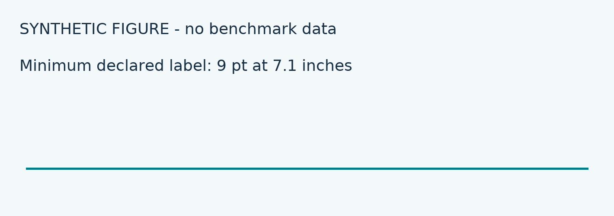

# Synthetic current edition

This body has **bold**, *italic*, `inline code`, an en–dash, an em—dash,
and a mathematical minus −. [Evidence](evidence.txt) stays a local link.

## Offline equations

\[
A\geq\frac{c}{1-p},\qquad B\geq2c+\frac{A}{2p}.
\]

\[
U\leq\min\left(Q,\sum_v\operatorname{depth}(v)\right)\leq\min(Q,Bh).
\]

\[
I_b=(c/b)\binom b2-(c-c/b).
\]

## Controls and ranges

| Case | KKT | Retained Boruvka | Deduplicating Boruvka | Kruskal | Prim | Original Boruvka |
| --- | --- | --- | --- | --- | --- | --- |
| synthetic_small_identifier | 1.49 | 1.00 | 1.19 | 0.78 | 0.81 | 0.89 |
| synthetic_large_identifier | 0.84 | 1.00 | 2.15 | 0.72 | 0.79 | 1.13 |

1. A numbered item.
2. Another item preserving the endpoint loss.

- One bullet with **emphasis**.
- Another bullet with [same-page navigation](#offline-equations).

```text
This_code_path_is_deliberately_long_to_exercise_wrapping_without_reducing_the_fixed_nine_point_type_size_and_without_clipping_the_page_frame.
    indentation is retained
```



## Closing body sentinel

No measurements or final report text are synthesized here.
