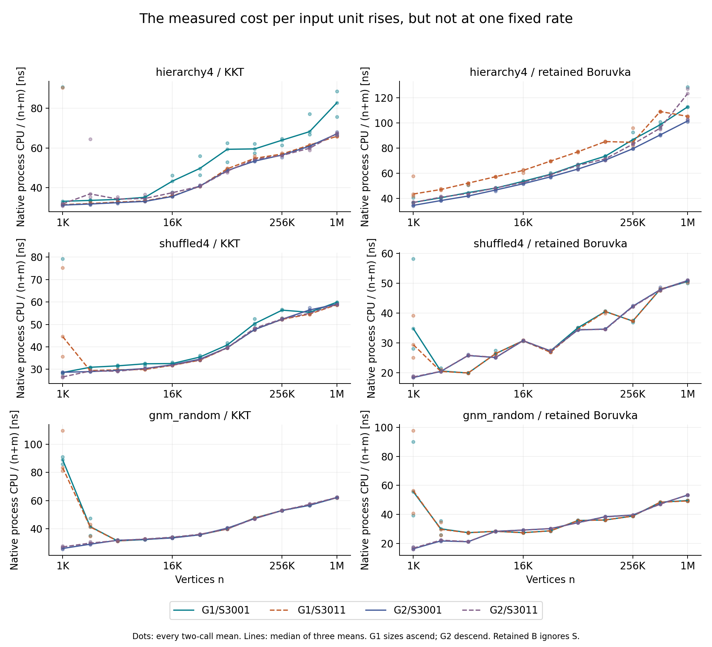
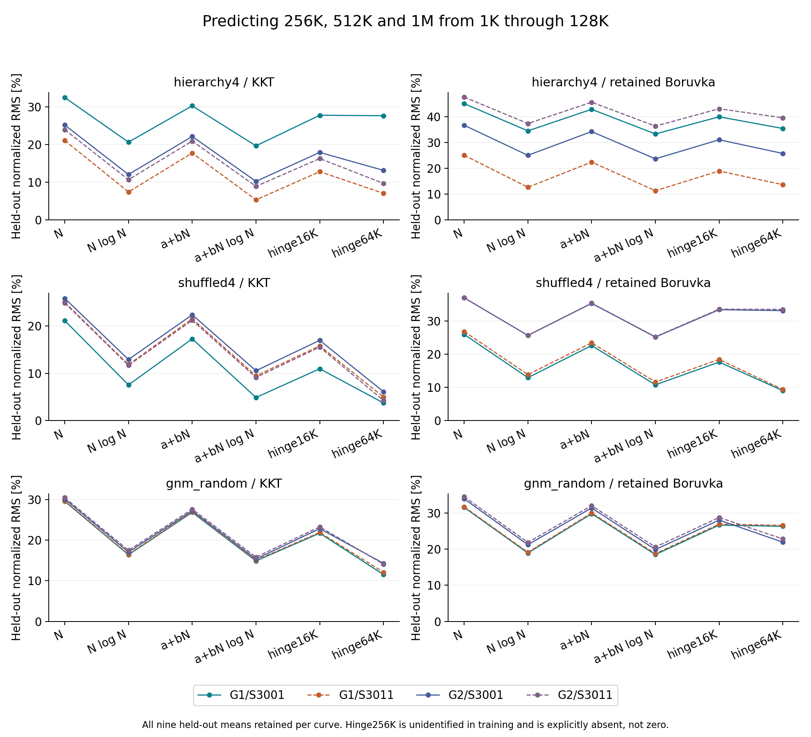

# What the current NlogN fit does, and does not, establish

The current measurements favor a superlinear **finite running-time curve** over
constant cost per input unit. That signal survives a nonzero-intercept model,
both CPU clocks, a different error objective, and retrospective prediction of
larger sizes. It is not just Google's label. However, `NlogN` is a coarse menu
choice: its own effective exponent is substantially below several measured
slopes, and fixed size-regime models sometimes predict better. These data do not
identify an asymptotic work law or its cause.

This investigation reuses the completed [current-complexity campaign](../benchmark/results/current-complexity-2026-10-15/README.md).
No native solver or benchmark was run. The [analysis plan](../benchmark/scaling_investigation/models/PLAN.md)
preceded the new calculations, but the campaign and its original curves had
already been observed. The blocked tests below are therefore **retrospective
extrapolation checks**, not blind prospective validation.

## Data and independent checks

The input is the opt-in eighth-sampling KKT implementation with retained parallel
edges, direct Edge input and compressed verifier queries. The other algorithm is
retained-edge Boruvka. Three families use eleven doubling sizes, n=1,024 through
1,048,576: ordered and shuffled attachment graphs have m=32n; connected G(n,m)
has m=16n. Google receives N=n+m, respectively 33n and 17n.

There are two graph seeds, two sampler labels and three callbacks per size; each
callback has a warmup and two timed calls. The analysis independently parses all
2,376 native rows, checks certificates and graph fingerprints, reconstructs all
3,168 two-call means across four clocks, and reproduces all 1,152 archived model
fits and all 24 exported Google choices. Every mean, including conspicuous small
input observations, remains in the analysis. Raw numerical inputs and source
hashes are recorded in [attempt03/provenance.json](../benchmark/scaling_investigation/models/attempt03/provenance.json).
The original native lifecycle/build proof is inherited from the completed
campaign; this numerical pass does not rebuild or rerun it.

Four curves per algorithm do not mean four independent graphs: retained Boruvka
ignores the sampler label. The first graph seed ran sizes ascending, the second
descending, so graph identity and size order are confounded. Repeated callbacks
reuse one graph/sampler realization. No confidence intervals are justified here
by treating those timings as independent graph draws.



## Google's objective has consequential details

Pinned Google Benchmark 1.5.2 fits `a f(N)` through the origin, selecting among
1, log N, N, N log N, N² and N³. Its coefficient is
`a = sum(f(N) t) / sum(f(N)²)`. The score is
`sqrt(mean((t - a f(N))²)) / mean(t)`.

The pinned `complexity.cc` comments call this “relative error,” but the code
minimizes **absolute duration squared error**, then normalizes by the overall
mean. It does not minimize the average of each point's squared relative error.
Within one curve, the score ranks models exactly as unnormalized SSE does.
Google chooses using library process CPU; manual time uses the same chosen
model. It exports only CPU RMS. Native solver CPU and library CPU are different
intervals, even when their values are close.

For this eleven-size ladder, the last three sizes account for **98.44%** of
`sum(N²)`, and about **98.79%** of `sum((N log N)²)` on attachment graphs. Those
are design-leverage shares, not shares of elapsed time or errors. The coefficient
and duration-space comparison are primarily about the high end.

The two through-origin feature vectors have cosine **0.999636** on attachment
graphs. They are geometrically close, but not indistinguishable at the observed
precision: NlogN fits and predicts better below. High feature similarity instead
warns against assigning an asymptotic law from a finite best-of-menu label.

Even the definition of the finite basis matters. With N=cn, `N log N` equals
`c n log n + c log(c) n`; replacing N with n is the same asymptotic class but a
different one-parameter finite curve. The analysis preserves the campaign's N.
It does not retune that definition to obtain a preferred label.

## Fixed overhead does not rescue a constant linear rate

The following are native process-CPU normalized RMS ranges over all four curves,
using all eleven sizes and all 33 two-call means per curve. These are residual
descriptions, not complexity classes or uncertainty intervals.

| Family | Algorithm | Through-origin N | Through-origin NlogN | Affine a+bN |
|---|---|---:|---:|---:|
| Ordered attachments | KKT | 8.93–20.76% | 3.62–16.91% | 7.14–19.07% |
| Ordered attachments | Retained B | 9.94–28.20% | 8.11–24.11% | 8.66–25.86% |
| Shuffled attachments | KKT | 8.05–9.00% | 3.22–3.77% | 5.93–7.02% |
| Shuffled attachments | Retained B | 11.60–13.27% | 6.43–8.55% | 9.15–11.16% |
| Connected G(n,m) | KKT | 10.89–11.26% | 5.25–5.61% | 8.64–9.04% |
| Connected G(n,m) | Retained B | 11.55–16.34% | 7.12–10.67% | 9.52–13.83% |

All **24 affine-N native-CPU intercepts are negative**, as are all 24 library-CPU
intercepts. For KKT they range from about −44.56 to −14.23 ms. Several fitted
lines predict negative durations at small inputs; those failures are retained
and counted in the CSV. This is not ordinary positive setup overhead. If
`t=a+bN` with a positive fixed a, then `t/N=a/N+b` falls with N; it cannot explain
the broad rise in the observed normalized curves.

Allowing an affine NlogN curve also reduces residuals, usually with a negative
intercept. More parameters naturally improve training fit. Neither that gain nor
a negative-intercept straight line establishes a physical cost model.

Repeated-call spread matters on particular curves. For ordered KKT,
G19000013/S3001, within-size variation alone gives 12.91% normalized RMS and
accounts for **58.25% of the NlogN residual SSE**. Conversely, within-size
variation accounts for only **0.32–1.54%** of that SSE on random KKT. The latter
curve's mismatch is mostly a systematic size shape, rather than spread between
three callback means. This is the exact decomposition of residuals into
within-size variation and size-mean mismatch, not a stochastic noise model.

## Does the model predict the larger sizes?

The main blocked test fits n=1K through 128K and predicts the nine means at
256K, 512K and 1M. NlogN beats N on **every one of 24 curves, under every one of
four clocks**. Thus the original result is not merely a training-fit artifact.
It also beats N under a separately fitted pointwise-relative-error objective on
every native-CPU curve. All four declared size-block splits and both objectives
are retained in the linked tables, rather than choosing only this split.

The continuous size-regime alternative is
`t=a+bN+c max(N-N0,0)`. Knots were fixed at n=16K, 64K and 256K before these new
fits. They are candidate regime boundaries, not measured cache capacities. A
knot that the training sizes do not identify is reported as rank deficient;
the 256K hinge is consequently unavailable in the 1K–128K training test.

The next table uses native process CPU only, with ranges over its four curves.

| Family | KKT holdout RMS: N | NlogN | Affine N | Fixed 64K hinge |
|---|---:|---:|---:|---:|
| Ordered attachments | 21.11–32.53% | 7.44–20.67% | 17.77–30.31% | 7.08–27.69% |
| Shuffled attachments | 21.10–25.79% | 7.53–12.89% | 17.24–22.32% | **3.73–6.10%** |
| Connected G(n,m) | 29.52–30.43% | 16.38–17.47% | 26.81–27.59% | **11.51–14.28%** |

The 64K hinge improves all four shuffled-KKT and all four random-KKT curves on
this split; it is not universally better on ordered KKT or retained Boruvka.
This supports investigating changing cost regimes. It does **not** identify
cache behavior: the same shape can come from size-dependent logical work,
allocation, verifier branches, memory access cost or machine state. The knots
also correspond to different edge counts in the two density settings.



## NlogN is not an accurate exponent estimate

All 192 original clock/window selections reproduce NlogN. Yet a pure NlogN
curve has local logarithmic slope `1+1/ln(N)`, only about **1.058–1.076** across
the upper six sizes of these families. KKT's observed log-log slopes are steeper:

| Family | Full 11 sizes | Upper 6 sizes | Upper 4 sizes |
|---|---:|---:|---:|
| Ordered attachments | 1.0981–1.1220 | 1.1267–1.1313 | 1.0881–1.1544 |
| Shuffled attachments | 1.0815–1.1233 | 1.1470–1.1591 | 1.0691–1.1038 |
| Connected G(n,m) | 1.0264–1.1237 | 1.1599–1.1616 | 1.1243–1.1314 |

These are regressions of log time on log N, a different objective from Google's.
All trailing windows of four through eleven sizes and adjacent median slopes are
reported. The changing estimates are evidence against treating one finite
exponent as settled. NlogN can be the closest available menu item while the
measured curve is locally steeper; N² is simply much steeper still. The upper-four
decline for shuffled and random KKT is consistent with a transition followed by
a lower slope, but four points do not prove a plateau or asymptotic linearity.

The difference between CPU boundaries is too small to explain this rise by
itself. Library/native CPU ratio is 1.00043–1.01654 at n=1K and
1.000002–1.000013 at n=1M. Manual time reconstructs the native steady interval.
This does not rule out effects shared by both clocks, including the host or
allocator. In particular, both algorithms show elevated small random inputs in
the ascending graph-seed group. Graph and order are confounded; those points
have not been removed or assigned a causal explanation.

## Discriminating the next hypotheses

There are no known archived instrumented work records matching these exact
Google graph seeds, sampling seeds and input fingerprints. Earlier eighth and
lower-density campaigns cannot be joined by family/size alone. Therefore this
note makes **no measured nanoseconds-per-logical-operation claim**.

1. **Actual operation count grows.** Reproduce every Google input with untimed
   instrumentation, join both fingerprints and sampler, and inspect cumulative
   work/N by phase. Growth in verifier/contraction/initialization work would
   identify an implementation cost that changing timers cannot remove. Source
   complexity must still include work not represented by a particular counter.
2. **Cost per operation grows.** If matching counts/N stabilize while time/N
   rises, compare phase times and data footprints across the predeclared sizes.
   This motivates memory-layout/allocation experiments. It does not by itself
   prove cache misses, bandwidth saturation or an allocation mechanism.
3. **A branch changes the amount of work.** Check exact connected-versus-
   disconnected verifier paths, graph sizes and query counts on the matching
   inputs. Earlier lower-density evidence shows that branch can matter, but it
   is not a measurement of this Google campaign and cannot be transferred.
4. **Order/host effects interact with size.** A new fixed campaign would need
   the same graphs in counterbalanced ascending/descending orders, with startup
   and repeated-run behavior retained. Reusing two different graph seeds as the
   two orders cannot resolve this confounding.

First establish matching logical counts and phases, then make one isolated
implementation change and compare unchanged inputs, boundaries and controls.
Neither accepting a reassuring linear fit nor maximizing an NlogN fit score
would answer which cost is worth fixing.

## Reproduction and complete outputs

From the `kkt-linear-scaling` worktree, using Python with NumPy:

```sh
/usr/bin/python3 -B -m unittest discover -s benchmark/scaling_investigation/models -p 'test_analyze_models.py' -v
/usr/bin/python3 -B benchmark/scaling_investigation/models/analyze_models.py --output /tmp/kkt-models-new-attempt
/usr/bin/python3 -B benchmark/scaling_investigation/models/plot_models.py --analysis /tmp/kkt-models-new-attempt --output /tmp/kkt-model-figures-new-attempt
```

Output directories must not already exist. Archived original-machine paths are
mapped to this checkout only for identical hashed repository files; the pinned
Google source dependency remains an explicit original-machine input. This is
numerical reproducibility, not a portable native rebuild bundle.

The [final provenance](../benchmark/scaling_investigation/models/attempt03/provenance.json)
binds source and every consumed raw artifact. Complete
[fits](../benchmark/scaling_investigation/models/attempt03/fits.csv),
[holdouts](../benchmark/scaling_investigation/models/attempt03/holdouts.csv),
[per-observation predictions](../benchmark/scaling_investigation/models/attempt03/blocked_predictions.csv),
[residuals](../benchmark/scaling_investigation/models/attempt03/residuals.csv),
[residual decomposition](../benchmark/scaling_investigation/models/attempt03/residual_components.csv),
[window slopes](../benchmark/scaling_investigation/models/attempt03/window_slopes.csv),
[relative-objective sensitivity](../benchmark/scaling_investigation/models/attempt03/relative_objective.csv)
and [summaries](../benchmark/scaling_investigation/models/attempt03/summaries.csv)
retain both algorithms, all four clocks and every declared case. Attempts 01
and 02 are preserved; attempt03 adds the exact residual decomposition and
explicit verification against all archived model-fit rows. Six focused algebra
tests passed; two full-resolution figures were inspected for labels, points and
clipping. No performance result was produced by the investigation itself.
