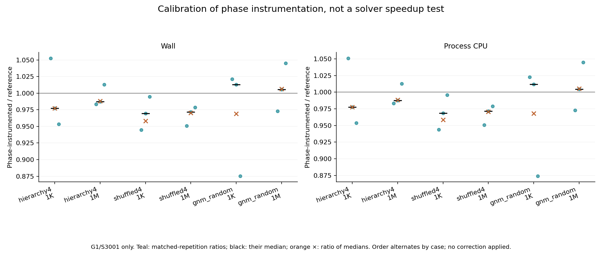
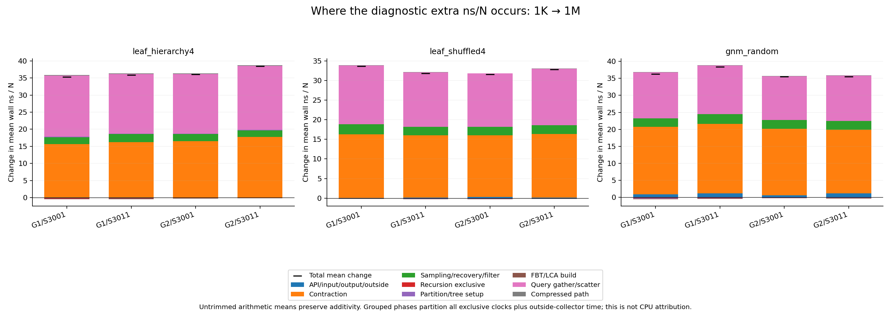
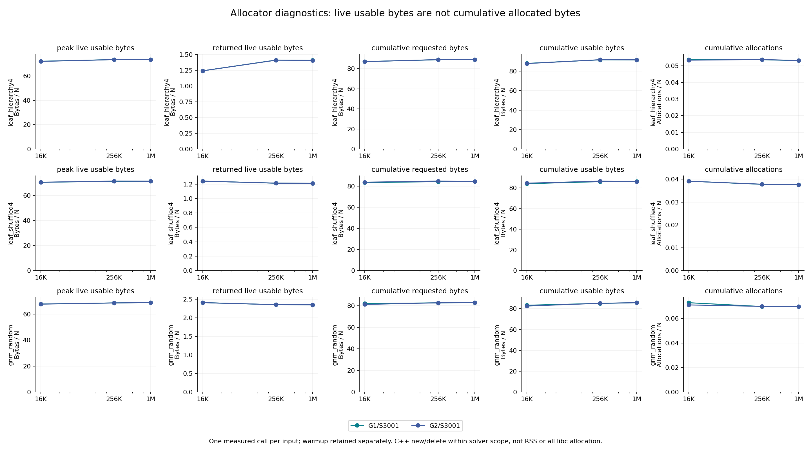

# Why the current clock curve bends upward

The selected logical work is much closer to linear than the runtime is. Across
all 84 count curves, a zero-intercept `N` fit beats `N log₂ N`, using the same
least-squares coefficient and normalized-RMS formula as Google Benchmark. Here
`N=n+m`; this is a six-size **count-space reanalysis**, not another Google
Benchmark invocation and not a measurement of every CPU instruction.

The instrumented wall clocks localize most of the growing cost per input unit to
query gathering and contraction, particularly the minimum-edge scan. LCA table
construction is small and becomes cheaper per input unit. These observations
motivate controlled implementation experiments; they do not identify cache
misses, prove a hardware cause, or establish that every phase timer is unbiased.

## Evidence and scope

The complete [analysis receipt](../../benchmark/scaling_investigation/analysis/attempt01/provenance.json)
binds build04 sources, compiler commands, objects, binaries, owned-process exit
and resource receipts, raw JSON lines, and canonical tables. Every child passed
the independent MST certificate. Exact joins include family, `n`, `m`, graph and
sampling seed, weighted fingerprint and topology fingerprint. All 72 phase/work
inputs also match the archived Google native inputs; no unrelated historical
counter campaign is joined by family name alone.

The matrix contains `leaf_hierarchy4` and `leaf_shuffled4` at `m=32n`, and connected
`gnm_random` at `m=16n`; sizes are 1,024, 4,096, 16,384, 65,536, 262,144 and
1,048,576. Graph seeds are 19000013/19000043, sampling seeds 3001/3011. G1 visits
sizes upward and G2 downward, so graph identity and size-order effects remain
confounded. This is the current opt-in retained-edge, direct-Edge, compressed-query,
one-eighth-sampling configuration, not the public default.

| Diagnostic | Distinct inputs | Measured calls per input | Raw rows including warmups |
|---|---:|---:|---:|
| Exclusive phase clocks | 72 | 3 | 288 |
| Logical work counters | 72 | 1 | 144 |
| Allocation accounting | 18 | 1 | 36 |
| Reference/phase calibration | 6, in both builds | 3 per build | 48 |

Allocation covers 16K, 256K and 1M with both graphs and S3001. Calibration covers
1K/1M, all three families, G1/S3001. All warmups, measured calls, zeros and outliers
remain in the exported evidence. No timing from the work or allocation build is
used as an uninstrumented performance result.

## Calibration comes before attribution

The following numbers are medians of three matched-repetition phase/reference
ratios; each cell shows wall/process-CPU. Ratios of separately computed medians
are also retained and need not equal these values.

| Family | 1K | 1M |
|---|---:|---:|
| Ordered hierarchy | 0.97719 / 0.97736 | 0.98736 / 0.98736 |
| Shuffled twin | 0.96928 / 0.96856 | 0.97149 / 0.97151 |
| Connected random | 1.01281 / 1.01174 | 1.00549 / 1.00432 |

Individual ratios span 0.87410–1.05254 at 1K and 0.95065–1.04522 at 1M, across
both clocks and all six inputs. A phase build appearing slightly faster is not
negative instrumentation overhead: code generation, execution order and ordinary
timing variation are not separately identified here. We apply no correction.
This calibration does not show an instrumentation penalty that could itself
explain the large normalized growth, but it cannot prove unbiased per-phase
times across all 72 inputs.

## Work volume and cost per event are different observations

Every one of the seven declared counters favors `N` over `N log₂ N` on each of
the 12 family/graph/sampler curves. The endpoint ranges below retain all four
realizations per family. They are growth in **count/N**, not time.

| Counter | Hierarchy: 1M / 1K | Shuffled: 1M / 1K | Random: 1M / 1K |
|---|---:|---:|---:|
| `kkt_edges` | 1.006–1.009 | 1.005–1.018 | 1.009–1.020 |
| `contraction_edge_visits` | 1.015–1.019 | 1.017–1.059 | 1.023–1.069 |
| `verifier_queries` | 1.038–1.072 | 1.081–1.163 | 1.090–1.192 |
| `path_binary_search_steps` | 1.235–2.204 | 1.506–1.946; 2 undefined | 1.010; 3 undefined |
| `lca_sparse_cells` | 0.971–1.029 | 0.674–0.929 | 0.777–1.098 |
| `initialized_slots` | 1.050–1.082 | 1.072–1.154 | 1.065–1.171 |
| `edge_materializations` | 1.034–1.043 | 1.037–1.072 | 1.042–1.081 |

Undefined endpoint growth means the small count is zero; it is not a missing
measurement. The counts and both fits remain present. In particular, path-search
counts vary materially at small sizes: their `N` normalized RMS is 1.02–9.72%,
despite winning the two-model comparison. The other six selected counters have
`N` RMS between approximately 0.006% and 0.898%; their `N log N` RMS is 3.31–4.22%.
The least-squares objective still gives large inputs greater leverage, as in the
[finite-fit investigation](../kkt-scaling-model-analysis.md). Selection is not a
proof of asymptotic order, nor does it erase finite coefficient growth.

The complete [count fits](../../benchmark/scaling_investigation/analysis/attempt01/count_fits.csv)
and [all 65 counters plus three derived fields](../../benchmark/scaling_investigation/analysis/attempt01/work.csv)
are retained. The [historical CPU/count table](../../benchmark/scaling_investigation/analysis/attempt01/historical_cpu_work.csv)
uses six old native CPU calls per exact input and the new deterministic counts.
It is a matched-input cross-campaign description, not phase timing. Small-input
timing outliers remain; not every individual 1K→1M endpoint ratio increases.

## Where the extra nanoseconds occur

For each of the four realizations, untrimmed arithmetic mean phase times are
divided by `N`. Their 1K→1M differences sum **exactly** to the total mean
difference, including the outside-collector residual. Component medians would
not have that additivity, so they are not substituted into this accounting.

| Family | Total extra ns/N | Query gather | Minimum scan | Mark scatter | LCA build |
|---|---:|---:|---:|---:|---:|
| Hierarchy | 35.36–38.52 | 13.34–14.34 | 8.54–10.03 | 4.15–4.45 | −0.13 to −0.09 |
| Shuffled | 31.57–33.69 | 10.43–11.30 | 8.74–9.09 | 3.22–3.65 | −0.06 to −0.04 |
| Random | 35.46–38.39 | 9.54–10.37 | 11.16–12.11 | 3.40–3.91 | −0.12 to −0.06 |

The columns are ranges over four separate decompositions; their endpoints must
not be added across columns as if they came from one realization. The figure
shows each complete decomposition. Its contraction group includes both the
exclusive contraction phase and nested minimum scan. A bare `contraction` row in
the CSV excludes that nested timer.

At 1M, mean total wall ns/N spans 66.97–70.24 for hierarchy, 60.46–61.13 for
shuffled and 63.64–65.33 for random. Query gather alone spans 22.02–23.03,
18.52–19.04 and 17.10–17.37 respectively. LCA construction spans only
0.191–0.203, 0.0716–0.0730 and 0.1106–0.1144 ns/N.

Per-event normalization sharpens that distinction. Across all realizations,
median query-gather ns per `lca_queries` event grows 1.93–2.53×, minimum-scan ns
per `contraction_edges` grows 4.41–5.94×, and mark-scatter ns per
`verifier_tree_edges` grows 1.57–1.90×. These denominators are precisely named
logical events, not instructions. Query gather includes LCA queries **and request
insertion**, so the entire increase cannot be attributed to LCA lookup alone.
Median LCA-build ns per the declared construction-event sum decreases to
0.50–0.82× its small-input value.

All denominator definitions, including the compressed path walk's
`visits + unique requests + binary-search steps`, are in the
[analysis README](../../benchmark/scaling_investigation/analysis/README.md).
Unique requests are `path_query_visits − 2*verifier_queries`. Undefined ratios
stay explicitly undefined; all timing ranges remain in the tables and figures.

## Allocation volume is near linear; locality is still a hypothesis

At 1M, the two graph realizations give the following values per `N`:

| Family | Peak live usable bytes/N | Cumulative requested bytes/N | Cumulative usable bytes/N |
|---|---:|---:|---:|
| Hierarchy | 73.335–73.348 | 88.987–89.019 | 91.646–91.673 |
| Shuffled | 71.397–71.401 | 84.518–84.551 | 86.208–86.246 |
| Random | 68.932–68.933 | 82.760–82.786 | 85.663–85.693 |

These account for instrumented C++ `new/delete` inside the solver scope. Peak and
returned usable bytes are live measures; requested/usable allocated bytes are
cumulative. They are not RSS, all libc allocation, or live requested bytes.
One measured allocation call per input is insufficient for a variance estimate.

Stable bytes/N can coexist with a working set growing beyond a cache. The current
evidence is consistent with increasing cost of indirect access in query gather,
component-minimum scans and mark scattering. It does not measure cache misses,
TLB misses, memory bandwidth or branch prediction, so those remain hypotheses.
The weak LCA-build contribution argues against prioritizing its construction
layout as the principal explanation for this campaign's upward clock curve.

The next discriminating test is a fresh paired candidate that removes unnecessary
query indirection while preserving answers, sampling and other work. A matched
`noinline` control can distinguish representation effects from compiler inlining.
It needs independent correctness, source/object isolation, unchanged-call work
checks and new uninstrumented timings. A lower phase clock alone is not a claimed
solver improvement, and no such candidate result is included here.

## Reproduce and inspect

The analyzer launches no solvers. Its
[source](../../benchmark/scaling_investigation/analysis/analyze_diagnostics.py)
and [eight focused tests](../../benchmark/scaling_investigation/analysis/test_analyze_diagnostics.py)
verify identity, count coverage, additive arithmetic, clock ratios, explicit zero
denominators, receipt failure handling and baseline source-copy boundaries.
The [independent source review](../../benchmark/scaling_investigation/analysis/INDEPENDENT_SOURCE_REVIEW.md)
is separate from runtime validation. If a later patch changes production sources,
use the explicit `--source-snapshot` manifest; it preserves the pinned build04
source inventory without relocating or trusting changed native artifacts.
The [baseline source snapshot](../../benchmark/results/scaling-investigation-2026-10-15/baseline-source-snapshot01/snapshot.json)
has now passed a complete alias-based reload: all canonical tables and the raw
export are byte-identical to the original analysis. Its
[reload receipt](../../benchmark/scaling_investigation/analysis/validation/snapshot-reload-attempt01.json)
records that check. The [build-evidence archive](../../benchmark/results/scaling-investigation-2026-10-15/build-evidence01/archive.json)
preserves 218 build/accounting receipt and log files, including rejected attempts;
the original `.build` artifacts remain in place with unchanged hashes.

The [full figure directory](../../benchmark/scaling_investigation/analysis/figures-attempt02/)
contains 15 PNG/SVG pairs: phase, logical-count, phase/event and historical
CPU/event grids for every family, plus allocation, calibration and endpoint
accounting. These are detailed desktop research figures, not small-screen or
page-width publication layouts. The first rendering attempt is preserved: visual
QA found clipped top markers in nearly constant panels, repaired solely by adding
y-axis headroom. Canonical numbers and input bindings were unchanged.
