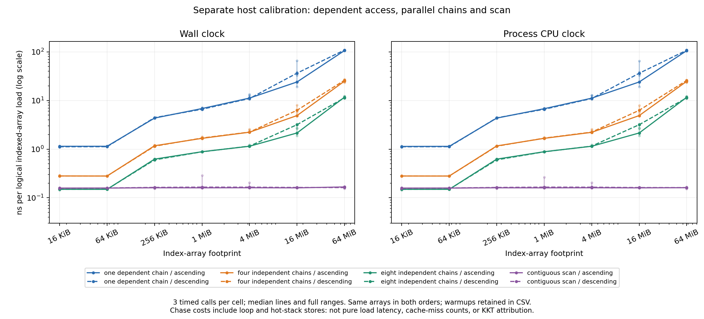

# A separate host memory-access calibration

On this host, a fixed amount of dependent indexed-array work became much more
expensive as its footprint grew. One chain's median CPU cost rose from roughly
1.1 ns per indexed-array load at 16 KiB to 106–108 ns at 64 MiB. Four and eight
independent chains reduced cost per load at the same large footprint. The
contiguous scan's endpoint cost remained near 0.16 ns. These are completed
observations of artificial kernels, not measurements of KKT cache misses.

[Vector figure](../../benchmark/results/scaling-investigation-2026-10-15/host-memory-figures02/host-memory.svg)
and [visual/provenance check](../../benchmark/results/scaling-investigation-2026-10-15/host-memory-figures02/VISUAL_QA.json).

Each cell executes exactly **16,777,224 logical indexed-array loads**. Seven
footprints span 16 KiB to 64 MiB; each runs one warmup and three measured calls
for one dependent chain, four independent chains, eight independent chains and
a contiguous scan. Two separate process launches traverse footprint sizes in
ascending and descending order, using the same deterministic arrays. The full
224 records comprise 168 measured calls and 56 retained warmups.

The table shows CPU ns per logical indexed-array load. Slashes separate the
ascending and descending process orders; ranges include all three measured
calls in that cell.

| Access pattern | 16 KiB median, ascending / descending | 64 MiB median, ascending / descending | 64 MiB range, ascending | 64 MiB range, descending |
|---|---:|---:|---:|---:|
| One dependent chain | 1.136 / 1.119 | 105.530 / 107.567 | 104.747–105.946 | 104.877–109.173 |
| Four independent chains | 0.2805 / 0.2813 | 24.738 / 25.820 | 23.967–25.123 | 23.426–26.333 |
| Eight independent chains | 0.1494 / 0.1492 | 11.623 / 11.345 | 11.355–12.139 | 10.994–12.168 |
| Contiguous scan | 0.1583 / 0.1570 | 0.16135 / 0.16206 | 0.15312–0.16755 | 0.16099–0.16540 |

One-chain CPU cost increases about 93–96 times between the two endpoint sizes.
The scan's corresponding increases are about 2% and 3%. At 64 MiB, wall-clock
medians are 106.136 / 108.775 ns for one chain, 24.977 / 26.111 for four,
11.689 / 11.352 for eight, and 0.16714 / 0.16213 for the scan. The
[112 cell summaries](../../benchmark/results/scaling-investigation-2026-10-15/host-memory-analysis01/summary.csv)
retain every intermediate footprint, both clocks and orders, all three measured
durations, and minimum/median/maximum values. The
[224 original-call records](../../benchmark/results/scaling-investigation-2026-10-15/host-memory-analysis01/all-calls.csv)
also retain warmups and native result checks. No favorable subset is selected.

The [actual assembly review](../../benchmark/scaling_investigation/audit/HOST_MEMORY_ASSEMBLY_REVIEW.md)
confirms 16,777,224 / 4,194,306 / 2,097,153 iterations for the 1/4/8-chain loops,
with 1/4/8 independent indexed reads per iteration. Each new chain position is
also stored to a hot stack array. The scan has four scalar loads and four
accumulators per iteration, with no SIMD reduction. The timing boundary includes
loop work, dispatch, argument/return copying and clock overhead. **The metric is
not pure load latency**, and the scan is not a STREAM bandwidth measurement.
The native cycle, final-position and checksum checks run outside timing;
assembly inspection additionally rules out omitted complete traversal cycles.

This is evidence that a constant logical operation count can have a
size-dependent elapsed cost on this machine. It motivates inspecting dependent
accesses in KKT, but does not identify which of KKT's accesses miss, establish a
cache-size threshold, assign a fraction of KKT CPU time to memory stalls, or
prove the cause of its empirical N log N fit. The almost-flat scan endpoint
comparison also shows why treating every edge or table visit as equally costly
would be misleading. None of these finite results changes an algorithmic
expected-linear proof under its unit-cost model.

Caches were not flushed. The three measured repeats alone are not fully
balanced across mode positions. The two size orders are repeated observations
of the same arrays, not independent random instances. Allocation layout,
translation, scheduling and frequency remain possible influences.

The [strict analysis receipt](../../benchmark/results/scaling-investigation-2026-10-15/host-memory-analysis01/analysis.json)
binds the completed native run, seven-command build/assembly record, sources,
binary, child receipts and all CSVs. Both native groups exited with known empty
groups; strict reanalysis also exited 0 under the owned guard. Its actual tool
completion and artifact checks are recorded in the linked receipts. The
accepted plot also exited successfully with an empty owned group, and
original-resolution visual QA passed. Its CSVs are byte-identical to
the strict analysis; an earlier layout with excess blank x-axis space is
preserved as `host-memory-figures01`. The separate v2 source adds only explicit
x limits. No KKT solver or further calibration ran to make the figure.
