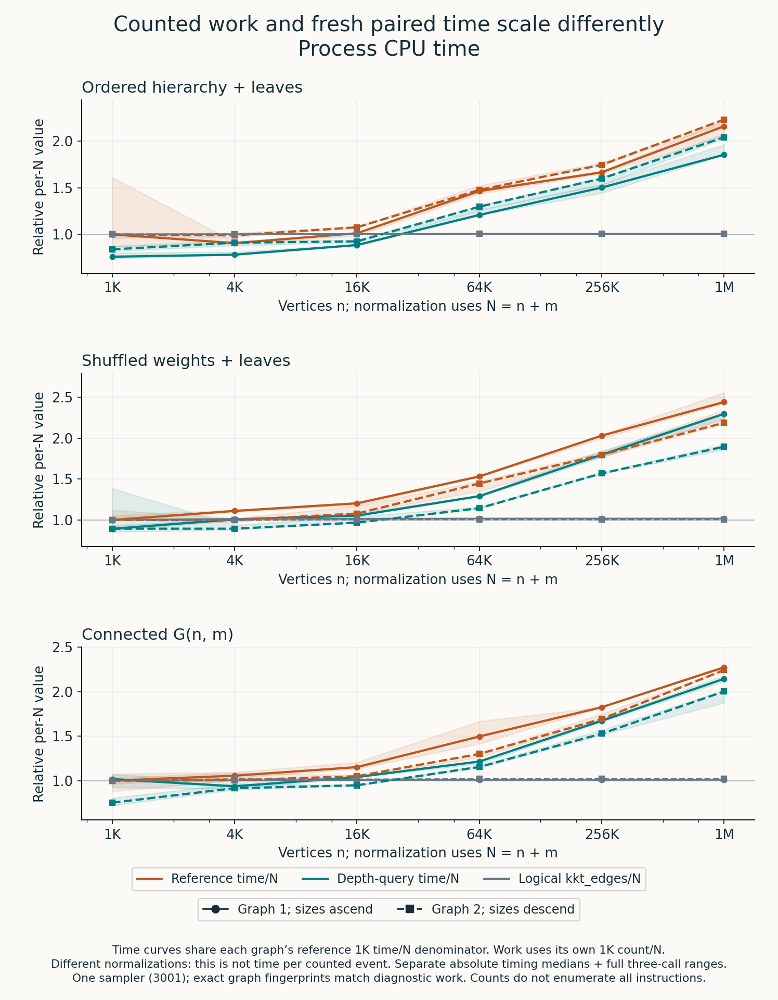

# Why linear counted work can still produce an NlogN timing fit

The current evidence supports a specific explanation for the scaling puzzle:
**several important amounts of KKT work grow almost proportionally to the input,
while their measured cost per event rises with input size.** A timing curve can
therefore bend upward even when those counts are close to a linear fit. The
all-65-counter review also finds real operation-mix changes of roughly 5–20% in
several query/initialization volumes. The evidence does not reduce the whole
curve to memory costs. A depth-query intervention now tests one costly access
pattern on the same inputs, rather than seeking a reassuring complexity label.

Let `N = n + m`. An illustrative finite model is `T(N) ≈ W(N) × c(N)`, where
`W(N)` is an amount of work and `c(N)` is its effective machine cost. Even if
`W(N)` is nearly proportional to N, time per input unit rises when `c(N)` rises.
The selected counters are imperfect, overlapping proxies for W, not a complete
instruction census; the changing operation mix can affect both terms. On a
real machine, a load can become more expensive as its working set grows; a small
helper can generate a different call sequence after specialization. Neither
possibility requires more graph edges to be visited. This model separates
questions to test; it is not an identified cost decomposition or a fitted proof
that memory explains KKT's curve.

An algebraic example makes the distinction exact. For a fixed `K > 0`, let
`T(N) = N[1 + N/(N + K)]`. For positive N, `N < T(N) < 2N`, so
`T(N) = Θ(N)`, yet `T(N)/N` rises from 1 toward 2. Thus even bounded per-unit
cost can produce an upward finite curve without changing asymptotic linearity;
an expected-linear bound does not require an exact through-origin N-shaped
timing curve. This is an illustration, not a fitted equation, observed data or
a cache model for this implementation.

The completed baseline and fresh 36-input candidate comparison are reported
below. The depth-query candidate wins every graph/size median of paired ratios,
and 35 of 36 comparisons of separately computed absolute medians on each clock.
It does not remove the upward finite scaling curve: both versions
still favor NlogN in the six-size reanalysis. Three wall trials and two CPU trials
lose and remain in the result. Paired phases and the separate six-input
query-method control are also complete. The new actual Google Benchmark run
likewise selects NlogN for all six fresh reference/depth curves, while lowering
the depth variant's CPU fit coefficients by about 10–15%. That separate campaign
uses only one graph and sampler; it does not replace the primary comparison or
its losses. Paired allocation was not run and remains optional.

## Three different questions

| Question | What the present evidence can establish |
|---|---|
| How does theoretical work scale? | KKT's expected linear bound concerns ideal independent sampling and a stated primitive-cost model. It is an expectation over randomness, not a constant-nanoseconds-per-edge promise for every finite seeded execution. |
| What did this implementation count? | Exact counters describe selected loops and data structures on these particular inputs. They do not enumerate all instructions, allocation internals, memory traffic or hardware stalls. |
| Which finite time curve fits better? | A model can predict the measured size range better than another without proving an asymptotic class or identifying its cause. |

The [source audit](source-audit.md) found no remaining unconditional `m log n`
loop in the selected optimized path. In particular, its LCA sparse table is built
over blocks, not all Euler positions, and the path-search work has a linear
aggregate bound under the verifier's full-branching-tree invariants. This is a
source argument with explicit caller, word-width and sampling assumptions. It
should not be replaced by a benchmark fit, nor inflated into a proof that every
real execution has fixed cost per input unit.

The native measurements use an Apple M3 Max with 128 GiB RAM, macOS 26.6.2,
and Apple Clang 15 targeting arm64 with `-O3 -march=native`, assertions enabled
and no LTO. The [environment observation](../../benchmark/results/scaling-investigation-2026-10-15/depth-environment-before01/observation.json)
records AC power; thermal-status queries failed, so they do not establish an
absence of throttling. Results are specific to this host, build and input matrix;
source hashes and exact commands accompany the captures.

This study concerns the opt-in path with retained parallel edges, direct Edge
queries, compressed verifier requests and scalar one-eighth sampling. An ordinary
default build selects a different path. The native public boundary includes
input conversion and internal temporary destruction; input generation,
independent MST certification and returned-result validation are outside it.
The [Google driver](../../benchmark/current_complexity/current_complexity.cpp)
constructs the fixture, Kruskal oracle, certificate and checked warmup before
entering the timed State loop; result checking, tracing and returned-result
destruction run with timing paused. Its separate native wall/CPU intervals also
surround the public solver call, so the fit is not accidentally measuring
Kruskal certification. The library CPU interval still includes its own loop and
clock machinery; it is a distinct interval from the recorded native clocks.

## What the completed baseline says

The archived Google Benchmark campaign selected NlogN for all 24 curves: 12 KKT
and 12 retained-Boruvka curves. A
separate [finite-model analysis](../kkt-scaling-model-analysis.md) reproduced the
raw means, the library's fit objective and all exported choices. It also tested
an affine linear model and retrospective larger-size holdouts. NlogN predicted
the final three sizes better than N for all 24 curves under all four recorded
clocks. Thus the upward shape is more substantial than an arbitrary label.

The label still has limited resolution. Google fits through the origin and
minimizes squared error in duration space, so large inputs dominate its choice.
Its NlogN basis has effective slope roughly 1.058–1.076 over the upper range,
whereas some observed KKT slopes are about 1.13–1.16. NlogN can be the closest
menu item without accurately describing the local exponent. The fixed-knot
regressions and blocked checks are exploratory, retrospective analyses of an
already observed campaign, not blind validation.

New diagnostics now match **72 exact Google input identities**, including both
weighted and topology fingerprints: three families, six sizes from 1K to 1M,
two graph seeds and two sampler seeds. The full [diagnostic report](DIAGNOSTICS.md)
and its [independent review](../../benchmark/scaling_investigation/analysis/INDEPENDENT_DIAGNOSTICS_EDITORIAL_REVIEW.md)
keep all inputs, clocks and ranges. The earlier model/source notes describe the
state before these matching diagnostics existed; this report incorporates the
completed follow-up.

Seven selected counters across the twelve family/graph/sampler curves give
**84 count curves**. Every one favors N over NlogN under the same through-origin
formula, applied to counts rather than durations. From 1K to 1M,
`kkt_edges/N` grows only 0.55–2.05%; contraction edge visits/N grow 1.46–6.88%.
This establishes near-linear measured edge volume on this matrix, not linear
instruction count. Counter totals overlap and have different meanings, so they
are not added into a literal total-operation model.

The [complete 65-field check](ALL_COUNTERS.md) prevents a selective reading of
those seven fits. It retains all 4,680 values and 780 curves, including 204 zero
points, maxima, call counts and intermediate peaks. Operation mix is not flat:
`path_query_visits/N` rises 4.16–7.51% on hierarchy, 8.24–16.46% on shuffled and
9.15–19.51% on random; `initialized_slots/N` rises 4.99–17.13% across the
families. These are overlapping logical events, not additive instruction counts.
Binary-search steps/N rise as much as 2.204× among defined endpoint ratios, but
the largest endpoint increment is only 0.002601 steps/N; five curves start at
zero and retain undefined ratios. The full ranking also retains intermediate
peaks. A good N fit under a large-size-weighted objective does not mean a
perfectly constant finite coefficient or an unchanged operation mix.

The diagnostic clocks locate substantial increases in query gathering,
component-minimum scans and mark scattering. Across all twelve realizations,
query-gather time per LCA-query event grows 1.93–2.53×; minimum-scan time per
contraction-edge event grows 4.41–5.94×. Query gathering includes request insertion
as well as LCA lookup. These are wall-phase/event ratios with precisely named
denominators, not CPU cost attributed to a single instruction or proof of cache
misses. LCA construction contributes less than 0.21 ns/N at the largest input
and its normalized cost decreases; rebuilding its layout was therefore a weak
first target for this campaign.

Allocation diagnostics likewise distinguish near-linear allocated volume from
access cost: stable bytes/N still means a larger absolute working set. They
measure cumulative requested/usable bytes and peak live usable bytes within the
instrumented C++ allocation scope, not RSS or all libc activity. Calibration on
six endpoint inputs found no growing twofold instrumentation factor, but does
not prove that every phase timer is unbiased. The full calibration ranges and
exact additive endpoint decompositions remain in the diagnostic report.

## The first intervention: return the depth the verifier actually needs

The compressed verifier needs an ancestor's **depth** to add and look up its
requests. The generic LCA interface returns an ancestor vertex ID, which the
caller then converts to a depth. Candidate D introduces an opt-in depth-specialized
query/request API, preserving the generic interfaces and the reference path.
The intended benefit is to remove unnecessary representation and access work.
The completed work comparison isolates its counted initialization change; the
fresh timing and phase studies below measure its benefit and limitations.

The current [candidate declaration](../../benchmark/scaling_investigation/candidates/CANDIDATE_PROTOCOL.md)
holds contraction, sampling, graph generation, input ordering and the public
boundary fixed. Reference and depth variants are fresh same-source builds; only
the verifier object differs within each pair. The baseline sources were copied
before the patch, and [snapshot validation](../../benchmark/scaling_investigation/analysis/validation/snapshot-reload-attempt01.json)
proved that all completed baseline tables can still be regenerated from those
exact bytes. Historical timing is not substituted for a fresh reference run.

Correctness has passed natively and under the sanitizer profile. In each
profile, the focused test covers 164 trees, 2,499,404 query pairs, 317 marking
cases and 710 dispatch cases. Existing direct-Edge and full-solver MSF suites
also pass. Native wrong-linked-policy and invalid-depth guard cases are required
to fail in the prescribed way. The [complete passing gate](../../benchmark/results/scaling-investigation-2026-10-15/depth-correctness03/gate.json)
binds the actual sources, artifacts, commands and known process exits; earlier
failed validation attempts remain archived. The
[build-evidence index](../../benchmark/results/scaling-investigation-2026-10-15/depth-build-evidence01/archive.json)
retains 311 exact copies of build metadata and command/log evidence.

All 72 candidate work inputs also pass independent exact comparison: **4,608 of
4,680 counter values are unchanged**. The other 72 are `initialized_slots`, each
reduced by exactly the corresponding old `lca_vertices`; all 204 both-zero ratios
remain explicitly undefined. Exact MST IDs, input fingerprints and the existing
work trajectory are checked. This shows the intended narrowly changed accounting
on these inputs, not a speedup. The [work tables and provenance](../../benchmark/scaling_investigation/analysis/depth-work-analysis-attempt01/)
and [analysis review](../../benchmark/scaling_investigation/analysis/INDEPENDENT_CANDIDATE_ARITHMETIC_REVIEW.md)
retain every field.

The [actual object inspection](depth-codegen.md) prevents a misleading causal
story. Both default and explicit-noinline `query_depth` calls remain out of line,
with identical normal query instruction bodies in this build. The generic LCA
query is also out of line. However, reference `add_request` is called out of line,
while the depth-specialized request helper is inlined. Candidate D therefore
bundles representation changes with helper API/code-generation changes. Marking
only the query method noinline cannot isolate those effects, and the observed
gain must not be called solely query-body inlining or a pure removed-load effect.

## Fresh paired timing: faster, still a rising per-input cost

The completed primary comparison fixes 36 inputs: all three families, six sizes,
both graph seeds and sampler 3001. Each input has a fresh reference/depth process
pair, one checked warmup and three timed calls. All 288 raw outputs pass strict
validation. The 108 paired observations per clock are preserved; wall and process
CPU remain separate. G1 visits sizes ascending and G2 descending, so graph and
size order remain confounded. No baseline diagnostic or historical Google timing
is pooled into this comparison.

Depth wins **105 of 108 wall pairs** and **106 of 108 CPU pairs**. All 36
per-graph **medians of paired ratios** on each clock favor depth, as do all 18
pooled case medians. Separately computed absolute medians favor depth on 35 of
36 inputs per clock; the remaining input loses on both clocks.
The table reports the median of six matched-repetition depth/reference ratios
(two graphs, three repetitions), not a ratio of separately computed medians.
Ratios below one favor depth; every input remains in the table.

| Family | Vertices n | Wall ratio | Process CPU ratio |
|---|---:|---:|---:|
| Ordered hierarchy | 1,024 | 0.841247 | 0.841671 |
| Ordered hierarchy | 4,096 | 0.887748 | 0.884877 |
| Ordered hierarchy | 16,384 | 0.874474 | 0.876880 |
| Ordered hierarchy | 65,536 | 0.848660 | 0.853138 |
| Ordered hierarchy | 262,144 | 0.905159 | 0.907128 |
| Ordered hierarchy | 1,048,576 | 0.917878 | 0.911371 |
| Shuffled weights | 1,024 | 0.883484 | 0.882797 |
| Shuffled weights | 4,096 | 0.901807 | 0.901411 |
| Shuffled weights | 16,384 | 0.896431 | 0.893493 |
| Shuffled weights | 65,536 | 0.838425 | 0.838402 |
| Shuffled weights | 262,144 | 0.879264 | 0.879131 |
| Shuffled weights | 1,048,576 | 0.892549 | 0.891719 |
| Connected G(n,m) | 1,024 | 0.887958 | 0.888689 |
| Connected G(n,m) | 4,096 | 0.898426 | 0.898819 |
| Connected G(n,m) | 16,384 | 0.904777 | 0.904437 |
| Connected G(n,m) | 65,536 | 0.858825 | 0.859222 |
| Connected G(n,m) | 262,144 | 0.916134 | 0.913135 |
| Connected G(n,m) | 1,048,576 | 0.914812 | 0.914574 |

At 1M vertices, one minus the **pooled median of paired ratios** is about
8–11%, depending on family and clock. This is not a reduction computed from
separate absolute-duration medians. For the six individual largest inputs
(three families × two graphs), the ratios of separate depth/reference medians
span **0.858902–0.944867 wall** and **0.858722–0.943130 CPU**: reductions of
**5.51–14.11% wall** and **5.69–14.13% CPU**. All six largest inputs win by
this separate-median statistic on both clocks. This is a within-KKT comparison,
not a new result against Boruvka, Prim or Kruskal. Only one sampling seed is
timed; the extra work-only sampler is not additional timing evidence.

The five losing clock observations come from three calls. G1/G2 below mean
19000013/19000043; every call uses sampler 3001.

| Family / n | Graph | Repetition | Losing wall ratio | Losing CPU ratio |
|---|---|---:|---:|---:|
| Connected G(n,m) / 1,024 | G1 | 2 | 1.013688 | 1.018149 |
| Shuffled / 4,096 | G2 | 1 | 1.190134 | None; CPU wins |
| Shuffled / 1,024 | G2 | 3 | 1.558948 | 1.390582 |

These statistics answer different questions. A paired-ratio median first divides
each depth call by the reference call with the same repetition label and then
takes the median. A ratio of separate medians first takes each policy's three
absolute-duration median, then divides them. Their ordering can differ.

| Statistic | Wall wins / comparisons | CPU wins / comparisons |
|---|---:|---:|
| Individual matched-repetition ratios | 105 / 108 | 106 / 108 |
| Per-input median of paired ratios | 36 / 36 | 36 / 36 |
| Ratio of separate absolute medians | 35 / 36 | 35 / 36 |

The exception is connected G(n,m), n=1,024, G1. Its reference/depth absolute
medians are **550,917 / 558,458 ns wall** and **551,000 / 561,000 ns CPU**:
depth is slower by those summaries. Its medians of paired ratios are nevertheless
0.990437 wall and 0.993255 CPU. The complete
[72 input/clock median comparisons](../../benchmark/scaling_investigation/analysis/depth-timing-medians-attempt01/all-input-medians.csv)
retain both statistics and their exact rational representations. No ties occur.

No explanation or removal of these observations is assumed. Individual ratio
ranges, both graph medians and all absolute times remain in the
[complete tables](../../benchmark/scaling_investigation/analysis/depth-timing-analysis-attempt01/)
and [all-size summary](../../benchmark/scaling_investigation/analysis/depth-timing-summary-attempt01/all-size-ratios.csv).
The timing capture uses separate adjacent processes and pairs repetition labels;
it is not a simultaneous same-host-state observation of both implementations.

### The finite shape has not become linear

For each policy, family, graph and clock, the analysis fits both `a*N` and
`a*N*log2(N)` using Google's through-origin duration-space objective. It keeps two
versions: all 18 timed calls and the six per-size means. Balanced repetitions
give the same fitted coefficient; the first objective additionally retains
within-size variation in its residual RMS.

**All 48 two-model selections favor NlogN**, covering both policies, both clocks,
six family/graph curves and both aggregations. This is custom numerical
reanalysis of the fresh native calls, not Google Benchmark's emitted BigO/RMS
rows. The separate actual library run below also retains NlogN. All
[96 fitted models](../../benchmark/scaling_investigation/analysis/depth-timing-analysis-attempt01/timing-fits.csv)
and [1,152 residual records](../../benchmark/scaling_investigation/analysis/depth-timing-analysis-attempt01/timing-residuals.csv)
remain available.

Lower elapsed time does not imply a flatter relative curve. Based on each graph's
own endpoint median, reference CPU time/N grows 2.16–2.44× from 1K to 1M across
the six curves; depth grows 2.11–2.66×. The candidate wins each endpoint's paired-median comparison while leaving
other size-dependent costs. Those endpoint growth ratios
also depend on the retained small-input observations and are not asymptotic
exponent estimates.

| Evidence | Current status | Scope |
|---|---|---|
| Exact work comparison | Complete, 72 inputs | Selected counter preservation and the initialization delta |
| Fresh reference/depth timing | Complete, 36 inputs | Within-KKT improvement on this fixed matrix, with every losing trial retained |
| Six-input three-policy control | Complete, 6 inputs | Query-method noinline control; helper changes remain bundled |
| Paired phases | Complete, 18 inputs | Exact additive diagnostic wall differences; no CPU attribution |
| Paired allocation | Not run; optional | Allocation mechanism, not uninstrumented performance |
| New Google Benchmark curves | Complete, 6 curves | Actual library fit; one graph/sampler, 11 sizes, no historical timing pooling |

### Paired phases locate a clear gather improvement

The separate phase build completes 18 inputs: all families at 16K, 256K and 1M,
both graphs, sampler 3001. Each policy has three measured diagnostic calls. Query
gather and total diagnostic wall time are lower on all 18 inputs. Gather's
ratio of arithmetic means spans 0.6255–0.7687. This timer includes LCA lookup and
request insertion; it cannot distinguish the representation and helper-inlining
changes identified in the object inspection.

At 1M, exact additive differences are:

| Family | Graph | Total change ns/N | Gather change ns/N | All other phases ns/N |
|---|---|---:|---:|---:|
| Ordered hierarchy | G1 | −8.2946 | −8.4696 | +0.1750 |
| Ordered hierarchy | G2 | −3.9955 | −5.5963 | +1.6008 |
| Shuffled weights | G1 | −1.5425 | −4.7256 | +3.1831 |
| Shuffled weights | G2 | −6.1408 | −5.4125 | −0.7284 |
| Connected G(n,m) | G1 | −7.7612 | −5.8207 | −1.9405 |
| Connected G(n,m) | G2 | −3.4050 | −4.6226 | +1.2176 |

Every row uses untrimmed arithmetic means: gather plus all other exclusive
phases and the outside-collector residual equals the total exactly before
rounding. Other phases sometimes offset the gather saving rather than sharing
it. Minimum-scan code is unchanged, yet its measured phase mean is higher on 11
inputs and lower on seven, with ratios 0.8660–1.1085. That variation is retained;
it is not automatically classified as noise or a causal consequence of the
patch. The outside-collector *difference* is tiny (within 0.000052 ns/N across
all 18 inputs); the meaningful remaining differences are in measured phases,
not an unaccounted large residual.

These are fresh diagnostic wall intervals, not a decomposition of the primary
capture's CPU speedup. The complete [phase tables](../../benchmark/scaling_investigation/analysis/depth-phase-analysis-attempt01/)
and [all-input additive summary](../../benchmark/scaling_investigation/analysis/depth-phase-summary-attempt01/)
retain every phase and input. No phase fraction is promoted to a literal CPU
attribution.

### The separate query-method control is mixed

The three-policy control uses six endpoint inputs: each family at 1K and 1M,
G1 and sampler 3001. The three policy-process launch positions rotate across
the six cases. Each process runs its own checked warmup and three timed calls;
the internal repetitions do not rotate process positions. These are separate fresh observations;
they are not pooled into the primary 36-input comparison. Values below one favor
the numerator. Each cell is a median of three matched-repetition ratios,
shown as wall / process CPU.

| Family / n | Depth / reference | Depth-noinline / reference | Depth-noinline / depth |
|---|---:|---:|---:|
| Ordered hierarchy / 1K | 0.93163 / 0.93175 | 0.91582 / 0.91564 | 0.98160 / 0.98157 |
| Ordered hierarchy / 1M | 0.90375 / 0.90642 | 0.95566 / 0.94931 | 1.03134 / 1.02396 |
| Shuffled weights / 1K | 0.88640 / 0.88693 | 0.90906 / 0.91080 | 1.02557 / 1.02682 |
| Shuffled weights / 1M | 0.90902 / 0.91411 | 0.89575 / 0.89692 | 1.00809 / 1.00655 |
| Connected G(n,m) / 1K | 0.88757 / 0.88787 | 0.88987 / 0.88971 | 1.00259 / 1.00207 |
| Connected G(n,m) / 1M | 1.02279 / 1.01775 | 0.84173 / 0.85946 | 0.84966 / 0.86501 |

The fresh connected-random 1M depth/reference paired medians lose on both clocks.
Its ratios of separate absolute medians instead win, at 0.986997 wall and
0.989368 CPU. The [complete control tables](../../benchmark/scaling_investigation/analysis/depth-inline-analysis-attempt01/)
preserve both summaries and all 18 individual pairs per comparison and clock.
Depth-noinline/reference paired medians win on all six inputs, but
depth-noinline/depth is mixed. This does not isolate a pure representation
effect: both depth variants still share the request-helper changes, and the
actual query bodies were already out of line and identical in the inspected
objects. It also supplies another reason not to treat one campaign's input
medians as a universal performance guarantee.

### Compact views of the complete observations

The central three-family view shows logical `kkt_edges/N` relative to its own
1K value alongside both fresh time/N curves relative to the **same reference
1K time/N**. These are distinct dimensionless baselines; the overlay is not time
per counted event. It uses separate absolute timing medians and all three-call
ranges. The ratio plots show medians of paired ratios plus orange crosses for
ratios of separate medians, preserving their disagreement.

All six PNG/SVG figures passed direct visual inspection. The
[wall central view](../../benchmark/scaling_investigation/analysis/figures-depth-attempt01/curve-bending-wall_ns.png),
[CPU paired ratios](../../benchmark/scaling_investigation/analysis/figures-depth-attempt01/paired-ratios-cpu_ns.png),
[wall paired ratios](../../benchmark/scaling_investigation/analysis/figures-depth-attempt01/paired-ratios-wall_ns.png),
[CPU inline controls](../../benchmark/scaling_investigation/analysis/figures-depth-attempt01/inline-controls-cpu_ns.png)
and [wall inline controls](../../benchmark/scaling_investigation/analysis/figures-depth-attempt01/inline-controls-wall_ns.png)
retain every loss and range. Exact plotted tables, raw-input bindings and
the [visual receipt](../../benchmark/scaling_investigation/analysis/validation/candidate-figures-visual-review-attempt01.json)
accompany them. The
[analysis and plotting protocol](../../benchmark/scaling_investigation/analysis/CANDIDATE_ANALYSIS.md)
documents the arithmetic and passed synthetic gates.

The fresh comparison supports a useful implementation improvement without a
linear timing label. The phase evidence locates a substantial gather improvement. Compiler controls
remain necessary to interpret the depth-specialized API and generated code;
the object inspection above rules out a simple query-body-inlining story.

## The actual Google Benchmark run: lower coefficients, the same selected model

This is a separate fresh campaign, with three families and two policies, graph
seed 19000013 and sampler 3001 only. All eleven power-of-two sizes from 1K to 1M
run ascending in each process. Every size has three callbacks, each with a
checked warmup and two timed calls: 594 raw outputs, 198 warmups and 396 timed
calls across the six curves. Neither historical timings nor the primary
36-input timings are pooled into it. The strict loader validates the completed
native/library outputs, exact input identities, certificates, source/build
proofs, resource observations and actual process exits.

The table transcribes **the library's actual emitted BigO/RMS records**. All six
select **NlgN**, meaning `a*N*log2(N)` here. CPU selects the model; the manual
coefficient fits that same CPU-selected model. The exported RMS is CPU-only,
normalized by mean time; the library does not emit a manual-clock RMS. These
are through-origin, duration-space least-squares coefficients in ns, not
per-edge latency or an asymptotic proof.

| Family | Policy | CPU coefficient | Manual coefficient | Exported CPU normalized RMS |
|---|---|---:|---:|---:|
| Ordered hierarchy | Reference | 2.882332 | 2.889856 | 0.081162 |
| Ordered hierarchy | Depth | 2.450264 | 2.450423 | 0.077402 |
| Shuffled weights | Reference | 2.626335 | 2.644395 | 0.069856 |
| Shuffled weights | Depth | 2.354626 | 2.359488 | 0.107739 |
| Connected G(n,m) | Reference | 2.923487 | 2.946778 | 0.104078 |
| Connected G(n,m) | Depth | 2.482563 | 2.482671 | 0.052012 |

Depth/reference CPU coefficient ratios are **0.850098, 0.896544 and 0.849179**
for hierarchy, shuffled and random. Manual coefficient ratios are **0.847939,
0.892260 and 0.842503**. Shuffled depth's normalized RMS gets worse, from
0.069856 to 0.107739, despite its lower coefficient. A lower fitted coefficient
does not mean a better-shaped fit or evidence that the scaling class changed.
The [exact six records and original library JSON files](../../benchmark/scaling_investigation/analysis/depth-google-analysis-attempt01/)
are retained, rather than replaced by custom model selections.

Native timing intervals provide a second view of the same calls. Pairing by
family, size, callback and iteration gives 198 depth/reference pairs per clock.
**All 198 win on wall and all 198 win on process CPU**, with no ties. All 33
per-input medians of paired ratios and all 33 ratios of separate absolute
medians also win on each clock. The full ranges remain visible:

| Statistic | Wall ratio range | Process CPU ratio range |
|---|---:|---:|
| Individual matched-call ratios | 0.311368–0.990202 | 0.382673–0.973387 |
| Per-input median of six paired ratios | 0.786061–0.938172 | 0.797376–0.937230 |
| Ratio of separate six-call medians | 0.790431–0.929566 | 0.801630–0.929545 |

At the largest size, each cell below is **wall / process CPU**. Each family
contains one graph input, with six timed calls per policy.

| Family at 1M | Median paired ratio | Ratio of separate absolute medians |
|---|---:|---:|
| Ordered hierarchy | 0.845559 / 0.847967 | 0.843917 / 0.844729 |
| Shuffled weights | 0.894170 / 0.898632 | 0.894143 / 0.898897 |
| Connected G(n,m) | 0.829115 / 0.834169 | 0.820850 / 0.831719 |

These pairs match labels across separate process curves; they are not
simultaneous measurements of the same machine state. The extreme individual
ratios are retained without assigning them a cause. The all-win result belongs
to this fixed one-graph/sampler campaign: it does not erase the primary study's
five losing clock observations, its separate-median exception, or the later
inline control's random-1M paired-median loss. The
[complete 66 input/clock summaries](../../benchmark/scaling_investigation/analysis/depth-google-summary-attempt01/all-input-medians.csv)
and [396 exact raw-derived paired ratios](../../benchmark/scaling_investigation/analysis/depth-google-analysis-attempt01/native-pairs.csv)
preserve every size and both statistics.

Four focused arithmetic groups passed before strict analysis, including a
direction-flip fixture where paired medians win but separate medians lose.
The [analysis proof](../../benchmark/scaling_investigation/analysis/depth-google-analysis-attempt01/provenance.json)
and [independent raw-summary derivation](../../benchmark/scaling_investigation/analysis/depth-google-summary-attempt01/summary.json)
bind sources and outputs. Both analysis processes exited successfully with
known empty owned groups. The result answers the immediate question: the
candidate is faster on these fresh observations, but **the actual library
still selects NlogN**. The aim was to understand and improve the implementation,
not force the finite fit to select N.

## A separate next hypothesis

The minimum scan is another plausible target. A [packed-argmin design](packed-minimum-design.md)
would keep cost and selected index together, avoiding a dependent gather of the
previous minimum edge's cost. It doubles the per-vertex state width, which can
also hurt locality. It is prospective: no implementation, correctness result or
performance claim is included here. It must remain a separate experiment so
that any effect is distinguishable from the depth-query change, and the shared
retained-B helper policy must be stated if that comparison is revisited.

The baseline already answers part of the puzzle: selected work counts near N
and a finite NlogN time fit can coexist. The fresh depth-query comparison reduces
time but retains the rising finite curve. Its phase and compiler controls narrow which costs changed; another
optimization should answer a separate measured hypothesis.
